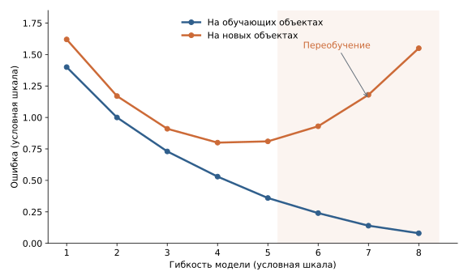
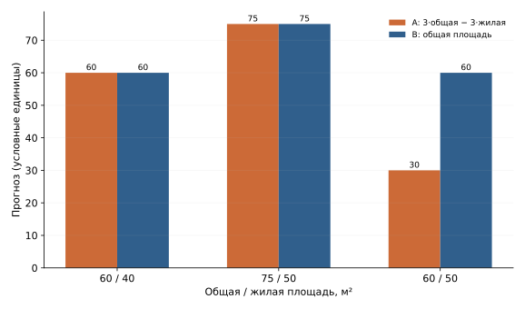
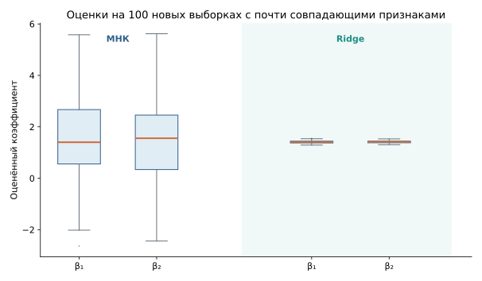
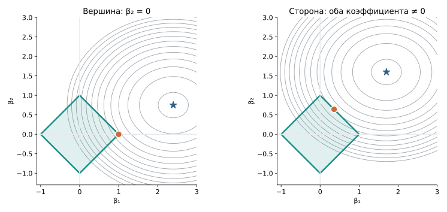
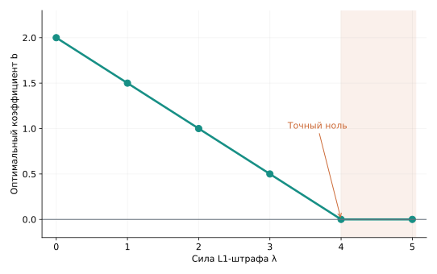
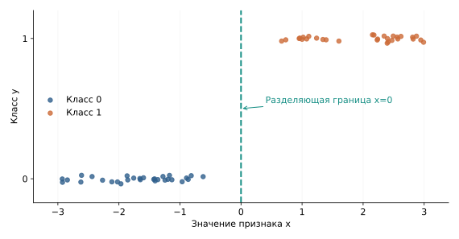
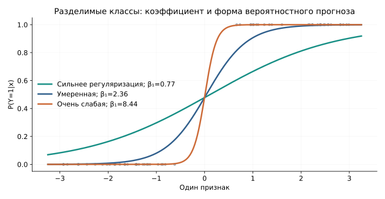
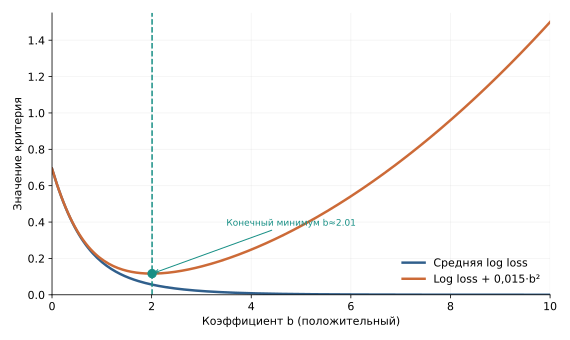
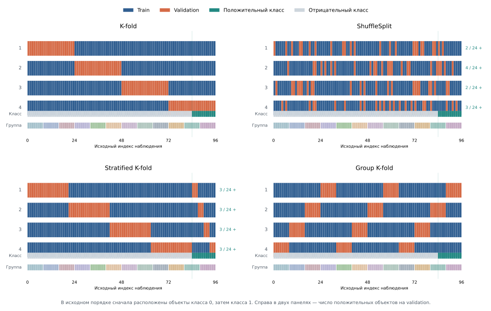
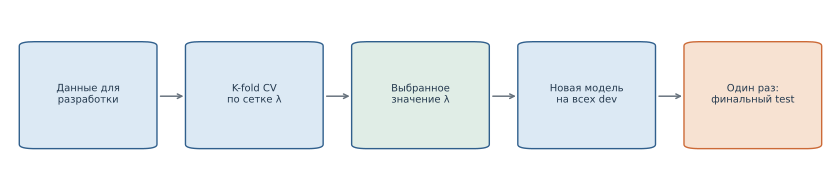

# Регуляризация и кросс-валидация

В предыдущих лекциях мы научились строить линейную и логистическую регрессию, выбирать функцию потерь, находить параметры модели и оценивать её прогнозы. Теперь рассмотрим две новые задачи. Первая касается самого обучения: как ограничить нежелательную подгонку и получить более устойчивое решение? Вторая касается оценивания: насколько вывод о качестве зависит от того, какие наблюдения оказались в проверочной выборке?

Сначала изучим **регуляризацию** на примере Ridge, Lasso и Elastic Net. Она меняет условия, при которых выбираются коэффициенты уже знакомых моделей. Затем разберём **кросс-валидацию** — оценивание процедуры обучения на нескольких разбиениях данных. В заключительной части применим кросс-валидацию для выбора силы регуляризации и других настроек модели.

Как и прежде, будем различать качество подгонки на данных обучения, качество на отложенных наблюдениях и окончательную проверку уже выбранного решения.

## Часть I. Сложность моделей и обобщающая способность

## 1. Почему хорошая подгонка не гарантирует хорошего прогноза

В первой лекции мы наблюдали **переобучение** (*overfitting*): достаточно гибкая модель способна воспроизвести не только зависимость между признаками и ответом, но и случайные особенности обучающей выборки. На тех же объектах её ошибка будет мала, однако на новых наблюдениях качество может заметно ухудшиться.



*Рисунок 1. Схема изменения ошибки на обучающих и новых объектах при увеличении гибкости модели.*

Под **обобщающей способностью** (*generalization*) понимают способность обученной модели давать хорошие прогнозы на новых объектах из той среды, для которой она предназначена. Эту способность нельзя установить по одному значению ошибки на обучающей выборке: оно характеризует подгонку уже увиденных наблюдений.

У сложности модели несколько проявлений. Полином высокой степени может описать очень извилистую зависимость даже при одном исходном признаке. Линейная модель с большим числом признаков, в том числе дублирующих друг друга, может иметь множество наборов коэффициентов с очень близкой ошибкой. Поэтому важны и семейство допустимых функций, и конкретная процедура выбора одной из них по данным.

### 1.1. Когда признаки содержат похожую информацию

Допустим, прогноз стоимости квартиры строят по общей площади, жилой площади, числу комнат, площади кухни и другим характеристикам. Некоторые признаки содержат близкую информацию. Например, общая и жилая площади обычно связаны: большие квартиры, как правило, имеют большую жилую площадь.

По этой причине может оказаться трудно определить, насколько именно каждый признак должен влиять на прогноз. Рассмотрим небольшой числовой пример. Пусть модель без свободного члена даёт прогноз в условных единицах по двум площадям:

```math
f(x)=\beta_1 x_1+\beta_2 x_2,
```

где $x_1$ — общая площадь, $x_2$ — жилая площадь. Сравним два набора коэффициентов: $A=(3,-3)$ и $B=(1,0)$.

| Квартира | Общая площадь $x_1$ | Жилая площадь $x_2$ | Прогноз A | Прогноз B |
|---|---:|---:|---:|---:|
| 1 | 60 | 40 | 60 | 60 |
| 2 | 75 | 50 | 75 | 75 |
| Новая | 60 | 50 | 30 | 60 |

Для первых двух квартир, у которых жилая площадь составляет две трети общей, прогнозы совпадают. Когда эта пропорция меняется, результаты расходятся. У модели A изменения двух признаков могут усиливать или компенсировать друг друга гораздо заметнее, чем у модели B.



*Рисунок 2. Две модели совпадают на первых квартирах, но расходятся при другом соотношении площадей.*

Какой из двух вариантов точнее предскажет цену новой квартиры, без новых наблюдений неизвестно. Но уже видно, что близкая подгонка исходных данных может сопровождаться совершенно разными коэффициентами и реакцией на изменение соотношения признаков.

В предельном случае, когда один столбец матрицы точно повторяет другой, МНК может не определять коэффициенты однозначно. Если столбцы лишь почти совпадают, решение может существовать единственным образом, но сильно изменяться при небольшом изменении обучающих наблюдений. Эту проблему мы уже изучали во второй лекции как одно из проявлений мультиколлинеарности.

### 1.2. Как можно ограничивать модель

Один из способов снизить чрезмерную подгонку — ограничить сложность модели или изменить правило выбора её параметров. Способ зависит от модели: у дерева можно ограничивать глубину, у итеративно обучаемых моделей — контролировать момент остановки, а у линейных моделей — величину коэффициентов.

Такое управление обучением называют **регуляризацией** (*regularization*). Мы подробно рассмотрим вариант, в котором на коэффициенты накладывают математические ограничения или добавляют штраф к целевой функции.

В линейных моделях это позволяет решать две задачи:

- **Контролировать подгонку.** Большие по модулю коэффициенты способны создавать излишне чувствительные прогнозы; ограничение коэффициентов иногда улучшает результат на новых данных.
- **Стабилизировать коэффициенты.** При почти одинаковых столбцах данных одни и те же прогнозы можно получить разными сочетаниями коэффициентов. Регуляризация помогает выбирать менее экстремальные сочетания.

Эти задачи связаны, но не равнозначны. В частности, неустойчивые коэффициенты не обязательно означают плохие прогнозы: изменения нескольких коэффициентов могут компенсировать друг друга. Поэтому стабильность коэффициентов будем исследовать отдельно от качества прогнозов.

### Итак

- Переобучение проявляется в том, что хорошая подгонка обучающих данных не переносится на новые объекты.
- Сложность зависит не только от числа параметров, но и от возможностей модели и способа обучения.
- Сильная связь между признаками может делать коэффициенты линейной регрессии неустойчивыми.
- Регуляризация меняет допустимые решения или правило их выбора; её пользу для качества прогнозов нужно проверять на отложенных данных.

## Часть II. Регуляризация линейных моделей

## 2. Вернёмся к методу наименьших квадратов

Для объекта с $p$ признаками линейная модель имеет вид

```math
f_{\beta_0,\beta}(x)=\beta_0+\sum_{j=1}^{p}\beta_jx_j=\beta_0+x^\top\beta,
```

где $\beta_0$ — свободный член, а $\beta=(\beta_1,\ldots,\beta_p)^\top$ — вектор коэффициентов при признаках. В дальнейшем будем обозначать полный набор параметров парой $(\beta_0,\beta)$, поскольку свободный член не участвует в регуляризации.

Метод наименьших квадратов (МНК, *ordinary least squares*, OLS) выбирает коэффициенты по минимальной средней квадратичной ошибке на обучающих наблюдениях:

```math
R_n(\beta_0,\beta)=\frac1n\sum_{i=1}^n(y_i-\beta_0-x_i^\top\beta)^2.
```

Эту величину мы уже называли **эмпирическим риском**. Как и во второй лекции, можно использовать сумму квадратов остатков $RSS=nR_n$; в этой лекции удобнее сохранять нормировку на число объектов.

Вернёмся к предельному примеру, где два признака совпадают: $x_2=x_1$. Тогда при $\beta_0=0$

```math
f_{\beta_0,\beta}(x)=(\beta_1+\beta_2)x_1.
```

Если сумма коэффициентов равна единице, все следующие варианты одинаково предсказывают ответ для каждого объекта с $x_2=x_1$:

| $\beta_1$ | $\beta_2$ | Сумма | $\beta_1^2+\beta_2^2$ |
|---:|---:|---:|---:|
| 3 | −2 | 1 | 13 |
| 1 | 0 | 1 | 1 |
| 0,5 | 0,5 | 1 | 0,5 |

По MSE эти варианты равноправны. Но если на новом объекте $x_2=x_1+\delta$, то

```math
f_{\beta_0,\beta}(x)=x_1+\beta_2\delta.
```

Коэффициент при отклонении $\delta$ различается: $-2$, $0$ и $0{,}5$. Одинаковая ошибка на одном наборе данных ещё не означает одинакового поведения вне него.

Из этого примера возникает содержательная идея: **ограничить величину коэффициентов**, особенно если увеличение их модулей почти не улучшает подгонку. Малые коэффициенты сами по себе не гарантируют хорошей модели, но при сопоставимых шкалах признаков помогают контролировать чувствительность прогноза к изменениям входа. Далее превратим эту идею в точную задачу оптимизации.

## 3. Ridge-регрессия: ограничение величины коэффициентов

### 3.1. От ограничения коэффициентов к Ridge

Для начала нужно договориться, как измерять величину **всего вектора** коэффициентов. В двух измерениях расстояние от начала координат до точки $(\beta_1,\beta_2)$ равно $\sqrt{\beta_1^2+\beta_2^2}$. В пространстве из $p$ коэффициентов точно так же определяется **евклидова, или $L_2$-норма**:

```math
\|\beta\|_2=\sqrt{\beta_1^2+\cdots+\beta_p^2}.
```

Её квадрат — сумма квадратов коэффициентов:

```math
\|\beta\|_2^2=\beta_1^2+\cdots+\beta_p^2.
```

Возьмём МНК, но разрешим только коэффициенты, длина которых не превосходит заданного значения. Для удобства ограничим *квадрат* длины:

```math
\boxed{\begin{aligned}
&\min_{\beta_0,\beta}R_n(\beta_0,\beta),\\[0pt]
&\text{при условии}\quad\|\beta\|_2^2\leq t,\qquad t\geq0.
\end{aligned}}
```

По-прежнему минимизируется ошибка, однако среди коэффициентов мы рассматриваем только те, для которых выполняется ограничение. Чем больше $t$, тем шире допустимая область. Если решение МНК удовлетворяет ограничению, оно остаётся оптимальным; когда $t$ уменьшается, часть коэффициентов становится недопустимой и решение может измениться.

Вспомним три набора коэффициентов из раздела 2:

| Коэффициенты | Квадрат L2-нормы | Допустимы при $t=1$? |
|---|---:|---|
| $(3,-2)$ | 13 | Нет |
| $(1,0)$ | 1 | Да |
| $(0{,}5,0{,}5)$ | 0,5 | Да |

Если МНК не различает эти три набора по ошибке, ограничение уже исключает первый. В многомерном случае мы таким способом не выбираем один из заранее выписанных кандидатов, а ищем минимум квадратичной ошибки **на всей допустимой области**.

У этой идеи есть другая, весьма удобная форма. Вместо жёсткого ограничения добавим к ошибке дополнительную цену больших коэффициентов:

```math
\boxed{J_\lambda^{\mathrm{Ridge}}(\beta_0,\beta)=R_n(\beta_0,\beta)+\lambda\|\beta\|_2^2.}
```

Новая величина $J_\lambda$ — **регуляризованная целевая функция**; буквой $J$ мы отличаем её от первоначального эмпирического риска $R_n$. Число $\lambda\geq0$ называется **коэффициентом регуляризации**. Оно определяет, какой вес при выборе коэффициентов имеет их величина относительно квадратичной ошибки. При $\lambda=0$ возвращаемся к МНК.

**Числовой пример.** Пусть три набора из таблицы дают одну и ту же MSE, равную 2. При $\lambda=0{,}2$ значения штрафной функции будут следующими:

| Коэффициенты | MSE | Штраф $0{,}2\|\beta\|_2^2$ | $J_{0{,}2}$ |
|---|---:|---:|---:|
| $(3,-2)$ | 2 | 2,6 | 4,6 |
| $(1,0)$ | 2 | 0,2 | 2,2 |
| $(0{,}5,0{,}5)$ | 2 | 0,1 | 2,1 |

При равной MSE регуляризованный критерий оказывается меньше для набора с меньшей нормой. Если ошибки различаются, метод сопоставляет **оба** слагаемых: иногда выгоднее немного увеличить ошибку подгонки, чтобы существенно уменьшить норму.

#### В каком смысле две постановки эквивалентны?

Ограничение с параметром $t$ и штраф с параметром $\lambda$ не означают, что при любых двух выбранных числах мы получим одинаковые коэффициенты. Но между ними можно установить соответствие оптимальных решений.

**Шаг 1.** Пусть мы зафиксировали некоторое $\lambda>0$ и решили штрафную задачу:

```math
(\hat\beta_{0,\lambda},\hat\beta_\lambda)
\in\arg\min_{\beta_0,\beta}\left[R_n(\beta_0,\beta)+\lambda\|\beta\|_2^2\right].
```

Это конкретная найденная модель со своими коэффициентами. Обозначим квадрат нормы её наклонов через

```math
t_\lambda=\|\hat\beta_\lambda\|_2^2.
```

**Шаг 2.** Рассмотрим другую задачу: минимизировать *только* $R_n$, но при ограничении $\|\beta\|_2^2\leq t_\lambda$.

```math
\min_{\beta_0,\beta}R_n(\beta_0,\beta)
\quad\text{при}\quad \|\beta\|_2^2\leq t_\lambda.
```

Найденная ранее модель допустима: её коэффициенты лежат ровно на границе такой области.

**Шаг 3.** Докажем, что она оптимальна и здесь. Предположим, нашлась другая допустимая пара $(\beta_0',\beta')$ с меньшей MSE:

```math
R_n(\beta_0',\beta')\lt R_n(\hat\beta_{0,\lambda},\hat\beta_\lambda).
```

Поскольку новая пара допустима, $\|\beta'\|_2^2\leq\|\hat\beta_\lambda\|_2^2$. Складывая эти два неравенства с весом $\lambda>0$, получаем

```math
\begin{aligned}
&R_n(\beta_0',\beta')+\lambda\|\beta'\|_2^2\\[0pt]
&\qquad\lt R_n(\hat\beta_{0,\lambda},\hat\beta_\lambda)+\lambda\|\hat\beta_\lambda\|_2^2.
\end{aligned}
```

Но правая часть — значение штрафной функции в её минимуме. Получилось противоречие. Следовательно, **штрафное решение является и решением ограниченной задачи** при $t=t_\lambda$.

Теперь посмотрим на обратное направление. Для нашей выпуклой квадратичной задачи при $t>0$ подходящий множитель Лагранжа $\lambda\geq0$ позволяет перейти от ограниченной постановки к штрафной. При неактивном ограничении достаточно $\lambda=0$. Если оно активно, $\lambda$ определяется условиями оптимальности; обычно его приходится находить, а не вычислять по универсальной формуле. Крайний случай $t=0$ требует отдельной оговорки: он оставляет только $\beta=0$, и для обычных данных такое решение штрафной Ridge может получаться лишь в пределе $\lambda\to\infty$.

Действительно, лагранжиан ограниченной задачи записывается как

```math
\mathcal L(\beta_0,\beta,\lambda)
=R_n(\beta_0,\beta)+\lambda(\|\beta\|_2^2-t).
```

При фиксированном $\lambda$ член $-\lambda t$ не зависит от коэффициентов. Поэтому минимизация лагранжиана по $(\beta_0,\beta)$ приводит к штрафному критерию Ridge. Формальные условия, связывающие ограничение и множитель, называются условиями Каруша — Куна — Таккера; сейчас достаточно установленной связи оптимальных решений.

**Итак,** $t$ задаёт максимальный допустимый квадрат нормы, а $\lambda$ — относительную цену нормы в целевой функции. Они не равны друг другу и не связаны универсальной формулой $t=1/\lambda$. В дальнейшем удобнее пользоваться штрафной записью: она естественно дополняет известную нам MSE и приводит к простой системе уравнений.

### 3.2. Как ограничение нормы влияет на прогноз

Пусть линейная модель уже обучена. Увеличим вектор признаков объекта с $x$ до $x+\Delta x$. При фиксированных коэффициентах прогноз изменится на

```math
f_{\beta_0,\beta}(x+\Delta x)-f_{\beta_0,\beta}(x)=\beta^\top\Delta x.
```

Напомним **неравенство Коши — Буняковского — Шварца**: модуль скалярного произведения двух векторов не превосходит произведения их евклидовых длин,

```math
|a^\top b|\leq\|a\|_2\|b\|_2.
```

Для двух векторов оно имеет простой геометрический смысл: $a^\top b=\|a\|_2\|b\|_2\cos\varphi$, где $\varphi$ — угол между векторами. Модуль косинуса не превышает единицу.

Например, если $a=(3,4)$, то $\|a\|_2=5$. Изменение $b=(0{,}06,0{,}08)$ имеет длину $0{,}1$. Их скалярное произведение равно $0{,}5$: здесь неравенство достигает равенства, так как векторы направлены одинаково.

Применим его к модели:

```math
\boxed{|f_{\beta_0,\beta}(x+\Delta x)-f_{\beta_0,\beta}(x)|\leq\|\beta\|_2\|\Delta x\|_2.}
```

Предположим, все рассматриваемые изменения признаков имеют длину не больше $0{,}1$. Если $\|\beta\|_2\leq5$, изменение прогноза не превосходит $0{,}5$. Если норма коэффициентов не превышает 2, верхняя граница будет уже $0{,}2$.

Итак, ограничение нормы контролирует **наибольшее возможное изменение линейного прогноза при заданной длине изменения признаков**. Это свойство имеет смысл для конкретных единиц измерения: если, скажем, площадь выражена в сантиметрах вместо метров, длины векторов изменятся. К роли масштаба ещё вернёмся.

### 3.3. Почему свободный член обычно не штрафуют

В ограничении Ridge учитываются $\beta_1,\ldots,\beta_p$, но не свободный член $\beta_0$. Он отвечает за сдвиг прогноза при неизменных наклонах. Например, если для модели стоимости квартиры все наблюдаемые цены выражены в шкале, увеличенной на 50 условных единиц, хотелось бы прибавить 50 и ко всем прогнозам, сохранив коэффициенты при площадях.

Проверим это алгебраически. Пусть исходные ответы $y_i$ заменили на $y_i'=y_i+c$. Возьмём тот же вектор $\beta$, но свободный член сдвинем на $c$: $\beta_0'=\beta_0+c$. Тогда каждый остаток сохранится:

```math
\begin{aligned}
y_i'-\bigl(\beta_0'+x_i^\top\beta\bigr)
&=(y_i+c)-(\beta_0+c+x_i^\top\beta)\\[0pt]
&=y_i-\beta_0-x_i^\top\beta.
\end{aligned}
```

При таком преобразовании не изменяются ни MSE, ни штраф $\lambda\|\beta\|_2^2$. Поэтому найденные наклоны остаются оптимальными, а свободный член увеличивается на $c$. Например, если ко всем ценам в данных прибавить 50 условных единиц, прогноз для любой квартиры тоже увеличится на 50. Коэффициенты при площади и других признаках для этого менять не нужно.

Что было бы при штрафе и на $\beta_0$? Возьмём предельно простой случай: других признаков вообще нет. Пусть MSE для постоянного прогноза равна $(\bar y-\beta_0)^2$ с точностью до части, не зависящей от $\beta_0$. Если штрафовать свободный член, нужно минимизировать

```math
(\bar y-\beta_0)^2+\lambda\beta_0^2.
```

Производная равна $2(\beta_0-\bar y)+2\lambda\beta_0$, поэтому $\hat\beta_0=\bar y/(1+\lambda)$. Вместо привычного среднего получился искусственно уменьшенный постоянный прогноз. При $\bar y=100$, $\lambda=1$ модель давала бы 50. Поэтому свободный член обычно не регуляризуют: изменение единиц отсчёта целевой переменной должно приводить к такому же сдвигу всех прогнозов, а не к изменению зависимости от признаков.

### 3.4. Матричное решение Ridge

Теперь получим коэффициенты Ridge аналитически, как ранее находили решение МНК. Чтобы аккуратно работать со свободным членом, договоримся: $X\in\mathbb R^{n\times p}$ здесь содержит **только столбцы обычных признаков**, без столбца единиц, а $\beta_0$ оставляем отдельной переменной.

Целевая функция имеет вид

```math
J_\lambda(\beta_0,\beta)
=\frac1n\sum_{i=1}^n(y_i-\beta_0-x_i^\top\beta)^2+\lambda\|\beta\|_2^2.
```

**Шаг 1. Находим оптимальный свободный член.** При фиксированном $\beta$ берём производную по $\beta_0$. Штраф не содержит $\beta_0$, поэтому

```math
\frac{\partial J_\lambda}{\partial\beta_0}
=-\frac2n\sum_{i=1}^n(y_i-\beta_0-x_i^\top\beta).
```

При фиксированном $\beta$ минимум по свободному члену достигается там, где производная равна нулю. Обозначим этот свободный член через $\beta_0^*(\beta)$, подчёркивая, что пока $\beta$ ещё не найден:

```math
\sum_i y_i-n\beta_0^*(\beta)-\sum_i x_i^\top\beta=0,
```

откуда

```math
\boxed{\beta_0^*(\beta)=\bar y-\bar x^\top\beta}.
```

Здесь $\bar x$ — вектор средних по признакам, а $\bar y$ — средний ответ. Для среднего вектора признаков при таком свободном члене получаем $\beta_0^*(\beta)+\bar x^\top\beta=\bar y$. Это знакомое свойство МНК: прогноз для среднего вектора признаков совпадает со средним ответом.

**Шаг 2. Переходим к центрированным данным.** Подставим $\beta_0^*(\beta)$ в остаток для произвольного объекта:

```math
\begin{aligned}
y_i-\beta_0^*(\beta)-x_i^\top\beta
&=y_i-(\bar y-\bar x^\top\beta)-x_i^\top\beta\\[0pt]
&=(y_i-\bar y)-(x_i-\bar x)^\top\beta.
\end{aligned}
```

Введём $X_c=X-\mathbf1\bar x^\top$ и $y_c=y-\bar y\mathbf1$. Тогда все остатки можно записать как $y_c-X_c\beta$. Свободный член уже выражен через $\beta$, поэтому остаётся минимизировать функцию только от вектора наклонов:

```math
J_\lambda(\beta)=\frac1n\|y_c-X_c\beta\|_2^2+\lambda\|\beta\|_2^2.
```

**Шаг 3. Находим стационарную точку.** Дифференцируем по вектору $\beta$:

```math
\nabla_\beta J_\lambda
=-\frac2nX_c^\top(y_c-X_c\beta)+2\lambda\beta.
```

Приравняв градиент к нулю и умножив равенство на $n/2$, получаем регуляризованные нормальные уравнения:

```math
\boxed{(X_c^\top X_c+n\lambda I)\hat\beta=X_c^\top y_c.}
```

Здесь $I$ — единичная матрица размера $p\times p$. При $\lambda>0$ матрица слева обратима; это докажем в следующем подразделе. Формально решение записывается так:

```math
\boxed{\hat\beta_{\mathrm{Ridge}}=(X_c^\top X_c+n\lambda I)^{-1}X_c^\top y_c.}
```

После нахождения оптимального вектора наклонов возвращаемся к свободному члену: $\hat\beta_0=\beta_0^*(\hat\beta)=\bar y-\bar x^\top\hat\beta$.

**Откуда множитель $n$?** Мы минимизируем $RSS/n+\lambda\|\beta\|_2^2$. При альтернативном соглашении $RSS+\gamma\|\beta\|_2^2$ нормальные уравнения выглядели бы как $(X_c^\top X_c+\gamma I)\hat\beta=X_c^\top y_c$. Чтобы решения совпадали, нужно $\gamma=n\lambda$.

Эта формула позволяет исследовать, как коэффициенты зависят от данных и силы регуляризации. При численном вычислении коэффициентов обычно решают систему нормальных уравнений непосредственно, не находя обратную матрицу вручную.

### 3.5. Почему Ridge делает решение однозначным

В разделе о мультиколлинеарности второй лекции мы уже использовали такой факт: при линейной зависимости столбцов матрицы $X$ существует ненулевой вектор $v$, для которого $Xv=0$. Поэтому можно изменить коэффициенты модели, не изменив её обучающих прогнозов.

Для такого свойства есть математическое название. **Ядро матрицы** $A$ — множество всех векторов $v$, удовлетворяющих равенству

```math
Av=0.
```

Его обозначают $\ker A$. Например, для матрицы с двумя одинаковыми столбцами

```math
A=\begin{pmatrix}1&1\\2&2\\3&3\end{pmatrix}
```

вектор $v=(1,-1)^\top$ принадлежит ядру, поскольку

```math
Av=\begin{pmatrix}1-1\\2-2\\3-3\end{pmatrix}=\begin{pmatrix}0\\0\\0\end{pmatrix}.
```

Более того, любой вектор $(t,-t)^\top$ лежит в ядре этой матрицы. Поэтому изменение коэффициентов на $(t,-t)$ никак не изменит прогнозы $A\beta$.

Для квадратной матрицы существует важный критерий: **она обратима тогда и только тогда, когда её ядро состоит только из нулевого вектора**. Это позволяет проверить обратимость новой матрицы Ridge без вычисления определителя.

Обозначим $B=X_c^\top X_c+n\lambda I$. Предположим, что некоторый вектор $v$ лежит в её ядре:

```math
Bv=0.
```

Умножим это равенство слева на $v^\top$:

```math
\begin{aligned}
0=v^\top Bv
&=v^\top X_c^\top X_cv+n\lambda v^\top v\\[0pt]
&=\|X_cv\|_2^2+n\lambda\|v\|_2^2.
\end{aligned}
```

Первое слагаемое — квадрат нормы и не может быть отрицательным. При $\lambda>0$ второе слагаемое строго положительно для любого ненулевого $v$. Значит, сумма может быть равна нулю **только при $v=0$**. Итак,

```math
\ker(X_c^\top X_c+n\lambda I)=\lbrace 0\rbrace .
```

Матрица $B$ обратима, поэтому коэффициенты Ridge определены однозначно даже при точно совпадающих столбцах данных. Заодно доказано, что $B$ **положительно определена**: $v^\top Bv>0$ для всех ненулевых $v$.

Если интересна дополнительная линейно-алгебраическая интерпретация, можно вспомнить собственные значения. При добавлении $n\lambda I$ каждое собственное значение матрицы $X_c^\top X_c$ увеличивается на $n\lambda$. Поэтому нулевые значения становятся положительными, а очень маленькие — больше. Так устраняется вырожденность и уменьшается проблема направлений, которые плохо различаются по данным.

#### Проверим устойчивость коэффициентов экспериментально

Создадим 100 независимых синтетических обучающих выборок по 70 объектов. В каждой сначала генерируется скрытая величина $z$, а затем два почти совпадающих признака:

```math
x_1=z+\varepsilon_1,\qquad x_2=z+\varepsilon_2,
```

где $z$ имеет стандартное нормальное распределение, а независимые нормальные шумы $\varepsilon_1,\varepsilon_2$ имеют стандартное отклонение 0,035. Ответ зависит от того же $z$:

```math
y=3z+\varepsilon_y,
```

где независимый нормальный шум $\varepsilon_y$ имеет стандартное отклонение 0,75. На каждой выборке отдельно обучаются МНК и Ridge, и мы записываем оба найденных коэффициента. При принятой в этой лекции нормировке Ridge использует $\lambda=8/70\approx0{,}114$ во всех 100 повторениях.



*Рисунок 3. Распределения двух коэффициентов по 100 повторным выборкам; каждый прямоугольник показывает центральную часть полученных значений.*

У МНК коэффициенты могут принимать большие положительные и отрицательные значения: почти одинаковые признаки позволяют компенсировать вклад одного другим. У Ridge оба коэффициента заметно менее изменчивы. Здесь мы специально измеряем **разброс коэффициентов**, а не качество на новых объектах. Последнее исследовали бы отдельной валидацией.

### 3.6. Сила регуляризации и траектории коэффициентов

Что меняется, если постепенно увеличивать $\lambda$? Для одного фиксированного датасета можно многократно обучить Ridge при разных значениях этого числа и записать полученные коэффициенты. Графики $\hat\beta_j(\lambda)$ называются **траекториями коэффициентов** (*coefficient paths*).

В эксперименте используются 130 синтетических наблюдений и шесть стандартизированных признаков. Признаки 1 и 2 очень сильно коррелируют (их выборочная корреляция около 0,994). Признаки 3 и 5 тоже связаны с ответом. Признаки 4 и 6 не входят в формулу, по которой сгенерированы ответы, хотя из-за случайности конечной выборки могут иметь ненулевые оценённые коэффициенты. Все модели обучаются на одних и тех же объектах; изменяется только $\lambda$.


*Рисунок 4. Коэффициенты шести признаков при увеличении силы Ridge; ось $`\lambda`$ логарифмическая.*

На левой части рисунка слабый штраф позволяет большие по модулю коэффициенты. С ростом $\lambda$ их общий квадрат нормы не увеличивается. Однако это **не означает**, что каждая отдельная линия обязательно монотонно идёт к нулю: коррелированные признаки могут перераспределять вклад между собой.

При очень сильной регуляризации коэффициенты при признаках приближаются к нулю. Поскольку свободный член не штрафуется, предсказания такой модели стремятся к среднему ответу на обучающей выборке. Модель становится слишком простой, если в данных была полезная зависимость от признаков.

Возникает естественный вопрос, который пока оставим открытым: какое значение $\lambda$ лучше всего для новых объектов? Ответ нельзя получить по одним траекториям коэффициентов — нам потребуется оценивание качества.

### 3.7. Почему важны единицы измерения признаков

Штраф рассчитывается по *числовым значениям коэффициентов*, а они зависят от единиц измерения. Допустим, площадь записана в квадратных метрах, и коэффициент равен 20. Если ту же площадь выразить в квадратных сантиметрах, значения признака увеличатся в 10 000 раз, а коэффициент при неизменных прогнозах уменьшится до 0,002.

При этом вклады в квадрат нормы резко различаются:

```math
20^2=400,\qquad 0{,}002^2=0{,}000004.
```

Для обычного МНК такая смена единиц не меняет семейство прогнозов. Для Ridge она меняет относительный размер штрафа. Два признака, измеряемые в разных единицах, могут оказаться в неравном положении.

Поэтому перед Ridge числовые признаки обычно приводят к сопоставимым масштабам. Один способ — **стандартизация**, знакомая нам из третьей лекции:

```math
x_{ij}^{\mathrm{std}}=\frac{x_{ij}-\bar x_j}{s_j},
```

где $\bar x_j$ и $s_j$ — среднее и стандартное отклонение признака по данным обучения. Признак с нулевым разбросом обрабатывают отдельно.

Полученные при обучении среднее и стандартное отклонение затем используются и для новых объектов. Пересчитывать их по проверочным данным нельзя: иначе проверка будет зависеть от информации, которая не должна была участвовать в подготовке модели. Это правило станет особенно важным в разделе о кросс-валидации.

### 3.8. Где применяют Ridge

Ridge часто используют в задачах прогнозирования, где много числовых признаков и часть из них коррелирует: например, в моделях спроса с несколькими близкими индикаторами активности, в оценке стоимости объектов по связанным характеристикам или в линейных моделях с большим набором текстовых признаков.

Её сильная сторона — возможность использовать информацию от нескольких признаков, не допуская неконтролируемого роста коэффициентов. В типичной задаче Ridge сжимает коэффициенты, но не зануляет их в точности.

Если же нам нужна модель, которая полностью исключает некоторые признаки из правила прогноза, стоит рассмотреть другую регуляризацию.

### Итак

- Ridge ограничивает сумму квадратов коэффициентов; эквивалентный по смыслу механизм задаётся добавлением L2-штрафа к MSE.
- Штраф не затрагивает свободный член, поэтому сдвиг целевой переменной меняет только уровень прогноза.
- Добавление $n\lambda I$ делает нормальные уравнения разрешимыми даже при линейной зависимости столбцов и может стабилизировать коэффициенты.
- Для Ridge важны масштаб признаков и выбор $\lambda$. Их влияние видно на траекториях коэффициентов; качество прогнозов необходимо оценивать отдельно.

## 4. Lasso-регрессия: разреженные коэффициенты

Ridge изменяет правило обучения МНК с помощью ограничения L2-нормы. Если признаки сильно коррелируют, это часто помогает избежать крайне больших компенсирующих коэффициентов. Однако при положительной регуляризации Ridge обычно оставляет ненулевой вклад у многих признаков.

Существует другой способ ограничивать коэффициенты: использовать сумму их **абсолютных значений**. Получается метод **Lasso** (*least absolute shrinkage and selection operator*). Он также сдерживает величину коэффициентов, но при определённых данных и настройках способен сделать часть из них точно равной нулю.

### 4.1. Другая норма — другое ограничение

Определим **L1-норму** вектора коэффициентов:

```math
\|\beta\|_1=|\beta_1|+\cdots+|\beta_p|.
```

Число 1 в индексе напоминает, что мы складываем первые степени модулей, в отличие от суммы квадратов в L2. Для набора $(3,-2)$ L1-норма равна 5, а для $(0{,}5,0{,}5)$ — 1.

Ограниченная задача Lasso записывается так:

```math
\boxed{\begin{aligned}
&\min_{\beta_0,\beta}R_n(\beta_0,\beta),\\[0pt]
&\text{при условии}\quad\|\beta\|_1\leq t.
\end{aligned}}
```

Соответствующая штрафная постановка:

```math
\boxed{J_\lambda^{\mathrm{Lasso}}(\beta_0,\beta)=R_n(\beta_0,\beta)+\lambda\|\beta\|_1.}
```

Как и в Ridge, свободный член не штрафуется. Однако новая целевая функция содержит модули коэффициентов и имеет изломы там, где какой-либо $\beta_j=0$. Матричная формула Ridge с простой обратной матрицей здесь уже не подходит; для практического решения применяют численные методы оптимизации.

### 4.2. Что означает нулевой коэффициент

Если $\hat\beta_j=0$, соответствующий признак $x_j$ не входит в линейную комбинацию, по которой вычисляется прогноз. Поэтому говорят о **разреженности** (*sparsity*) коэффициентов: многие координаты вектора могут быть нулевыми. В этом смысле Lasso одновременно обучает модель и осуществляет отбор признаков.

Однако алгоритм не проверяет по очереди, какие отдельные переменные «хорошие» и «плохие». Он подбирает все коэффициенты совместно, учитывая их вклад в снижение ошибки и увеличение L1-штрафа. При двух почти дублирующих признаках модель может оставить один и занулить второй: использование обоих не всегда даёт достаточный выигрыш, чтобы оправдать штраф. Какой именно из двух останется, может зависеть от небольших особенностей данных.

Есть случаи, когда Lasso зануляет шумовой признак, но на достаточно сильной регуляризации он может убрать и полезный. Поэтому отобранные переменные не обязательно составляют единственный или «истинный» набор факторов. Математическую причину появления точных нулей объясним с помощью геометрии.

## 5. Геометрия L1 и L2: как ограничения меняют минимум

### 5.1. Пространство коэффициентов и линии уровня

В третьей лекции, изучая градиентный спуск, мы уже изображали целевую функцию на плоскости параметров. Здесь используем тот же приём. Пусть при двух признаках неизвестны $\beta_1$ и $\beta_2$. Каждая точка на плоскости $(\beta_1,\beta_2)$ задаёт свою пару коэффициентов, а значит — конкретное правило прогноза.

После центрирования данных MSE является квадратичной функцией двух коэффициентов. Если два столбца признаков линейно независимы, линии уровня MSE — вложенные эллипсы (в частном случае окружности). Все точки одного эллипса дают одинаковую MSE, а его центр соответствует решению МНК.


*Рисунок 5. Линии одинаковой квадратичной ошибки на плоскости двух коэффициентов; звёздочка отмечает минимум МНК.*

Для задачи с ограничением теперь нужно найти точку **в допустимой области**, где значение MSE минимально. Круг и ромб — геометрические изображения ограничений, которые мы уже ввели для Ridge и Lasso.

### 5.2. Круг и ромб как области допустимых коэффициентов

Рассмотрим два ограничения с одинаковым числом справа:

```math
\underbrace{\beta_1^2+\beta_2^2\leq1}_{\text{Ridge: круг}},\qquad
\underbrace{|\beta_1|+|\beta_2|\leq1}_{\text{Lasso: ромб}}.
```

Первое условие описывает все точки на расстоянии не больше единицы от начала координат — диск с круглой границей. Второе в первой четверти принимает вид $\beta_1+\beta_2\leq1$; его граница — отрезок между $(1,0)$ и $(0,1)$. Повторив рассуждение в остальных четвертях, получим ромб с вершинами $(\pm1,0)$ и $(0,\pm1)$.

Именно форма допустимой области — гладкая круговая граница либо ромб с углами на осях — оказывается существенной для различий Ridge и Lasso. Следующий рисунок использует одни и те же линии уровня квадратичной ошибки, но разные ограничения.

### 5.3. Как находится решение с ограничением

Представим, что мы начинаем от центра эллипсов — свободного решения МНК — и постепенно рассматриваем линии уровня с большими значениями MSE. Если центр находится **внутри допустимой области**, ограничения не меняют решение. Если центр расположен снаружи, первая линия уровня, которая касается допустимой области, даёт минимально достижимую ошибку при этом ограничении.


*Рисунок 6. Для одной квадратичной функции показаны решения при круговой области Ridge и ромбовидной области Lasso.*

Слева решение Ridge касается гладкой границы круга: обе координаты отличны от нуля. Справа решение Lasso попадает в вершину ромба $(1,0)$ — второй коэффициент равен нулю.

У ромба вершины лежат как раз на координатных осях. Поэтому при изменении положения эллипсов касание с одной из таких вершин встречается естественным образом: Lasso часто даёт точно нулевые коэффициенты. Эта картинка иллюстрирует механизм разреженности, а не безусловный результат для любых данных.

### 5.4. Когда нули появляются, а когда нет

Из формы L1-ограничения следует возможность касания в вершине, но не обязательность. Всё определяется совместно положением свободного минимума, ориентацией линий уровня и размером допустимой области.



*Рисунок 7. Слева решение в вершине: один коэффициент нулевой; справа решение на стороне ромба: оба коэффициента ненулевые.*

В правой панели направление эллиптических линий приводит к касанию стороны, а не вершины. Lasso в этом случае использует оба признака. Аналогично Ridge при особой симметрии квадратичной ошибки может иметь решение точно на оси координат — у метода нет математического запрета на нулевой коэффициент.

Значит, корректное утверждение такое: L1-регуляризация **способствует разреженным решениям**, а L2-регуляризация обычно сжимает коэффициенты без точного зануления. Эти слова описывают типичное поведение, но не гарантию для каждого набора данных.

### 5.5. Откуда берётся точный ноль: простой одномерный пример

Геометрия ромба помогает увидеть, почему у Lasso появляются нулевые коэффициенты. Рассмотрим тот же механизм в задаче с одной переменной, которую можно решить до конца:

```math
J_\lambda(b)=(b-2)^2+\lambda|b|,\qquad \lambda\geq0.
```

Первое слагаемое достигает минимума при $b=2$: это решение задачи без регуляризации. Второе слагаемое увеличивает значение функции тем сильнее, чем дальше $b$ от нуля. Из-за модуля выражение для функции различается справа и слева от нуля. Разберём оба случая, а затем проверим саму точку $b=0$.

**Шаг 1. Положительные значения $b$.** При $b>0$ имеем $|b|=b$, поэтому

```math
J_\lambda(b)=(b-2)^2+\lambda b.
```

Найдём производную и приравняем её к нулю:

```math
\begin{aligned}
J_\lambda'(b)&=2(b-2)+\lambda,\\[0pt]
2(b-2)+\lambda&=0,\\[0pt]
b&=2-\frac{\lambda}{2}.
\end{aligned}
```

Это число остаётся положительным, пока $0\leq\lambda<4$. Например, при $\lambda=1$ получим $b=1{,}5$, а при $\lambda=3$ — $b=0{,}5$. Пока минимум расположен справа от нуля, увеличение штрафа постепенно сдвигает его к началу координат.

**Шаг 2. Отрицательные значения $b$.** При $b<0$ модуль раскрывается с другим знаком:

```math
J_\lambda(b)=(b-2)^2-\lambda b.
```

Теперь производная равна

```math
J_\lambda'(b)=2(b-2)-\lambda.
```

Для любого $b<0$ и любого $\lambda\geq0$ она отрицательна. Это означает, что на всей отрицательной полуоси функция уменьшается, если двигаться вправо, к нулю. Следовательно, искать её минимум среди отрицательных значений не нужно.

**Шаг 3. Что происходит в нуле?** В точке $b=0$ у $|b|$ излом: обычной производной функции $J_\lambda$ здесь нет при $\lambda>0$. Зато мы знаем направление изменения функции слева и справа.

Слева, как мы только что установили, при движении к нулю значение $J_\lambda$ уменьшается. Справа производная при приближении к нулю равна

```math
J_\lambda'(0+)=-4+\lambda.
```

При $\lambda<4$ это отрицательное число: двигаясь от нуля вправо, можно ещё уменьшить функцию, поэтому минимум остаётся положительным. При $\lambda\geq4$ производная справа уже неотрицательна. Тогда движение из нуля ни влево, ни вправо не уменьшает значение функции. **Точка $b=0$ становится минимумом.**

Итак, решение имеет вид

```math
\boxed{\hat b_\lambda=\begin{cases}
2-\dfrac{\lambda}{2},&0\leq\lambda\lt 4,\\[0.6em]
0,&\lambda\geq4.
\end{cases}}
```

| $\lambda$ | 0 | 1 | 2 | 3 | 4 | 5 |
|---:|---:|---:|---:|---:|---:|---:|
| Оптимальное $b$ | 2 | 1,5 | 1 | 0,5 | 0 | 0 |



*Рисунок 8. Коэффициент постепенно уменьшается и при $`\lambda\geq4`$ становится точно равным нулю.*

У Ridge с квадратичным штрафом $\lambda b^2$ в этом же примере минимум равен $2/(1+\lambda)$: он стремится к нулю, но при любом конечном $\lambda$ остаётся положительным. Так проявляется различие гладкого квадратичного штрафа и L1-штрафа с изломом в нуле. В многомерной задаче коэффициенты зависят друг от друга, поэтому их зануление не обязано происходить в том же порядке, что в одномерном примере.

### 5.6. Траектории коэффициентов Lasso

Вернёмся к шести признакам из эксперимента с Ridge. Первые два сильно коррелируют и частично заменяют друг друга, часть других связана с ответом, а последний введён как шумовой. На одних и тех же 130 объектах теперь много раз обучим Lasso при разных значениях $\lambda$.


*Рисунок 9. Некоторые коэффициенты достигают нуля при увеличении L1-штрафа, тогда как другие остаются ненулевыми дольше.*

Линии показывают, что зануление происходит не одновременно: для каждого признака критическая сила штрафа может быть своей. Но нельзя просто прочитать этот график как рейтинг «реальной важности»: в частности, два коррелированных признака могут передавать друг другу вклад. Смена обучающей выборки способна изменить, какой из них будет занулён раньше.

Для выбора практической модели важно сопоставлять характер траекторий с качеством на новых объектах. Возможно, умеренная разреженность почти не ухудшает прогноз; возможно, удаление полезных признаков быстро увеличивает ошибку. Мы проверим это позднее через валидацию.

### 5.7. Какие признаки Lasso исключает и где её используют

Вернёмся к синтетической выборке из 130 объектов, по которой построены траектории Ridge и Lasso. Признаки 1 и 2 сильно коррелируют и содержат почти одну и ту же информацию. Признаки 3 и 5 связаны с ответом, а признаки 4 и 6 не участвуют в формуле его генерации.

Посмотрим на несколько решений Lasso на *одних и тех же стандартизированных данных*. В таблице приведены коэффициенты, округлённые до двух знаков. Нуль означает, что коэффициент занулён в результате оптимизации.

| $\lambda$ | $\beta_1$ | $\beta_2$ | $\beta_3$ | $\beta_4$ | $\beta_5$ | $\beta_6$ |
|---:|---:|---:|---:|---:|---:|---:|
| 0,01 | 0,48 | 1,22 | −1,07 | −0,14 | 0,66 | 0 |
| 0,3 | 0,34 | 1,23 | −0,95 | 0 | 0,54 | 0 |
| 1 | 0,07 | 1,21 | −0,64 | 0 | 0,29 | 0 |
| 3 | 0 | 0,35 | 0 | 0 | 0 | 0 |
| 6 | 0 | 0 | 0 | 0 | 0 | 0 |

При $\lambda=0{,}3$ оба шумовых признака уже получили нулевые коэффициенты, тогда как признаки, связанные с ответом, в основном остались. Но при $\lambda=3$ занулился и коэффициент полезного третьего признака, а из тесно связанной пары $x_1,x_2$ остался только второй. При ещё большем штрафе исчезает вся линейная часть прогноза: модель сводится к постоянному прогнозу.

Этот пример показывает как пользу, так и цену разреженности. **Lasso исключает признаки на основании совместного уменьшения ошибки и L1-штрафа, а не по заранее известной метке «полезный» или «шумовой».** Если сильно коррелированные столбцы поменять местами или немного изменить обучающие данные, Lasso может предпочесть другой столбец из пары.

Разреженные линейные модели используют, например, в задачах с тысячами текстовых индикаторов или большим количеством измеряемых характеристик, когда компактное правило прогноза имеет самостоятельную ценность. Но нулевой коэффициент не доказывает, что признак не связан с ответом; ненулевой коэффициент не доказывает причинную связь. Для выбора силы регуляризации и проверки прогнозов нужны данные, не участвовавшие в обучении.

### Итак

- Lasso ограничивает L1-норму коэффициентов; его штраф пропорционален сумме их модулей.
- Геометрическая форма L1-области — ромб, а его вершины на осях объясняют появление нулевых коэффициентов.
- Ridge типично сжимает коэффициенты без точного зануления; Lasso может получать разреженные решения.
- Разреженность полезна для компактной модели, но сама по себе не подтверждает причинную значимость отобранных признаков.

## 6. Elastic Net и регуляризация других линейных моделей

### 6.1. Elastic Net: L1 и L2 в одной задаче

Ridge стабилизирует коэффициенты при зависимости признаков, а Lasso может занулять их. Это подсказывает соединить два штрафа в одной целевой функции. Так устроен **Elastic Net**:

```math
\boxed{J_{\lambda,\rho}^{\mathrm{EN}}(\beta_0,\beta)
=R_n(\beta_0,\beta)+\lambda\left[\rho\|\beta\|_1+\frac{1-\rho}{2}\|\beta\|_2^2\right],}
```

где $0\leq\rho\leq1$. При $\rho=1$ остаётся только L1, а при $\rho=0$ — квадратичный штраф с переопределённым коэффициентом регуляризации. Между этими крайними случаями действуют оба ограничения.

Зачем нужна L2-часть, если уже есть Lasso? Рассмотрим два **одинаковых** стандартизированных признака $x_1=x_2$, причём общая величина их коэффициентов равна $c>0$. Прогноз зависит только от суммы $\beta_1+\beta_2=c$. Если оба коэффициента неотрицательны, L1-штраф будет равен $c$ при любом распределении суммы:

```math
|\beta_1|+|\beta_2|=c.
```

А вот квадратичный штраф минимален, когда коэффициенты одинаковы:

```math
\beta_1=\beta_2=\frac c2,\qquad
\beta_1^2+\beta_2^2=\frac{c^2}{2}.
```

Это частный пример **группирующего эффекта**: L2-часть способствует совместному распределению вклада между тесно связанными признаками, в то время как L1-составляющая сохраняет возможность зануления других коэффициентов.


*Рисунок 10. Траектории шести коэффициентов Elastic Net на тех же стандартизированных данных, что и для Ridge и Lasso.*

На графике признаки 1 и 2 почти совпадают: их корреляция около 0,994. При слабом штрафе их коэффициенты различаются, но с ростом $\lambda$ линии сближаются. Например, при $\lambda=0{,}1$ коэффициенты приблизительно равны 0,76 и 0,90, а при $\lambda=1$ — 0,66 и 0,68. Это конкретное проявление группирующего эффекта: вклад распределяется между близкими признаками более равномерно. Одновременно линии некоторых других коэффициентов доходят до нуля — работает L1-составляющая.

Группирующий эффект не означает, что Elastic Net обязательно сохранит оба коррелированных признака в любой задаче. Его выраженность зависит от относительного веса L1 и L2, силы штрафа и структуры данных. На этой иллюстрации параметр смешивания фиксирован: $\rho=0{,}5$, изменяется только $\lambda$.

Название «эластичная сеть» отражает аналогию с гибкой сетью, связывающей группы коррелированных признаков. У метода есть дополнительная настройка $\rho$, которую приходится выбирать наряду с $\lambda$.

### 6.2. Регуляризация логистической регрессии: разделимые классы

Регуляризация нужна не только для квадратичной ошибки в задаче регрессии. В логистической регрессии, которую мы разбирали в четвёртой лекции, коэффициенты выбирают минимизацией **log loss**. Добавив к ней, например, L2-штраф, мы получим новую целевую функцию:

```math
\boxed{J_\lambda^{\mathrm{log}}(\beta_0,\beta)
=R_n^{\mathrm{log}}(\beta_0,\beta)+\lambda\|\beta\|_2^2.}
```

Штраф ограничивает чрезмерный рост коэффициентов, сохраняя знакомую формулу вероятности через сигмоиду. Это может помочь при многочисленных или связанных признаках, а в особом случае **линейно разделимых классов** позволяет устранить проблему отсутствия конечного оптимума у нерегуляризованной log loss. Разберём этот случай подробно.

**Шаг 1. Данные и модель.** Представим выборку с одним признаком $x$. У всех объектов класса 0 значение $x$ отрицательное, а у всех объектов класса 1 — положительное. Значит, граница $x=0$ правильно разделяет оба класса.



*Рисунок 11. Все объекты класса 0 лежат слева от нуля, класса 1 — справа; вертикальная пунктирная линия разделяет классы.*

Возьмём модель без свободного члена, с одним положительным коэффициентом $b$:

```math
p_b(x)=\sigma(bx)=\frac{1}{1+e^{-bx}},\qquad b>0.
```

При любом таком $b$ вероятности объектов справа больше $1/2$, а слева — меньше $1/2$. Следовательно, классификация по порогу $0{,}5$ уже правильная на всех объектах. Но при увеличении $b$ численные вероятности продолжают меняться.

**Шаг 2. Объект класса 1.** Пусть $y=1$ и $x>0$. Его потеря равна отрицательному логарифму вероятности правильного класса:

```math
\ell(b;x,1)=-\ln p_b(x).
```

Подставим формулу сигмоиды и последовательно преобразуем выражение:

```math
\begin{aligned}
\ell(b;x,1)
&=-\ln\left(\frac1{1+e^{-bx}}\right)\\[0pt]
&=\ln(1+e^{-bx}).
\end{aligned}
```

Если $b$ растёт, произведение $bx$ тоже растёт, поскольку $x>0$. Тогда $e^{-bx}$ уменьшается, выражение под логарифмом приближается к единице, а сама потеря — к нулю. Например, модель всё увереннее предсказывает класс 1, хотя она уже не ошибалась в метке класса.

**Шаг 3. Объект класса 0.** Теперь $y=0$ и $x<0$. Его потеря зависит от вероятности *нулевого* класса:

```math
\ell(b;x,0)=-\ln(1-p_b(x)).
```

Используем $1-\sigma(bx)=1/(1+e^{bx})$:

```math
\begin{aligned}
\ell(b;x,0)
&=-\ln\left(\frac1{1+e^{bx}}\right)\\[0pt]
&=\ln(1+e^{bx}).
\end{aligned}
```

Так как $x<0$, с ростом положительного $b$ произведение $bx$ становится всё более отрицательным. Экспонента $e^{bx}$ уменьшается и потеря снова приближается к нулю. Иными словами, модель становится увереннее также и в классе 0.

**Шаг 4. Что происходит с ошибкой на всей выборке.** Для обоих классов получились выражения одного типа, потому что при $x<0$ имеем $bx=-b|x|$, а при $x>0$ — $-bx=-b|x|$. Поэтому средняя log loss записывается без новой кодировки меток:

```math
R_n^{\mathrm{log}}(b)=\frac1n\sum_{i=1}^n\ln(1+e^{-b|x_i|}).
```

Каждое слагаемое строго положительно при конечном $b$, но уменьшается с ростом $b$ и стремится к нулю. Значит, **вся средняя log loss уменьшается к нулю, а конечного значения $b$, в котором достигался бы её нулевой минимум, нет**. Данных уже достаточно для идеального разделения по меткам; дальнейшее увеличение коэффициента меняет прежде всего уверенность вероятностного прогноза.

Для ориентира можно взять два объекта с $x=-1$ и $x=1$ (и правильными классами 0 и 1). Их средняя потеря равна $\ln(1+e^{-b})$:

| Коэффициент $b$ | 0 | 1 | 3 | 6 |
|---:|---:|---:|---:|---:|
| Средняя log loss | 0,693 | 0,313 | 0,049 | 0,0025 |

При этом все положительные $b$ соответствуют одной и той же разделяющей границе $x=0$. Числа показывают: даже без изменения меток классификации функция потерь продолжает уменьшаться.

**Шаг 5. Добавляем L2-регуляризацию.** Для той же модели минимизируем

```math
J_\lambda^{\mathrm{log}}(b)=R_n^{\mathrm{log}}(b)+\lambda b^2,\qquad\lambda>0.
```

В этом выражении два слагаемых действуют противоположно при большом $b$. Log loss уменьшается и постепенно почти перестаёт изменяться, а квадратный штраф $\lambda b^2$ продолжает расти. Поэтому стремление увеличивать $b$ до бесконечности больше не выгодно: рано или поздно рост штрафа перевесит небольшое дальнейшее снижение log loss.

Это можно увидеть и по производной, если рассматривать $b>0$:

```math
\frac{dJ_\lambda^{\mathrm{log}}}{db}
=-\frac1n\sum_{i=1}^n\frac{|x_i|}{1+e^{b|x_i|}}+2\lambda b.
```

Первое слагаемое отрицательно, но по мере роста $b$ приближается к нулю. Второе растёт линейно и положительно при $b>0$. При небольшом $b$ функция ещё уменьшается, а при достаточно большом начинает увеличиваться. Между этими областями и находится **конечный минимум**. Для строго разделённых данных такого типа он единственен, поскольку добавленный квадратичный штраф делает функцию строго выпуклой.



*Рисунок 12. При большем положительном коэффициенте $`b`$ сигмоида круче: вероятности быстрее приближаются к 0 и 1.*



*Рисунок 13. На синтетических разделимых данных log loss продолжает уменьшаться, а сумма log loss и штрафа $`0{,}015b^2`$ имеет конечный минимум.*

На рисунках 11–13 использован более многочисленный синтетический набор объектов с тем же свойством: все отрицательные $x$ принадлежат классу 0, все положительные — классу 1. Логика остаётся той же, что в числовом примере с двумя объектами.

Мы увидели, что регуляризация помогает получить конечные коэффициенты даже тогда, когда нерегуляризованная логистическая регрессия может не иметь конечного решения. В других задачах регуляризация может быть полезна для сдерживания подгонки к шуму и работы с коррелированными признаками. При этом подходящую силу штрафа по-прежнему необходимо выбирать по качеству на отложенных данных.

### 6.3. Общая формула и её границы применения

У Ridge, Lasso, Elastic Net и регуляризованной логистической регрессии есть общая математическая конструкция:

```math
\boxed{J_\lambda(\theta)=R_n(\theta)+\lambda\Omega(\theta).}
```

Здесь $R_n$ оценивает потери на наблюдениях, $\Omega$ — величину штрафа, а $\lambda$ определяет его вес. Для Ridge $\Omega(\beta)=\|\beta\|_2^2$, для Lasso — $\|\beta\|_1$. Таким образом, мы меняем правило выбора коэффициентов, сохраняя знакомую модель прогноза.

Однако термин **регуляризация** шире этой формулы. Например, ограничение глубины дерева или ранняя остановка обучения не обязаны выражаться добавлением такого штрафа. Общая задача остаётся прежней — ограничивать нежелательную сложность или нестабильность решения в конкретном семействе моделей.

### Итак

- Ridge ограничивает квадратичную норму коэффициентов и стабилизирует решение при коррелированных признаках.
- Lasso использует L1-норму, поэтому может занулять отдельные коэффициенты, но не гарантирует отбор единственно верного набора переменных.
- Elastic Net сочетает L1- и L2-слагаемые; L2-компонента может помогать при группах связанных признаков.
- Регуляризация применима и к логистической регрессии. В случае разделимых классов L2-штраф приводит к конечному оптимальному коэффициенту.
- Выбирать силу регуляризации нужно с учётом качества на новых объектах, а не только по величине коэффициентов.

## Часть III. Кросс-валидация как метод оценивания

## 7. Почему оценка качества зависит от разбиения

В первой лекции мы договорились оценивать прогнозы на объектах, которые не использовались для обучения. Самый простой вариант — единожды разделить наблюдения на обучающую и отложенную выборки. Этот способ называют **методом отложенной выборки** (*holdout*).

Он позволяет не путать качество на уже известных данных с качеством на новых. Но если выборка невелика, результат может зависеть от случайного состава отложенной части. Например, при оценивании классификатора на трёх разных разбиениях могли получиться значения accuracy 79%, 75% и 86%. Одна цифра не показывает, насколько сильно меняется оценка при смене проверочных объектов.


*Рисунок 14. Результат одной отложенной проверки может заметно зависеть от состава данных.*

Один holdout может быть достаточен, например, при большой репрезентативной отложенной выборке. Но когда оценка заметно зависит от её состава, полезно повторить проверку на нескольких разбиениях: каждый раз обучать модель заново и получать метрику на объектах, исключённых из этого обучения.

Такой подход называют **кросс-валидацией** (*cross-validation*, CV). Кросс-валидация не предполагает какую-то одну обязательную схему разбиения: разные схемы отвечают разным постановкам задачи.

### 7.1. Что оценивает кросс-валидация

Допустим, мы заранее определили семейство модели, алгоритм обучения, все его настройки и метрику. Тогда на каждом проходе выполняется один и тот же порядок действий:

1. формируются текущие части **train** и **validation**;
2. на train с нуля обучается модель с фиксированными настройками;
3. готовая модель даёт прогнозы для validation;
4. эти прогнозы сравниваются с истинными ответами, получается оценка качества.

Если сделать пять проходов, мы получим **пять разных обученных моделей** и пять отложенных оценок. Могут различаться их коэффициенты: данные для обучения на проходах разные. Усреднение оценок помогает охарактеризовать работу **процедуры обучения**, а не одного фиксированного вектора коэффициентов.

Поэтому важно сформулировать, какой именно метод мы оцениваем. Например: «линейная регрессия с такими-то признаками, обучаемая МНК и оцениваемая по MSE». Пока настройки не выбираются по CV, мы исследуем качество одного заранее установленного варианта обучения.

### 7.2. Как соотносятся CV и финальная тестовая выборка

В нашей принятой схеме эксперимента сохраняем отдельную тестовую выборку для окончательной проверки. Пусть всего имеется 100 объектов: 80 оставляем **для разработки модели**, а 20 откладываем для финального test.


*Рисунок 15. Все проходы CV выполняются внутри данных для разработки; финальный test в них не участвует.*

На этих 80 объектах можно проводить CV, сравнивать гиперпараметры и выбирать модели. Один объект может входить в train на одном проходе и в validation на другом: каждый проход использует заново обученную модель, и **текущая validation-часть не участвует в её обучении**. Это не утечка между обучением и проверкой внутри прохода.

После завершения выбора можно обучить итоговую модель на всех 80 объектах и один раз оценить её на 20 тестовых. Изоляция test сохраняется именно потому, что он не использовался для решений в процессе разработки.

**Нужен ли отдельный test, если есть CV?** Если процедура обучения, её настройки и способ CV заданы заранее и не меняются после просмотра результатов, кросс-валидацию можно использовать как основной метод оценивания без дополнительного test. Но такая оценка, как и всякая оценка по конечной выборке, имеет неопределённость, а размеры обучающих частей в CV отличаются от размера выборки окончательного обучения.

Если по результатам той же CV мы **выбираем** лучшую из множества моделей, её минимальная CV-ошибка уже подвержена эффекту отбора. Независимую оценку выбранной процедуры тогда получают на заранее отложенном test либо с помощью более сложной внешней схемы оценивания. Для учебного эксперимента в этой лекции сохраним отдельный test.

## 8. K-fold: проверочная часть по очереди меняется

### 8.1. Как формируются фолды

В **K-fold cross-validation** все доступные для кросс-валидации объекты делят на $K$ непересекающихся частей — **фолдов** (*folds*). Например, при $K=5$ образуется пять частей приблизительно одинакового размера. По очереди каждая становится validation, а объединение остальных служит train.


*Рисунок 16. Каждый фолд ровно один раз служит validation; на каждом проходе модель обучается заново на остальных фолдах.*

Если для разработки оставлено 80 объектов, то при $K=5$ каждый фолд содержит 16 объектов. На одном проходе обучение использует 64 объекта, оценивание — 16.

| Проход | Фолды train | Фолд validation |
|---|---|---|
| 1 | 2, 3, 4, 5 | 1 |
| 2 | 1, 3, 4, 5 | 2 |
| 3 | 1, 2, 4, 5 | 3 |
| 4 | 1, 2, 3, 5 | 4 |
| 5 | 1, 2, 3, 4 | 5 |

Каждый объект используется для проверки ровно один раз и для обучения — на остальных четырёх проходах. Фолды можно сформировать из исходного порядка строк или предварительно случайно перемешать объекты. Для обычных независимых наблюдений перемешивание часто полезно, если исходный порядок связан с каким-либо свойством данных; но само определение K-fold перемешивания не требует.

### 8.2. Как из отдельных проверок получается CV-MSE

Обозначим через $V_k$ индексы validation-объектов на проходе $k$, через $T_k$ — индексы обучающих объектов, а через $\hat f^{(-k)}$ — модель, обученную только на $T_k$. Если выбрана средняя квадратичная ошибка, то для одного прохода

```math
\mathrm{MSE}_k=\frac1{|V_k|}\sum_{i\in V_k}\bigl(y_i-\hat f^{(-k)}(x_i)\bigr)^2.
```

Классическая сводная оценка K-fold — среднее этих $K$ чисел:

```math
\boxed{\mathrm{CV\text{-}MSE}=\frac1K\sum_{k=1}^K\mathrm{MSE}_k.}
```

Например, для пяти фолдов получили MSE 4,1; 4,7; 3,9; 5,8; 4,5. Их среднее:

```math
\mathrm{CV\text{-}MSE}=\frac{4{,}1+4{,}7+3{,}9+5{,}8+4{,}5}{5}=4{,}6.
```

Это число описывает **среднюю ошибку валидации выбранной процедуры обучения на пяти разбиениях**. Оно не является ошибкой модели, обученной на всех 80 объектах. При равных размерах фолдов оно также совпадает с MSE по всем 80 собранным внеобучающим прогнозам; при неравных размерах фолдов простое среднее по фолдам и среднее по отдельным объектам могут различаться.

Одного среднего иногда мало. Значение 5,8 заметно выше остальных — соответствующая validation-часть, возможно, содержит более сложные объекты. Полезно исследовать не только среднее, но и отдельные результаты.

### 8.3. Что зависит от числа фолдов

При $K=5$ модель каждый раз обучается примерно на 80% доступных для CV данных. При $K=10$ — примерно на 90%, но запусков будет вдвое больше.

Крайний случай $K=n$ называется **leave-one-out cross-validation** (*LOOCV*, проверка с исключением одного объекта). Каждый раз обучение проводится на $n-1$ наблюдениях, а проверка — на одном. Для $n$ объектов потребуется $n$ отдельных обучений.

Увеличение $K$ меняет размер обучающих частей, вычислительную стоимость и свойства оценки. Поэтому максимальное число фолдов не означает автоматически лучшую оценку качества. Для многих обычных задач K-fold с $K=5$ или $K=10$ служит разумной отправной точкой.

### 8.4. Что означает разброс между фолдами

Предположим, две процедуры дают одинаковую среднюю CV-MSE, но у первой ошибки на фолдах близки друг к другу, а у второй сильно различаются. Это повод исследовать состав фолдов, наличие редких объектов и зависимость обучения от выборки.

Однако различия между фолдами не измеряют **только** устойчивость модели: фолды могут иметь разную сложность. Кроме того, обучающие части пересекаются, поэтому пять результатов нельзя считать пятью независимыми экспериментами. Разброс ошибок по фолдам сам по себе не показывает, насколько точно найденное среднее оценивает качество на будущих данных.

Кросс-валидация помогает оценивать ожидаемую работу процедуры обучения при заданной схеме разбиения. Она не гарантирует, что будущие данные устроены так же, как наблюдаемая выборка. Важно выбирать схему, соответствующую будущему использованию модели.

### Итак

- K-fold делит данные на $K$ непересекающихся фолдов и выполняет $K$ отдельных обучений.
- В каждом проходе один фолд служит для валидации, остальные — для обучения.
- Средняя CV-метрика объединяет оценки по отложенным фолдам; разброс между ними заслуживает отдельного анализа.
- CV оценивает процедуру обучения при данных настройках, а не коэффициенты одной окончательной модели.

## 9. Другие схемы кросс-валидации

K-fold — не единственный способ организовать обучение и отложенную проверку. Главный вопрос при выборе схемы: **какие объекты в реальной задаче будут новыми для модели?**



*Рисунок 17. Четыре способа разделить одни и те же 96 наблюдений. Синий — train, оранжевый — validation; внизу каждой панели указаны классы и группы объектов. В исходном порядке 84 объекта класса 0 стоят перед 12 объектами класса 1.*

На каждой панели показаны четыре прохода обучения и проверки. Одинаковый исходный порядок объектов позволяет сравнивать сами способы формирования проверочных частей, а не разные наборы данных.

**K-fold без предварительного перемешивания.** В верхней левой панели validation последовательно занимает четыре непересекающихся блока по 24 объекта. Поскольку наблюдения сначала упорядочены по классу, все 12 положительных объектов попали в последний validation-фолд, а в первых трёх их нет вовсе. Это неудачное разбиение для многих задач классификации. Если предварительно перемешать строки, фолды останутся непересекающимися, но на исходной оси индексов их элементы будут перемежаться.

**ShuffleSplit — повторные случайные разбиения.** На каждом проходе случайно выбираются 24 проверочных объекта из 96. В верхней правой панели видно, что красные участки разбросаны по всей оси индексов. Одни объекты могут оказаться в validation несколько раз, другие — ни разу. Из-за случайного выбора доля положительного класса различается: в четырёх проверочных частях оказались соответственно 2, 4, 2 и 3 положительных объекта (числа подписаны справа). Количество повторений и размер проверочной части здесь можно задавать независимо.

**Stratified K-fold — стратифицированная K-fold.** В нашей выборке 12 положительных объектов из 96, то есть 12,5%. Стратификация распределяет их по четырём validation-фолдам равномерно: в каждом из 24 проверочных объектов находятся 3 положительных и 21 отрицательный. Поэтому в нижней левой панели оранжевые блоки берутся и из начала списка (класс 0), и из его конца (класс 1). **В отличие от ShuffleSplit**, каждый объект по-прежнему используется для валидации ровно один раз. Стратификация поддерживает доли классов в фолдах, но сама по себе не гарантирует высокой точности оценки на будущих данных.

**Group K-fold — групповая K-fold.** Пусть 96 строк принадлежат 12 пациентам, по 8 анализов на каждого. Тогда группа — один пациент, а не отдельный анализ. Нижняя правая панель показывает, что все восемь строк одного пациента получают одинаковый цвет train либо validation на данном проходе. Это важно, если требуется оценить работу модели на *новом пациенте*: сведения о нём не должны одновременно попадать в обе части разбиения. При неодинаковом числе анализов у разных пациентов размеры фолдов могут заметно различаться. Групповая схема не обязана одновременно сохранять доли классов.

Таким образом, CV включает семейство способов оценивания. Выбор схемы зависит от структуры данных и того, на какие новые объекты предполагается переносить прогноз. Теперь воспользуемся CV для другой практической задачи — выбора модели и её настроек.

### Итак

- K-fold использует непересекающиеся проверочные фолды; ShuffleSplit каждый раз создаёт случайный split заново.
- Stratified K-fold поддерживает соотношение классов; Group K-fold разделяет данные по группам, не разрывая одну группу между train и validation.
- CV-оценка относится к процедуре обучения при заданных настройках и выбранной схеме разбиения.
- Если на тех же результатах выбирается победитель среди вариантов, для независимой оценки выбранной процедуры сохраняют отдельный test или используют специальный внешний цикл CV.

## Часть IV. Выбор моделей и гиперпараметров

## 10. Выбор модели и подбор гиперпараметров

До сих пор CV помогала оценивать одну заранее заданную процедуру обучения. Но для новой задачи можно рассмотреть несколько моделей: например, МНК, Ridge, Lasso или разные наборы признаков. Сравнение таких вариантов называют **выбором модели** (*model selection*).

Есть и более узкая задача: модельное семейство уже выбрано, но его настройки ещё предстоит определить. Так, в Ridge требуется выбрать силу регуляризации $\lambda$. Это **подбор гиперпараметра** (*hyperparameter tuning*) — частный случай выбора модели.

**Параметры модели** находятся в ходе конкретного обучения по данным: у линейной регрессии это $\hat\beta_0,\ldots,\hat\beta_p$. **Гиперпараметры** задают правила обучения и фиксируются перед его запуском: например, $\lambda$ в Ridge, пара $(\lambda,\rho)$ в Elastic Net или темп обучения градиентного спуска. Подбираемые гиперпараметры тоже зависят от данных, только на другом уровне — через результаты сравнения обученных моделей.

В пятой лекции мы уже выбирали по валидационным данным порог классификации. Теперь рассмотрим настройки, от которых зависит само обучение модели: например, силу регуляризации $\lambda$, при изменении которой коэффициенты приходится находить заново.

### 10.1. Почему силу регуляризации выбирают на отложенных данных

Напомним, что при $\lambda=0$ Ridge возвращается к МНК. А МНК по определению минимизирует MSE на обучающих данных среди всех коэффициентов выбранной линейной модели. Следовательно, положительная регуляризация не способна уменьшить **минимально достижимую обучающую MSE** по сравнению с МНК на той же выборке.

Если выбирать $\lambda$ по самой маленькой train MSE, мы получим предпочтение отсутствия регуляризации. Но смысл регуляризации в другом: допустив некоторое ухудшение подгонки, она иногда уменьшает ошибку на новых объектах.

Поэтому сравнивать настройки следует по отложенным данным. Удобный первый вариант — одна validation-выборка, как мы делали при выборе порога. Затем это сравнение можно повторить через K-fold CV.

### 10.2. Выбор по одной валидационной выборке

Самый простой вариант — дополнительно разделить данные, предназначенные для разработки модели, на **train** и **validation**.

Для каждого проверяемого значения $\lambda$ обучается отдельная Ridge на train. После этого считаем MSE на одних и тех же validation-объектах и выбираем настройку с наименьшей ошибкой.

Предположим, получили такую таблицу:

| $\lambda$ | MSE на train | MSE на validation |
|---:|---:|---:|
| 0 | 1,2 | 3,8 |
| 0,1 | 1,4 | 2,6 |
| 1 | 1,9 | 2,2 |
| 10 | 3,1 | 3,4 |

По обучающей ошибке лучшим оказался бы МНК, но по отложенным объектам — Ridge с $\lambda=1$. Эти числа показывают, зачем при выборе гиперпараметра отделять качество подгонки от качества на данных, по которым модель не обучалась.

Однако одна validation-часть может оказаться нетипичной. Поэтому вместо единственного разбиения можно использовать уже изученную кросс-валидацию.

## 11. Поиск силы регуляризации с помощью CV

### 11.1. Что усредняем по фолдам и что сравниваем между настройками

Предположим, задан набор кандидатов

```math
\Lambda=\lbrace 0{,}0001,\ 0{,}001,\ 0{,}01,\ 0{,}1,\ 1,\ 10,\ 100\rbrace .
```

Для первого $\lambda$ проводим K-fold CV: обучаем $K$ моделей и получаем $K$ валидационных MSE. Вычисляем их среднее. Затем проделываем **то же самое на тех же разбиениях** для второго значения $\lambda$, третьего и так далее.

Здесь важно не перепутать две операции:

1. **При фиксированном $\lambda$** усредняем ошибки нескольких моделей, обученных на разных фолдах. Получается одно число — CV-MSE данного варианта процедуры обучения.
2. **Между значениями $\lambda$** сравниваем уже полученные средние CV-MSE. Победителем становится вариант с минимальной средней ошибкой среди рассмотренных кандидатов.

Обозначим через $\hat f_{\lambda}^{(-k)}$ модель, обученную без валидационного фолда $k$ при коэффициенте регуляризации $\lambda$. Тогда

```math
\mathrm{CV\text{-}MSE}(\lambda)
=
\frac1K\sum_{k=1}^{K}
\underbrace{
\frac1{|V_k|}\sum_{i\in V_k}
\bigl(y_i-\hat f_{\lambda}^{(-k)}(x_i)\bigr)^2
}_{\text{MSE на }k\text{-м валидационном фолде}}.
```

Выбранное значение:

```math
\boxed{
\hat\lambda\in
\arg\min_{\lambda\in\Lambda}\mathrm{CV\text{-}MSE}(\lambda).
}
```

При равенстве оценок необходимо заранее договориться, как разрешать ничью: например, выбрать более простую модель или одну из настроек по фиксированному правилу.

### 11.2. Числовой пример: семь значений регуляризации

Возьмём синтетические данные для разработки модели: $n=150$ объектов, 60 коррелированных признаков. Целевая переменная зависит от нескольких скрытых факторов и содержит шум. Сравним семь значений $\lambda$ из заданной выше сетки по схеме 5-fold CV. На каждом проходе признаки стандартизируются по текущей обучающей части; затем с помощью тех же средних и стандартных отклонений преобразуется validation. Это важно для корректного сравнения регуляризованных моделей.

Для каждой настройки получаем пять отдельных валидационных ошибок. Например, при $\lambda=1$:

| Фолд | MSE на validation |
|---|---:|
| 1 | 2,033 |
| 2 | 3,450 |
| 3 | 2,141 |
| 4 | 1,884 |
| 5 | 2,185 |
| **Средняя CV-MSE** | **2,339** |

На каждом проходе модель заново обучалась на 120 объектах и оценивалась на остальных 30. Следовательно, число 2,339 — среднее **по пяти валидационным частям**, а не ошибка одной модели, обученной на всех 150 наблюдениях.

Теперь таким же способом посчитаем результаты для остальных значений $\lambda$:

| $\lambda$ | Средняя train MSE по пяти проходам | Средняя validation MSE (CV-MSE) |
|---:|---:|---:|
| 0,0001 | 1,095 | 4,151 |
| 0,001 | 1,095 | 4,032 |
| 0,01 | 1,126 | 3,389 |
| 0,1 | 1,391 | 2,519 |
| **1** | **1,821** | **2,339** |
| 10 | 3,007 | 3,244 |
| 100 | 4,061 | 4,142 |

*Таблица 1. Для каждой строки выполнены пять обучений и пять оцениваний. Столбец train MSE — среднее ошибки на пяти обучающих частях по 120 объектов каждая. Столбец CV-MSE — среднее ошибки на пяти соответствующих валидационных частях по 30 объектов.*

При очень слабой регуляризации обучающая MSE мала, однако средняя ошибка на валидационных фолдах существенно выше. С увеличением $\lambda$ train MSE растёт, а CV-MSE сначала уменьшается. При слишком сильной регуляризации обе ошибки увеличиваются: модель начинает хуже воспроизводить полезную зависимость.


*Рисунок 18. Те же данные, что и в таблице 1. Минимальная CV-MSE среди семи проверенных значений получена при $`\lambda=1`$.*

Отсюда получаем конкретное решение: **для этой выборки и выбранной сетки** остановиться на $\lambda=1$. Если бы мы проверили дополнительные значения, например 0,3 и 2, минимум среди рассмотренных кандидатов мог бы измениться. Это нормальная особенность поиска по заранее заданному набору настроек.

### 11.3. Как выбирать диапазон регуляризации и что такое поиск по сетке

Для Ridge и Lasso математически допустимы $\lambda\geq0$. Однако универсального полезного диапазона не существует: величина $\lambda$ зависит от масштаба признаков, нормировки ошибки и особенностей выборки. Число, подходящее в одной задаче, необязательно будет подходить в другой.

Один практический способ — выбрать **логарифмическую сетку**: $10^{-4},10^{-3},\ldots,10^2$. Она покрывает несколько порядков величины и помогает увидеть, где регуляризация почти отсутствует, а где модель чрезмерно ограничена. Если минимум CV-ошибки оказался между соседними проверенными значениями, сетку можно уточнить. Если он на крайнем значении, разумно исследовать более широкий диапазон, сохранив ту же процедуру оценивания.

У Lasso есть специальный ориентир для верхней границы. Для центрированных данных, нашего критерия $RSS/n+\lambda\|\beta\|_1$ и фиксированной матрицы признаков решение $\beta=0$ становится оптимальным при

```math
\lambda\geq\lambda_{\max}=\frac2n\max_j|X_{c,j}^\top y_c|.
```

Эта формула следует из условий оптимальности L1-задачи. Здесь она служит ориентиром: при достаточно большом штрафе Lasso полностью исключает все признаки из линейной части прогноза. При построении сетки можно двигаться от такой верхней границы к более слабой регуляризации. Для Ridge аналогичного конечного порога полного зануления обычно нет.

Проверка всех заранее заданных вариантов называется **поиском по сетке** (*grid search*). Для одного гиперпараметра сетка — список значений $\lambda$. Для Elastic Net с двумя настройками получается таблица комбинаций:

| | $\rho=0{,}25$ | $\rho=0{,}75$ |
|---|---|---|
| $\lambda=0{,}01$ | A | B |
| $\lambda=0{,}1$ | C | D |
| $\lambda=1$ | E | F |

Для шести комбинаций и 5-fold CV потребуется 30 обучений: пять для каждой комбинации. После выбора финальную модель обучают ещё раз на всех данных для разработки.

Поиск по сетке прост и воспроизводим, однако число вариантов быстро растёт при добавлении гиперпараметров. Существуют другие способы исследования настроек, в том числе случайный поиск. В scikit-learn описанный цикл автоматизирует `GridSearchCV`; его использование на языке Python разберём на семинаре.

### 11.4. Почему выбранную модель обучают заново

После пятифолдового оценивания одного $\lambda$ у нас было пять обученных моделей, каждая со своими коэффициентами. Они нужны были для сравнения настроек. Итоговую модель теперь следует получить на **всех данных, отведённых для разработки**.

Последовательность такова: выбираем $\hat\lambda$ по CV, заново обучаем одну модель при этом значении на всей части данных для разработки, фиксируем полученное правило и затем оцениваем его на отдельном test, не использовавшемся в выборе.



*Рисунок 19. По CV выбирают настройку, затем обучают итоговую модель на всех данных для разработки и только после этого используют финальный test.*

Финальный test даёт независимую проверку *уже выбранной процедуры*. Если после просмотра его результата мы начинаем менять $\lambda$, признаки или семейство модели именно ради улучшения на тех же тестовых объектах, этот test постепенно превращается в ещё одну валидационную выборку. Для новой независимой оценки тогда потребуются новые отложенные данные либо иной специально спланированный протокол.

Кросс-валидация и финальный test выполняют разные функции: первая помогает оценивать и сравнивать варианты внутри разработки, второй проверяет зафиксированное решение.

### 11.5. Масштабирование внутри CV

Для Ridge, Lasso и Elastic Net масштаб признаков влияет на штраф. Поэтому стандартизация часто входит в процедуру обучения. Но среднее и стандартное отклонение признаков **тоже оцениваются по данным**.

Если сначала вычислить их по всем 150 объектам, а потом выполнить CV, информация из будущих валидационных фолдов уже попадёт в подготовку модели. Правильная последовательность для каждого прохода следующая:

1. выделить текущие train и validation;
2. вычислить средние и стандартные отклонения *только на train*;
3. стандартизировать train и validation с помощью этих величин;
4. обучить модель на преобразованном train и вычислить ошибку на преобразованном validation.

Такая последовательность воспроизводится заново на каждом проходе и для каждой проверяемой настройки. При окончательном обучении параметры стандартизации оцениваются на всей части данных для разработки, а затем используются без изменений для финального test.

Это частный случай общего правила: всякая операция, которая что-либо **обучает или оценивает по данным**, должна выполняться только на разрешённой обучающей части текущего эксперимента.

### 11.6. Почему лучшая CV-оценка не равна независимой оценке качества

CV-ошибка зависит от конечной выборки и того, как объекты распределились по фолдам. Если проверять множество похожих моделей, какая-то может оказаться первой благодаря особенно удачному для неё сочетанию проверочных объектов. Это называют **оптимизмом отбора**: значение выбранного минимума CV-ошибки может быть лучше, чем независимая оценка качества победившей процедуры.

Например, мы сравнили сто конфигураций и выбрали конфигурацию с минимальной средней CV-MSE. Это число использовалось для выбора победителя, поэтому оно уже не является полностью независимой проверкой самого выбора.

Практический порядок действий: использовать CV для сравнения кандидатов, выбрать и зафиксировать процедуру, обучить её на всех данных для разработки, а затем оценить на отдельном test. Если независимый test недоступен, можно применять **nested CV**, где внутренние разбиения служат для выбора настроек, а внешние — для оценивания всей процедуры выбора. Подробный вывод этого метода оставим за пределами лекции.

### Итак

- Гиперпараметры определяют настройки обучения, тогда как коэффициенты модели получаются по данным внутри каждого обучения.
- Для каждого значения $\lambda$ выполняется самостоятельный CV-цикл; сравниваются средние оценки разных настроек.
- Поиск по сетке систематически перебирает заранее заданные варианты и может быть автоматизирован.
- После выбора настройки модель обучается заново; параметры подготовки признаков оцениваются только на соответствующих обучающих данных.
- Финальный test нужен для независимой оценки уже зафиксированного варианта.

## Часть V. Завершение

## 12. Регуляризация и кросс-валидация в работе с моделями

Регуляризация расширяет способы обучения уже знакомых моделей. В линейной регрессии ограничение L2-нормы приводит к Ridge, ограничение L1-нормы — к Lasso, а их сочетание — к Elastic Net. Те же идеи можно применить к логистической регрессии, сохранив сигмоиду и заменив критерий выбора коэффициентов.

Кросс-валидация позволяет оценивать работу процедуры обучения на нескольких разбиениях. Она полезна и для фиксированной модели, и для сравнения нескольких вариантов. Во втором случае по CV можно подобрать силу регуляризации, другие гиперпараметры или само семейство моделей.

При этом важно сохранять дисциплину работы с данными: на каждом проходе обучение выполняется только на train-фолдах; валидационные фолды используются для оценивания; после выбора модель обучается заново; отдельный test остаётся для независимой итоговой проверки.

## Вопросы для самопроверки

1. Почему уменьшение MSE на обучающей выборке не гарантирует уменьшения ошибки на новых объектах? Как регуляризация связана с этой проблемой?
2. Почему связанные характеристики квартиры могут приводить к разным наборам коэффициентов с близкими обучающими прогнозами?
3. При $x_2=x_1$ объясните, почему коэффициенты $(3,-2)$ и $(0{,}5,0{,}5)$ дают одинаковые обучающие прогнозы. Чем их свойства могут различаться на новых объектах?
4. Как формулируется ограниченная задача Ridge? Что изменяется при переходе к штрафной постановке?
5. Объясните своими словами неравенство Коши — Буняковского — Шварца. Как из него получить верхнюю границу изменения линейного прогноза?
6. Почему в стандартной Ridge не штрафуется свободный член? Что произойдёт при добавлении постоянной ко всем значениям $y$?
7. Выведите регуляризованные нормальные уравнения Ridge для центрированных данных. Откуда берётся множитель $n\lambda$?
8. Что такое ядро матрицы? Почему ядро матрицы $X_c^\top X_c+n\lambda I$ состоит только из нулевого вектора при $\lambda>0$?
9. Как изменение единиц измерения признака влияет на величину L1/L2-штрафа? Зачем стандартизировать числовые признаки?
10. Что показывает траектория коэффициентов Ridge? Обязательно ли каждый отдельный коэффициент по модулю уменьшается при увеличении $\lambda$?
11. В чём основное отличие Lasso от Ridge? Как связаны L1-ограничение, форма ромба и возможные нулевые коэффициенты?
12. Почему геометрический пример не гарантирует появления нулей у Lasso при любых данных и любой силе штрафа?
13. Для каких задач может быть полезна разреженная линейная модель? Почему ненулевые коэффициенты не означают причинную важность признаков?
14. Что объединяет Elastic Net? Зачем он бывает полезен на коррелированных признаках?
15. Что меняется в логистической регрессии после добавления L2-штрафа? Как это связано с линейно разделимыми классами?
16. Объясните смысл кросс-валидации без упоминания подбора гиперпараметров. Что повторяется на каждом проходе?
17. Если для разработки оставлены 80 объектов и применяется 5-fold CV, сколько моделей обучается, сколько объектов будет на train и validation в одном проходе?
18. Почему один объект может участвовать в валидации одного прохода и обучении другого, но финальный test всё равно должен оставаться нетронутым?
19. Чем отличаются K-fold, ShuffleSplit, Stratified K-fold и Group K-fold? Приведите пример задачи для двух из этих методов.
20. Почему выбор силы Ridge по минимальной MSE на обучающей выборке обычно приводит к отсутствию регуляризации?
21. По таблице 1 определите выбранное значение $\lambda$. Что усредняется при фиксированном $\lambda$ и какие величины затем сравниваются между собой?
22. Что такое поиск по сетке? Сколько отдельных обучений потребуется для 6 комбинаций гиперпараметров при 5-fold CV?
23. Почему после подбора гиперпараметров обучают новую модель на всех данных для разработки?
24. На каких объектах вычисляют среднее и стандартное отклонение признаков внутри CV? Что случится, если воспользоваться и валидационными объектами?
25. Почему лучшая CV-ошибка среди большого числа кандидатов не всегда совпадает с независимой ошибкой выбранной процедуры?
26. Почему произвольно выбранные $t$ и $\lambda$ не обязаны приводить к одним и тем же коэффициентам Ridge?
27. Почему Lasso может оставить один из двух почти одинаковых признаков, и почему этот выбор может измениться на другой обучающей выборке?
28. Чем различаются оценивание заранее фиксированного алгоритма с помощью CV и оценивание процедуры, которая сама была выбрана по CV?
29. Как выбирать начальный диапазон $\lambda$ для Ridge и Lasso? Что делать, если лучший вариант находится на границе сетки?
30. Почему в Group K-fold некоторые фолды могут содержать неодинаковое число объектов?

## Дополнительное чтение

- **James, Witten, Hastie, Tibshirani, Taylor — *An Introduction to Statistical Learning with Applications in Python*.** [Официальный сайт и книга](https://www.statlearning.com/). §6.2 о регуляризации, §5.1 о кросс-валидации; лаборатории по регуляризованной регрессии.
- **Hastie, Tibshirani, Friedman — *The Elements of Statistical Learning*.** [Официальный сайт](https://hastie.su.domains/ElemStatLearn/). §3.4 о Ridge/Lasso; глава 7 об оценивании качества и выборе моделей. Более глубокая математическая версия рассматриваемых идей.
- **Хендбук Яндекса «Математика для анализа данных».** [Линейные модели и регуляризация](https://education.yandex.ru/handbook/math/article/lineinie-modeli-i-reguliarizatsiia). Русскоязычное объяснение ограничений, норм и геометрии.
- **Хендбук Яндекса по машинному обучению.** [Главная страница](https://education.yandex.ru/handbook/ml). Материалы по оцениванию качества, регуляризации и настройке моделей.
- **Tibshirani (1996), *Regression Shrinkage and Selection via the Lasso*.** [DOI](https://doi.org/10.1111/j.2517-6161.1996.tb02080.x). Оригинальная работа, вводящая Lasso.
- **Zou, Hastie (2005), *Regularization and Variable Selection via the Elastic Net*.** [DOI](https://doi.org/10.1111/j.1467-9868.2005.00503.x). Почему сочетание L1/L2 полезно на группах коррелированных признаков.
- **scikit-learn User Guide.** [Линейные модели](https://scikit-learn.org/stable/modules/linear_model.html); [кросс-валидация](https://scikit-learn.org/stable/modules/cross_validation.html); [подбор гиперпараметров](https://scikit-learn.org/stable/modules/grid_search.html). Точные определения, разновидности разбиений и практические соглашения библиотек.
- **Machine Learning in Python with scikit-learn (INRIA MOOC).** [Курс](https://inria.github.io/scikit-learn-mooc/). Практические ноутбуки по регуляризации, K-fold и поиску по сетке.
- **MLU-Explain.** [Cross-Validation](https://mlu-explain.github.io/cross-validation/). Наглядное интерактивное объяснение повторных разбиений.
- **Mathematics for Machine Learning.** [Официальная книга](https://mml-book.github.io/). Повторение скалярного произведения, евклидовой нормы, неравенства Коши — Буняковского и квадратичных форм.
- **Неформальные разборы Ridge и Lasso на Хабре.** [Геометрия L1/L2](https://habr.com/ru/articles/679232/) и [практический обзор линейной регрессии](https://habr.com/ru/articles/1037110/). Дополнительные пояснения; математические соглашения и формулы следует сопоставлять с учебниками.
