# Неделя 7. Метод ближайших соседей и многоклассовая классификация

*От локальных прогнозов к работе с несколькими классами и категориальными признаками*

За первые шесть недель мы построили основу для работы с предсказательными моделями: научились отличать обучение от оценивания, изучили линейную и логистическую регрессию, функции потерь, регуляризацию, метрики классификации и кросс-валидацию.

В этой лекции расширим эту картину в трёх направлениях. Во-первых, рассмотрим модели, которые опираются не на одну глобальную формулу, а на сходство наблюдений. Во-вторых, перейдём от двух классов к нескольким: обсудим постановку задачи, метрики и модели. Наконец, разберёмся, что делать с категориальными признаками и почему их числовое представление влияет на прогноз.

---

## 1. От глобального правила к локальному прогнозу

### 1.1. Что ограничивает линейный классификатор

В бинарной логистической регрессии вероятность положительного класса описывалась формулой

```math
P(Y=1\mid X=x)=\sigma(\beta_0+x^\top\beta),
```

где

```math
\sigma(z)=\frac{1}{1+e^{-z}}.
```

Если для классификации используется порог $0.5$, граница между классами определяется условием

```math
\beta_0+x^\top\beta=0.
```

Для двух исходных числовых признаков это прямая, для трёх — плоскость, а в пространстве большего числа признаков — гиперплоскость.

Такое правило хорошо подходит для многих задач. Но представим, что объекты двух классов образуют две изогнутые области — например, два переплетённых полумесяца, как на рисунке 1. Одной прямой разделить их невозможно.

Это не означает, что линейные модели принципиально бесполезны для подобных данных. Можно добавить нелинейные преобразования признаков, взаимодействия или перейти к другому представлению объектов. Граница, линейная в новом пространстве признаков, может оказаться нелинейной относительно исходных координат.

Однако это требует заранее выбрать подходящее представление.

Альтернативная идея состоит в том, чтобы **не искать одну глобальную границу для всего пространства**, а принимать решение исходя из близости нового объекта к уже известным.


*Рисунок 1. Два семейства классификаторов на одинаковой синтетической обучающей выборке. Слева — линейная граница в исходных признаках, справа — области решений 1NN. Границы ячеек ближайших наблюдений определяются геометрией данных.*

### 1.2. Метод одного ближайшего соседа

Пусть обучающая выборка состоит из $n$ наблюдений:

```math
D=\lbrace (x_i,y_i)\rbrace _{i=1}^{n},
```

где $x_i\in\mathbb R^p$ — признаки наблюдения с номером $i$, а $y_i$ — его известный класс. Для нового объекта с признаками $x$ ищем ближайшее наблюдение:

```math
\boxed{i^*(x)\in\arg\min_{i=1,\ldots,n}d(x,x_i).}
```

Разберём запись по частям. Индекс $i$ перебирает номера **обучающих** объектов от 1 до $n$; $d(x,x_i)$ — расстояние от нового объекта до наблюдения с номером $i$. Знак $\arg\min$ означает: «найди **номер объекта**, на котором расстояние минимально» — это не само минимальное расстояние. Звёздочка в $i^*$ помечает выбранный индекс, а зависимость $i^*(x)$ подчёркивает: для **другого** нового объекта ближайший обучающий сосед может быть другим. Знак $\in$ учитывает ситуацию, когда ближайших объектов несколько на одинаковом расстоянии. На практике реализация выбирает одного из них по принятому правилу.

Итоговый прогноз чрезвычайно прост:

```math
\boxed{\hat y(x)=y_{i^*(x)}.}
```

Это **1NN**, метод одного ближайшего соседа: найдено наблюдение с индексом $i^*$ — берём его известный класс.

**Пример.** Новый объект $x=(2,2)$, а известные наблюдения:

| Наблюдение | Признаки | Класс |
|---|---|---|
| A | $(1,1)$ | Красный |
| B | $(4,2)$ | Синий |
| C | $(2,5)$ | Синий |

Пока возьмём привычное евклидово расстояние — длину отрезка между точками. Тогда $d(x,A)=\sqrt2$, $d(x,B)=2$, $d(x,C)=3$. Минимум достигается на A; значит, $i^*(x)$ — индекс объекта A и $\hat y(x)$ — красный класс.

Чуть позже мы обсудим, почему сам выбор формулы расстояния — часть построения модели.

### 1.3. Какую границу решений создаёт 1NN

Мы умеем классифицировать **одну** новую точку. А что получится, если применить правило 1NN в каждой точке плоскости?

Сначала отметим на рисунке обучающие наблюдения и новый объект. Проведём от нового объекта отрезки к нескольким обучающим точкам. Пока объект расположен в данной области, один и тот же сосед будет ближайшим. Стоит передвинуть его за границу этой области — ближайшее обучающее наблюдение изменится.


*Рисунок 2. Три состояния объяснения: известные точки; выбор ближайшего соседа для нового объекта; разбиение плоскости на области, в которых ближайший обучающий объект не меняется.*

Если для каждого обучающего наблюдения выделить **все** точки пространства, которым оно ближе остальных, получится **диаграмма Вороного**. Для обычного евклидова расстояния соседние ячейки разделяются участками серединных перпендикуляров к отрезкам между наблюдениями. Классификатор присваивает каждой ячейке метку её обучающего объекта; ячейки одинаковых классов визуально сливаются в более крупные области решений.

Для сравнения вернёмся к двум переплетённым полумесяцам: линейная логистическая регрессия проводит одну прямую, а 1NN создаёт гибкую границу, меняющуюся вместе с расположением наблюдений (рисунок 1). На изображении **не** следует путать границы отдельных ячеек Вороного и итоговую границу **классов**: внутри области одного класса может быть множество ячеек.

Такая гибкость одновременно полезна и опасна. Представим, что среди многих наблюдений синего класса случайно попало одно красное — из-за шума или ошибки разметки. Метод 1NN создаст вокруг него собственный красный участок, даже если общая закономерность не изменилась.


*Рисунок 3. Добавление одного нетипичного обучающего объекта создаёт небольшой «остров» противоположного класса. На тестовых данных такая чувствительность может ухудшать качество.*

Значит, можно попробовать принять решение не по единственной точке, а по **нескольким** соседям, чтобы отдельные случайные наблюдения не определяли прогноз целиком.

## 2. Метод $k$ ближайших соседей

### 2.1. Вместо одного соседа — группа

Пусть $k$ — положительное целое число, не превосходящее размер обучающей выборки.

Для нового объекта $x$ найдём $k$ обучающих наблюдений с наименьшими расстояниями до него. Обозначим множество их индексов через

```math
\mathcal N_k(x).
```

Тогда $|\mathcal N_k(x)|=k$, если правило выбора соседей разрешает возможные совпадения расстояний.

В методе kNN для классификации прогноз строится с помощью **голосования соседей**: каждый выбранный объект голосует за свой класс, а итоговым ответом становится класс с наибольшим количеством голосов.

Пусть возможные классы образуют множество $\mathcal Y=\lbrace 1,\ldots,K\rbrace $. Число голосов за класс $c$ равно

```math
V_c(x)=\sum_{i\in\mathcal N_k(x)}\mathbb I(y_i=c),
```

где индикатор $\mathbb I(y_i=c)$ равен единице, если сосед принадлежит классу $c$, и нулю в противном случае.

Следовательно, правило классификации имеет вид

```math
\boxed{\hat y(x)\in\arg\max_{c\in\mathcal Y}\sum_{i\in\mathcal N_k(x)}\mathbb I(y_i=c).}
```

Если максимальное число голосов получили несколько классов, модель должна воспользоваться заранее определённым правилом выбора одного из них.

Заметим, что для применения этого правила совершенно неважно, сколько классов существует. Мы можем использовать его для двух, трёх или десяти категорий без изменения общей конструкции.

### 2.2. Числовой пример


*Рисунок 4. Вокруг нового объекта выделяются пять ближайших наблюдений; голосование учитывает только их. Цвета и расположение на рисунке иллюстративны, числовая таблица ниже — отдельный учебный пример.*


Предположим, что задача состоит в определении одного из трёх условных классов: A, B или C.

Мы нашли пять ближайших соседей нового объекта:

| Сосед | Расстояние | Класс |
|---|---:|---|
| 1 | 0.4 | A |
| 2 | 0.6 | B |
| 3 | 0.7 | A |
| 4 | 0.9 | C |
| 5 | 1.1 | A |

При $k=1$ используется только первое наблюдение, и прогноз — A. При $k=3$ два из трёх соседей относятся к A, поэтому прогноз остаётся тем же. При $k=5$ голоса распределяются следующим образом:

```math
V_{\mathrm{A}}=3,\qquad V_{\mathrm{B}}=1,\qquad V_{\mathrm{C}}=1.
```

Побеждает A.

Но обратите внимание: при $k=1$ и $k=5$ модель получила одинаковый ответ, хотя использовала разное количество информации из обучающей выборки. При изменении $k$ может меняться не только метка класса, но и степень уверенности, которую мы могли бы связать с локальным голосованием.

### 2.3. От голосов к оценке вероятности

Вместо выбора только победившего класса можно сохранить **долю голосов за каждый класс**:

```math
\boxed{\hat p_c(x)=\frac{1}{k}\sum_{i\in\mathcal N_k(x)}\mathbb I(y_i=c).}
```

В нашем примере при $k=5$ три соседа относятся к A и по одному — к B и C. Получаем локальные доли $(0.6,0.2,0.2)$; они неотрицательны и суммируются в единицу.

**Что означает число 0.6?** Мы непосредственно знаем только одно: **60% пяти выбранных соседей относятся к A**. Если вблизи $x$ распределение классов меняется не слишком быстро, эту долю можно использовать как оценку неизвестной вероятности $P(Y=\mathrm{A}\mid X=x)$. То есть:

- $P(Y=c\mid X=x)$ — характеристика неизвестного распределения данных, которую нам хотелось бы оценить;
- $\hat p_c(x)$ — вычисленная по обучающим соседям **оценка** этой характеристики, зависящая от набора данных, $k$ и расстояния;
- калибровка — отдельный **вопрос о качестве оценок на новых данных**: среди множества объектов, которым модель назначает примерно 0.6, наблюдается ли соответствующий класс приблизительно в 60% случаев?

Следовательно, локальная доля является вычислимым вероятностным выходом kNN, но не гарантией того, что условная вероятность класса в данной точке оценена точно. Насколько хорошо такие значения работают как вероятности, проверяют на новых данных. Это различие особенно важно, когда прогнозируемые вероятности используются не только для выбора класса, но и для последующих решений.

### 2.4. Что именно происходит при обучении kNN

В линейной и логистической регрессии метод `fit` определял коэффициенты модели.

У kNN обучение устроено иначе. В простейшей реализации алгоритм сохраняет обучающие признаки и ответы. В зависимости от реализации он может также строить вспомогательную структуру данных, ускоряющую поиск соседей.

Основная работа выполняется при предсказании нового объекта: вычислить расстояния от него до обучающих наблюдений, определить $k$ ближайших, получить их ответы и агрегировать ответы в прогноз.

Такой подход называют **обучением по примерам** (*instance-based learning*), а также **ленивым обучением** (*lazy learning*).

Слово «ленивое» здесь не означает, что алгоритм работает плохо. Оно указывает на перенос существенной части вычислений с этапа обучения на этап прогнозирования.

kNN также относят к **непараметрическим методам**. Это не означает отсутствия гиперпараметров: у него есть $k$, способ измерения расстояния, правило взвешивания и другие настройки.

Смысл непараметричности здесь в другом: модель не сводится к заранее заданному семейству функций с фиксированным числом глобальных коэффициентов. Вместо этого сложность её предсказательного правила может расти вместе с объёмом обучающих данных.

---

## 3. Расстояния: что означает похожесть объектов

До сих пор мы говорили о ближайших соседях, как будто расстояние между объектами всегда очевидно. Но в реальных задачах это далеко не так.

Пусть два обращения похожи по длине текста, но сильно различаются по времени поступления. Другие два, наоборот, близки по времени, но очень разные по длине текста. Какая пара обращений более похожа?

Ответ зависит от того, как мы измеряем расстояние и какое значение придаём отдельным признакам.

### 3.1. Евклидово расстояние: длина отрезка

Для $x=(x_1,\ldots,x_p)$ и $z=(z_1,\ldots,z_p)$ евклидово расстояние:

```math
\boxed{d_2(x,z)=\sqrt{\sum_{j=1}^{p}(x_j-z_j)^2}.}
```

Это привычная длина отрезка между точками. Например, при $x=(1,2)$ и $z=(4,6)$ разности координат равны 3 и 4, поэтому расстояние $\sqrt{3^2+4^2}=5$.

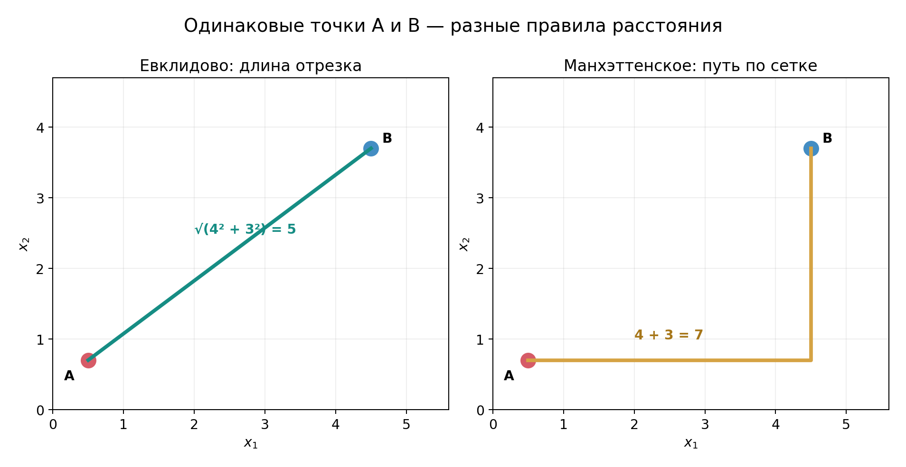

*Рисунок 5. Слева — кратчайший отрезок между A и B; справа — один из путей вдоль координатной сетки. Обе величины вычислены для одних и тех же точек.*

Чтобы найти порядок ближайших соседей по евклидову расстоянию, можно сравнивать квадраты расстояний без извлечения корня: порядок не изменится. Позже мы познакомимся с **взвешиванием соседей**; там уже важны не только их места в порядке, но и сами численные значения расстояний.

### 3.2. Манхэттенское расстояние и семейство $L_p$

Другая естественная мера расстояния — сумма абсолютных различий координат:

```math
\boxed{d_1(x,z)=\sum_{j=1}^{p}|x_j-z_j|.}
```

Для двух точек из примера она равна $|4-1|+|6-2|=3+4=7$. Это **манхэттенское расстояние**: чтобы добраться из A в B по прямоугольной сетке улиц, достаточно пройти на 3 единицы в одном направлении и на 4 — в другом (см. рисунок 5). В отличие от евклидова расстояния, здесь нельзя пройти «наискосок».

В более общем виде для $q\ge 1$ используют *расстояние Минковского*:

```math
\boxed{d_q(x,z)=\left(\sum_{j=1}^{p}|x_j-z_j|^q\right)^{1/q}.}
```

Оно получается как норма разности векторов: $d_q(x,z)=\lVert x-z\rVert_q$. Поэтому полезно различать **норму** $\lVert v\rVert$ — «длину» одного вектора — и **расстояние** $d(x,z)$ между двумя векторами. Для $q=1$ получаем $L_1$, для $q=2$ — $L_2$. Также используют

```math
\lVert v\rVert_\infty=\max_j|v_j|,
\qquad
d_\infty(x,z)=\max_j|x_j-z_j|.
```

Последняя величина — максимальное абсолютное расхождение по координатам. Её называют расстоянием Чебышёва.

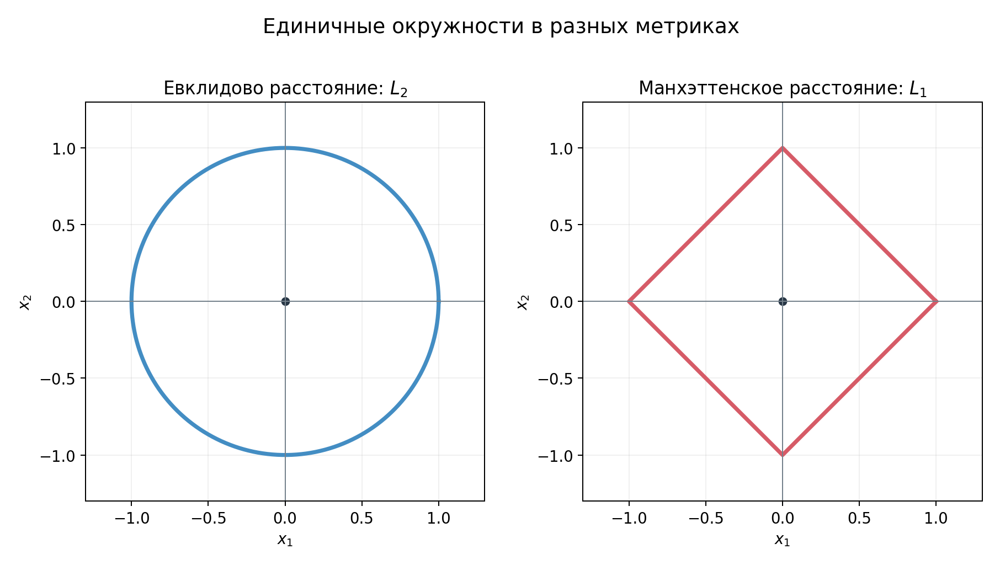

*Рисунок 6. Множества точек на расстоянии ровно 1 от начала координат. Для $`L_2`$ — окружность, для $`L_1`$ — ромб; при $`L_\infty`$ границей был бы квадрат.*

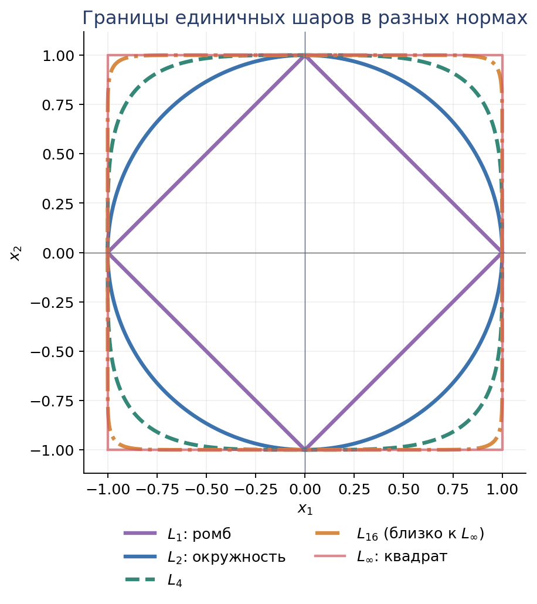

*Рисунок 7. Границы единичных шаров при нормах $`L_q`$: $`L_1`$ задаёт ромб, $`L_2`$ — окружность, а по мере роста $`q`$ форма приближается к квадрату, соответствующему $`L_\infty`$. На графике индекс $`q`$ обозначает порядок нормы, а не количество признаков.*

Разные расстояния не просто имеют разные формулы: они могут **иначе упорядочивать одни и те же наблюдения**. Рассмотрим новую точку $x=(0,0)$ и двух кандидатов в соседи:

```math
A=(4,0),\qquad B=(2.5,2.5).
```

При манхэттенском расстоянии до A получается 4, до B — 5, поэтому ближе A. При евклидовом расстоянии до A также 4, а до B — $\sqrt{2\cdot2.5^2}\approx3.54$, поэтому ближе уже B. Расстояние Чебышёва даёт 4 до A и 2.5 до B: снова побеждает B.

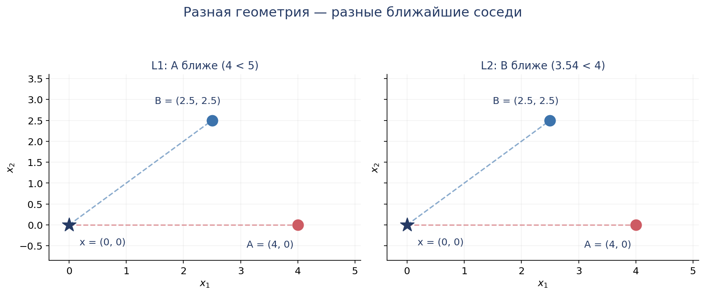

*Рисунок 8. Одни и те же точки образуют два разных порядка близости: $`L_1`$ выбирает A, а $`L_2`$ — B. Алгоритм поиска соседей и координаты не менялись; изменилась только метрика.*

Так проявляется смысл выбора расстояния. $L_1$ складывает абсолютные отклонения по координатам; $L_2$ сильнее выделяет большое расхождение по одной координате; $L_\infty$ вообще определяется наибольшим отклонением. Например, максимальное расхождение может быть важным в задаче, где значительное нарушение хотя бы одного допустимого предела делает объекты непохожими. Если же нужна привычная геометрическая дистанция между сопоставимыми измерениями, естественным кандидатом будет евклидово расстояние. Решение зависит от предметной задачи, распределения признаков и валидационного качества, а не от существования универсально лучшей метрики.

### Функции сходства и косинус

Близость можно описывать не только расстоянием. **Функцией сходства** называют числовую оценку того, насколько объекты похожи: обычно **большее значение соответствует большему сходству**. Такая функция не обязана удовлетворять аксиомам математического расстояния. В частности, расстояние минимально для совпадающих объектов, а сходство часто максимально при совпадении или близости определённых характеристик.

Для ненулевых векторов полезный пример — **косинусное сходство**:

```math
\boxed{
\mathrm{sim}_{cos}(x,z)
=\frac{x^\top z}{\lVert x\rVert_2\,\lVert z\rVert_2}
=\cos\theta.
}
```

Здесь $\theta$ — угол между векторами, проведёнными от начала координат. Косинусное сходство равно 1 для сонаправленных векторов, 0 для перпендикулярных и −1 для противоположных направлений. Оно отвечает на вопрос о **сходстве направлений**, а не об абсолютной разнице длин. Например, $x=(1,0)$ и $z=(10,0)$ имеют косинусное сходство 1, хотя их евклидово расстояние равно 9.

Это полезно, в частности, для векторных представлений текстов: два документа могут значительно различаться объёмом, но иметь похожие относительные частоты терминов, то есть близкие направления векторов. Часто используют величину

```math
\mathrm{dist}_{cos}(x,z)=1-\mathrm{sim}_{cos}(x,z),
```

которую принято называть **косинусным расстоянием**. Чем она меньше, тем направления ближе. При этом математически она в общем случае **не является метрикой**: например, для различных сонаправленных векторов значение будет равно нулю, а также не выполняется обычное неравенство треугольника. Следовательно, слово «расстояние» в названии не гарантирует выполнение всех аксиом метрики.

Выбирая функцию расстояния или сходства, мы фактически определяем, какие изменения признаков считаются существенными для прогноза. Проверка на валидационных данных помогает установить, работает ли выбранное представление на новых объектах.

### 3.3. Почему масштаб признаков меняет модель

Предположим, что мы измеряем расстояние между объектами по двум признакам. Новый объект имеет координаты $x=(0,0)$, а два обучающих объекта:

```math
A=(1,8),\qquad B=(3,0).
```

При евклидовом расстоянии

```math
d(x,A)=\sqrt{1^2+8^2}=\sqrt{65}\approx8.06,\qquad d(x,B)=3.
```

Ближайший сосед — B.

Теперь допустим, что второй признак представлен в других единицах измерения: все его значения делятся на 10. Объекты становятся

```math
x'=(0,0),\qquad A'=(1,0.8),\qquad B'=(3,0).
```

Физически мы не изменили наблюдаемые объекты. Изменились только численные значения одного признака.

Но теперь

```math
d(x',A')=\sqrt{1+0.8^2}\approx1.28,\qquad d(x',B')=3.
```

Ближайшим стал A.

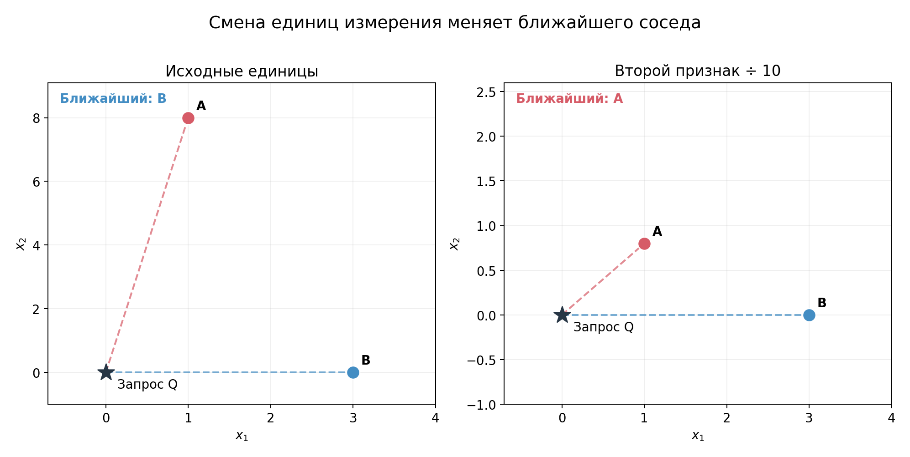

*Рисунок 9. Изменение единиц второго признака меняет расстояния и порядок соседей: исходно ближе B, после преобразования — A. Это специально сконструированный числовой пример.*

Получается, **изменение единиц измерения признака способно изменить предсказание kNN**. Это фундаментальная особенность методов, основанных на расстояниях.

Если один числовой признак принимает значения порядка тысяч, а другой — порядка единиц, первый может доминировать в евклидовом расстоянии просто вследствие своего масштаба. Причём это не означает, что он действительно содержит больше информации о целевой переменной.

### 3.4. Масштабирование признаков: стандартизация и MinMax

Прежде чем вычислять расстояния, числовые признаки часто нужно **масштабировать** — изменить их численный масштаб по некоторому правилу. Стандартизация является **одним из видов масштабирования**, но эти слова не синонимы.

**Стандартизация (StandardScaler)** использует статистики обучающей выборки:

```math
\boxed{z_{ij}=\frac{x_{ij}-\mu_j}{s_j},}
```

где $\mu_j$ и $s_j$ — среднее и стандартное отклонение признака $j$, рассчитанные на соответствующей **обучающей** части. После такого преобразования на этой части среднее становится нулевым, а стандартное отклонение — единичным (для непостоянного признака и согласованного определения $s_j$).

**MinMax-масштабирование** переносит обучающий диапазон в интервал, обычно $[0,1]$:

```math
\boxed{z_{ij}=\frac{x_{ij}-\min_{train}X_j}{\max_{train}X_j-\min_{train}X_j}.}
```

Новые данные могут выходить за границы обучающего диапазона, поэтому после MinMax результат не обязан оставаться в $[0,1]$. Оба преобразования требуют отдельной обработки постоянных признаков.

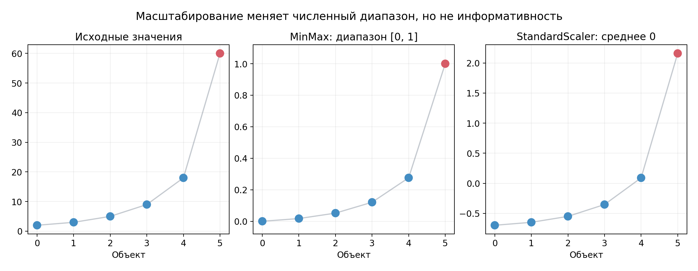

*Рисунок 10. Один числовой признак до масштабирования, после MinMax и после стандартизации. Красным выделено большое значение: ни один способ сам по себе не делает его менее экстремальным относительно остальных наблюдений.*

**Что выбрать?** Это зависит от свойств данных и модели. Стандартизация естественна, когда важны различия относительно разброса признаков, но чувствительна к сильным выбросам в среднем и стандартном отклонении. MinMax задаёт фиксированную шкалу на обучающем диапазоне, но большой выброс может «сжать» основную массу значений около нуля. При тяжёлых выбросах существуют и более робастные способы масштабирования, например по медиане и межквартильному размаху. Универсально лучшего преобразования нет.

Для kNN изменение масштаба — **изменение расстояния**, а значит, потенциально и соседей. Поэтому выбор преобразования при необходимости становится частью честного сравнения моделей.

И StandardScaler, и MinMaxScaler обучаются на **тренировочных** данных. В кросс-валидации значения среднего, стандартного отклонения, минимума и максимума должны пересчитываться **внутри обучающего фолда**. Удобный способ соблюдать этот порядок — помещать преобразования вместе с моделью в общий `Pipeline`.

Важно: масштабирование приводит численные диапазоны к более сопоставимому виду, но **не выявляет**, какие признаки полезны для прогноза.

### 3.5. Взвешенное голосование


*Рисунок 11. Один близкий красный сосед может перевесить два дальних синих, если веса убывают с расстоянием.*


В обычном kNN каждый из $k$ соседей имеет один голос. Но логично предположить, что очень близкий сосед должен влиять на прогноз сильнее, чем объект, расположенный заметно дальше.

Для этого вводят веса $w_i(x)\geq0$, зависящие от расстояния между новым объектом и соответствующим соседом.

Тогда локальная оценка вероятности класса становится

```math
\boxed{\hat p_c(x)=\frac{\sum_{i\in\mathcal N_k(x)}w_i(x)\mathbb I(y_i=c)}{\sum_{i\in\mathcal N_k(x)}w_i(x)}.}
```

Здесь предполагается, что сумма весов положительна. В числителе суммируются веса **только тех выбранных соседей**, у которых класс равен $c$. Индикатор $\mathbb I(y_i=c)$ обнуляет голоса остальных классов. В знаменателе складываются веса **всех $k$ соседей**, чтобы доли классов снова суммировались в единицу. Вес $w_i(x)$ может зависеть от расстояния нового объекта $x$ до соседа $x_i$: более близкому обычно задают больший вес.

Если все веса одинаковы, возвращаемся к обычному голосованию.

Один из распространённых вариантов — назначать веса обратно пропорционально расстоянию: $w_i(x)=1/d(x,x_i)$.

Такое правило требует специальной обработки нулевых расстояний. Если новый объект в точности совпадает с обучающим, простое деление на расстояние становится неопределённым. Реализация должна отдельно обработать такие совпадения.

Возьмём трёх соседей:

| Сосед | Расстояние | Класс |
|---|---:|---|
| A | 0.2 | Красный |
| B | 1.0 | Синий |
| C | 1.2 | Синий |

При обычном голосовании побеждает синий класс: два голоса против одного. Но при весах $1/d$ получаем

```math
V_{\mathrm{red}}=\frac{1}{0.2}=5,
```

```math
V_{\mathrm{blue}}=\frac{1}{1.0}+\frac{1}{1.2}\approx1.83.
```

Теперь побеждает красный.

Это показывает, что выбор способа агрегирования соседей способен изменить итоговый прогноз даже при неизменном $k$.

Взвешивание позволяет сделать метод чувствительнее к действительно близким объектам. Однако оно не гарантирует улучшения качества: ближайшие наблюдения тоже могут быть шумными или ошибочно размеченными.

Параметры $k$, метрики расстояния и способа взвешивания следует рассматривать как гиперпараметры, качество которых проверяется на валидационных данных.

### Итак

- kNN строит прогноз из ответов соседних обучающих наблюдений, а не из одной глобальной формулы.
- Понятие близости зависит от расстояния и представления признаков; норму вектора следует отличать от расстояния между векторами.
- Масштабирование может изменить соседей; взвешивание — влияние уже выбранных соседей.
- Метрика, число соседей, масштабирование и правило весов — решения, которые проверяются на валидации.

---

## 4. Выбор числа соседей: гибкость и обобщающая способность

Вспомним рисунок с единичной необычной точкой (рисунок 3). Почему она так сильно повлияла на 1NN и что изменится, если соседей станет больше?

### 4.1. Малое $k$: высокая чувствительность к отдельным объектам

При $k=1$ новое наблюдение получает метку ближайшей обучающей точки. Если все обучающие точки имеют различающиеся признаки и сами включены в поиск соседей, 1NN правильно классифицирует всю обучающую выборку: для каждой точки ближайшей окажется она сама.

На новых данных идеальная обучающая accuracy ни о чём не свидетельствует: случайная ошибка разметки способна создать вокруг себя отдельную область неправильных предсказаний. На рисунке 3 хорошо видно, откуда у маленького $k$ возникают мелкие «острова» и изломы границы. Это знакомый нам пример **переобучения**.

### 4.2. Большое $k$: сглаживание и потеря деталей

Если учитывать пять, пятнадцать или двадцать пять соседей, один случайный объект с неправильной меткой уже не обязательно изменит решение: его голос станет одним среди многих. Граница обычно оказывается менее чувствительной к отдельным обучающим наблюдениям.

Но у большего $k$ есть цена. Представим небольшую локальную область красных объектов внутри большой синей области. Несколько ближайших соседей внутри неё будут красными, однако при чрезмерно большом $k$ среди соседей начнут преобладать далёкие синие точки. Локальная красная область исчезнет из предсказаний.

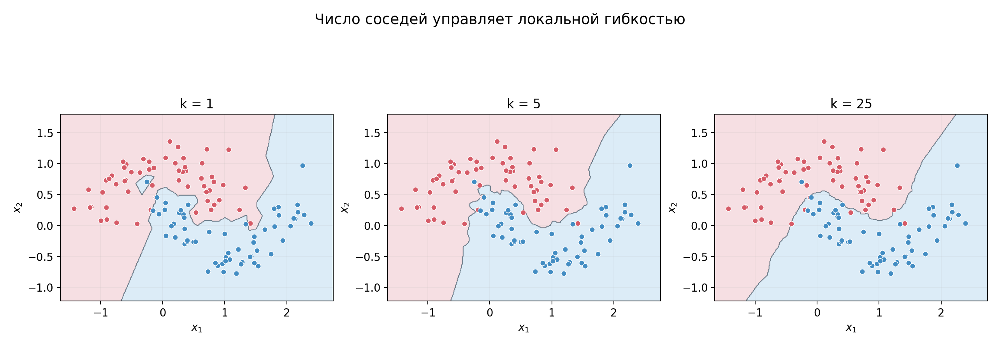

*Рисунок 12. Одна и та же синтетическая выборка при $`k=1`$, $`k=5`$ и $`k=25`$. Посмотрите, как меняются мелкие области классификации — от чувствительности к одиночным точкам до сглаживания.*

В пределе, при $k=n$ и одинаковых весах всех соседей, каждый новый объект получает один из самых частых классов во **всей** обучающей выборке:

```math
\hat y(x)\in\arg\max_c\sum_{i=1}^{n}\mathbb I(y_i=c).
```

Это константный baseline из первой недели: признаки нового объекта перестают влиять на ответ. Иными словами, слишком большое $k$ приводит к **недообучению**, поскольку модель больше не различает полезную локальную структуру.

Общая тенденция такова:

```math
\boxed{k\uparrow\quad\Longrightarrow\quad\text{больше сглаживания и меньше локальной гибкости}.}
```

Это не означает, что любая метрика качества на произвольных данных изменяется монотонно с ростом $k$.

### 4.3. Выбор $k$ по кросс-валидации

Как понять, какой уровень сглаживания нужен именно нам? Разделить доступные обучающие данные на фолды, проверить несколько значений $k$ и сравнить качество на тех наблюдениях, которые не участвовали в соответствующем обучении.

Например, можно проверить $k\in\lbrace 1,3,5,7,11,15,21\rbrace $. При этом **вся цепочка подготовки признаков** должна повторяться внутри каждого тренировочного фолда. Так сохраняется независимость оценки качества от подготовительных преобразований.

Искать максимальную train accuracy бесполезно: 1NN часто получает идеальную оценку на обучающих точках и при этом может переобучаться. Валидация показывает, как выбранное $k$ работает на новых объектах. При сравнении используют метрику, связанную с задачей: например, accuracy либо macro-F1, если важно качество по всем классам.

### Итак

- Малое $k$ усиливает чувствительность к одиночным объектам и шуму; чрезмерно большое сглаживает полезные различия.
- При $k=n$ невзвешенный классификатор превращается в константный baseline.
- Подходящее $k$ выбирают по валидации, а не по идеальной accuracy на обучении.

## 5. Проклятие размерности: почему локальным методам нужно много данных

Метод ближайших соседей использует ответы обучающих объектов из окрестности новой точки. Чтобы такой прогноз был надёжным, хочется выполнить два требования одновременно:

1. **Соседи должны быть действительно близкими.** Если признаки новых и обучающих объектов сильно различаются, нет оснований ожидать у них одинакового условного распределения целевой переменной.
2. **Соседей должно быть достаточно.** Прогноз по единственному наблюдению легко зависит от случайного шума; усреднение по нескольким объектам может быть устойчивее.

При большом числе признаков эти требования трудно совместить: в небольших окрестностях может почти не оказаться обучающих наблюдений. Разберём, откуда возникает это затруднение.

### 5.1. Сколько данных помещается рядом с новым объектом

Представим, что каждый числовой признак принимает значения от 0 до 1, а объекты распределены по пространству равномерно. Для простоты будем брать окрестности в виде отрезков, квадратов и многомерных кубов, стороны которых параллельны координатным осям. Рассматриваем области, целиком лежащие внутри единичного пространства; для таких областей доля наблюдений в среднем соответствует их доле объёма.

**При одном признаке** всё пространство — отрезок $[0,1]$. Небольшой отрезок длиной $r=0.2$ занимает 20% общей длины. Если у нас 100 наблюдений, внутри такой области ожидаем примерно 20 объектов.

**При двух признаках** всё пространство — единичный квадрат. Квадратная окрестность со стороной $0.2$ занимает уже лишь $0.2^2=0.04$, то есть 4% площади. В ней ожидаем только 4 из 100 наблюдений.

**При трёх признаках** область превращается в куб со стороной $0.2$. Его доля объёма равна $0.2^3=0.008$, или 0.8%. Из 100 наблюдений внутри него в среднем окажется меньше одного.


*Рисунок 13. При одинаковой стороне окрестности её доля всего пространства быстро уменьшается с ростом размерности: 20% в одномерном пространстве, 4% в двумерном и 0.8% в трёхмерном. Показанные области целиком находятся внутри соответствующих единичных пространств.*

При $p$ признаках доля объёма такого гиперкуба равна

```math
\boxed{r^p.}
```

Следовательно, если обучающая выборка содержит $n$ независимых наблюдений из равномерного распределения, **ожидаемое** число объектов в данной окрестности составляет

```math
\boxed{\mathbb E[N_{\mathrm{inside}}]=nr^p.}
```

Это и есть связь между геометрией и качеством локального оценивания. При неизменных $n$ и $r$ с ростом числа признаков значение $nr^p$ резко падает: соседей внутри близкой области становится всё меньше.

Теперь поставим обратную задачу. Предположим, мы хотим иметь **в среднем хотя бы десять наблюдений** в столь же узкой по каждой координате области со стороной $r=0.2$. Тогда для числа обучающих объектов нужно примерно

```math
\boxed{n\approx\frac{10}{0.2^p}.}
```

| Число признаков | Размер выборки для ожидаемых 10 объектов в такой окрестности |
|---:|---:|
| 1 | 50 |
| 2 | 250 |
| 5 | 31 250 |
| 10 | 97 656 250 |

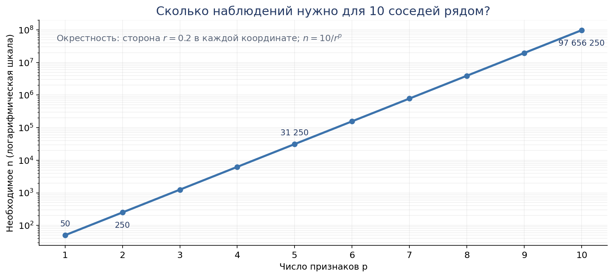

*Рисунок 14. В идеализированном равномерном пространстве число наблюдений, необходимое для сохранения ожидаемых десяти соседей внутри окрестности со стороной 0.2, растёт экспоненциально по числу признаков.*

Это не требование иметь десятки миллионов строк **для любого** kNN с десятью признаками. Пример намеренно упрощён: реальные данные не обязаны заполнять весь единичный куб равномерно, а kNN чаще использует окрестности, задаваемые выбранной метрикой. Но эксперимент объясняет механизм проблемы.

Если данных мало, метод всё равно найдёт ближайшие $k$ объектов. Просто ему придётся включить наблюдения из более широкой области пространства. А когда такая окрестность захватывает объекты с существенно разными значениями признаков, их ответы уже могут описывать разные локальные закономерности. Мы получаем необходимое число соседей ценой **потери локальности**.

Эту проблему называют одним из проявлений **проклятия размерности** (*curse of dimensionality*): при росте числа координат объём пространства увеличивается так быстро, что локальному оцениванию может требоваться несоразмерно больше данных. Универсального порога вроде «после десяти признаков метод не работает» нет: всё зависит от распределения данных, метрики и того, насколько информативны признаки.

### 5.2. Когда новые признаки мешают находить полезных соседей

Вторая трудность связана не только с разреженностью данных. Даже при фиксированном числе наблюдений дополнительные **неинформативные признаки** могут менять порядок соседей.

Пусть классы в основном определяются двумя координатами $X_1$ и $X_2$. Добавим ещё 30 независимых числовых признаков, не связанных с ответом. Если использовать обычное евклидово расстояние в полном пространстве, то

```math
\begin{aligned}
d^2(x,z)
&=(x_1-z_1)^2+(x_2-z_2)^2\\[0pt]
&\quad+\sum_{j=3}^{32}(x_j-z_j)^2.
\end{aligned}
```

В этой сумме шумовые признаки участвуют наряду с информативными. Если их много, случайные расхождения по ним могут изменить расстояния настолько, что объект, близкий по полезным признакам, перестанет входить в число ближайших.

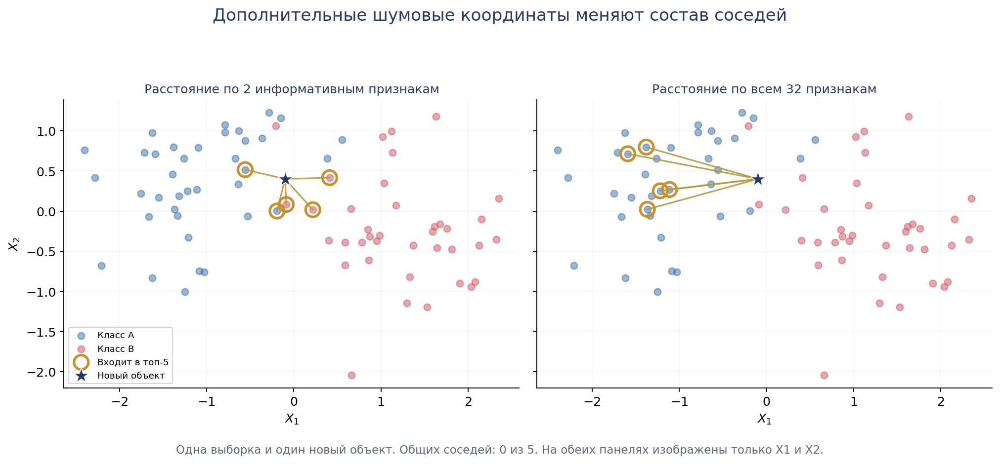

*Рисунок 15. Слева соседство строится по двум информативным признакам. Справа — для той же точки и тех же наблюдений, но расстояние вычисляется уже по всем 32 признакам. На обеих панелях показаны только первые две координаты; золотые кольца и отрезки отмечают пятёрку ближайших объектов. Справа эти объекты выбраны по расстояниям в полном 32-мерном пространстве, которое невозможно непосредственно изобразить на плоскости.*

Стандартизация здесь не даёт автоматического решения. Она меняет масштабы признаков, но не умеет отличить полезную координату от шума. Поэтому при проектировании метрической модели важно не только количество признаков, но и то, насколько их различия действительно связаны с различиями в ответах.

В реальных задачах могут помогать отбор признаков, содержательно подходящие способы их представления и методы снижения размерности. Однако любое преобразование следует оценивать как часть общей процедуры обучения, не используя информацию из тестовой выборки для его настройки.

### Итак

- Для локального прогноза нужны достаточно **близкие** и достаточно **многочисленные** соседи; высокая размерность затрудняет выполнение обоих требований одновременно.
- В простом равномерном примере ожидаемое число объектов внутри узкой окрестности равно $nr^p$. При фиксированном размере выборки оно быстро падает с ростом $p$.
- Много шумовых координат могут изменить порядок ближайших соседей, даже если полезная зависимость определяется всего двумя признаками.
- Масштабирование не заменяет содержательного выбора признаков и определения полезного сходства.


## 6. kNN для регрессии

До сих пор мы голосовали за классы. А если нужно предсказать число? Например, арендную плату квартиры по её характеристикам. Вместо поиска коэффициентов глобальной регрессионной модели найдём похожие квартиры и усредним известные значения аренды:

```math
\boxed{\hat f(x)=\frac1k\sum_{i\in\mathcal N_k(x)}y_i.}
```

Это **kNN-регрессия**. При трёх ближайших квартирах с арендной платой 40, 45 и 50 тыс. руб. получаем прогноз $(40+45+50)/3=45$ тыс. руб. От выбора классификации или регрессии меняется только **способ агрегирования ответов**: голосование либо среднее.

Можно учитывать и расстояния:

```math
\boxed{\hat f_w(x)=\frac{\sum_{i\in\mathcal N_k(x)}w_i(x)y_i}{\sum_{i\in\mathcal N_k(x)}w_i(x)}.}
```

Тогда близкие наблюдения могут сильнее влиять на прогноз.

### 6.1. Как выглядит локальная регрессия и почему это важно

Рассмотрим данные с одним числовым признаком. По горизонтали — значение признака $x$, по вертикали — наблюдаемые ответы $y$. Для нового значения $x$ (той самой **точки, где мы хотим сделать прогноз**) берём несколько ближайших обучающих наблюдений и усредняем их ответы.

Сдвигаем новое значение $x$ чуть правее. Пока состав его ближайших соседей не поменялся, среднее тоже не изменяется. Когда из окрестности выходит один обучающий объект и входит другой, прогноз может скачком перейти на новый уровень. Поэтому при **равных весах**, одномерном признаке и фиксированном $k$ kNN-регрессия создаёт ступенчатую функцию.


*Рисунок 16. Одна обучающая выборка при $`k=1`$, $`k=5`$, $`k=17`$: при малом числе соседей кривая следует за отдельными шумными наблюдениями; при большом усредняет их, но может пропускать локальные изменения зависимости.*

Эта ступенчатая форма непосредственно следует из способа построения прогноза. kNN не подбирает одну гладкую зависимость на всей числовой оси: значение оценки определяется набором ближайших обучающих ответов. Когда состав этого набора меняется, предсказание может скачком измениться. Поэтому даже в регрессионной задаче выбор $k$ означает выбор степени сглаживания. Взвешивание по расстоянию может изменить форму кривой и смягчить часть скачков, но её вид будет зависеть от принятой схемы весов.

### 6.2. Связь со статистической регрессией

Если цель — предсказать числовой ответ при квадратичной функции потерь, естественным ориентиром служит условное среднее

```math
m(x)=\mathbb E[Y\mid X=x].
```

Линейная регрессия аппроксимирует его с помощью глобальной функции заданного вида; kNN — локальным средним вблизи $x$. Они решают одну общую предсказательную задачу с разными предположениями о зависимости.

### Итак

- Для классификации соседние **классы голосуют**, для регрессии соседние **числовые ответы усредняются**.
- Прогноз одномерной kNN-регрессии с равными весами обычно ступенчатый, поскольку состав соседей меняется дискретно.
- Увеличение $k$ сглаживает локальный шум, но может скрывать детали зависимости.

## 7. Вычислительная цена kNN и семейство метрических алгоритмов

Простота правила предсказания не означает, что kNN всегда дешёв. Представим таблицу со **100 тысячами** обучающих объектов и **50 признаками**. Чтобы классифицировать **один** новый объект полным перебором, нужно сравнить его признаки с признаками каждого из 100 тысяч наблюдений. То есть потребуется около **5 миллионов сравнений координат**, не считая других арифметических операций и выбора ближайших расстояний.

При десяти тысячах новых объектов прямой перебор означает уже миллиарды подобных сравнений.

### 7.1. Очень кратко о вычислительной сложности

Для описания роста вычислительной работы используют **нотацию $O(\cdot)$**. Она описывает, как приблизительно растёт число операций при увеличении размера задачи, оставляя в стороне постоянные множители и второстепенные слагаемые.

Один проход по списку из $n$ объектов — $O(n)$; если для каждого объекта повторяется ещё один полный проход по $n$ объектам — $O(n^2)$. Чтение $p$ координат одного вектора обычно требует порядка $O(p)$ операций.

Поэтому вычисление расстояний до всех $n$ обучающих объектов при $p$ признаках занимает **порядка $O(np)$ операций** для одного нового объекта. Это не полная стоимость любого способа поиска: ещё надо выбрать нужные $k$ соседей. Смысл записи простой: **при удвоении числа объектов примерно удвоится работа по прямому перебору**, если остальные условия сохраняются.

При таком подходе приходится также **хранить сами обучающие признаки**. Для плотной таблицы из 100 тысяч объектов и 50 признаков это 5 миллионов числовых значений — заметно больше памяти, чем один небольшой вектор коэффициентов линейной модели.

### 7.2. Как ускоряют поиск и зачем kNN полезен

Для поиска ближайших точек существуют специализированные реализации. **KD-tree** рекурсивно разбивает пространство по координатам, чтобы при удачной геометрии не просматривать заведомо далёкие области. **BallTree** группирует точки по вложенным областям, ограниченным расстоянием. Есть и алгоритмы **приближённого поиска**, которые могут находить соседей значительно быстрее, сознательно допуская редкие ошибки в наборе ближайших объектов.

Ни одна структура не ускоряет все задачи. В высокой размерности деревья часто теряют преимущество перед полным перебором, а приближённый поиск вводит собственный компромисс скорости и точности. Для небольших таблиц прямой алгоритм может быть проще и вполне приемлем.

Поэтому kNN полезен как **понятный и нередко сильный baseline**, особенно когда данные не слишком велики и выбранное расстояние отражает содержательное сходство. Но в больших табличных задачах он не обязательно будет самым точным, быстрым или удобным для эксплуатации.

### 7.3. Что объединяет метрические методы

**Метрическими алгоритмами** в широком учебном смысле называют методы, в которых решение существенно зависит от расстояний между объектами либо от объектов до представителей классов. Не всякая функция сходства удовлетворяет строгим аксиомам математической метрики, поэтому термин здесь используется как название семейства методов на основе близости.

kNN сравнивает новый объект **с исходными обучающими наблюдениями**. Но можно хранить не все наблюдения, а один представитель каждого класса — например, **центроид**, то есть средний вектор его обучающих объектов:

```math
\mu_c=\frac{1}{n_c}\sum_{i:y_i=c}x_i,
\qquad
\hat y(x)=\arg\min_c d(x,\mu_c).
```

Так устроен **центроидный классификатор** (nearest centroid). Он вычислительно проще при предсказании, поскольку сравнивает точку всего с $K$ центрами, но теряет информацию о сложной форме классов: вытянутые или многокомпонентные облака одной средней точкой описываются плохо.

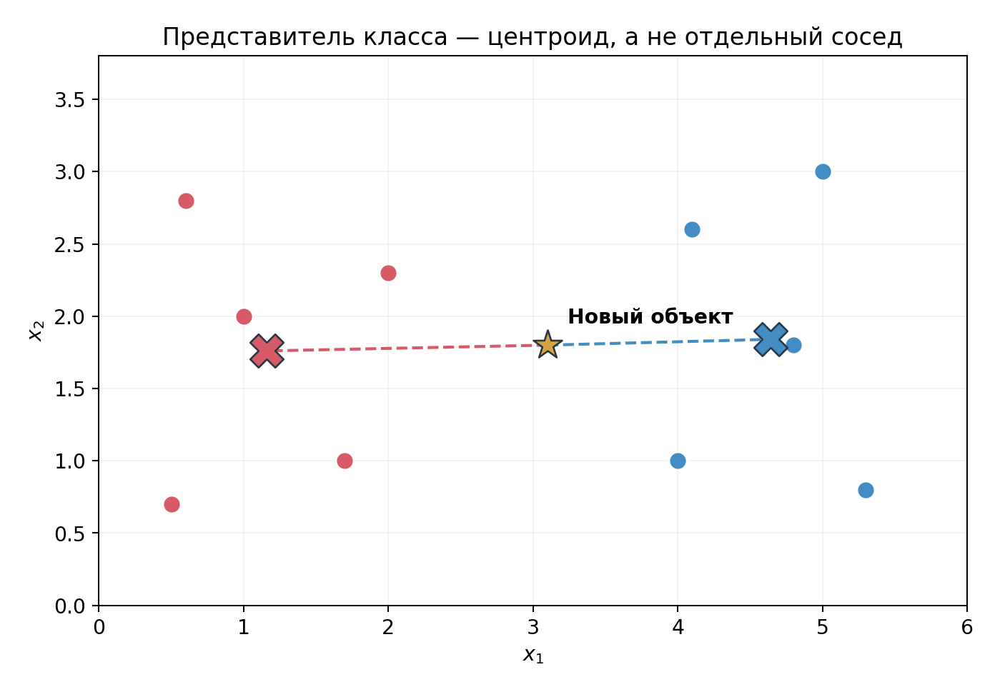

*Рисунок 17. Кресты — центры классов. В отличие от kNN, прогноз ориентируется на них, а не на ближайшие отдельные наблюдения.*

Центроидный классификатор — **похожий, но самостоятельный метод**, а не разновидность взвешенного kNN. Оба примера показывают общий вопрос метрических подходов: *с чем именно мы измеряем близость и что считаем представителем класса?*

### 7.4. Сравнение с глобальной моделью

| Свойство | Линейная / логистическая модель | kNN |
|---|---|---|
| Как описан прогноз | Глобальная функция с коэффициентами | Локальные обучающие наблюдения |
| Основное содержимое `fit` | Оценивание коэффициентов | Сохранение примеров и, возможно, построение индекса |
| Что важно при `predict` | Число признаков и классов | Поиск соседей среди обучающих данных |
| Вид границы в исходных признаках | Линейный при исходном линейном score | Может быть сложным |
| Чувствительность к масштабу | Влияет на регуляризацию и оптимизацию | Может непосредственно изменить соседей |
| Управление гибкостью | Признаки, регуляризация | $k$, метрика, веса |

Разные модели содержат разные **индуктивные предпочтения** (*inductive biases*): линейная модель ищет зависимость выбранного глобального вида, kNN опирается на полезность локального соседства. Ни один подход не лучший всегда; корректное сравнение проводится на новых данных.

### Итак

- Прямой поиск всех расстояний при $n$ объектах и $p$ признаках требует порядка $np$ координатных операций на новый объект.
- Для ускорения поиска существуют деревья и приближённые методы; их применимость зависит от данных.
- kNN часто удобен как baseline, но может быть дорогим при частом предсказании.
- Близость можно определять к отдельным объектам (kNN) или к центрам классов (nearest centroid): это разные алгоритмы одного общего подхода.

## 8. Многоклассовая классификация: от одного ответа к нескольким возможным

Мы уже пользовались kNN для классификации объектов трёх классов. Для самого метода ближайших соседей переход от двух классов к трём почти не потребовал изменений: соседи голосовали, а побеждал класс, набравший больше голосов. Но другие семейства моделей, в частности знакомая нам логистическая регрессия, первоначально были введены для бинарной задачи. Разберём, как распространить их на несколько классов.

В **многоклассовой классификации** (*multiclass classification*) каждому объекту соответствует **одна** метка из $K$ взаимоисключающих вариантов:

```math
\boxed{Y\in\lbrace 1,2,\ldots,K\rbrace .}
```

Например, система маршрутизации обращений в поддержку должна выбрать один основной отдел: «оплата», «доставка» или «техническая проблема». Здесь требуется один итоговый ответ. Числа $1,2,3$ только обозначают классы; они не задают расстояний между отделами.

Классификатор может возвращать и числовые оценки принадлежности классам. В идеале это вектор условных вероятностей:

```math
\bigl(p_1(x),\ldots,p_K(x)\bigr),\qquad
p_c(x)\geq0,\qquad \sum_{c=1}^{K}p_c(x)=1.
```

По такому вектору можно получить метку класса с максимальной вероятностью. В kNN мы уже видели один способ построить подобный вектор: взять долю соседей каждого класса. Теперь рассмотрим способы получить многоклассовый прогноз из линейных функций признаков.

## 9. One-vs-Rest: несколько бинарных задач

### 9.1. Как использовать уже знакомый бинарный классификатор

Мы умеем обучать модель, различающую два варианта ответа: класс 1 и класс 0. Если исходных классов три — A, B и C, — можно построить три бинарные задачи:

- **A против остальных:** объекты A обозначаем единицей, B и C — нулём;
- **B против остальных:** объекты B обозначаем единицей, A и C — нулём;
- **C против остальных:** объекты C обозначаем единицей, A и B — нулём.

Это стратегия **One-vs-Rest (OvR)**, или «один против остальных». Для $K$ исходных классов обучаем $K$ **самостоятельных** бинарных классификаторов.

Если каждый из них — логистическая регрессия, для класса $c$ получается своя линейная функция:

```math
\boxed{s_c(x)=w_c^\top x+b_c.}
```

Коэффициенты $w_c,b_c$ определяются **только по соответствующей бинарной задаче**, хотя признаки обучающих объектов во всех задачах одинаковы. Преобразование $\sigma(s_c(x))$ даёт оценку положительного класса именно в задаче «$c$ против остальных».

Пусть на трёх новых объектах бинарные классификаторы получили следующие значения линейных оценок:

| Объект | $s_A$ | $s_B$ | $s_C$ | Выбранный класс |
|---|---:|---:|---:|---|
| $x^{(1)}$ | 1.4 | 0.3 | −0.8 | A |
| $x^{(2)}$ | −0.2 | 1.8 | 0.6 | B |
| $x^{(3)}$ | 0.2 | −0.1 | 1.1 | C |

Для $x^{(2)}$ максимальная оценка равна $1.8$; значит, прогноз — B. Для этих бинарных логистических моделей порядок не изменится, если вместо scores сравнивать их сигмоиды, поскольку сигмоида строго возрастает.

В общем виде правило выбора класса:

```math
\boxed{\hat y(x)\in\arg\max_{c\in\lbrace 1,\ldots,K\rbrace }s_c(x).}
```

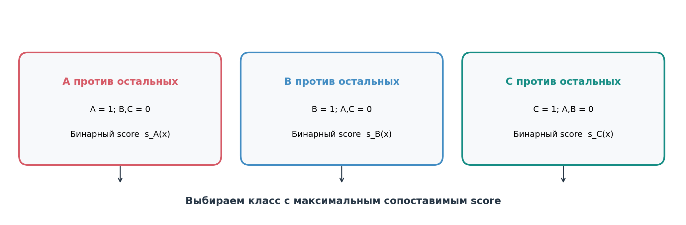

*Рисунок 18. Стратегия OvR: одна и та же исходная выборка трижды получает разные бинарные метки. Модели обучаются независимо и формируют оценки принадлежности каждому классу.*

### 9.2. Почему выходы OvR — не одна совместная модель вероятностей

Каждая бинарная логистическая регрессия в OvR оценивает вероятность **своего класса против всех остальных**. Для одного объекта обозначим её выход через $\hat p_c^{\mathrm{bin}}(x)$. Верхний индекс напоминает, что оценка получена из самостоятельной бинарной задачи, а не из единого распределения по $K$ классам.

Допустим, независимые модели получили

```math
\hat p_A^{\mathrm{bin}}=0.8,\qquad
\hat p_B^{\mathrm{bin}}=0.7,\qquad
\hat p_C^{\mathrm{bin}}=0.3.
```

Их сумма равна $1.8$. При этом в исходной задаче у обращения может быть только один правильный отдел. Следовательно, эти три числа **нельзя без дополнительной обработки** считать вероятностями взаимоисключающих исходов.

Один из способов получить согласованное распределение — нормировать оценки:

```math
\boxed{
\hat p_c^{\mathrm{OvR}}(x)=
\frac{\hat p_c^{\mathrm{bin}}(x)}{\sum_{j=1}^{K}\hat p_j^{\mathrm{bin}}(x)}.
}
```

В нашем примере получится приблизительно $(0.444,\;0.389,\;0.167)$. Так устроено получение вероятностей в `OneVsRestClassifier.predict_proba` для обычной многоклассовой постановки, если базовые классификаторы поддерживают оценивание вероятностей. Однако **каждая бинарная модель всё равно обучалась самостоятельно**; нормировка изменила лишь способ объединения готовых выходов.

Вместо вероятностей некоторые алгоритмы выдают числовые оценки (*scores*), которые не имеют вероятностной интерпретации. Например, линейный метод опорных векторов (`LinearSVC`) возвращает оценку, связанную с положением объекта относительно разделяющей границы. Отдельные OvR-классификаторы обучаются по разным бинарным задачам, поэтому большое значение score одной модели не обязано означать ту же степень уверенности, что такое же значение другой. В стандартном OvR итоговый класс всё же выбирается сравнением выходов; это одна из причин осторожно относиться к интерпретации таких чисел как вероятностей.

Главное достоинство OvR — возможность использовать знакомый бинарный алгоритм в задаче с несколькими классами. Другой путь состоит в построении **одной многоклассовой вероятностной модели**, параметры которой определяются в общей задаче обучения.

## 10. Одна многоклассовая логистическая модель

### 10.1. Почему модели нужны несколько линейных оценок

В бинарной логистической регрессии достаточно одной линейной оценки

```math
s(x)=w^\top x+b.
```

Сигмоида превращает её в вероятность класса 1, а вероятность класса 0 определяется как дополнение до единицы. Теперь рассмотрим три взаимоисключающих класса — A, B и C. Модель должна сопоставить каждому объекту три вероятности, сумма которых равна единице.

Сохраним знакомую линейную зависимость от признаков и **введём по одной линейной оценке для каждого класса**:

```math
\begin{aligned}
s_A(x)&=w_A^\top x+b_A,\\[0pt]
s_B(x)&=w_B^\top x+b_B,\\[0pt]
s_C(x)&=w_C^\top x+b_C.
\end{aligned}
```

Здесь $w_A,w_B,w_C$ — разные векторы коэффициентов при **одних и тех же входных признаках**. Например, длина обращения может увеличивать оценку класса A и уменьшать оценку класса B. Сами оценки ещё не являются вероятностями. Чтобы получить их, мы будем одновременно учитывать все три числа: вероятность каждого класса зависит и от его собственной оценки, и от оценок конкурирующих классов.

В этих формулах записано **устройство многоклассовой логистической регрессии**. Её неизвестными параметрами служат все коэффициенты и свободные члены. Их будут определять по обучающей выборке, минимизируя **одну общую функцию потерь**, которая связывает классы между собой. В этом и состоит различие с OvR, где каждую из трёх линейных функций находят в отдельной бинарной задаче.

Посмотрим, как вычисляются оценки при двух числовых признаках $x=(x_1,x_2)$. Пусть коэффициенты принимают значения

```math
\begin{aligned}
s_A(x)&=1.0x_1+0.5x_2,\\[0pt]
s_B(x)&=1.0x_1,\\[0pt]
s_C(x)&=0.
\end{aligned}
```

Для объекта $x=(1,2)$ получаем

```math
\begin{aligned}
s_A(x)&=1+0.5\cdot2=2,\\[0pt]
s_B(x)&=1,\\[0pt]
s_C(x)&=0.
\end{aligned}
```

Значит, **один объект получает три оценки**:

```math
s(x)=(2,1,0).
```

Для другого объекта, например $x=(2,1)$, те же коэффициенты дадут $(2.5,2,0)$. После обучения эти коэффициенты будут одинаковыми при обработке всех новых объектов; различаться будут входные признаки и вычисленные значения scores.

Когда классов много, удобно сложить их векторы коэффициентов в одну **матрицу** $W$, по одной строке на класс, а свободные члены — в вектор $b$:

```math
W=
\begin{pmatrix}
w_A^\top\\w_B^\top\\w_C^\top
\end{pmatrix}
=
\begin{pmatrix}
1&0.5\\1&0\\0&0
\end{pmatrix},
\qquad
b=\begin{pmatrix}0\\0\\0\end{pmatrix}.
```

Тогда все три вычисления для **одного объекта** записываются коротко:

```math
\boxed{s(x)=Wx+b.}
```

При $p$ признаках и $K$ классах матрица $W$ имеет размер $K\times p$, а результат $s(x)$ — вектор длины $K$. Таким образом, вместо одного вектора коэффициентов, как в бинарной логистической регрессии, мы подбираем **матрицу коэффициентов всех классов** и вектор свободных членов. Матричная запись только объединяет уже знакомые линейные выражения; способ их совместного обучения мы разберём после введения вероятностей.

### 10.2. Softmax: как из оценок получить вероятности

Значения $s_A,s_B,s_C$ могут быть любыми вещественными числами, поэтому напрямую вероятностями они не являются. Для взаимоисключающих классов нужен вектор положительных значений с суммой 1. **Softmax** преобразует scores именно таким образом:

```math
\boxed{
p_c(x)=\frac{\exp(s_c(x))}{\sum_{j=1}^{K}\exp(s_j(x))}.
}
```

В числителе стоит экспонента оценки класса $c$, а в знаменателе — **сумма экспонент оценок всех классов того же объекта**. Здесь и появляется непосредственная связь классов: вероятность A зависит не только от $s_A$, но и от $s_B,s_C$.

Экспонента положительна, поэтому каждое $p_c(x)>0$, а общая сумма вероятностей равна единице:

```math
\sum_{c=1}^{K}p_c(x)
=\frac{\sum_c e^{s_c(x)}}{\sum_j e^{s_j(x)}}=1.
```

Для нашего объекта со scores $(2,1,0)$:

```math
\begin{aligned}
Z&=e^2+e^1+e^0\approx11.107,\\[0pt]
p_A&\approx7.389/11.107\approx0.665,\\[0pt]
p_B&\approx2.718/11.107\approx0.245,\\[0pt]
p_C&\approx1/11.107\approx0.090.
\end{aligned}
```

Получается распределение вероятностей $(0.665,0.245,0.090)$ и прогноз A.


*Рисунок 19. Для одного объекта каждая строка коэффициентов даёт score. Softmax преобразует все scores совместно: отдельный числитель и общий знаменатель определяют классовые вероятности.*

Поскольку экспонента возрастает, наибольшей вероятности соответствует наибольший score:

```math
\arg\max_c p_c(x)=\arg\max_c s_c(x).
```

Значит, для выбора класса достаточно исходных оценок. Но сами вероятности содержат больше информации, чем одна метка, и нужны для построения функции потерь и оценки качества вероятностного прогноза.

Есть полезное свойство: добавление ко всем scores одной константы $a$ ничего не меняет, поскольку общий множитель $e^a$ сокращается:

```math
\mathrm{softmax}(s+a\mathbf1)=\mathrm{softmax}(s).
```

Для численно устойчивого расчёта из всех scores часто вычитают их максимум. Это позволяет избежать слишком больших значений экспоненты, сохранив те же вероятности.

### 10.3. Связь с бинарной логистической регрессией

Для двух классов softmax даёт

```math
p_1(x)=\frac{e^{s_1(x)}}{e^{s_0(x)}+e^{s_1(x)}}.
```

Разделим числитель и знаменатель на $e^{s_1(x)}$:

```math
\begin{aligned}
p_1(x)&=\frac{1}{1+e^{s_0(x)-s_1(x)}}\\[0pt]
&=\sigma\bigl(s_1(x)-s_0(x)\bigr).
\end{aligned}
```

А разность двух линейных функций сама линейна:

```math
s_1(x)-s_0(x)=(w_1-w_0)^\top x+(b_1-b_0).
```

Следовательно, для двух классов softmax **сводится к обычной сигмоиде от линейной оценки**. Общая многоклассовая модель продолжает знакомую бинарную конструкцию.

## 11. Как обучается многоклассовая логистическая регрессия

Теперь можно вернуться к главному вопросу: как найти все коэффициенты $w_A,w_B,w_C$ и свободные члены $b_A,b_B,b_C$? Одинаковых формул для scores недостаточно — нужно определить, **какие значения коэффициентов согласуются с правильными ответами обучающей выборки**.

### 11.1. От бинарной log-loss к многоклассовой

Напомним бинарную функцию потерь для объекта с меткой $y\in\lbrace 0,1\rbrace $ и вероятностью положительного класса $p$:

```math
\boxed{L_{binary}(y,p)=-y\log p-(1-y)\log(1-p).}
```

При $y=1$ остаётся $-\log p$; при $y=0$ — $-\log(1-p)$. То есть в обоих случаях мы берём **отрицательный логарифм вероятности действительно наблюдавшегося ответа**.

Эта же идея непосредственно переносится на $K$ классов. Если у объекта $x_i$ истинный класс $y_i$, а модель присвоила ему вероятность $p_{y_i}(x_i)$, зададим

```math
\boxed{L_i(W,b)=-\log p_{y_i}(x_i;W,b).}
```

Это многоклассовая log-loss, или *categorical cross-entropy*. Например, если модель выдала $(0.665,0.245,0.090)$ и истинный класс B, то

```math
L_i=-\log(0.245)\approx1.407.
```

Если истинный класс A, loss была бы меньше: $-\log(0.665)\approx0.407$. За уверенную ошибку с очень маленькой вероятностью правильного класса модель получает большую потерю, как и в бинарном случае.

### 11.2. Одна функция для всех коэффициентов

Подставим формулу softmax в функцию потерь одного обучающего объекта:

```math
\begin{aligned}
L_i(W,b)
&=-\log\frac{e^{s_{y_i}(x_i)}}{\sum_{c=1}^{K}e^{s_c(x_i)}}\\[0pt]
&=-s_{y_i}(x_i)+\log\left(\sum_{c=1}^{K}e^{s_c(x_i)}\right).
\end{aligned}
```

Рассмотрим объект, правильный класс которого — B. Его loss равна $-\log p_B(x)$. Но вероятность $p_B(x)$ определяется не одним score $s_B(x)$, а сразу тремя:

```math
\boxed{
p_B(x)=\frac{e^{s_B(x)}}{e^{s_A(x)}+e^{s_B(x)}+e^{s_C(x)}}.
}
```

Поэтому коэффициенты класса A тоже влияют на то, какую loss модель получает **на объекте класса B**. Например, при scores $(2,1,0)$ вероятность правильного класса B равна приблизительно $0.245$, и loss составляет $1.407$. Если score A для этого объекта возрастёт с 2 до 3, а два других останутся неизменными, то

```math
p_B(x)=\frac{e^1}{e^3+e^1+e^0}\approx0.114,
```

и loss увеличится примерно до $2.170$. Мы изменили оценку A, но ухудшили прогноз **объекта B**. Аналогичная связь существует и между остальными классами.

Теперь объединим потери всех обучающих объектов, взяв среднее:

```math
\boxed{
R_n(W,b)=-\frac1n\sum_{i=1}^{n}\log p_{y_i}(x_i;W,b).
}
```

Обучение многоклассовой логистической регрессии состоит в том, чтобы найти **все** коэффициенты, при которых эта средняя loss минимальна:

```math
\boxed{
(\hat W,\hat b)\in\arg\min_{W,b}R_n(W,b).
}
```

В бинарной логистической регрессии мы подбирали один вектор коэффициентов и свободный член. Здесь неизвестных больше: матрица из $K$ строк и $p$ столбцов плюс $K$ свободных членов. Но математический принцип тот же — определить параметры модели по одной целевой функции.

Почему задача **совместная**? В среднем риске участвуют все обучающие объекты, а вероятность правильного класса **каждого** объекта зависит от всех строк $W$. Поэтому изменение коэффициентов одного класса может улучшать прогнозы одних объектов и ухудшать прогнозы других. Нельзя оптимизировать $w_A$ как отдельную бинарную модель, не учитывая зависимость потерь от $w_B$ и $w_C$: мы получили бы уже другую задачу, то есть OvR.

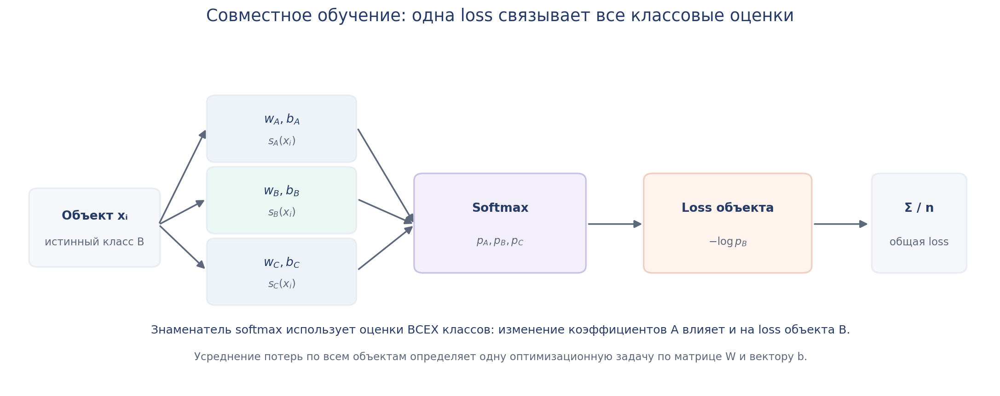

*Рисунок 20. Для каждого обучающего объекта вычисляются оценки всех классов, а softmax преобразует их в вероятности. Потеря зависит от вероятности истинного класса, но в её расчёте участвуют все классовые scores. Среднее по объектам образует общую функцию, по которой подбираются все коэффициенты модели.*

### 11.3. Что происходит при подгонке модели

Модель определена формулами scores и softmax. Для её обучения задают начальные значения коэффициентов и затем с помощью **численного оптимизатора** ищут такие $W,b$, при которых средняя cross-entropy невелика.

На очередной итерации оптимизатор получает информацию о значении целевой функции и её изменении при варьировании коэффициентов, после чего обновляет параметры. Затем функция пересчитывается; процесс продолжается до выполнения критерия остановки. Иными словами, оптимизация работает сразу со всем набором неизвестных коэффициентов, а не последовательно завершает самостоятельную бинарную задачу для A, затем B и затем C.

Конкретный численный метод может различаться. Например, `LogisticRegression` из scikit-learn по умолчанию использует `lbfgs` — квазиньютоновский метод, который использует информацию о градиенте и приближении кривизны целевой функции. Он **не является обычным градиентным спуском с фиксированным шагом**, знакомым по первым примерам оптимизации. Однако он решает ту же общую математическую задачу минимизации указанного риска.

Для сравнения вспомним OvR. При OvR каждая бинарная модель минимизировала собственную функцию потерь по **своему** набору коэффициентов. В multinomial logistic regression есть одна функция $R_n(W,b)$, поэтому все классовые параметры связаны уже на этапе обучения, а не только при выдаче прогноза.

### 11.4. Регуляризация и устойчивость

Как и для линейных моделей, к средней cross-entropy можно добавить штраф на величину коэффициентов. Например, L2-регуляризованная задача имеет вид

```math
\boxed{
\min_{W,b}\left\lbrace R_n(W,b)+\lambda\sum_{c=1}^{K}\|w_c\|_2^2\right\rbrace .
}
```

В записанном варианте штраф применяется к коэффициентам признаков, но не к свободным членам. В других вариантах регуляризации штраф может также включать свободные члены либо использовать иную меру величины коэффициентов. Эти настройки не меняют сам принцип многоклассовой логистической регрессии. Регуляризация ограничивает величину коэффициентов и может улучшать устойчивость и качество обобщения. В частности, мы уже встречались с ситуациями, когда для разделимых данных нерегуляризованные коэффициенты логистической регрессии могут не иметь конечного оптимума.

В математическом определении логистической регрессии регуляризация **не обязательна**. В scikit-learn она по умолчанию включена как практическая настройка, а её сила регулируется, в частности, параметром `C` (меньше `C` — сильнее штраф в стандартной параметризации). Подходящую силу регуляризации проверяют в рамках общей схемы выбора гиперпараметров.

### 11.5. Эквивалентная запись с индикаторами классов

Функцию потерь иногда удобно записать без отдельного обращения к индексу правильного класса:

```math
L_i=-\sum_{c=1}^{K}\mathbb I(y_i=c)\log p_c(x_i).
```

Допустим, истинная метка — B. Тогда индикаторы $(\mathbb I(y_i=A),\mathbb I(y_i=B),\mathbb I(y_i=C))$ равны $(0,1,0)$. При подстановке получаем

```math
L_i=-(0\log p_A+1\log p_B+0\log p_C)=-\log p_B.
```

Обе записи описывают **одну и ту же** categorical cross-entropy; вторая удобна при работе с индикаторной матрицей классов.

### 11.6. Сквозной пример: от признаков к прогнозу и функции потерь

Вернёмся к модели с двумя числовыми признаками и коэффициентами из раздела 10:

```math
W=\begin{pmatrix}1&0.5\\1&0\\0&0\end{pmatrix},
\qquad b=\begin{pmatrix}0\\0\\0\end{pmatrix}.
```

Для каждого объекта сначала вычисляем $s(x)=Wx+b$, затем применяем softmax, выбираем класс с наибольшей вероятностью и сопоставляем результат с известной меткой. Рассмотрим несколько наблюдений:

| Признаки $x$ | Истинный класс | Scores $(s_A,s_B,s_C)$ | Softmax $(p_A,p_B,p_C)$ | Прогноз | Loss |
|---|---|---|---|---|---:|
| $(1,2)$ | B | $(2,1,0)$ | $(0.665,0.245,0.090)$ | A | 1.408 |
| $(1,-2)$ | B | $(0,1,0)$ | $(0.212,0.576,0.212)$ | B | 0.551 |
| $(-2,0)$ | C | $(-2,-2,0)$ | $(0.107,0.107,0.787)$ | C | 0.240 |
| $(2,2)$ | A | $(3,2,0)$ | $(0.705,0.259,0.035)$ | A | 0.349 |

Первая строка особенно показательна. У объекта истинный класс B, но максимальная оценка и максимальная вероятность принадлежат A. Поэтому жёсткий прогноз ошибочен, а значение loss $-\log(0.245)$ достаточно велико.

Для этих четырёх наблюдений среднее значение cross-entropy составляет приблизительно

```math
R_4(W,b)=\frac{1.408+0.551+0.240+0.349}{4}\approx0.637.
```

Это значение относится **ко всему набору коэффициентов** $W,b$. Во время обучения оптимизатор изменяет параметры, пересчитывает scores, вероятности и общую loss по обучающим объектам. Так несколько линейных оценок каждого объекта оказываются связанными одной задачей подбора коэффициентов.

### Итак

- Каждому классу соответствует собственная строка линейных коэффициентов, но все строки являются параметрами **одной модели**.
- Softmax связывает оценки всех классов общим знаменателем.
- Cross-entropy одного объекта зависит от коэффициентов всех классов; средняя loss по выборке задаёт одну задачу совместной оптимизации.
- OvR отличается именно **независимым обучением** бинарных моделей; нормировка их выходов не устраняет этого различия.

## 12. Как оценивать качество многоклассового классификатора

Теперь мы можем получать многоклассовые прогнозы разными способами: kNN использует голоса соседей, OvR объединяет независимые бинарные классификаторы, а multinomial logistic regression обучает общую вероятностную модель. Но сравнивать их по единственному числу, не разбираясь в распределении ошибок, рискованно. В многоклассовой задаче модель может прекрасно различать один класс и почти полностью игнорировать другой.

### 12.1. Матрица ошибок для трёх классов

В бинарной классификации матрица ошибок имела размер $2\times2$. Для $K$ классов получим матрицу размера $K\times K$. Примем соглашение: **строки — истинные классы, столбцы — предсказанные**.

Элемент матрицы $C_{ab}$ — количество объектов, для которых истинный класс равен $a$, а предсказанный — $b$:

```math
\boxed{C_{ab}=\sum_{i=1}^{n}\mathbb I(y_i=a)\mathbb I(\hat y_i=b).}
```

Сумма пробегает все $n$ объектов оцениваемой выборки. Произведение индикаторов равно 1 только тогда, когда выполнены **оба** условия, поэтому и получается число объектов с конкретной парой истинного и предсказанного класса.

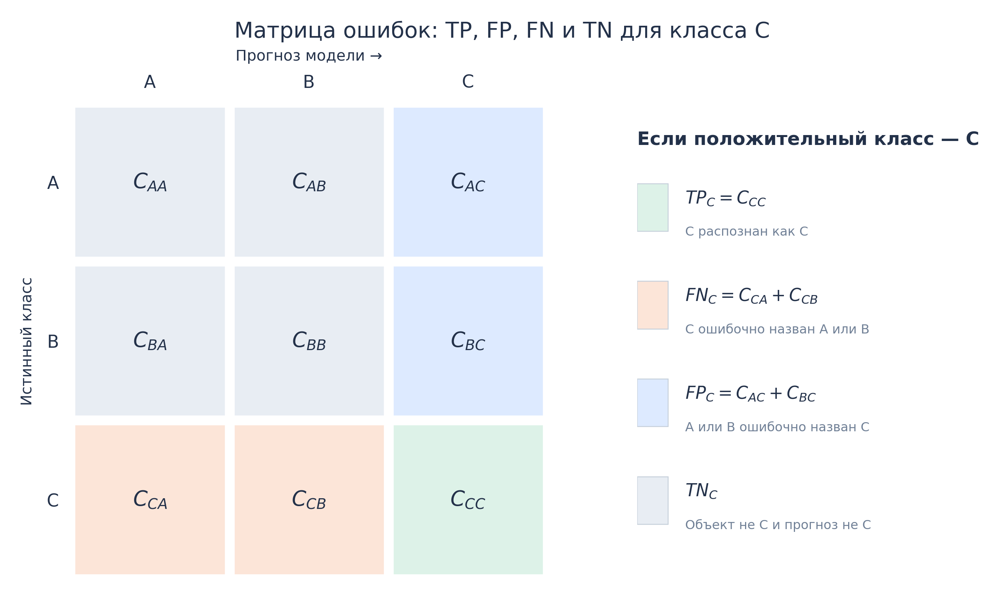

*Рисунок 21. Общая структура матрицы ошибок для трёх классов. При рассмотрении класса C как положительного: диагональная ячейка C–C даёт $`TP_C`$, остальные клетки строки C — $`FN_C`$, остальные клетки столбца C — $`FP_C`$, а блок A/B против A/B — $`TN_C`$. Для другого класса соответствующие области выделяются аналогично.*

Рассмотрим 60 обращений в поддержку. Для каждого был известен правильный отдел A, B или C, а модель пыталась его определить:

| Истинный класс / Прогноз | A | B | C | Всего |
|---|---:|---:|---:|---:|
| **A** | 38 | 2 | 0 | 40 |
| **B** | 4 | 10 | 1 | 15 |
| **C** | 2 | 2 | 1 | 5 |
| **Всего предсказано** | 44 | 14 | 2 | 60 |


*Рисунок 22. Строки матрицы соответствуют истинным классам. Диагональ содержит правильные предсказания, внедиагональные ячейки показывают, какие классы путаются между собой.*

Правильных ответов 38+10+1=49. Поэтому общая доля правильных классификаций:

```math
\mathrm{Accuracy}=\frac{49}{60}\approx0.817.
```

Но более 80% правильных ответов не означают, что модель одинаково успешна для всех трёх отделов. Для класса A верны 38 из 40 прогнозов по истинным объектам, а для C — всего 1 из 5. Матрица показывает это различие непосредственно.

### 12.2. Precision, recall и F1 для каждого класса

Чтобы вычислять знакомые бинарные метрики, последовательно считаем интересующий класс положительным, а все остальные — отрицательными. Возьмём класс C.

**True positive класса C** — объекты C, правильно названные C. Их один:

```math
TP_C=C_{CC}=1.
```

**False negative класса C** — настоящие C, отправленные в A или B. Их четыре:

```math
FN_C=C_{CA}+C_{CB}=2+2=4.
```

**False positive класса C** — чужие объекты, ошибочно названные C. Такой объект один:

```math
FP_C=C_{AC}+C_{BC}=0+1=1.
```

Тогда

```math
\mathrm{Precision}_C=\frac{TP_C}{TP_C+FP_C}
=\frac12=0.5,
```

```math
\mathrm{Recall}_C=\frac{TP_C}{TP_C+FN_C}
=\frac15=0.2.
```

Precision отвечает на вопрос: **среди обращений, отправленных моделью в C, какая доля действительно должна была попасть в C?** Recall — на другой: **какую долю всех настоящих обращений C модель вообще нашла?** Для F1 получаем

```math
F_{1,C}=
\frac{2\mathrm{Precision}_C\mathrm{Recall}_C}
{\mathrm{Precision}_C+\mathrm{Recall}_C}
\approx0.286.
```

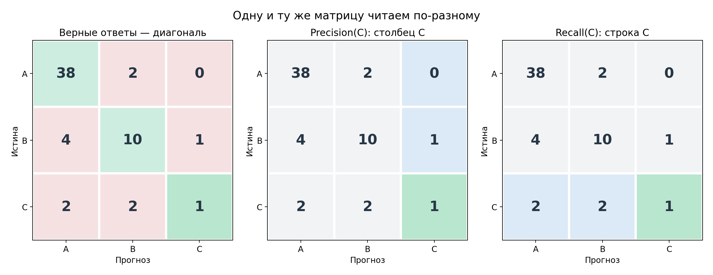

*Рисунок 23. Для класса C подсвечиваются диагональная ячейка TP, часть **столбца** C, образующая FP, и часть **строки** C, образующая FN. Это три разных множества наблюдений.*

Повторим вычисления для A и B:

| Класс | Support | Precision | Recall | F1 |
|---|---:|---:|---:|---:|
| A | 40 | 0.864 | 0.950 | 0.905 |
| B | 15 | 0.714 | 0.667 | 0.690 |
| C | 5 | 0.500 | 0.200 | 0.286 |

*Support* — число объектов **истинного** класса в оцениваемой выборке, то есть сумма соответствующей строки матрицы. Именно так называется этот столбец в отчёте `classification_report` библиотеки scikit-learn. Мы видим, что модель очень уверенно обрабатывает преобладающий класс A и гораздо хуже — редкий C.

Для класса можно посчитать и бинарную accuracy, но при редком классе она часто малоинформативна: множество объектов других классов образуют true negatives. Если нас интересует, какая доля настоящих объектов C распознана верно, это уже выражается через $\mathrm{Recall}_C$.

### 12.3. Macro-усреднение: одинаковый вес каждого класса

Оценки по классам полезны для диагностики, но при сравнении нескольких моделей бывает необходимо одно число. Как объединить три значения F1?

Первый способ — дать каждому классу одинаковый вес, независимо от его распространённости:

```math
\boxed{F_1^{macro}=\frac{1}{K}\sum_{c=1}^{K}F_{1,c}.}
```

Для нашей матрицы:

```math
F_1^{macro}=\frac{0.905+0.690+0.286}{3}\approx0.627.
```

Важное свойство macro-усреднения: результат класса C влияет на итоговую оценку **столь же сильно**, как результат класса A, хотя объектов C только пять, а объектов A сорок. Показатель оказывается чувствителен к плохой работе хотя бы по одному классу.

Macro-F1 уместно использовать, когда отдельные классы заслуживают сопоставимого внимания. Но для надёжной интерпретации всегда полезно видеть support: F1 по пяти объектам может сильно меняться от одной ошибки.

Аналогичным способом усредняют не только F1, но и precision, recall и другие подходящие классовые метрики. Например, средний recall по классам в multiclass-классификации соответствует *balanced accuracy*.

### 12.4. Weighted-усреднение: вес класса зависит от его распространённости

Другой вариант — назначить классам веса пропорционально support. Если $n_c$ — число истинных объектов класса $c$, а $n$ — общее число объектов, то

```math
\boxed{F_1^{weighted}=\sum_{c=1}^{K}\frac{n_c}{n}F_{1,c}.}
```

Для нашей матрицы:

```math
\begin{aligned}
F_1^{weighted}
&=\frac{40}{60}\cdot0.905
+\frac{15}{60}\cdot0.690
+\frac{5}{60}\cdot0.286\\[0pt]
&\approx0.799.
\end{aligned}
```

Здесь результат класса A определяет большую часть итогового числа. Если редкий класс C распознаётся плохо, weighted-F1 может оставаться довольно высоким.

Weighted-усреднение может быть полезным для характеристики работы на классах в пропорциях, встречающихся в оцениваемой выборке. Но оно хуже подходит как единственный показатель, если задача требует внимательно учитывать редкие категории.

Важно: weighted-F1 — среднее **готовых классовых F1**, а не F1, вычисленное из усреднённых precision и recall. Эти операции в общем случае дают разные значения.

### 12.5. Micro-усреднение: объединяем результаты до вычисления метрики

При macro и weighted мы сначала вычисляли метрику **для каждого класса**, а затем усредняли полученные значения. При **micro-усреднении** порядок другой: складываем элементарные количества $TP$, $FP$ и $FN$ по всем классам и подставляем полученные суммы в формулу бинарной метрики.

Разберём этот принцип непосредственно по отдельным наблюдениям. В нашей задаче у каждого объекта ровно одна истинная и одна предсказанная метка.

Если настоящее обращение A модель отправила в A, для класса A появляется **один TP**. По остальным классам это наблюдение не создаёт FP или FN.

Если настоящее обращение A ошибочно отправлено в B, возникают две записи:

```math
FN_A=1,\qquad FP_B=1.
```

Первая отражает пропуск истинного A; вторая — ошибочное присвоение B. При этом такое обращение **не добавляет TP** ни одному классу. Это верно для любой ошибки между двумя различными классами.


*Рисунок 24. Из исходной матрицы одно верное предсказание A → A заменено ошибкой A → B. В строке A единица переместилась из диагональной ячейки в соседнюю. Число правильных прогнозов уменьшилось на один; одновременно общие суммы $`FP`$ и $`FN`$ увеличились каждая на один. Размер оцениваемой выборки не изменился.*

Пусть в оцениваемой выборке $n$ объектов, из них $t$ классифицированы правильно. Тогда:

```math
\boxed{\sum_{c=1}^{K}TP_c=t,}
```

```math
\boxed{\sum_{c=1}^{K}FP_c=n-t,\qquad
\sum_{c=1}^{K}FN_c=n-t.}
```

Теперь вычислим micro-precision:

```math
\begin{aligned}
\mathrm{Precision}^{micro}
&=\frac{\sum_c TP_c}{\sum_c TP_c+\sum_c FP_c}\\[0pt]
&=\frac{t}{t+(n-t)}=\frac tn.
\end{aligned}
```

Аналогично для micro-recall:

```math
\begin{aligned}
\mathrm{Recall}^{micro}
&=\frac{\sum_c TP_c}{\sum_c TP_c+\sum_c FN_c}\\[0pt]
&=\frac{t}{t+(n-t)}=\frac tn.
\end{aligned}
```

Precision и recall оказались равны, следовательно, их гармоническое среднее также равно $t/n$. Но $t/n$ — это и есть доля правильных классификаций, то есть accuracy:

```math
\boxed{
\mathrm{Precision}^{micro}
=\mathrm{Recall}^{micro}
=F_1^{micro}
=\mathrm{Accuracy}.
}
```

Это равенство выполняется для **single-label multiclass**, если в суммирование включены **все классы**. Для нашей матрицы $t=49$, $n=60$, поэтому каждый из четырёх показателей равен $49/60\approx0.817$.

Таким образом, micro-F1 в этой постановке отражает общую успешность классификации на уровне отдельных объектов. Он не даёт особой дополнительной информации по сравнению с accuracy. Напротив, macro-F1 сохраняет равный вес классов, поэтому в нашем примере заметно ниже.

### 12.6. Как выбрать метрику для конкретной задачи

Разные показатели полезны не потому, что один «строже» другого во всех ситуациях, а потому, что они **по-разному учитывают наблюдения и классы**.

**Маршрутизация обращений.** Предположим, что главное требование — как можно чаще отправлять типичное обращение в правильный отдел, а ошибки разных видов сопоставимы по последствиям. Тогда accuracy ясно отвечает на прикладной вопрос: какую долю обращений система маршрутизирует верно? Но матрица ошибок всё равно поможет увидеть, что, например, технические запросы часто ошибочно направляются в отдел оплаты.

**Диагностика нескольких типов неисправностей.** Редкая неисправность может быть не менее важной, чем массовая. Высокая accuracy за счёт распространённой категории здесь не обеспечивает приемлемое качество. Macro-F1 полезна для общего сравнения, поскольку не даёт редким типам исчезнуть в усреднении. Но если пропуск определённой неисправности особенно опасен, следует дополнительно оценивать recall именно этой категории: один общий показатель не отражает всей стоимости ошибок.

**Распознавание исходов обучения студентов.** Если важная цель — своевременно обнаружить группу риска, стоит отдельно смотреть её recall и precision. Высокий recall означает, что меньше студентов риска остаются незамеченными; но слишком низкий precision ведёт к большому числу ошибочных сигналов. Выбор компромисса определяется тем, какие действия последуют за прогнозом, а не удобством числа в отчёте.

На практике разумно фиксировать одну основную метрику для выбора модели и одновременно сохранять таблицу значений по классам и confusion matrix. При выраженном дисбалансе особенно важно не терять информацию о редких классах.


*Рисунок 25. Разные способы агрегирования F1 для одной и той же модели. Разница возникает из-за правил усреднения, а не из-за изменения прогнозов.*

Наконец, если модель вообще не предсказывает некоторый класс, precision этого класса не определяется обычной дробью из-за нулевого знаменателя. Библиотеки используют явно выбранное соглашение для такого случая (`zero_division` в scikit-learn), но при интерпретации результата необходимо прежде всего заметить сам факт отсутствия прогнозов данного класса.

### Итак

- Многоклассовая матрица ошибок показывает не только долю правильных предсказаний, но и конкретные направления путаницы.
- Per-class precision, recall и F1 выявляют проблемы, скрытые общей accuracy.
- Macro усредняет классовые метрики поровну; weighted учитывает support.
- При single-label multiclass с полным набором классов micro-precision, micro-recall, micro-F1 и accuracy совпадают.
- Итоговую метрику выбирают исходя из прикладных последствий ошибок; общую оценку полезно дополнять результатами по классам.

## 13. Многоклассовые ROC-AUC и PR-кривые

Precision, recall и F1 при выбранном способе классификации описывают качество **готовых меток**. Но вероятностная модель также выдаёт оценки принадлежности каждому классу. Их можно использовать для ранжирования объектов и анализа работы при различных порогах, как в бинарной классификации.

### 13.1. One-vs-Rest как способ оценивания

Предположим, интересует, насколько хорошо модель выделяет класс C среди остальных. Для каждого объекта берём бинарный истинный ответ

```math
z_i^{(C)}=\mathbb I(y_i=C)
```

и оценку $p_C(x_i)$, выданную **уже обученной** многоклассовой моделью. Перебирая порог по этой оценке, получим обычную ROC-кривую для задачи «C против остальных». Аналогично строятся кривые для A и B.

Это **OvR-оценивание качества**, а не указание на способ обучения модели. Одинаковую процедуру можно применить к вероятностям multinomial logistic regression, kNN и других многоклассовых классификаторов.

Для каждого класса получаем своё значение $\mathrm{ROC\!\!\text{-}\!AUC}_c$. Если нужно одно число, их можно усреднить:

```math
\boxed{
\mathrm{ROC\!\!\text{-}\!AUC}^{macro}_{OvR}
=\frac1K\sum_{c=1}^{K}\mathrm{ROC\!\!\text{-}\!AUC}_{c\,vs\,rest}.
}
```

При weighted-усреднении вместо равных весов используют доли классов. В отличие от F1, AUC характеризует **качество ранжирования по score** при изменении порога, а не одно конкретное правило принятия решения.

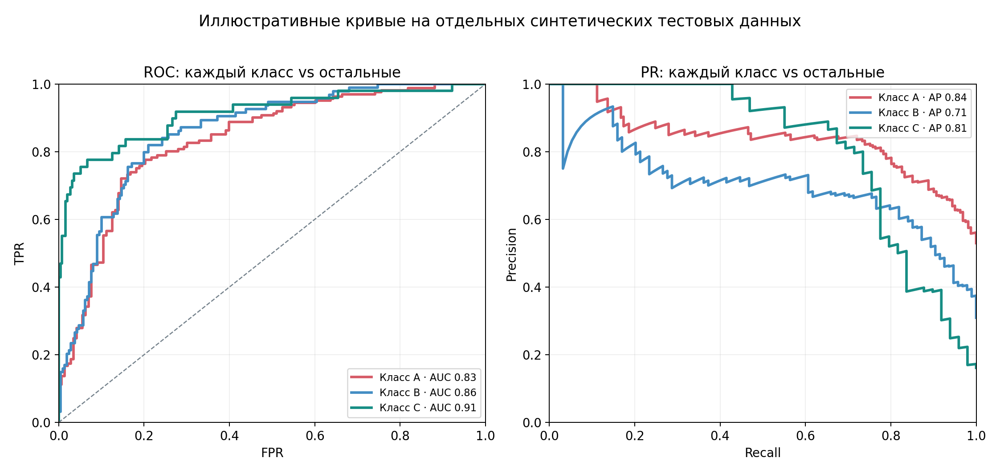

*Рисунок 26. Для каждого класса отдельно рассматриваются его истинные метки против остальных и соответствующие модельные вероятности. Из этих бинарных постановок получают собственные ROC- и PR-кривые.*

### 13.2. Альтернатива One-vs-One

В схеме **One-vs-One (OvO)** рассматривают попарные различения классов: A против B, A против C и B против C. В конкретной паре объекты третьего класса исключаются из оценивания. Для такой пары можно сравнить ранжирование двух классов по их модельным оценкам, а затем объединить попарные результаты в общую оценку. В частности, применяют симметричное усреднение двух направлений пары.

Здесь **не требуется переобучать** модель для каждой пары: OvO относится именно к способу вычисления multiclass ROC-AUC по выходам уже обученного классификатора. OvR и OvO оценивают разные совокупности бинарных сравнений, поэтому итоговые значения могут отличаться.

Для первоначального анализа обычно достаточно OvR: он позволяет получить показатель для каждого класса относительно остальных и сопоставить его с per-class диагностикой из предыдущего раздела.

### 13.3. PR-кривые для нескольких классов

Для каждого класса можно точно так же построить **PR-кривую**: берём его вероятности, рассматриваем остальные классы как отрицательные и изменяем порог. Получаются per-class зависимости precision от recall. Их удобно анализировать отдельно, особенно для редких категорий.

Для численного обобщения могут использовать Average Precision (AP) по каждому классу и macro- или weighted-усреднение этих значений. Смысл AP соответствует изученному для бинарной классификации; при переходе к multiclass меняется прежде всего организация бинарных постановок и агрегирования результатов.

Например, может оказаться, что общий macro ROC-AUC достаточно высок, но PR-показатели редкого класса невелики. Поэтому полезно рассматривать качество ранжирования совместно с распространённостью класса и прикладной целью.

В scikit-learn multiclass `roc_auc_score` принимает матрицу вероятностей по классам, нормированных в каждой строке до суммы 1, и параметр `multi_class='ovr'` либо `'ovo'` выбирает одну из только что рассмотренных схем вычисления. Это **реализация тех же математических определений**, а не другой показатель.

### Итак

- Для multiclass ROC и PR обычно строят бинарные кривые отдельно для каждого класса.
- OvR сравнивает класс с объединением остальных; OvO — пары классов.
- Усреднение классовых AUC/AP даёт общий показатель, но кривые редких классов полезно изучать отдельно.
- Эти оценки относятся к ранжированию по числовым выходам модели и дополняют анализ жёстких меток.

## 14. Многометочная классификация: один объект, несколько меток

Во всех предыдущих многоклассовых примерах у обращения был **один** основной отдел. Но не всякую задачу можно свести к выбору единственного ответа. Например, одному фильму могут одновременно подходить теги «драма», «детектив» и «исторический». Научная статья может относиться сразу к статистике и экономике.

Такая постановка называется **многометочной классификацией** (*multilabel classification*). При $K$ возможных метках правильный ответ — бинарный вектор:

```math
\boxed{Y=(Y_1,\ldots,Y_K)\in\lbrace 0,1\rbrace ^{K}.}
```

Например, $(1,1,0)$ означает, что первые две метки присутствуют, а третья — нет. Возможен и ответ $(0,0,0)$: объекту не подходит ни одна из предусмотренных меток.

### 14.1. Как получить несколько меток

Простейшая стратегия — обучить **по одному бинарному классификатору на каждую метку**. Каждая модель оценивает вероятность наличия соответствующей метки, например

```math
q_c(x)=\sigma(w_c^\top x+b_c).
```

В отличие от multinomial logistic regression эти значения **не должны суммироваться в единицу**. Если у фильма высокие вероятности и «драмы», и «детектива», противоречия нет: оба тега могут быть верны одновременно.

Из вероятностей нужно получить набор меток. Например, при пороге $0.5$:

```math
\boxed{\hat y_c(x)=\mathbb I(q_c(x)\geq0.5).}
```

Пусть выходы трёх бинарных моделей равны $(0.85,0.70,0.15)$. Тогда при этом пороге прогноз — $(1,1,0)$. В задачах с разной ценой ошибок пороги могут подбираться отдельно для каждой метки.

Такой подход называют *binary relevance*. Он прост, но в самостоятельных бинарных задачах не использует возможные зависимости между метками — например, что «исторический» и «драма» нередко встречаются вместе.

Существуют и подходы, учитывающие связь между метками. Например, **classifier chains** обучают последовательность бинарных моделей: последующие модели используют информацию о ранее определённых метках. Другой вариант, **label powerset**, рассматривает каждую встретившуюся комбинацию меток как отдельный класс. Этот подход сводит задачу к многоклассовой, но число возможных комбинаций может быстро расти.

В scikit-learn `OneVsRestClassifier` поддерживает и multiclass, и multilabel. При multilabel он обучает отдельную бинарную модель для каждой метки и возвращает её собственную вероятность присутствия метки, **не нормируя все метки к общей сумме 1**.

### 14.2. Особенности оценивания

Precision, recall и F1 можно считать по каждой метке и усреднять по меткам или по всем бинарным решениям. Но у multilabel есть и специфический вопрос: **совпадает ли весь предсказанный набор меток с истинным набором?**

При *exact match*, или *subset accuracy*, объект считается классифицированным правильно только тогда, когда совпадают **все** метки. Например, прогноз $(1,0,0)$ при правильном $(1,1,0)$ не засчитывается как полностью верный, хотя две из трёх координат совпали. Это значительно более строгое условие, чем правильность отдельной бинарной метки.

Таким образом, multiclass и multilabel различаются не только форматом ответа: для них различаются естественные модели вероятностей, правила принятия решений и некоторые способы оценивания. Дальше сосредоточимся на ещё одной общей практической проблеме — представлении входных признаков.

## 15. Категориальные признаки: как превратить категории в осмысленное числовое представление

До сих пор мы предполагали, что каждый объект описывается вектором числовых признаков $x=(x_1,\ldots,x_p)$. Но реальные табличные данные устроены сложнее.

Например, при классификации обращений в поддержку у нас могут быть числовые признаки — длина текста, время обращения — и категориальные признаки: канал связи и тип устройства.

Чтобы использовать такие данные в линейной модели или вычислять расстояния между объектами, потребуется определить их числовое представление. При этом важно не просто получить числа, а сохранить смысл исходных признаков.

### 15.1. Числовое обозначение не делает категорию количественной

Предположим, что номинальный признак `channel` (канал обращения) принимает три значения:

```math
\lbrace \text{Chat},\text{Email},\text{Phone}\rbrace .
```

Можно заменить названия числами:

| Канал | Код |
|---|---:|
| Chat | 0 |
| Email | 1 |
| Phone | 2 |

Но теперь обычная евклидова метрика будет считать, что

```math
d(\text{Chat},\text{Email})=1,
```

```math
d(\text{Email},\text{Phone})=1,
```

```math
d(\text{Chat},\text{Phone})=2.
```

Получается, что первый и третий каналы якобы вдвое дальше друг от друга, чем соседние по кодировке категории. Однако мы не задавали никакого такого отношения. Числа 0, 1 и 2 служили лишь условными обозначениями.

Мы уже встречались с подобной проблемой при обсуждении категориальной целевой переменной в логистической регрессии. Теперь она возникает не в ответе, а в признаках.

Следует различать два случая.

**Номинальный категориальный признак** не имеет естественного порядка. Например, тип документа, регион или канал связи.

**Порядковый категориальный признак** имеет содержательный порядок: например, низкий, средний и высокий уровень риска.

Но даже наличие порядка ещё не означает, что расстояния между категориями количественно осмысленны. Если кодировать уровни риска числами 0, 1 и 2, то разность между 0 и 1 не обязательно имеет тот же смысл, что разность между 1 и 2.

Сопоставление категорий с целыми номерами часто называют **label encoding**. Оно вполне уместно для **меток целевой переменной** $y$: классификатор может предсказывать класс с номером 0, 1 или 2, не используя расстояния между номерами классов. Но если такие номера подставляются в **числовые признаки $X$**, то kNN начинает воспринимать их разности как расстояния. Для номинальных признаков один из стандартных способов избежать навязанной числовой шкалы — *one-hot encoding*.

### 15.2. One-hot encoding

Вместо одного числового кода создадим отдельный индикатор для каждой категории.

Для нашего примера:

| Канал | Chat | Email | Phone |
|---|---:|---:|---:|
| Chat | 1 | 0 | 0 |
| Email | 0 | 1 | 0 |
| Phone | 0 | 0 | 1 |

Каждая строка содержит единицу в позиции соответствующей категории и нули в остальных.

Формально, если признак $f(x)$ принимает значения из множества $U=\lbrace u_1,\ldots,u_m\rbrace $, то введём $m$ новых индикаторных признаков:

```math
\boxed{g_j(x)=\mathbb I(f(x)=u_j),\qquad j=1,\ldots,m.}
```

Это и есть **one-hot encoding**.

В эконометрике подобные индикаторные переменные обычно называют *dummy variables*.

Главное преимущество такого представления в том, что мы больше не навязываем номинальным категориям искусственный линейный порядок. Однако геометрия пространства признаков всё равно зависит от выбранного кодирования.

### 15.3. Геометрия полного one-hot

Представим три категории:

```math
A=(1,0,0),\qquad B=(0,1,0),\qquad C=(0,0,1).
```

Вычислим евклидовы расстояния. Между A и B:

```math
d(A,B)=\sqrt{(1-0)^2+(0-1)^2+(0-0)^2}=\sqrt2.
```

Аналогично

```math
d(A,C)=\sqrt2,\qquad d(B,C)=\sqrt2.
```

Следовательно,

```math
\boxed{d(A,B)=d(A,C)=d(B,C)=\sqrt2.}
```

Все разные категории оказались равноудалёнными.

Это не означает, что мы нашли единственно правильную геометрию номинального признака. Некоторые реальные категории могут быть содержательно ближе друг к другу, чем другие.

Но в отсутствие дополнительной информации равное расстояние между различными категориями часто является более оправданным исходным предположением, чем произвольные расстояния 1 и 2, возникающие из числовых кодов.

Для kNN это имеет прямое значение: выбор представления определяет, какие обучающие объекты считаются близкими.

### 15.4. Dummy trap и удаление базовой категории

Здесь возникает интересная связь с линейной регрессией.

Во второй неделе мы обсуждали мультиколлинеарность и ситуации, когда столбцы матрицы признаков линейно зависимы.

Если один категориальный признак закодирован полным набором dummy-переменных и модель содержит свободный член, возникает точная линейная зависимость.

Действительно, для каждого объекта

```math
g_A(x)+g_B(x)+g_C(x)=1.
```

Сумма трёх индикаторных столбцов равна столбцу единиц, соответствующему свободному члену. Поэтому в обычной линейной регрессии с intercept такой набор столбцов линейно зависим.

Классический способ устранить эту зависимость — удалить одну базовую категорию.

Например, если в качестве базовой выбрана A, получаем:

| Категория | B | C |
|---|---:|---:|
| A | 0 | 0 |
| B | 1 | 0 |
| C | 0 | 1 |

Для обычной линейной модели со свободным членом и без регуляризации это меняет параметризацию, но не множество представимых прогнозов: коэффициенты остальных категорий можно интерпретировать относительно базовой.

Однако посмотрим, что произошло с геометрией. Теперь

```math
A=(0,0),\qquad B=(1,0),\qquad C=(0,1).
```

Следовательно,

```math
d(A,B)=1,\qquad d(A,C)=1,\qquad d(B,C)=\sqrt2.
```

Получается:

```math
\boxed{d(A,B)=d(A,C)\lt d(B,C).}
```

Категории перестали быть равноудалёнными.

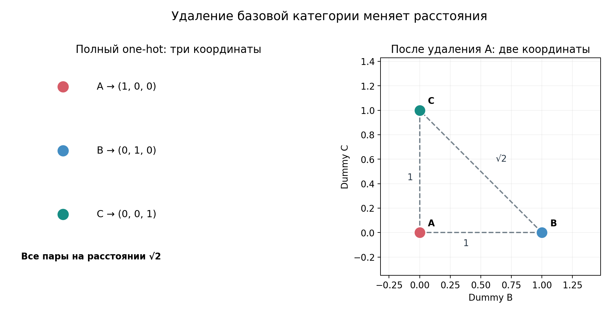

*Рисунок 27. Полный one-hot для трёх категорий и представление после удаления базовой. Справа расстояния до категории A равны 1, между B и C — $`\sqrt2`$. Это не просто косметическая смена координат для kNN.*

При полном one-hot все три категории находились на одинаковом расстоянии друг от друга. После удаления базовой категории расстояния от A до остальных стали меньше, чем расстояние между B и C.

**Для kNN это не просто изменение записи признаков — это изменение самой геометрии задачи.** Следовательно, ближайшие соседи и прогнозы могут измениться.

Этот пример показывает важное различие между семействами моделей.

В линейной регрессии удаление базовой dummy при определённых условиях позволяет сохранить множество возможных прогнозов, избавившись от точной линейной зависимости столбцов.

В kNN удаление одной категории может изменить расстояния и, соответственно, правило прогнозирования.

Более того, даже для регуляризованных линейных моделей удаление одной категории не всегда нейтрально: разные параметризации могут взаимодействовать с ограничениями на коэффициенты по-разному.

Следовательно, выбор полного или сокращённого dummy-представления должен учитывать свойства выбранной модели; универсальное правило для всех алгоритмов здесь не подходит.

### 15.5. Числовые и категориальные признаки в одной таблице

Реальный объект может одновременно иметь числовые и категориальные признаки. Например, обращение в службу поддержки характеризуется длиной сообщения, числом предыдущих обращений, каналом связи и типом устройства. Для kNN нужен единый способ измерять различия между такими объектами.

Распространённый базовый подход — **при необходимости масштабировать числовые столбцы**, **закодировать номинальные категории через one-hot**, а затем объединить полученные признаки. Обучаемые преобразования настраивают только на соответствующей обучающей части данных. В scikit-learn для этого удобно использовать `ColumnTransformer` и `Pipeline`.

Но одинаковый способ записи столбцов не делает их вклады в расстояние равнозначными. Рассмотрим всего два исходных признака: стандартизованное числовое измерение $z$ и категорию канала связи. Пусть для каналов Chat, Email и Phone используется полный one-hot:

| Объект | $z$ | Канал | One-hot канала |
|---|---:|---|---|
| A | 0 | Chat | $(1,0,0)$ |
| B | 1 | Email | $(0,1,0)$ |
| C | 2 | Chat | $(1,0,0)$ |

Для объектов A и B квадрат евклидова расстояния по **всем закодированным признакам** равен

```math
\begin{aligned}
d_{\text{num}}^2(A,B)
&= (0-1)^2 = 1,\\[6pt]
d_{\text{cat}}^2(A,B)
&= (1-0)^2+(0-1)^2+(0-0)^2 = 2,\\[6pt]
d^2(A,B)
&= d_{\text{num}}^2(A,B)+d_{\text{cat}}^2(A,B)\\[0pt]
&= 1+2=3.
\end{aligned}
```

Для A и C категория совпадает, но числовое измерение отличается на две стандартизованные единицы:

```math
\boxed{d^2(A,C)=(0-2)^2+0=4.}
```

В результате B оказывается ближе к A, хотя у них **разные каналы связи**, а C — тот же канал. Это не ошибка алгоритма: такой выбор непосредственно следует из принятого представления и евклидовой метрики. Если добавить несколько отдельных категориальных полей, их несовпадения будут накапливаться в общей сумме квадратов.

Для работы со смешанными данными существуют и другие меры различия. Например, **расстояние Гауэра (Gower)** объединяет сравнение числовых величин, приведённых к сопоставимому диапазону, и категориальных несовпадений. Его преимущество — явный учёт различной природы признаков, хотя выбор весов и масштабирования всё равно остаётся содержательной задачей.

На практике разумно начать с простого воспроизводимого преобразования, проверить, какие признаки вносят наибольший вклад в расстояния, и сравнить качество нескольких осмысленных вариантов в кросс-валидации. Хорошее кодирование — не самостоятельная гарантия, что выбранная мера близости подходит для прогнозирования целевой переменной.

### 15.6. Новые категории

Представим, что на обучающей выборке признак `channel` принимал три известных значения: Chat, Email и Phone. Но при использовании модели появился новый канал, например Messenger, которого в обучающих данных не было.

Если кодировщик строил столбцы только для известных категорий, как представить новую?

Одна из возможных стратегий — кодировать неизвестную категорию нулевым вектором соответствующего блока.

Именно такое поведение может использовать `OneHotEncoder` в scikit-learn при настройке

```python
OneHotEncoder(handle_unknown="ignore")
```

Если полный one-hot содержит три столбца, неизвестная категория будет представлена как

```math
(0,0,0).
```

Это позволяет применить преобразование к новому объекту без ошибки. Но важно правильно интерпретировать результат.

Нулевой вектор не означает, что неизвестная категория действительно похожа на какую-то конкретную известную категорию. Это техническое соглашение о её представлении.

При обычном полном one-hot неизвестная категория окажется на расстоянии 1 от каждой известной категории, тогда как две разные известные категории находятся на расстоянии $\sqrt2$.

Если одновременно удалить базовую категорию, ситуация станет ещё сложнее: неизвестная категория может получить тот же нулевой вектор, что и известная базовая.

Поэтому обработка неизвестных категорий не сводится исключительно к предотвращению ошибки выполнения кода. Способ представления новой категории влияет на расстояния и прогноз. Его следует выбирать в соответствии с тем, какие неизвестные значения ожидаются в эксплуатации: для одних задач достаточно схемы `ignore`, для других полезно заранее объединять редкие категории в отдельную группу «другие».

### 15.7. Пропуски, редкие категории и высокая кардинальность

Кроме неизвестных категорий, реальные таблицы содержат пропущенные значения. Например, для некоторых обращений может отсутствовать информация о типе устройства или времени ответа.

Такой пропуск не обязательно равен новой неизвестной категории. Он может означать, что значение не было измерено, не было записано или отсутствует по другой причине.

Для числовых признаков распространены стратегии заполнения пропусков средним или медианой, рассчитанными по обучающей выборке.

Для категориальных признаков можно использовать наиболее частое значение, отдельную категорию пропуска или другой обоснованный подход.

Ещё одна трудность возникает, когда категориальный признак имеет очень большое число уникальных значений. Например, идентификатор товара или код населённого пункта.

Полное one-hot в таком случае может создавать множество индикаторных столбцов. Многие из них будут редко принимать значение 1. Это увеличивает размерность представления и может затруднять работу некоторых моделей.

Существуют специальные методы для редких категорий, хеширование, кодирование на основе статистик целевой переменной и другие подходы.

Подробно рассматривать их сейчас не будем. В дальнейшем, при изучении CatBoost, мы вернёмся к более сложным методам работы с категориальными признаками, включая статистики ответов и способы избегать утечек при их вычислении.

В качестве отправной точки для работы со смешанными таблицами разумно использовать раздельную подготовку числовых и категориальных столбцов с последующим объединением преобразованных признаков.

### Итак

- Номинальная категория не становится количественной только потому, что ей присвоили целый номер.
- Полный one-hot даёт равные евклидовы расстояния между различными известными категориями, но не гарантирует оптимального представления для любой задачи.
- Удаление базовой dummy меняет геометрию расстояний и может изменить прогнозы kNN.
- Новые категории, пропуски и редкие значения требуют обоснованных правил обработки.

---

## Таким образом

- **kNN** предсказывает ответ по ближайшим обучающим объектам: в классификации агрегирует голоса классов, в регрессии — числовые значения. Его прогноз зависит от определения расстояния, масштаба признаков, числа соседей и правила их взвешивания.
- **Высокая размерность** осложняет локальное оценивание: для достаточного числа близких наблюдений может потребоваться намного больше данных, а шумовые признаки способны изменить порядок соседей.
- **Многоклассовые линейные модели** можно построить через независимые бинарные задачи OvR или через совместную multinomial logistic regression. Во втором случае все классовые scores преобразуются softmax и все параметры определяются минимизацией единой cross-entropy.
- **Качество классификации** следует изучать по классам и в агрегированном виде. Macro, weighted и micro учитывают результаты по-разному; ROC-AUC и PR/AP описывают качество ранжирования по модельным оценкам.
- **Multilabel** допускает несколько меток для одного объекта, а **категориальные признаки** требуют осмысленного числового представления. Выбор кодирования может менять геометрию данных и поведение моделей, основанных на расстояниях.

---

## Вопросы для самопроверки

1. Чем локальное правило 1NN отличается от глобального линейного классификатора? Что показывают ячейки диаграммы Вороного?
2. Как прочитать формулу голосования kNN через множество $\mathcal N_k(x)$ и индикаторы $\mathbb I(y_i=c)$?
3. Почему долю голосов соседей можно использовать как оценку вероятности класса, но нельзя автоматически считать хорошо откалиброванной?
4. Что измеряют нормы $L_1$, $L_2$ и $L_\infty$? Приведите пример, где смена расстояния меняет ближайшего соседа.
5. Чем функция сходства отличается от расстояния? Как работает косинусное сходство и почему оно полезно для векторных представлений текстов?
6. Почему масштабирование меняет соседей kNN? В чём различие между StandardScaler и MinMaxScaler?
7. Как работает взвешенное голосование? Может ли победить класс с меньшим числом соседей?
8. Как увеличение $k$ влияет на гибкость и сглаживание? Что произойдёт при $k=n$ и равных весах?
9. Как выбирают число соседей по кросс-валидации? Почему train accuracy недостаточна?
10. Какие два требования к соседству вступают в конфликт при высокой размерности? Откуда в равномерном примере появляется формула $nr^p$?
11. Как шумовые признаки могут изменить состав ближайших соседей, даже если их значения не связаны с целевой переменной?
12. Как из kNN-классификации получается kNN-регрессия? Почему в одномерной регрессии с равными весами возможны скачки прогноза?
13. Почему стоимость полного перебора соседей растёт вместе с числом наблюдений? Чем центроидный классификатор отличается от kNN?
14. Как формулируется multiclass-классификация? Почему kNN легко работает с $K$ классами?
15. Как стратегия OvR строит многоклассовую модель из бинарных? Почему её сигмоидные оценки не обязаны суммироваться в единицу?
16. Зачем в multinomial logistic regression по одной линейной оценке на каждый класс? Какую роль играет матрица $W$?
17. Вычислите softmax для вектора $(2,1,0)$. Почему вероятности всегда суммируются в единицу?
18. Объясните, как бинарная сигмоида получается из softmax для двух классов.
19. Что означает формула $L_i=-\log p_{y_i}(x_i)$ и как из неё получается общий эмпирический риск?
20. Почему изменение коэффициентов класса A влияет на значение loss даже для объекта истинного класса B? Чем совместное обучение отличается от OvR?
21. Как при обучении multinomial logistic regression используют численную оптимизацию? Какую роль может играть регуляризация?
22. Как читается многоклассовая confusion matrix и как выделить $TP$, $FP$, $FN$ для выбранного класса?
23. Как вычисляются macro-F1 и weighted-F1? Какую роль играет support?
24. Докажите, что при однозначной multiclass-классификации по всем классам micro-precision, micro-recall и micro-F1 равны accuracy.
25. Какой показатель важнее для обнаружения редкой, но критически важной категории: общая accuracy или recall этой категории? Обоснуйте ответ.
26. Как устроены OvR и OvO при вычислении multiclass ROC-AUC? Требуется ли обучать заново модель для каждого сравнения?
27. Как получать PR-кривые и AP по каждому классу из вероятностных выходов модели?
28. Чем multilabel отличается от multiclass? Как отдельные бинарные вероятности превращаются в набор меток?
29. Почему exact match accuracy в multilabel может быть существенно строже метрик отдельных меток?
30. Чем label encoding целевой переменной отличается от числового кодирования номинального входного признака?
31. Как полный one-hot меняет расстояния между категориями? Почему удаление базовой dummy может быть существенным для kNN?
32. Что происходит с неизвестной категорией при `handle_unknown="ignore"`? Как влияет это соглашение на расстояния?
33. Почему one-hot и StandardScaler не гарантируют, что вклад категориальных и числовых признаков в kNN будет содержательно оптимален?

---

## Дополнительное чтение

- **James G., Witten D., Hastie T., Tibshirani R., Taylor J. — *An Introduction to Statistical Learning with Applications in Python*.** §2.2.3 — kNN-классификация, §3.5 — kNN-регрессия, глава 4 — классификация и вероятностные модели. [Официальный сайт](https://www.statlearning.com/).
- **А. Г. Дьяконов — «Машинное обучение и анализ данных».** [Глава о метрических методах](https://github.com/Dyakonov/MLDM_BOOK/blob/main/book_021_kNN_202413.pdf) и [глава о многоклассовой классификации](https://github.com/Dyakonov/MLDM_BOOK/blob/main/book_075_multiclass_202408.pdf). Русскоязычные материалы о метрических алгоритмах и оценке многоклассовой классификации.
- **Scikit-learn — [Multiclass and Multioutput](https://scikit-learn.org/stable/modules/multiclass.html).** Описание OvR и разных способов представления многоклассовых и многометочных ответов; полезно сопоставить с разделами 9 и 14.
- **Scikit-learn — [Metrics and Scoring](https://scikit-learn.org/stable/modules/model_evaluation.html).** Определения способов усреднения precision/recall/F1 и вариантов multiclass ROC-AUC; особенно полезно при самостоятельной диагностике моделей.
- **Scikit-learn MOOC — [Using Numerical and Categorical Variables Together](https://inria.github.io/scikit-learn-mooc/python_scripts/03_categorical_pipeline_column_transformer.html).** Раздел о смешанных числовых и категориальных данных и использовании `ColumnTransformer`.
- **mlcourse.ai — [Decision Trees and kNN](https://mlcourse.ai/book/topic03/topic03_decision_trees_kNN.html).** Прикладные эксперименты с kNN и влиянием нерелевантных координат на его качество; дополняют геометрическую картину раздела 5.
