# Решающие деревья: от правил разбиения к обучаемой модели

В линейной регрессии мы заранее задавали вид функции прогноза, а затем находили её коэффициенты. В методе ближайших соседей (kNN) прогноз нового объекта определялся ответами похожих обучающих наблюдений. Решающее дерево (*decision tree*) использует ещё один способ: оно последовательно проверяет условия по признакам объекта и в зависимости от результатов направляет его к одному из простых прогнозов.

Такие условия нетрудно сформулировать вручную: например, для прогнозирования покупки можно сначала проверить активность пользователя, а затем — его историю заказов. Но вручную придуманные правила ещё не составляют алгоритм машинного обучения. Нужно научиться **выбирать сами условия по данным**: какие признаки проверять, где устанавливать пороги, в каком порядке выполнять проверки и когда прекратить добавлять новые.

Сначала разберём уже обученное дерево и проследим, как оно получает прогноз. Затем рассмотрим общий принцип его построения: от одного узла до целой системы разбиений. На этом этапе важнее понять последовательность действий, чем запомнить формулы. Позднее мы подробно определим, как оценивать разбиения, и покажем работу алгоритма на задачах регрессии и классификации.

## 1. Как устроено дерево и как оно предсказывает

### 1.1. От одного условия к дереву

Пусть объект описывается двумя числовыми признаками, $x=(x_1,x_2)$, а целевая переменная принимает значения $y\in\lbrace 0,1\rbrace $. Представим, что на обучающих данных уже построено следующее правило:

1. Если $x_1\le 2.5$, выдать прогноз $0$.
2. В противном случае проверить $x_2$. Если $x_2\le1.5$, выдать прогноз $0$; иначе — $1$.

Правило изображено на рисунке 1. В верхней вершине расположен **корень** (*root*). Вершины, в которых проверяется условие и выбирается дальнейший путь, называются **внутренними узлами** (*internal nodes*). Конечные вершины называются **листьями** (*leaves*): в них записаны прогнозы. От каждого внутреннего узла показанного **бинарного дерева** отходят две ветви — для выполненного и невыполненного условия.

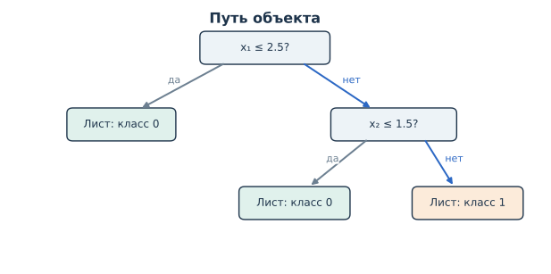

*Рисунок 1. Путь объекта $`x=(3.4,2.2)`$ по готовому дереву. Синим выделены ветви, по которым проходит этот объект.*

У объекта $x=(3.4,2.2)$ первая проверка даёт ответ «нет», поскольку $3.4>2.5$. Во втором узле проверка $2.2\le1.5$ тоже даёт ответ «нет». Поэтому объект попадает в правый нижний лист, и дерево предсказывает класс $1$. Для объекта $x=(1,3)$ прогноз можно получить после первой проверки: $1\le2.5$, следовательно, мы сразу переходим в левый лист с классом $0$.

**Предикат** — функция, которая каждому объекту ставит в соответствие логическое значение: *истина* или *ложь*. Например, проверка «$x_1\le2.5$» является предикатом. В деревьях с числовыми признаками особенно распространены **пороговые предикаты**: они сравнивают значение одного признака с выбранным порогом $t$.

Обозначим такой предикат через $P_{j,t}$: условие $P_{j,t}(x)$ истинно, когда $x_j\le t$. Если нужно записать результат проверки числом, используется **индикатор** $I[\,\cdot\,]$:

```math
I[P_{j,t}(x)]=I[x_j\le t]=
\begin{cases}
1,&x_j\le t,\\[0pt]
0,&x_j>t.
\end{cases}
\qquad\text{(1)}
```

Здесь **предикат** — само логическое условие, а **индикатор** — его запись через ноль и единицу. В дальнейшем будем считать, что при выполнении порогового условия объект идёт влево, иначе — вправо. Это лишь соглашение о направлении ветвей.

Дерево может повторно использовать один и тот же признак: например, сначала проверить $x_1\le5$, а внутри полученной группы — $x_1\le3$. При этом на разных ветвях могут встречаться разные признаки. **Глубиной узла** называют число рёбер от корня до него; у корня глубина нулевая. Глубина дерева — наибольшая глубина его листьев.

### 1.2. Откуда берётся прогноз в листе

В примере на рисунке 1 каждый лист содержит только номер класса. Во время обучения для каждого листа вычисляют сводные сведения о **наблюдениях, попавших в него**, например число объектов каждого класса. В обученной модели достаточно сохранить эти счётчики или полученные по ним прогнозы; сами строки обучающей таблицы хранить необязательно.

Предположим, в некоторый лист попали десять объектов обучающей выборки: три с классом $0$ и семь с классом $1$. Для нового объекта, который дойдёт до этого листа, дерево может выдать класс большинства, то есть $1$. А оценки вероятностей классов внутри листа составят

```math
\hat p_0=\frac3{10}=0.3,\qquad
\hat p_1=\frac7{10}=0.7.
\qquad\text{(2)}
```


*Рисунок 2. Отдельный пример листа с десятью обучающими объектами. Обычный классификационный прогноз — класс большинства; вероятностный прогноз использует доли классов в этом же листе.*

Знакомые методы `predict` и `predict_proba` используются здесь так же, как и в других классификаторах: `predict` возвращает метку класса, а `predict_proba` — оценки вероятностей, например $(0.3,0.7)$ в порядке классов $(0,1)$. **Частоты рассчитываются по объектам данного листа, а не по всему дереву.** Новый объект не участвует в их подсчёте: его признаки нужны только для выбора пути. Истинный класс нового объекта при этом неизвестен.

Такие доли — понятные оценки, но с ними нужно быть осторожными. Если лист содержит всего два обучающих объекта одного класса, дерево может вернуть вероятность $1$, хотя это ещё не означает полной уверенности в правильности прогноза на новых данных. Маленькие листья дают менее устойчивые оценки.

В **регрессионном дереве** лист хранит числовой прогноз. Например, если мы измеряем ошибку квадратом отклонения, оптимальной постоянной величиной для листа будет среднее целевых значений попавших в него обучающих объектов — результат, уже знакомый по МНК. Различаются ответы в листьях, но путь объекта по внутренним узлам устроен точно так же.

Пока мы обсуждали **применение готового дерева**. Оно не подбирает новые условия каждый раз, когда поступает объект: признаки проверяются по уже сохранённой структуре. Обучение, на котором эта структура появляется, — отдельная процедура.

### 1.3. Дерево делит пространство признаков на области

Один и тот же набор условий можно изобразить двумя способами: как дерево с ветвями или как разбиение пространства признаков. Для дерева с рисунка 1 получаются три области:

```math
\begin{aligned}
R_1&=\lbrace x:x_1\le2.5\rbrace ,\\[0pt]
R_2&=\lbrace x:x_1>2.5,\;x_2\le1.5\rbrace ,\\[0pt]
R_3&=\lbrace x:x_1>2.5,\;x_2>1.5\rbrace .
\end{aligned}
\qquad\text{(3)}
```

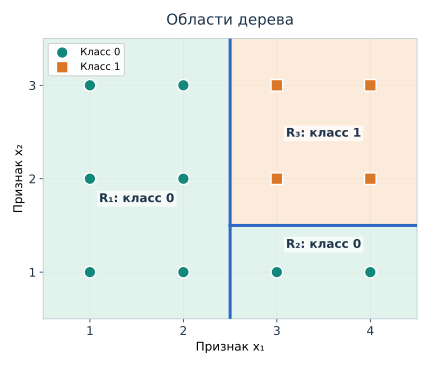

*Рисунок 3. Вертикальная граница соответствует первой проверке $`x_1\le2.5`$. Горизонтальная появляется только справа от неё: условие по $`x_2`$ выполняется лишь в правой ветви. В каждом из трёх регионов прогноз постоянен.*

Каждый объект попадает ровно в одну область. Пороговая проверка одного числового признака создаёт осевую границу; последовательность таких проверок формирует прямоугольные области, иногда неограниченные. Два разных листа могут выдавать один и тот же класс: у нас и $R_1$, и $R_2$ дают прогноз $0$, но соответствуют разным путям по дереву.

Если листу с номером $m$ сопоставлен прогноз $c_m$, можно записать функцию дерева одной формулой:

```math
\hat f_T(x)=\sum_{m=1}^{M}c_m I[x\in R_m].
\qquad\text{(4)}
```

Для конкретного $x$ ровно один индикатор равен единице, а остальные — нулю. Поэтому сумма просто выбирает прогноз нужного листа. В регрессии $c_m$ — число, в классификации это может быть метка класса. Для вероятностной классификации аналогично можно выбирать вектор долей классов, записанный в листе.

Такое представление называют **кусочно-постоянной функцией**: значение прогноза фиксировано внутри каждой области, но может изменяться при переходе через её границу. В одномерной регрессии эту структуру особенно легко увидеть как ступенчатый график.

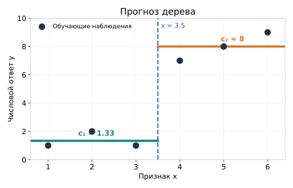

*Рисунок 4. Порог $`x=3.5`$ создаёт два интервала. В левом дерево выдаёт примерно $`1.33`$, в правом — $`8`$. Точки показывают обучающие наблюдения; горизонтальные отрезки — прогноз модели.*

Получается единая картина. **Структура дерева** показывает последовательность проверок; **геометрия** показывает, на какие области эти проверки делят пространство; **значения в листьях** определяют прогноз в каждой области. Теперь остаётся понять, как все три части возникают из обучающей выборки.

### Итак

- Готовое дерево направляет объект от корня к листу, проверяя сохранённые логические условия.
- В классификационном листе могут храниться доли классов, в регрессионном — постоянный числовой прогноз.
- Каждому листу соответствует область пространства признаков; внутри неё дерево выдаёт один и тот же прогноз.
- Во время предсказания дерево не подбирает условия заново: оно применяет структуру, созданную при обучении.

## 2. Как строится дерево: общая схема обучения

### 2.1. Начинаем с одного листа

Пусть имеется обучающая выборка

```math
D=\lbrace (x_i,y_i)\rbrace _{i=1}^{n},
\qquad\text{(5)}
```

где $x_i$ — признаки $i$-го объекта, а $y_i$ — известный правильный ответ. Пока рассмотрим бинарную классификацию с числовыми признаками. В самом начале **все обучающие объекты находятся в корне**. Можно считать его единственным листом, который выдаёт всем один базовый прогноз — наиболее распространённый класс.

Например, на рисунке 5 показаны двенадцать точек, описанных двумя признаками. Восемь точек принадлежат классу $0$, четыре — классу $1$.

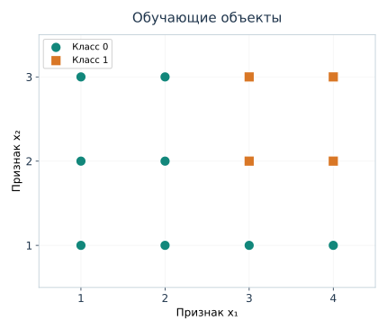

*Рисунок 5. Каждый маркер — обучающий объект с признаками $`(x_1,x_2)`$ и известной меткой класса. До обучения разбиений нет.*

Одно-листовое дерево предсказывало бы класс $0$ для любого объекта. Оно использует информацию о том, сколько представителей каждого класса есть в выборке, но пока никак не учитывает различия между значениями признаков.

Можно ли улучшить такую модель? Для этого попробуем заменить один лист **внутренним узлом с условием** и создать два дочерних узла. Объекты, для которых условие истинно, попадут влево; остальные — вправо. Если полученные группы заметно различаются по составу ответов, в них можно будет назначить более подходящие прогнозы.

Но как выбрать условие? В данных может быть много признаков, а для каждого числового признака — много возможных порогов. Значит, алгоритму предстоит решить задачу поиска разбиения.

### 2.2. Сравниваем возможные разбиения

Для одного разбиения нужно выбрать **признак** $x_j$ и **порог** $t$. Их пара $(j,t)$ определяет, какие объекты окажутся в левом и правом дочерних узлах. Такую пару будем называть кандидатом на разбиение.

На рисунке 6 показаны два кандидата для одних и тех же двенадцати объектов. Первый разделяет данные по $x_1$, второй — по $x_2$.

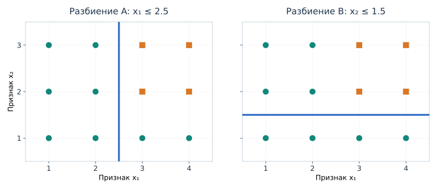

*Рисунок 6. В обоих случаях одна из групп оказывается целиком состоящей из класса $`0`$. Но размеры групп и состав оставшихся объектов различаются. Чтобы выбрать между кандидатами, понадобится общий количественный критерий.*

При условии $x_1\le2.5$ слева окажутся шесть объектов класса $0$; справа — два объекта класса $0$ и четыре объекта класса $1$. Если вместо этого выбрать $x_2\le1.5$, снизу окажутся четыре нуля, а сверху — четыре нуля и четыре единицы.

Мы видим, что разбиение влияет на **состав дочерних групп**. Хорошее разбиение должно помогать делать более точные прогнозы внутри этих групп. В классификации обычно удобно искать группы, в которых один класс преобладает над другими; в регрессии — группы, внутри которых числовые ответы меньше различаются. Важны и размеры групп: однородность двух объектов и однородность двухсот объектов нельзя бездумно считать равноценными при оценке улучшения всей выборки.

Пока этой интуиции недостаточно, чтобы строго сравнить кандидатов A и B. Для алгоритма нужна **численная мера качества разбиения**. Она позволит перебрать допустимые варианты и выбрать тот, который лучше по заранее определённому правилу. Мы получим такую меру из известных функций потерь в следующих разделах. Здесь важно увидеть саму задачу: алгоритм должен принять решение не «какой класс ответить», а **«по какому признаку и порогу разделить данные»**.

### 2.3. После разбиения задача повторяется

Представим, что после сравнения кандидатов для корня было выбрано условие $x_1\le2.5$. Пока зафиксируем этот выбор; численное обоснование появится, когда мы введём критерий разбиения.

В левый дочерний узел попали шесть объектов класса $0$. Для них можно сразу записать лист с прогнозом $0$. Правый узел содержит шесть объектов: два нуля и четыре единицы. Здесь имеет смысл снова попробовать разделить данные. Однако **теперь мы рассматриваем только шесть объектов правого узла**, а не все двенадцать наблюдений первоначальной выборки.

Для этой группы можно выбрать условие $x_2\le1.5$. Тогда слева будут два объекта класса $0$, а справа — четыре объекта класса $1$. В данном маленьком примере мы получили три однородных листа.

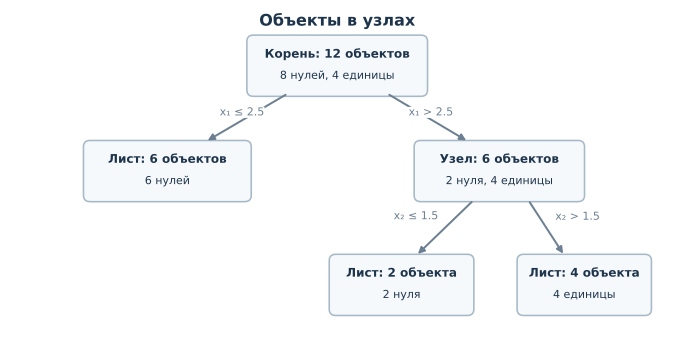

*Рисунок 7. Первое разбиение распределяет двенадцать объектов между двумя потомками. Второе применяется только к шести объектам правого узла. Каждый лист получает прогноз по тем обучающим объектам, которые в него попали.*

Обратите внимание на устройство процесса: после первого разделения **каждый дочерний узел становится отдельной задачей того же типа**, что и исходная. В нём снова можно оценить текущий прогноз, поискать удачное разбиение, создать потомков или остановиться. Так работает **рекурсия**: одна и та же процедура повторяется на меньших подмножествах данных. При этом дерево может расти неодинаково по разным ветвям. Одна остановится сразу, другая разделится ещё несколько раз.

Построение обычно идёт **сверху вниз** (*top-down*): сначала корень, затем его потомки, затем потомки потомков. Выбор разбиения в текущем узле называют **жадным** (*greedy*), если алгоритм ориентируется на лучшее локальное улучшение, не просчитывая заранее все будущие последовательности разбиений. Такой способ позволяет строить деревья без перебора всех возможных структур, хотя локально лучший шаг не обязательно приводит к глобально лучшему дереву.

### 2.4. Когда узел превращается в лист

Не каждый узел обязательно нужно делить до тех пор, пока в нём останутся объекты только одного класса. Лист может быть **смешанным**, то есть содержать несколько классов. В таком случае дерево всё равно способно выдать класс большинства и оценки долей классов.

Остановка возможна по нескольким причинам. Например, все ответы в узле уже совпадают, так что дальнейшее разделение не требуется. Или объекты имеют одинаковые значения доступных признаков — тогда порог не разделит их на две непустые группы. Наконец, мы можем заранее ограничить сложность дерева: запретить слишком большую глубину или слишком маленькие дочерние группы. Дополнительное правило может требовать, чтобы предлагаемое разбиение действительно улучшало выбранный критерий качества.

Таким образом, обучение принимает два вида решений: **какое разбиение выбрать**, если продолжать рост, и **стоит ли продолжать** в данном узле. И то и другое влияет на конечную структуру. Подробно причины переобучения и ограничения роста мы разберём после математического описания алгоритма.

### 2.5. Обучение и прогнозирование — два разных процесса

Теперь можно собрать общий механизм без привязки к конкретной формуле качества.

| При обучении дерева | При применении готового дерева |
|---|---|
| Корень получает всю размеченную выборку | На вход приходит новый объект с известными признаками |
| В текущем узле оцениваются возможные разбиения по признакам и порогам | Проверяется уже сохранённое условие текущего узла |
| Выбирается разбиение, создаются дочерние группы; процедура повторяется в них | Объект переходит только по одной соответствующей ветви |
| При остановке создаётся лист с прогнозом по объектам этого узла | В достигнутом листе считывается сохранённый прогноз |

Для небольшого дерева отдельный прогноз получить легко: число проверок не превышает глубину пути до листа. Главная работа происходит **на этапе обучения**, когда нужно выбрать условия и структуру. В этом отличие от kNN, где существенная часть работы по поиску соседей выполняется при прогнозировании.

Описанную схему используют разные алгоритмы решающих деревьев. Мы подробно разберём вариант из семейства **CART** (*Classification and Regression Trees*): бинарные разбиения, жадный поиск и рекурсивное построение. В этом названии отражено, что одна общая идея применяется и к классификации, и к регрессии. Различаются прежде всего способ оценки разбиения и правило прогноза в листе.

### Итак

- Обучение начинается в корне, который содержит всю размеченную выборку.
- Алгоритм выбирает разбиение по признаку и порогу, затем повторяет ту же процедуру на объектах каждого дочернего узла.
- Узел превращается в лист, когда дальнейшее разбиение невозможно, не требуется или запрещено ограничениями сложности.
- После обучения дерево хранит условия внутренних узлов и прогнозы листьев; при предсказании оно только применяет их.

Мы установили общую последовательность, но ещё не определили её центральный вычислительный шаг: **как количественно сравнить два разбиения и выбрать лучшее?** Начнём с регрессионного дерева. В нём ответ числовой, а нужный критерий можно построить из уже знакомой квадратичной ошибки. После этого перейдём к классификации и её критериям неоднородности.

## 3. Как выбрать разбиение в регрессионном дереве

Во втором разделе мы описали обучение дерева как последовательность разбиений. Для каждого узла алгоритм должен сравнить несколько условий и выбрать одно. Но выражение «лучшее разбиение» пока оставалось неформальным: мы смотрели, насколько удачно сгруппировались объекты, не умея измерить улучшение числом.

Начнём с **регрессии**, где правильный ответ — число, а качество прогноза можно измерять уже знакомой квадратичной ошибкой. На рисунке 4 мы уже видели, что пороговое правило создаёт ступенчатый числовой прогноз. Теперь выясним, **как алгоритм выбирает сам порог**, а не просто применяет готовое правило. После этого тот же принцип выбора разбиения можно будет перенести на классификацию, хотя мера качества в ней будет другой.

### 3.1. Прогноз дерева из одного листа

Рассмотрим шесть обучающих наблюдений. У каждого есть один числовой признак $x$ и целевой ответ $y$:

| Номер объекта | 1 | 2 | 3 | 4 | 5 | 6 |
|---|---:|---:|---:|---:|---:|---:|
| $x$ | 1 | 2 | 3 | 4 | 5 | 6 |
| $y$ | 1 | 2 | 1 | 7 | 8 | 9 |

Пока дерево состоит из единственного листа, оно должно выдавать **одно и то же число $c$** для всех шести объектов. Какое число выбрать? Если мы хотим минимизировать среднюю квадратичную ошибку, решаем знакомую по МНК задачу:

```math
\mathrm{MSE}(c)=\frac{1}{6}\sum_{i=1}^{6}(y_i-c)^2\longrightarrow\min_c.
\qquad\text{(6)}
```

Мы уже знаем, что минимизатор этой функции — среднее наблюдаемых ответов. Здесь оно равно

```math
\bar y=\frac{1+2+1+7+8+9}{6}=\frac{14}{3}\approx4.67.
\qquad\text{(7)}
```

Коротко напомним причину. Для произвольного набора ответов отклонение от числа $c$ можно разложить на отклонение от среднего и сдвиг самого $c$ относительно среднего. При раскрытии квадратов смешанное слагаемое исчезает, поскольку сумма отклонений от среднего равна нулю. Остаются сумма квадратов отклонений от среднего и неотрицательный член $n(c-\bar y)^2$. Поэтому наименьшая сумма квадратов достигается именно при $c=\bar y$.

Итак, **для квадратичной потери регрессионный лист предсказывает среднее целевых значений объектов, попавших в него**. Мы применили известный результат МНК не ко всей регрессионной прямой, а к самой простой модели — одной константе.

Сколько ошибок делает такое дерево? Сначала посчитаем **RSS** (*residual sum of squares*, сумму квадратов остатков):

```math
\begin{aligned}
RSS_{\text{один лист}}
&=\sum_{i=1}^{6}(y_i-\bar y)^2\\[0pt]
&=\frac{121+64+121+49+100+169}{9}\\[0pt]
&=\frac{208}{3}\approx69.33.
\end{aligned}
\qquad\text{(8)}
```

Средняя квадратичная ошибка равна $RSS/6=104/9\approx11.56$. Важно различать эти две записи: **RSS — сумма**, а **MSE — среднее** квадратов ошибок. Поскольку сейчас сравниваем разбиения *одних и тех же шести объектов*, можно минимизировать любую из них: деление на постоянное число $6$ не меняет выбор лучшего разбиения.

На рисунке 8 слева показано, насколько неудачно одна горизонтальная линия описывает все ответы: первые три находятся около $1$–$2$, а последние три — около $7$–$9$. Именно такую ситуацию дерево может улучшить, разделив данные на группы.

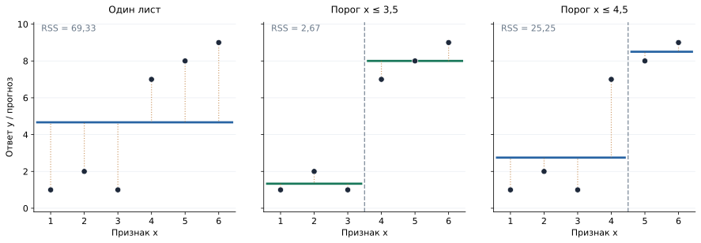

*Рисунок 8. Слева — прогноз одного листа для всех объектов. В центре и справа — два кандидата на первое разбиение. Точки обозначают ответы, горизонтальные линии — прогнозы листьев, вертикальные отрезки — остатки.*

### 3.2. Проверим два порога

Возьмём сначала условие $x\le3.5$. В **левом** дочернем узле окажутся три объекта с ответами $(1,2,1)$, в **правом** — три объекта с ответами $(7,8,9)$. Теперь в каждом узле можно назначить собственный постоянный прогноз:

```math
\bar y_L=\frac{1+2+1}{3}=\frac43,\qquad
\bar y_R=\frac{7+8+9}{3}=8.
\qquad\text{(9)}
```

Вычислим сумму квадратов ошибок *отдельно для каждого листа*, а затем сложим:

```math
\begin{aligned}
RSS_L&=(1-4/3)^2+(2-4/3)^2+(1-4/3)^2
=\frac19+\frac49+\frac19=\frac23,\\[0pt]
RSS_R&=(7-8)^2+(8-8)^2+(9-8)^2=2,\\[0pt]
RSS_{3.5}&=RSS_L+RSS_R=\frac23+2=\boxed{\frac83\approx2.67}.
\end{aligned}
\qquad\text{(10)}
```

Мы заменили один лист двумя, причём в каждом подмножестве прогноз считается по **его** объектам. RSS снизилась с $208/3$ до $8/3$. Улучшение составляет $200/3\approx66.67$.

Однако одного удачного условия недостаточно. Алгоритм должен уметь *сравнивать* кандидатов. Проверим другое условие — $x\le4.5$. Теперь слева окажутся ответы $(1,2,1,7)$, справа — $(8,9)$, и прогнозы изменятся:

```math
\bar y_L=\frac{1+2+1+7}{4}=\frac{11}{4}=2.75,\qquad
\bar y_R=\frac{8+9}{2}=8.5.
```

Подставляем их в тот же критерий:

```math
\begin{aligned}
RSS_L&=(1-2.75)^2+(2-2.75)^2+(1-2.75)^2+(7-2.75)^2\\[0pt]
&=3.0625+0.5625+3.0625+18.0625=24.75,\\[0pt]
RSS_R&=(8-8.5)^2+(9-8.5)^2=0.5,\\[0pt]
RSS_{4.5}&=24.75+0.5=\boxed{25.25}.
\end{aligned}
\qquad\text{(11)}
```

Это разбиение тоже улучшает прогноз по сравнению с одним листом, но заметно уступает порогу $3.5$. Причина видна на рисунке 8: значение $y=7$ оказалось в левом листе вместе с тремя маленькими ответами, поэтому среднее этой группы сместилось, а суммарная ошибка сильно выросла.

То же сравнение можно записать как две маленькие структуры дерева:

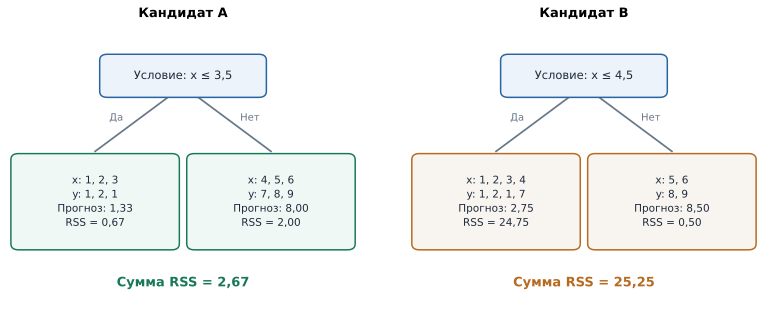

*Рисунок 9. Внутренний узел хранит условие; в каждом листе указаны ответы дошедших до него обучающих объектов, средний прогноз и RSS. Разбиение при $`3.5`$ лучше по сумме ошибок, хотя оба дерева имеют одинаковую глубину.*

### 3.3. Как алгоритм находит лучший порог

В нашем примере все значения $x$ различны и уже упорядочены: $1,2,3,4,5,6$. При пороговом условии $x\le t$ состав левой и правой групп **меняется только тогда, когда порог проходит через очередное наблюдаемое значение**. Поэтому нет смысла проверять каждое действительное число: достаточно выбрать по одному представителю из пяти промежутков между соседними значениями. Обычно берут середины: $1.5$, $2.5$, $3.5$, $4.5$, $5.5$.

Для каждого кандидата выполняется одна и та же последовательность: распределить объекты по двум группам; вычислить среднее $y$ внутри каждой; посчитать RSS обеих групп; сложить. Получается следующая таблица:

| Порог $t$ | Размеры групп $n_L+n_R$ | $RSS_L+RSS_R$ |
|---:|:---:|---:|
| 1.5 | $1+5$ | $53.20$ |
| 2.5 | $2+4$ | $39.25$ |
| **3.5** | **$3+3$** | **$2.67$** |
| 4.5 | $4+2$ | $25.25$ |
| 5.5 | $5+1$ | $46.80$ |

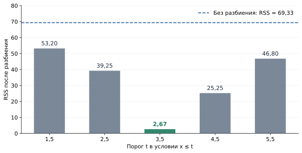

*Рисунок 10. Суммарная квадратичная ошибка после каждого допустимого разбиения. Минимум достигается при $`t=3.5`$. Качество определяется ошибками прогнозов внутри дочерних групп, а не только количеством объектов в них.*

Итак, для этого узла мы нашли лучший **первый split** по MSE: $x\le3.5$. Если признаков несколько, аналогично рассматриваются допустимые пороги каждого из них и выбирается пара «признак — порог» с наименьшей ошибкой. После этого обучение продолжается в дочерних узлах по описанной в разделе 2 рекурсивной схеме.

Здесь важно не перепутать два утверждения. Мы нашли **лучшее разбиение текущего узла**, но не доказали, что оно входит в глобально лучшее дерево любой глубины. Именно в таком локальном выборе и состоит жадность алгоритма.

### 3.4. Единая формула качества разбиения

Пока мы сравнивали кандидатов по **суммарной RSS**. Чтобы тем же способом описывать узлы разного размера и позднее перейти к классификации, удобно измерять *среднюю ошибку* внутри каждого узла.

Обозначим через $S$ множество обучающих объектов, находящихся в текущем узле, а через $|S|$ — их количество. Для квадратичной потери определим

```math
H_{\mathrm{MSE}}(S)=\frac{1}{|S|}\sum_{i\in S}(y_i-\bar y_S)^2,
\qquad \bar y_S=\frac{1}{|S|}\sum_{i\in S}y_i.
\qquad\text{(12)}
```

Здесь $H_{\mathrm{MSE}}(S)$ — **неоднородность узла** в задаче регрессии: средний квадрат отклонений ответов от лучшего постоянного прогноза. Если ответы близки друг к другу, одно среднее описывает их хорошо и неоднородность мала. Если разброс большой, она выше. В этой постановке неоднородность численно совпадает с эмпирической дисперсией целевой переменной, рассчитанной с делением на $|S|$, а не на $|S|-1$.

Если кандидат на разбиение создаёт два непустых дочерних узла $S_L$ и $S_R$, средняя ошибка после разбиения равна

```math
H_{\text{после}}=
\frac{|S_L|}{|S|}H_{\mathrm{MSE}}(S_L)
+\frac{|S_R|}{|S|}H_{\mathrm{MSE}}(S_R).
\qquad\text{(13)}
```

Вес каждой группы — это доля объектов исходного узла, попавших в неё. Это не дополнительное предпочтение алгоритма, а обычный способ сложить потери всех объектов и затем разделить их общую сумму на $|S|$:

```math
\begin{aligned}
H_{\text{после}}
&=\frac{|S_L|}{|S|}\cdot\frac{RSS_L}{|S_L|}
+\frac{|S_R|}{|S|}\cdot\frac{RSS_R}{|S_R|}\\[0pt]
&=\frac{RSS_L+RSS_R}{|S|}.
\end{aligned}
\qquad\text{(14)}
```

Например, при пороге $3.5$ обе дочерние группы содержат по три объекта. Их неоднородности равны $H_L=(2/3)/3=2/9$ и $H_R=2/3$. По формуле (13) **средняя неоднородность после разбиения** составляет

```math
H_{\text{после}}=\frac36\cdot\frac29+\frac36\cdot\frac23
=\frac49.
```

**До разбиения** средняя неоднородность составляла $H_{\text{до}}=(208/3)/6=104/9$. Следовательно, разбиение уменьшило её на

```math
\boxed{\Delta H=H_{\text{до}}-H_{\text{после}}
=\frac{104}{9}-\frac49=\frac{100}{9}>0.}
\qquad\text{(15)}
```

Именно разница между неоднородностью *до* и *после* характеризует полезность разбиения. Связь с ранее посчитанной RSS следует из формулы (14): для этого узла обе величины отличаются постоянным множителем $|S|=6$.

Внутри текущего узла $H_{\text{до}}$ не зависит от выбранного порога. Поэтому **максимизировать уменьшение неоднородности — то же самое, что минимизировать среднюю ошибку после разбиения**. А поскольку число объектов $|S|$ фиксировано при сравнении порогов одного узла, это эквивалентно и минимизации суммарной RSS, которую мы использовали в таблице.

### Итак

- При квадратичной потере прогноз регрессионного листа — среднее целевых значений объектов, дошедших до этого листа.
- Чтобы выбрать разбиение, алгоритм для каждого допустимого порога пересчитывает прогнозы двух дочерних листьев и сравнивает их суммарную ошибку.
- Уменьшение **взвешенной средней неоднородности** и уменьшение RSS описывают одно и то же улучшение в разных масштабах.
- Мы математически определили выбор разбиения для регрессии, но не изменили общую схему обучения дерева из раздела 2. В классификации потребуется другая мера качества, поскольку ответы теперь являются классами, а не числами.

## 4. Как выбрать разбиение в классификационном дереве

В регрессионном дереве мы выбирали разбиение, минимизирующее сумму квадратов ошибок в дочерних узлах. Внутри каждого из них прогнозом служило среднее значение целевой переменной. Для классификации эта схема сохраняется: алгоритм по-прежнему сравнивает возможные условия, делит объекты и повторяет процедуру в дочерних узлах. Меняется то, **какую характеристику узла мы считаем хорошей**.

В классификации правильный ответ — категория. Если классы обозначены числами $0$ и $1$, их числовые коды не следует автоматически трактовать как обычные количественные значения: для задачи с тремя классами, например, среднее кодов не имело бы смысла как метка класса. Поэтому начнём с естественного для классификации правила — предсказывать наиболее частый класс — и посмотрим, можно ли по нему выбирать разбиения.

### 4.1. Почему ошибки класса большинства недостаточно

Вернёмся к двенадцати обучающим объектам из раздела 2. Их признаки $x_1$ и $x_2$ образуют небольшую сетку; в каждой клетке указан истинный класс наблюдения:

| $x_2\backslash x_1$ | 1 | 2 | 3 | 4 |
|:---:|:---:|:---:|:---:|:---:|
| **3** | 0 | 0 | 1 | 1 |
| **2** | 0 | 0 | 1 | 1 |
| **1** | 0 | 0 | 0 | 0 |

В исходном узле находятся восемь объектов класса $0$ и четыре класса $1$. Если оставить его листом, дерево будет прогнозировать класс $0$ и ошибётся на четырёх обучающих объектах. Доля ошибок — $4/12=1/3$.

Для любого узла $S$ обозначим через $p_k(S)$ долю обучающих объектов класса $k$:

```math
p_k(S)=\frac{n_k(S)}{|S|},
\qquad \sum_{k=1}^{K}p_k(S)=1,
\qquad\text{(16)}
```

где $n_k(S)$ — число объектов класса $k$, $|S|$ — число всех объектов узла, $K$ — количество возможных классов. Если лист выдаёт самый распространённый класс, доля ошибок в нём равна

```math
H_{\mathrm{err}}(S)=1-\max_{k}p_k(S).
\qquad\text{(17)}
```

Действительно, доля объектов наиболее частого класса будет распознана верно, а остальные составят ошибки. Для исходного узла $H_{\mathrm{err}}(S)=1-8/12=1/3$.

Теперь попробуем условие $x_2\le1.5$. В левую ветвь попадут четыре нуля из нижней строки таблицы, в правую — четыре нуля и четыре единицы. В левом дочернем узле ошибок не будет. В правом доли классов одинаковы, поэтому при выборе любого из двух классов ошибочными окажутся четыре ответа. **Итого снова четыре ошибки — столько же, сколько до разбиения.**

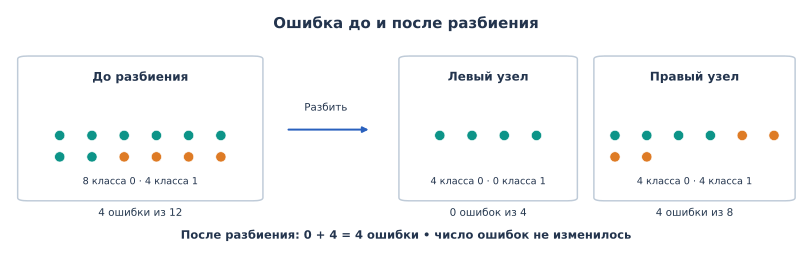

*Рисунок 11. Разбиение выделило однородную группу из четырёх объектов, но общее число ошибок при прогнозировании класса большинства осталось равным четырём.*

По формуле (13) средняя ошибка после разбиения действительно не изменилась:

```math
H_{\mathrm{err,\,после}}=
\frac4{12}\cdot0+\frac8{12}\cdot\frac12
=\frac13=H_{\mathrm{err,\,до}}.
```

До разбиения все двенадцать объектов находились в одном смешанном узле. Теперь для четырёх объектов мы уже получили однозначный прогноз по обучающим данным: их дальнейшее разделение не требуется. Остальные восемь объектов пока образуют смешанную группу, с которой алгоритм может продолжить работу. Так шаг может подготовить дальнейшее построение дерева, даже если **число ошибок класса большинства пока не уменьшилось**. При этом выделение чистой группы само по себе ещё не гарантирует лучшего качества на новых данных. **Для построения дерева нужен критерий, который замечает и такие изменения состава групп.**

### 4.2. Неоднородность классов и критерий Джини

Назовём узел **чистым**, если в нём находятся объекты только одного класса. В смешанном узле присутствуют несколько классов. Нам нужна числовая мера, которая мала для чистого узла и возрастает по мере того, как доли разных классов становятся сопоставимыми.

Один из стандартных вариантов — **критерий неоднородности Джини** (*Gini impurity*):

```math
\boxed{G(S)=1-\sum_{k=1}^{K}p_k(S)^2.}
\qquad\text{(18)}
```

Посмотрим, что измеряет эта формула. Сумма квадратов долей $\sum_k p_k^2$ велика, когда распределение сосредоточено на одном классе. Если в узле только один класс, одна доля равна $1$, остальные — $0$, и $G(S)=0$. Если два класса представлены поровну, сумма квадратов равна $1/4+1/4=1/2$, поэтому $G(S)=1/2$. Таким образом, **чем ближе доли к равенству, тем выше неоднородность**. Более глубокий вывод этой формулы через знакомую квадратичную потерю для вероятностных прогнозов приведём после разбора алгоритма.

Для двух классов удобно обозначить долю единиц через $p$, а долю нулей через $1-p$. Тогда

```math
G(p)=1-p^2-(1-p)^2=2p(1-p).
\qquad\text{(19)}
```

Например, для узла с четырьмя нулями и одной единицей $p=1/5$, откуда $G=2\cdot(1/5)\cdot(4/5)=8/25=0.32$. Если доли стали $1/2$ и $1/2$, получаем $G=0.5$. А в чистом узле $G=0$. В многоклассовой задаче идея та же: чистому узлу соответствует нулевая неоднородность; максимум достигается при равных долях всех $K$ классов.

В экономике тоже используют **коэффициент Джини** — например, для измерения неравенства доходов населения или неравномерности долей фирм на рынке. В обоих случаях речь идёт о характеристике неоднородности распределения, но экономический коэффициент Джини и критерий Джини для классов — **разные математические показатели**, с разными формулами и интерпретациями.

### 4.3. Сравним два разбиения по Джини

Для исходного узла из 12 объектов с долями $p_0=8/12=2/3$ и $p_1=4/12=1/3$ получаем:

```math
G(S)=1-\left(\frac23\right)^2-\left(\frac13\right)^2
=\boxed{\frac49\approx0.444}.
\qquad\text{(20)}
```

В разделе 3 мы определили общий принцип: **неоднородность после разбиения — это взвешенная средняя неоднородностей дочерних узлов**. Теперь используем в той же формуле Gini вместо MSE. Для пары «признак $j$ — порог $t$» уменьшение неоднородности равно

```math
\Delta G(S;j,t)=G(S)-
\left[
\frac{|S_L|}{|S|}G(S_L)+
\frac{|S_R|}{|S|}G(S_R)
\right].
\qquad\text{(21)}
```

Все обозначения прежние: $S$ — объекты текущего узла, $S_L,S_R$ — группы после проверки $x_j\le t$. Алгоритм сравнивает допустимые разбиения **по выигрышу $\Delta G$** и выбирает наибольший.

**Кандидат A: $x_2\le1.5$.** Слева четыре нуля, справа четыре нуля и четыре единицы. Состав групп виден на рисунке 11. Левая группа чистая, а в правой классы поровну, поэтому $G(S_L)=0$, $G(S_R)=1/2$. Подставляем размеры групп:

```math
\begin{aligned}
G_{\mathrm{после},A}
&=\frac4{12}\cdot0+\frac8{12}\cdot\frac12=\frac13,\\[0pt]
\Delta G_A&=\frac49-\frac13=\boxed{\frac19\approx0.111}.
\end{aligned}
\qquad\text{(22)}
```

Число ошибок класса большинства при этом разбиении не уменьшилось, однако Gini уменьшился с $4/9$ до $1/3$. Критерий заметил, что часть наблюдений отделилась в чистый узел.

**Кандидат B: $x_1\le2.5$.** Теперь слева шесть нулей, справа два нуля и четыре единицы. Слева $G(S_L)=0$, а справа

```math
G(S_R)=1-\left(\frac26\right)^2-\left(\frac46\right)^2
=1-\frac19-\frac49=\frac49.
```

Обе группы содержат по шесть объектов, следовательно,

```math
\begin{aligned}
G_{\mathrm{после},B}
&=\frac6{12}\cdot0+\frac6{12}\cdot\frac49=\frac29,\\[0pt]
\Delta G_B&=\frac49-\frac29=\boxed{\frac29\approx0.222}.
\end{aligned}
\qquad\text{(23)}
```

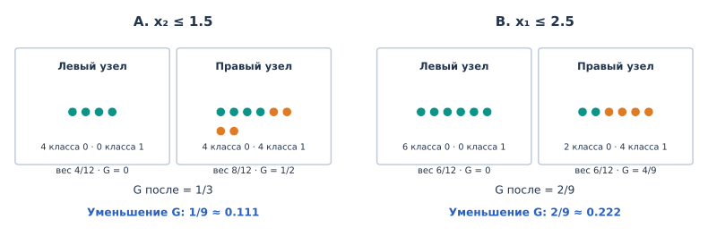

*Рисунок 12. Кандидат A выделяет четыре нуля; кандидат B — шесть. У обоих один дочерний узел чистый, но суммарная взвешенная неоднородность после B меньше.*

Оба кандидата создают чистый дочерний узел, однако B даёт большее уменьшение Gini: $2/9>1/9$. Следовательно, **между этими двумя условиями алгоритм выберет $x_1\le2.5$**. Чтобы утверждать, что оно лучшее среди всех допустимых, понадобится проверить остальные возможные пороги — к этому вернёмся при полном построении дерева.

### 4.4. Энтропия: другая мера неоднородности

Критерий Джини позволяет сравнивать разбиения по тому, насколько перемешаны классы в полученных группах. Существует и другой способ измерять неоднородность — через **неопределённость относительно класса объекта**. Он приводит к энтропии Шеннона. Чтобы понять её формулу, начнём не с дерева, а с простой задачи: как передать неизвестную метку класса?

**От неизвестной метки к двоичным сообщениям.** Предположим, из некоторого узла случайно выбирают объект. Его истинный класс известен отправителю, но пока неизвестен получателю. Получатель знает, какие классы возможны и каковы их доли в узле. Отправитель должен передать значение метки так, чтобы получатель смог однозначно его восстановить.

Здесь **сообщение** — не текст на естественном языке, а одно значение случайной величины: например, метка $0$ или $1$. Вместо названия класса можно отправить заранее согласованный двоичный код, состоящий из нулей и единиц. Каждый двоичный знак называют **битом**. Если нужно различить две равновероятные метки, достаточно договориться, что $0$ обозначает первый класс, а $1$ — второй. Получатель прочтёт один бит и узнает, какая именно метка была выбрана.

При этом количество необходимой информации зависит от того, что получатель знал **до** сообщения. Если все объекты в узле относятся к одному классу, истинная метка уже известна: никакого дополнительного двоичного знака для её определения не требуется. Если возможны два равновероятных класса, необходимо различить две альтернативы — для этого достаточно одного бита.

Рассмотрим на время более широкий случай. Пусть возможны восемь равновероятных меток с номерами от $1$ до $8$. Их можно различить тремя последовательными ответами на вопросы «да» или «нет». Например, если выбран номер $6$, можно задавать вопросы так:

1. Номер больше $4$? **Да** — остаются $5,6,7,8$.
2. Номер больше $6$? **Нет** — остаются $5,6$.
3. Номер больше $5$? **Да** — остаётся только $6$.

Если кодировать ответ «да» как $1$, а «нет» как $0$, получим сообщение `101`. После каждого ответа число возможных вариантов уменьшалось вдвое: $8\rightarrow4\rightarrow2\rightarrow1$.

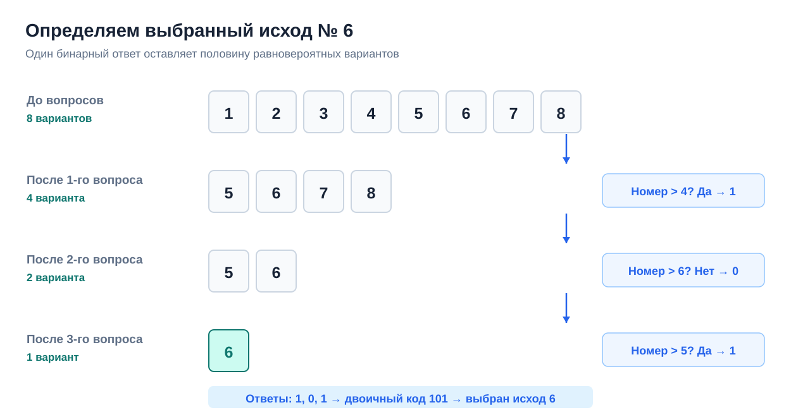

*Рисунок 13a. Каждый бинарный ответ устраняет половину оставшихся равновероятных вариантов. Для определения номера 6 достаточно трёх ответов — кода `101`.*

Один бит позволяет различить $2$ варианта, два бита — $2^2=4$, три — $2^3=8$, четыре — $2^4=16$. В общем случае $b$ бит позволяют записать $2^b$ различных кодовых слов. Поэтому, если число **равновероятных** исходов равно $m=2^b$, то

```math
b=\log_2m.
```

Вероятность каждого из этих исходов равна $p=1/m$. Подставляя $m=1/p$, получаем

```math
b=\log_2\frac1p=-\log_2p.
```

Пока это рассуждение относится к равновероятным исходам, число которых является степенью двойки. Но мы уже видим, откуда появился логарифм: каждый дополнительный бит **умножает число различимых вариантов на два**, а логарифм показывает, сколько таких удвоений требуется.

**Почему частые сообщения выгодно кодировать короче.** В узле дерева доли классов обычно различаются. Чтобы понять, что тогда происходит с количеством информации, временно рассмотрим четыре возможные метки $A,B,C,D$ с вероятностями

```math
p(A)=\frac12,\qquad p(B)=\frac14,\qquad
p(C)=p(D)=\frac18.
```

Получатель знает это распределение, но не знает значения очередной метки. Пусть метки поступают многократно. Например, в иллюстративной серии из восьми сообщений встретились четыре $A$, два $B$, одно $C$ и одно $D$. Это соответствует указанным долям, хотя в другой серии фактические частоты могут немного отличаться.

Самый простой способ — дать каждой из четырёх меток код одинаковой длины: $A\mapsto\texttt{00}$, $B\mapsto\texttt{01}$, $C\mapsto\texttt{10}$, $D\mapsto\texttt{11}$. Для каждой метки понадобятся два бита. На восемь сообщений уйдёт $8\cdot2=16$ бит, а средняя длина одного сообщения будет равна двум битам. Получатель без труда разделит поток битов на сообщения: каждые два бита — очередная метка.

А если мы хотим назначить **разную длину** разным меткам, появляется новое требование. Мы передаём много сообщений подряд, без пробелов и дополнительных разделителей. Получатель должен понимать, **где закончилось одно сообщение и началось следующее**. Поэтому нельзя просто назначить коды $A\mapsto\texttt{0}$, $B\mapsto\texttt{1}$, $C\mapsto\texttt{10}$, $D\mapsto\texttt{01}$. Получив последовательность `10`, адресат не поймёт, пришла ли одна метка $C$ или две последовательные метки $B,A$. Можно было бы передавать границы сообщений отдельно, но это потребовало бы дополнительного соглашения и затрат на передачу.

Удобно устроить код так, чтобы **ни один законченный код не был началом более длинного**. Тогда получатель сможет читать поток по одному биту: пока код не закончен — читать следующий, когда закончен — восстановить метку и начать читать следующую. Именно такую схему наглядно представляет **двоичное дерево декодирования**: на каждом шаге бит $0$ или $1$ выбирает ветвь, а достижение листа означает конец очередной метки.

Но чаще всего нам приходится передавать именно $A$. Поэтому в таком коде выгодно сделать путь до $A$ коротким, даже если ради этого пути к редким меткам окажутся длиннее:

| Метка | Вероятность | Код | Длина |
|---|---:|:---:|---:|
| $A$ | $1/2$ | `0` | 1 бит |
| $B$ | $1/4$ | `10` | 2 бита |
| $C$ | $1/8$ | `110` | 3 бита |
| $D$ | $1/8$ | `111` | 3 бита |

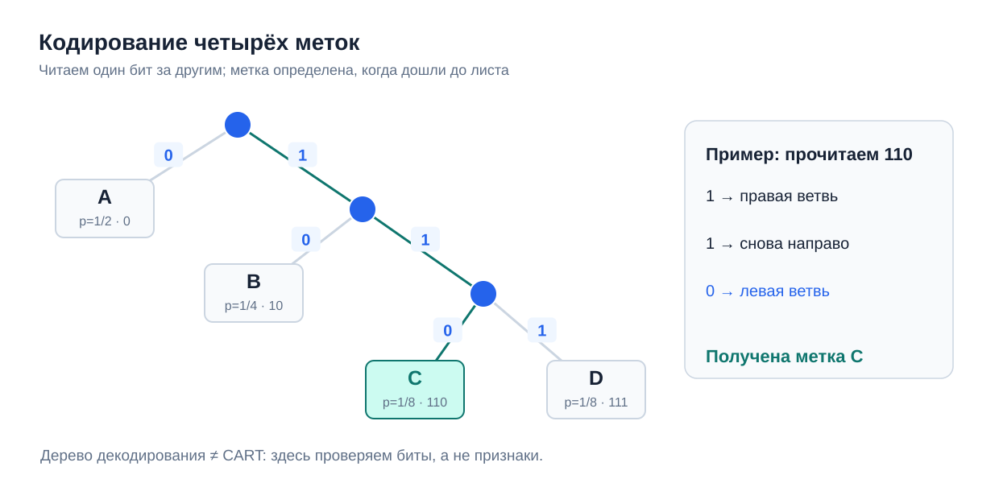

*Рисунок 13b. Код переменной длины. Читая биты слева направо, получатель идёт по ветвям до одной из четырёх меток. Ни один законченный код не является началом другого, поэтому границы сообщений определяются однозначно. Это дерево **декодирования сообщения**, а не решающее дерево CART.*

Например, получив `110`, адресат последовательно проходит по ветвям $1$, $1$, $0$ и попадает в лист $C$. Метка восстановлена; следующий бит, если он есть, уже относится к следующему сообщению.

Для той же иллюстративной серии длина передачи теперь равна $4\cdot1+2\cdot2+1\cdot3+1\cdot3=14$ битам вместо $16$. Если рассматривать вероятности возможных сообщений, **средняя длина кода** составляет

```math
\bar L=\frac12\cdot1+\frac14\cdot2+\frac18\cdot3+\frac18\cdot3
=\boxed{1.75\ \text{бита на метку}}.
```


*Рисунок 13c. Для серии $`A,A,A,A,B,B,C,D`$ постоянный двухбитовый код потребовал бы 16 бит, а выбранный код переменной длины — 14. В среднем часто встречающееся сообщение обходится дешевле.*

Разница возникает благодаря вероятностям: укоротив самый частый код, мы выигрываем на множестве сообщений; удлинение редких кодов увеличивает общую длину значительно меньше. Этот результат подводит нас к более общей интуиции. **Информация зависит от того, что получатель знал до наблюдения исхода.** Если исход заранее известен, сообщение не устраняет никакой неопределённости. Если исход очень вероятен, сообщение в основном подтверждает ожидание. Если произошёл редкий исход, мы узнаём нечто гораздо менее ожидаемое. Поэтому редкий исход естественно считать более информативным, чем частый.

Пока мы увидели это через **расход битов при кодировании**: часто встречающиеся исходы выгодно обозначать короткими кодами. Теперь попробуем определить количество информации об исходе непосредственно по его вероятности, независимо от конкретного способа записи сообщения.

**От длины кода к информации одного исхода.** В построенном примере кодовые длины не случайно оказались равны $1,2,3,3$. Вероятности меток здесь — степени $1/2$:

```math
\begin{aligned}
p(A)=\tfrac12 &\quad\Longrightarrow\quad -\log_2p(A)=1,\\[0pt]
p(B)=\tfrac14 &\quad\Longrightarrow\quad -\log_2p(B)=2,\\[0pt]
p(C)=p(D)=\tfrac18 &\quad\Longrightarrow\quad -\log_2p(C)=3.
\end{aligned}
```

Для таких специально выбранных вероятностей **длина нашего кода точно совпала с $-\log_2p$**. Но здесь важно не принять частный пример за общее правило. **Длина кодового слова** — это число реально записанных нулей и единиц в выбранном коде; оно всегда целое. **Количество информации об исходе** мы хотим измерять иначе — как степень его статистической неожиданности, определяемую вероятностью, а не тем, какой именно код мы назначили метке. Например, $-\log_2(0.9)\approx0.152$, хотя код из $0.152$ двоичного символа записать невозможно. Это не попытка придумать дробный символ: речь о двух разных величинах.

Почему для измерения статистической неожиданности подходит именно логарифм? Желательно, чтобы выбранная мера обладала тремя понятными свойствами. **Заранее известный исход** не даёт новой информации; **более редкий исход** приносит больше информации; а информация о **двух независимых результатах** должна складываться. Последнее особенно существенно: если вероятности независимых исходов равны $p$ и $q$, то вероятность их совместного наступления равна $pq$. Логарифм позволяет превратить это произведение вероятностей в сумму информаций:

```math
-\log_2(pq)=-\log_2p-\log_2q.
```

Например, результат одного броска честной монеты даёт один бит информации. Два независимых броска имеют четыре равновероятных результата, а чтобы различить их, нужны два бита. Вероятность конкретной последовательности равна $1/4$, и $-\log_2(1/4)=2$. Три броска дают восемь вариантов и три бита. **Логарифм отражает простую идею: каждый новый независимый равновероятный бинарный результат добавляет один бит, хотя вероятность всей последовательности с каждым шагом уменьшается вдвое.**

Основание $2$ задаёт единицу измерения: исход вероятности $1/2$ получает информационное содержание один бит. Минус перед логарифмом нужен потому, что вероятности не превосходят единицы: $\log_2p\le0$, тогда как количество информации должно быть неотрицательным и возрастать при уменьшении $p$.

Таким образом, **информационным содержанием** (*self-information*) исхода называют численную меру того, насколько неожиданно его наступление при заранее известной вероятности. Она зависит от вероятности исхода, но не от выбранной для передачи последовательности нулей и единиц. Математически для исхода $y$ с $p(y)>0$ определяют

```math
\boxed{h(y)=-\log_2p(y).}
\qquad\text{(24)}
```

Чем менее вероятен исход, тем больше информации приносит известие о том, что он произошёл. Для заранее известного исхода $p(y)=1$ и $h(y)=0$: новой неопределённости сообщение не устраняет. Для исхода с $p(y)=1/2$ имеем один бит; для исхода с $p(y)=1/8$ — три бита.

Слово «информация» здесь **не означает полезность или важность сообщения**. Оно описывает статистическую неожиданность исхода относительно заранее известного распределения. Например, если метки $0$ и $1$ встречаются с вероятностями $0.9$ и $0.1$, при передаче одиночной метки их можно обозначить обычными однобитовыми кодами `0` и `1`. Но информационное содержание частого исхода равно лишь $-\log_2(0.9)\approx0.152$ бита, а редкого — $-\log_2(0.1)\approx3.322$ бита. **Это не требование передать дробную длину одного кодового слова**, а мера того, сколько нового сообщает нам каждый результат. Если кодировать длинную последовательность меток совместно, суммарное число переданных битов остаётся целым, но *средний расход на одну метку* может быть дробным. Ниже мы определим, какую характеристику распределения этот средний расход отражает.

**От одного исхода к неопределённости распределения.** Информация $h(y)$ относится к уже наступившему конкретному событию. Но при обучении дерева мы ещё **не знаем класс случайно выбранного объекта**. Нам известны только возможные классы и их доли в узле. Поэтому нужна величина, характеризующая неопределённость класса *до* наблюдения его значения.

Обозначим случайную метку через $Y$. Её значения — классы $1,\ldots,K$, а вероятности $p_k$ в обучающем узле оцениваются долями наблюдений. Усредним информационное содержание возможных исходов с весами по их вероятностям. Получим **энтропию Шеннона**:

```math
\boxed{
H_{\mathrm{ent}}(S)
=\mathbb E[h(Y)]
=-\sum_{k=1}^{K}p_k(S)\log_2p_k(S).
}
\qquad\text{(25)}
```

Это *средняя информация, которую приносит раскрытие неизвестной метки*, и одновременно мера неопределённости её распределения до наблюдения. В примере с четырьмя метками $A$–$D$ энтропия равна $1.75$ бита: именно столько составляла средняя длина выбранного кода. В данном примере совпадение точное; при произвольных вероятностях энтропия не обязана равняться средней длине какого-либо кода отдельных меток. При совместном кодировании длинных последовательностей средний расход битов на одну метку может приближаться к энтропии. Именно здесь становится практически осмысленным дробное среднее число битов на один исход.

Посмотрим на три характерных бинарных распределения:

- **$100\%/0\%$.** Класс определён заранее. Для единственного возможного исхода $h=-\log_2 1=0$, следовательно, $H_{\mathrm{ent}}=0$.
- **$50\%/50\%$.** Каждый из двух исходов приносит $-\log_2(0.5)=1$ бит. Средняя информация $H_{\mathrm{ent}}=0.5\cdot1+0.5\cdot1=1$ бит.
- **$90\%/10\%$.** Частый исход приносит $-\log_2(0.9)\approx0.152$ бита, редкий — $-\log_2(0.1)\approx3.322$ бита. Но редкий наблюдается лишь в одной десятой случаев, поэтому

```math
H_{\mathrm{ent}}=0.9\cdot0.152+0.1\cdot3.322\approx\boxed{0.469\ \text{бита}}.
```

Итак, редкий исход может быть очень неожиданным, но **распределение с одним преобладающим классом предсказуемее в среднем**, чем распределение $50\%/50\%$. Это и делает энтропию удобной характеристикой неоднородности классов в узле дерева.

Для бинарной классификации обозначим долю класса $1$ через $p$, а долю класса $0$ через $1-p$. Тогда

```math
H_{\mathrm{ent}}(p)=-(1-p)\log_2(1-p)-p\log_2p.
\qquad\text{(26)}
```

Эта функция, как и Gini, равна нулю в чистых узлах и максимальна при равных долях классов, когда $H_{\mathrm{ent}}(1/2)=1$ бит. Её график показан на правой панели рисунка 14. Если какой-либо класс отсутствует, его вклад принимают равным нулю: $-p\log_2p\to0$ при $p\to0+$. Для $K$ равновероятных классов максимум энтропии равен $\log_2K$ битам.

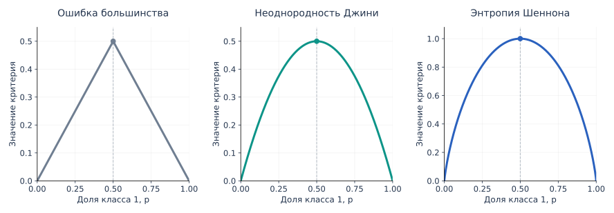

*Рисунок 14. Поведение трёх мер при бинарной классификации. У каждой панели собственная шкала по вертикали. Ошибка класса большинства образует ломаную с изломом при $`p=0.5`$; Джини и энтропия меняются более плавно.*

**Как энтропия помогает выбрать разбиение.** Теперь вернёмся к дереву. Проверка условия $x_j\le t$ сообщает, попал ли объект в левый или правый дочерний узел. Внутри каждой группы своё распределение классов, а следовательно, своя энтропия. Взвесим неопределённости дочерних узлов по долям объектов — точно так же, как делали для MSE и Gini:

```math
H_{\mathrm{ent,after}}
=\frac{|S_L|}{|S|}H_{\mathrm{ent}}(S_L)
+\frac{|S_R|}{|S|}H_{\mathrm{ent}}(S_R).
```

Это средняя неопределённость класса **после того, как стало известно, в какой дочерний узел попал объект**. Разность между исходной и оставшейся неопределённостью называют **информационным выигрышем** (*information gain*):

```math
IG(S;j,t)=H_{\mathrm{ent}}(S)-H_{\mathrm{ent,after}}(S;j,t).
```

Здесь речь идёт не о числе бит в ответе «да/нет» на пороговое условие. Выигрыш измеряет, насколько **знание результата проверки помогает определить истинный класс**, в среднем по объектам узла.

Воспользуемся теми же 12 объектами и кандидатами A и B из §4.3. В исходном узле восемь нулей и четыре единицы, поэтому

```math
H_{\mathrm{ent}}(S)=-\frac23\log_2\frac23-\frac13\log_2\frac13
\approx0.9183\ \text{бита}.
```

**Кандидат A, $x_2\le1.5$.** Слева четыре нуля: энтропия равна нулю. Справа четыре нуля и четыре единицы: энтропия равна одному биту. Следовательно,

```math
\begin{aligned}
H_{\mathrm{ent,after},A}&=\frac4{12}\cdot0+\frac8{12}\cdot1=\frac23\approx0.6667,\\[0pt]
IG_A&\approx0.9183-0.6667=\boxed{0.2516\ \text{бита}}.
\end{aligned}
\qquad\text{(27)}
```

**Кандидат B, $x_1\le2.5$.** Слева шесть нулей: энтропия снова равна нулю. Справа два нуля и четыре единицы: доли равны $1/3$ и $2/3$, поэтому энтропия правой группы совпадает с энтропией исходного узла. При одинаковых размерах групп получаем

```math
\begin{aligned}
H_{\mathrm{ent,after},B}&=\frac6{12}\cdot0+\frac6{12}\cdot0.9183\approx0.4591,\\[0pt]
IG_B&\approx0.9183-0.4591=\boxed{0.4591\ \text{бита}}.
\end{aligned}
\qquad\text{(28)}
```

Таким образом, **кандидат B уменьшает среднюю неопределённость класса сильнее**, чем A. В нашем примере выбор совпал с результатом по Gini, хотя сами значения критериев различаются. В других данных две меры могут по-разному ранжировать допустимые разбиения.

Формула энтропии не зависит от выбора основания логарифма принципиально. При натуральном логарифме её измеряют в **натах**, при основании $2$ — в **битах**. Смена основания умножает все энтропии и информационные выигрыши на один положительный коэффициент, поэтому не изменяет выбор лучшего разбиения при фиксированном критерии.

Получили ещё один способ оценивать узлы: помимо неоднородности Джини можно использовать среднюю неопределённость метки класса. **Алгоритм построения дерева остаётся тем же** — меняется только функция, по которой он сравнивает разбиения. Далее сопоставим все три классификационных критерия, а в §6 вернёмся к энтропии с другой стороны — через минимальную среднюю log-loss в листе.

### 4.5. Как соотносятся три критерия

Соберём расчёты для двух разбиений, которые рассматривали. В каждой колонке показано **уменьшение соответствующей меры** относительно исходного узла:

| Разбиение | Уменьшение ошибки класса большинства | Уменьшение Gini | Информационный выигрыш (биты) |
|---|---:|---:|---:|
| $x_2\le1.5$ (A) | $0$ | $1/9\approx0.111$ | $\approx0.252$ |
| $x_1\le2.5$ (B) | $1/6\approx0.167$ | $2/9\approx0.222$ | $\approx0.459$ |

Все три критерия здесь предпочитают B, но причина использовать более чувствительные критерии видна на кандидате A: он **ничего не улучшает по ошибке класса большинства**, хотя создаёт чистую группу и уменьшает Gini и энтропию.

Ошибка классификации, Gini и entropy не являются тремя названиями одной величины. Они по-разному реагируют на изменение классовых долей, и для других данных могут по-разному ранжировать кандидатов. При построении стандартного дерева классификации обычно используют **Gini или энтропию**, а не долю ошибок класса большинства. В каждом отдельном запуске алгоритм фиксирует выбранный критерий и сравнивает по нему все кандидаты. Например, для нашего полного учебного дерева далее удобно выбрать Gini.

Критерий построения дерева также не следует путать с метрикой итогового качества. Можно выбирать разбиения по Gini, а качество готовой модели оценивать на отложенных данных по accuracy, F1 или другой подходящей метрике. Иными словами, **мера неоднородности направляет рост дерева; проверка на новых данных показывает, насколько удачно получилась модель**.

### Итак

- В классификационном узле можно прогнозировать класс большинства, но связанная с ним доля ошибок не всегда чувствительна к полезным изменениям классовых долей при разбиении.
- Gini и энтропия оценивают неоднородность распределения классов: они равны нулю в чистых узлах и увеличиваются при более равномерном распределении классов.
- Выбор разбиения опирается на **уменьшение взвешенной неоднородности**: тот же принцип, что и для MSE в регрессионном дереве.
- Gini и энтропия дают две распространённые конкретизации алгоритма классификации. После выбора критерия можно перейти к поиску всех порогов и рекурсивному построению дерева.

## 5. Как обучается классификационное дерево: полный пример

В разделах 2–4 мы познакомились с устройством дерева, общим порядком его построения и критериями выбора одного разбиения. Теперь соберём эти части в единый алгоритм. Проследим, какие решения он принимает **в каждом узле**, как из данных появляются условия и почему процесс заканчивается конкретной структурой дерева.

Будем строить **бинарное дерево классификации с пороговыми разбиениями**, используя критерий Джини. Это один из стандартных вариантов CART (*Classification and Regression Trees*). Выбор Джини здесь не означает, что энтропия хуже: мы просто фиксируем критерий, чтобы все кандидаты сравнивались по одной и той же величине.

### 5.1. Корень: выбираем первое разбиение

Возьмём 12 обучающих объектов с двумя числовыми признаками. Как и в разделе 4, строки таблицы соответствуют значениям $x_2$, столбцы — значениям $x_1$, а в клетках указан целевой класс:

| $x_2\backslash x_1$ | 1 | 2 | 3 | 4 |
|:---:|:---:|:---:|:---:|:---:|
| **3** | 0 | 0 | 1 | 1 |
| **2** | 0 | 0 | 1 | 1 |
| **1** | 0 | 0 | 0 | 0 |

Пока дерево состоит из корня с 12 объектами: восемь нулей и четыре единицы. Если остановиться сейчас, мы получили бы лист с прогнозом класса $0$. Но сначала проверим, можно ли полезно разделить данные. Неоднородность корня нам известна из формулы (20):

```math
G(S)=1-\left(\frac{8}{12}\right)^2-\left(\frac{4}{12}\right)^2
=\frac49.
```

Какие условия можно рассмотреть? У признака $x_1$ в текущем узле встречаются значения $1,2,3,4$. Разделение объектов меняется только между соседними различными значениями; удобно проверить три порога: $1.5$, $2.5$, $3.5$. Аналогично для $x_2\in\lbrace 1,2,3\rbrace $ достаточно порогов $1.5$ и $2.5$.

**Итого пять кандидатов.** Для каждого алгоритм выполняет одни и те же действия: разделяет 12 объектов на левую и правую группы, вычисляет доли классов и Gini в каждой из них, а затем находит уменьшение взвешенной неоднородности по формуле (21). Два кандидата мы подробно посчитали в §4.3. Теперь сравним **все**:

| Признак и порог | Размеры групп | Выигрыш $\Delta G$ |
|---|:---:|---:|
| $x_1\le1.5$ | $3+9$ | $2/27\approx0.074$ |
| **$x_1\le2.5$** | **$6+6$** | **$2/9\approx0.222$** |
| $x_1\le3.5$ | $9+3$ | $2/27\approx0.074$ |
| $x_2\le1.5$ | $4+8$ | $1/9\approx0.111$ |
| $x_2\le2.5$ | $8+4$ | $1/36\approx0.028$ |

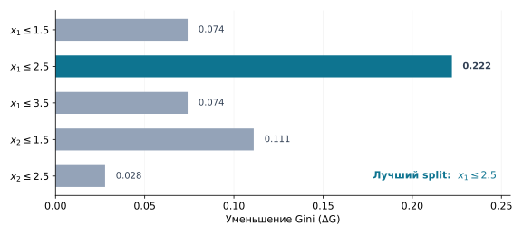

*Рисунок 15. Проверены все пороги, меняющие состав дочерних узлов. Максимальное уменьшение Джини достигается при $`x_1\le2.5`$.*

Выбираем **$x_1\le2.5$** и записываем это условие в корень. Так появляется первое внутреннее ветвление дерева. Отметим границу решения: пока мы нашли лучшее **локальное разбиение корня**, а не глобально оптимальную структуру дерева.

### 5.2. После корня: у каждого потомка свои данные

Условие $x_1\le2.5$ распределило данные следующим образом:

| Левый узел: $x_1\le2.5$ | Правый узел: $x_1>2.5$ |
|---|---|
| $x_1\in\lbrace 1,2\rbrace $ | $x_1\in\lbrace 3,4\rbrace $ |
| $x_2\in\lbrace 1,2,3\rbrace $ | $x_2\in\lbrace 1,2,3\rbrace $ |
| **6 объектов класса 0** | **2 объекта класса 0, 4 объекта класса 1** |
| $G(S_L)=0$ | $G(S_R)=4/9$ |

Левый узел уже чистый: для всех шести обучающих объектов в нём класс равен нулю. Разделять его дальше для уменьшения Gini бессмысленно. Поэтому здесь сразу образуется **лист с прогнозом класса $0$**.

Правый узел остаётся смешанным. Но принципиально важно, что его обучение теперь происходит **не на всех двенадцати наблюдениях, а только на шести дошедших до него объектах**. Покажем их отдельно:

| $x_2\backslash x_1$ | 3 | 4 |
|:---:|:---:|:---:|
| **3** | 1 | 1 |
| **2** | 1 | 1 |
| **1** | 0 | 0 |

Посмотрим, какие пороги можно выбрать в этом узле. Для $x_1$ остались только значения 3 и 4, поэтому кандидат один: $x_1\le3.5$. Для $x_2$ есть два кандидата: $x_2\le1.5$ и $x_2\le2.5$.

Если разделить правый узел по $x_1\le3.5$, в каждом потомке окажется один ноль и две единицы. Доли классов не изменятся, поэтому **выигрыш Джини равен нулю**. Разбиение по $x_2\le2.5$ улучшит неоднородность, но оставит одну смешанную группу. А условие $x_2\le1.5$ разделит данные полностью: два нуля попадут в левую группу, четыре единицы — в правую.

Для последнего кандидата обе группы чистые, поэтому

```math
\begin{aligned}
G_{\mathrm{после}}&=\frac26\cdot0+\frac46\cdot0=0,\\[0pt]
\Delta G_{S_R}&=\frac49-0=\boxed{\frac49}.
\end{aligned}
\qquad\text{(29)}
```

Сравнение всех кандидатов для **этого** узла:

| Признак и порог | Группы | Выигрыш $\Delta G$ |
|---|:---:|---:|
| $x_1\le3.5$ | $3+3$ | $0$ |
| **$x_2\le1.5$** | **$2+4$** | **$4/9\approx0.444$** |
| $x_2\le2.5$ | $4+2$ | $1/9\approx0.111$ |

Итак, во втором внутреннем узле выбирается **$x_2\le1.5$**. Это не «второй порог всей выборки»: условие проверяют только объекты, которые уже прошли через правую ветвь корня. В этом и состоит рекурсивное построение дерева.

### 5.3. Когда построение закончилось

После второго разбиения у нас три листа. Слева от корня — шесть объектов класса $0$; справа и ниже порога $x_2\le1.5$ — ещё два нуля; справа и выше порога — четыре единицы. Все три листа чистые, поэтому дальнейший рост для этой выборки не требуется.

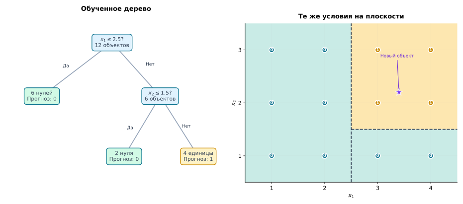

*Рисунок 16. Слева — обученное дерево с числом объектов и классами в листьях. Справа — те же правила на плоскости признаков. Горизонтальное разбиение применяется только справа от вертикального.*

Теперь функция предсказания может быть описана тремя случаями:

```math
\hat y(x)=
\begin{cases}
0,&x_1\le2.5,\\[0pt]
0,&x_1>2.5\ \text{и}\ x_2\le1.5,\\[0pt]
1,&x_1>2.5\ \text{и}\ x_2>1.5.
\end{cases}
\qquad\text{(30)}
```

В этом маленьком примере дерево научилось двум условиям и трём листовым прогнозам. Важно, что **эти правила не были заданы заранее**. Мы определили только семейство допустимых условий, критерий качества разбиения и алгоритм поиска. Конкретные признаки, пороги и структура дерева были найдены по обучающим данным.

Например, для нового объекта с признаками $x=(3.4,2.2)$ дерево сначала проверит $3.4\le2.5$. Условие ложно, поэтому объект уйдёт вправо. Там оно проверит $2.2\le1.5$, снова получит ложь и попадёт в лист класса $1$. Так работает `predict`.

Если запросить `predict_proba`, в данном примере соответствующий лист содержит четыре объекта класса $1$ и ни одного класса $0$, поэтому оценка вероятностей равна $(0,1)$. В реальном дереве листья могут быть смешанными; тогда в `predict_proba` возвращаются доли классов внутри достигнутого листа, а не всей обучающей выборки.

**Обязательно ли все листья должны быть чистыми?** Нет. Представим, что ещё до обучения установили максимальную глубину один. Тогда дерево остановится сразу после первого разбиения. Его правый лист будет содержать два нуля и четыре единицы, прогнозировать класс $1$ и возвращать вероятности $(1/3,2/3)$. Это корректное, хотя и более простое дерево. Вопрос, когда нужно останавливать рост, подробно разберём в разделе о переобучении.

### 5.4. Обобщим последовательность обучения

Наши расчёты можно теперь заменить единым алгоритмом. Он работает для любого узла, будь то корень или потомок, потому что каждый раз получает **только объекты текущего узла**.

```text
ПостроитьУзел(S, глубина):
    вычислить прогноз по объектам S

    если достигнуто условие остановки:
        вернуть лист с этим прогнозом

    найти допустимый split с наибольшим улучшением критерия
    если такого полезного split нет:
        вернуть лист с этим прогнозом

    разделить S на непустые группы S_left и S_right
    создать внутренний узел с выбранным условием
    его левый потомок  = ПостроитьУзел(S_left, глубина + 1)
    его правый потомок = ПостроитьУзел(S_right, глубина + 1)
    вернуть созданный узел
```

**Рекурсивность** состоит в повторном применении одной и той же процедуры построения узла. После выбора разбиения процедура отдельно запускается для левой и правой групп объектов, а затем — для их потомков. Построение каждой ветви заканчивается, когда выполняется условие остановки. Предсказание — отдельный процесс: новый объект проходит по уже сохранённым условиям от корня к листу.

В рассмотренном варианте CART каждый внутренний узел содержит бинарное пороговое условие. Для классификации мы использовали Gini; если выбрать энтропию, структура поиска останется прежней, хотя конкретные выбранные пороги могут отличаться. Для регрессии вместо долей классов и Gini используются средние целевых значений и квадратичная ошибка, как в разделе 3.

CART — не единственный алгоритм построения деревьев. Более ранний **ID3** (*Iterative Dichotomiser 3*) выбирает разбиения по информационному выигрышу и в исходной постановке работает с категориальными признаками, допуская разветвление более чем на две ветви. Его развитие **C4.5** умеет работать и с числовыми признаками, использует нормированный информационный выигрыш (*gain ratio*), предусматривает обработку пропусков и сокращение дерева (*pruning*). В частности, C4.5 реализован в алгоритме **J48** библиотеки Weka.

Мы подробно изучаем именно **CART-подобное построение**, потому что бинарные разбиения позволяют единообразно описать классификацию и регрессию; кроме того, оптимизированная версия CART используется для одиночных деревьев в scikit-learn. Другие алгоритмы отличаются выбором разбиений и способами ограничения сложности, но общая идея рекурсивного разделения обучающих объектов остаётся той же. Более подробно о свойствах и ограничениях деревьев поговорим в следующих разделах. См. также [сравнение алгоритмов в документации scikit-learn](https://scikit-learn.org/stable/modules/tree.html#tree-algorithms-id3-c4-5-c5-0-and-cart) и [описание J48 в Weka](https://weka.sourceforge.io/doc.stable-3-8/weka/classifiers/trees/J48.html).

До сих пор рост дерева не сталкивался с трудным выбором: маленькая выборка позволяла дойти до чистых листьев. На реальных данных это может привести к чрезмерной сложности модели. Кроме того, жадный выбор лучших разбиений не гарантирует лучшего дерева в целом. К этим ограничениям мы вернёмся после математического углубления.

### Итак

- Обучение выбирает пару «признак — порог» **отдельно в каждом узле**, сравнивая все допустимые разбиения по фиксированному критерию.
- После первого split каждый дочерний узел работает только со своими объектами; поэтому условия разных ветвей могут различаться.
- Чистый узел можно сделать листом, но дерево вправе остановиться и в смешанном узле, сохранив класс большинства и доли классов.
- В результате `fit` создаёт условия и листовые прогнозы, а `predict` и `predict_proba` используют уже готовое дерево.

## 6. Почему Gini и энтропия связаны с функциями потерь

Мы уже умеем строить дерево: в регрессии выбирали разбиения по уменьшению квадратичной ошибки, а в классификации — по уменьшению Gini или энтропии. При этом сами деревья обучались по одной схеме: сравнить допустимые условия, разделить объекты, повторить процедуру в дочерних узлах. Возникает вопрос: **почему именно эти величины подходят для оценки разбиений?**

Ответ связан с задачей, которую решает любой лист дерева. Когда разбиения прекращаются, всем объектам листа приходится выдавать **один постоянный прогноз**. Мы можем подобрать этот прогноз так, чтобы его средняя потеря на обучающих объектах была минимальной. Именно величина этой минимальной потери при подходящем выборе функции потерь и даёт знакомые нам меры неоднородности.

### 6.1. Одна задача для разных видов прогнозов

Пусть $S$ — множество индексов обучающих объектов, дошедших до некоторого узла, $a$ — постоянный прогноз, который мы могли бы записать в его лист, а $L(y_i,a)$ — потеря этого прогноза на объекте $i$. Для начала определим **среднюю потерю при заданном прогнозе**:

```math
R_S(a)=\frac{1}{|S|}\sum_{i\in S}L(y_i,a).
\qquad\text{(31)}
```

Теперь выберем лучший возможный постоянный прогноз $a^*_S$ и обозначим через $H_L(S)$ среднюю потерю, которая при этом остаётся:

```math
\boxed{
\begin{aligned}
a^*_S&\in\arg\min_{a\in\mathcal A}R_S(a),\\[0pt]
H_L(S)&=R_S(a^*_S)=\min_{a\in\mathcal A}R_S(a).
\end{aligned}}
\qquad\text{(32)}
```

Эти две строки отвечают на **разные вопросы**. Первая определяет, *что записать в лист*: число, класс или вектор вероятностей. Вторая определяет, *насколько хорошо этот единственный прогноз описывает объекты узла*. Множество $\mathcal A$ содержит допустимые прогнозы: например, все действительные числа для регрессии или все распределения вероятностей по $K$ классам для вероятностной классификации.

В §3 мы уже решили эту задачу для квадратичной потери $L(y_i,a)=(y_i-a)^2$: оптимальным $a^*_S$ оказалось среднее $\bar y_S$, а $H_L(S)$ — средний квадрат отклонений от него, то есть неоднородность $H_{\mathrm{MSE}}(S)$ из формулы (12). Таким образом, **квадратичная ошибка и прогноз среднего появляются одновременно из одной задачи минимизации**.

Теперь представим, что текущий узел разбивают на непустые группы $S_L$ и $S_R$. У каждой появляется собственный оптимальный постоянный прогноз. Средняя потеря после разбиения — это средняя по **всем исходным объектам** потеря двух полученных листьев:

```math
\boxed{
\Delta H_L=
H_L(S)-\frac{|S_L|}{|S|}H_L(S_L)-\frac{|S_R|}{|S|}H_L(S_R).
}
\qquad\text{(33)}
```

Эта запись объединяет формулы, которые мы уже использовали в §3–4. Она не требует нового способа строить дерево: меняется только локальная потеря $L$ и, следовательно, то, как вычисляется $H_L$.

Если минимальная потеря в узле большая, один постоянный прогноз плохо описывает находящиеся там ответы. Если разбиение позволяет двум отдельным прогнозам уменьшить эту потерю, оно полезно **на обучающих данных**. Именно в этом смысле минимальную потерю можно использовать как меру неоднородности. При этом разные функции потерь по-разному оценивают одно и то же распределение ответов.

### 6.2. Квадратичная ошибка вероятностей приводит к Gini

В §4 мы ввели критерий Джини по долям классов, а в §1 увидели, что классификационный лист может возвращать не только номер класса, но и вероятности. Теперь воспользуемся этим: **пусть лист выдаёт один и тот же вектор вероятностей всем своим объектам**.

Для $K$ классов обозначим его через $q=(q_1,\ldots,q_K)$, где $q_k\ge0$ и $\sum_kq_k=1$. В отличие от $q$, эмпирические доли классов $p_k=p_k(S)$ уже определены по обучающим ответам внутри узла. Нам нужно выбрать $q$ так, чтобы вероятностный прогноз был как можно лучше.

Правильный класс $y_i$ можно записать *one-hot-вектором*: его $k$-я координата равна $I[y_i=k]$. Например, если классы имеют номера 0 и 1, то правильному классу 0 соответствует вектор $(1,0)$, а классу 1 — $(0,1)$. Вектор прогноза $(0.3,0.7)$ сравнивается с каждым из них покоординатно.

Для нескольких классов используем квадратичную потерю вероятностного прогноза — **многоклассовый Brier score**. Для каждого класса сравниваем предсказанную вероятность $q_k$ с индикатором того, что истинная метка равна $k$, а затем складываем квадраты ошибок по всем $K$ классам:

```math
L_{\mathrm{Brier}}(y_i,q)=\sum_{k=1}^{K}\bigl(I[y_i=k]-q_k\bigr)^2.
\qquad\text{(34)}
```

Эта формула обобщает знакомую бинарную квадратичную потерю $(y_i-r)^2$, где $y_i\in\lbrace 0,1\rbrace $, а $r$ — предсказанная вероятность класса 1. В бинарном случае вектор вероятностей равен $q=(1-r,r)$, поэтому получаем

```math
\begin{aligned}
\sum_{k\in\lbrace 0,1\rbrace }\bigl(I[y_i=k]-q_k\bigr)^2
&=\bigl((1-y_i)-(1-r)\bigr)^2+(y_i-r)^2\\[0pt]
&=2(y_i-r)^2.
\end{aligned}
```

В бинарном случае сумма квадратов по двум классам, следовательно, равна $2(y_i-r)^2$. В определениях Brier score встречаются разные соглашения о **масштабе потери**: сумму квадратов можно брать целиком, как в (34), либо умножать на общий положительный множитель, например $1/2$. Такой множитель меняет численные значения потерь, но не меняет оптимальный вероятностный прогноз и выбор наилучшего разбиения. В формуле (34) используется полная сумма без множителя $1/2$; при этой записи минимальная средняя потеря в узле совпадает с критерием Джини $G(S)$.

Посчитаем среднюю потерю на узле. Для фиксированного класса $k$ индикатор $I[y_i=k]$ равен единице у доли $p_k$ объектов и нулю у доли $1-p_k$. Следовательно, при усреднении по всем объектам:

```math
\begin{aligned}
R_S(q)
&=\sum_{k=1}^{K}\left[p_k(1-q_k)^2+(1-p_k)q_k^2\right]\\[0pt]
&=\sum_{k=1}^{K}\left[p_k-2p_kq_k+q_k^2\right].
\end{aligned}
\qquad\text{(35)}
```

Дополним квадраты: $q_k^2-2p_kq_k=(q_k-p_k)^2-p_k^2$. Поскольку $\sum_kp_k=1$, получаем

```math
\boxed{
R_S(q)=\underbrace{\sum_{k=1}^{K}(q_k-p_k)^2}_{\text{ошибка выбора вероятностей}}
+\underbrace{\left(1-\sum_{k=1}^{K}p_k^2\right)}_{\text{зависит только от состава узла}}.
}
\qquad\text{(36)}
```

Первое слагаемое — сумма квадратов. Она неотрицательна и становится равной нулю, если взять **$q_k=p_k$ для каждого класса**. Это допустимый прогноз: доли $p_k$ неотрицательны и в сумме дают единицу. Второе слагаемое от нашего выбора $q$ уже не зависит.

Поэтому решение задачи (32) оказывается таким:

```math
\boxed{q^*=(p_1,\ldots,p_K),\qquad H_{\mathrm{Brier}}(S)=1-\sum_{k=1}^{K}p_k^2=G(S).}
\qquad\text{(37)}
```

**Итак, минимальная средняя квадратичная потеря постоянного вероятностного прогноза численно равна Gini** — при выбранной нормировке Brier score. Это объясняет и оптимальные вероятности в листе, и появление критерия неоднородности при оценке разбиения.

Проверим на числах. В правом узле дерева из §5 находились **шесть объектов: два класса 0 и четыре класса 1**. Их доли равны $p=(1/3,2/3)$. Если лист без разбора предсказывает $q=(1/2,1/2)$, средняя квадратичная потеря равна $1/2$. Если же он использует доли $q^*=(1/3,2/3)$, потеря становится

```math
R_S(q^*)=
\frac26\cdot\frac89+\frac46\cdot\frac29
=\frac49\approx0.444.
\qquad\text{(38)}
```

Значения $8/9$ и $2/9$ здесь — суммы квадратов ошибок **двух координат** для объекта класса 0 и класса 1 соответственно. Результат $4/9$ совпал с Gini этого узла, рассчитанным в §4–5. Формула (36) показывает, что такое совпадение верно не только для нашего примера, но и для любого числа классов.

Ещё одна связь с уже известной статистикой: для бинарного ответа $Y\in\lbrace 0,1\rbrace $ с эмпирической долей единиц $p$ дисперсия равна $p(1-p)$. А Gini равен $2p(1-p)$. Следовательно, в бинарной классификации Gini — это удвоенная эмпирическая дисперсия ответа. В обоих случаях речь идёт о делении на количество объектов узла, поскольку мы измеряем **среднюю потерю на этих объектах**, а не строим несмещённую оценку дисперсии популяции.

### 6.3. Логарифмическая потеря приводит к энтропии

В §4.4 энтропия описывала среднюю информацию, которую приносит раскрытие неизвестной метки. Теперь выберем постоянный вероятностный прогноз для всех объектов узла: минимальная средняя log-loss также выражается через энтропию распределения классов.

Во время изучения логистической регрессии мы использовали **бинарную log-loss**. Напомним её для одного объекта с правильной меткой $y_i\in\lbrace 0,1\rbrace $ и прогнозируемой вероятностью положительного класса $q$:

```math
L_{\log}(y_i,q)=-y_i\ln q-(1-y_i)\ln(1-q).
\qquad\text{(39)}
```

Для объекта класса 1 остаётся потеря $-\ln q$, для объекта класса 0 — $-\ln(1-q)$. Если **доля единиц внутри рассматриваемого узла равна $p$**, а всем объектам лист выдаёт одинаковое $q$, то средняя по узлу потеря составляет

```math
R_S(q)=-p\ln q-(1-p)\ln(1-q).
\qquad\text{(40)}
```

Это та же формула, которую мы применяли к ожидаемой log-loss при известной истинной вероятности события. Здесь её смысл немного другой: $p$ — **эмпирическая доля класса 1 среди объектов конкретного узла**, поэтому мы минимизируем среднюю *обучающую*, а не популяционную потерю.

При $0<p<1$ можно найти оптимальную вероятность дифференцированием:

```math
R_S'(q)=-\frac pq+\frac{1-p}{1-q}=
\frac{q-p}{q(1-q)}.
\qquad\text{(41)}
```

При $q<p$ производная отрицательна, а при $q>p$ — положительна. Следовательно, **минимум достигается при $q=p$**. Для чистого узла оптимум находится на границе $q=0$ или $q=1$. Подставим $q=p$ в среднюю потерю:

```math
\boxed{H_{\log}(S)=-p\ln p-(1-p)\ln(1-p).}
\qquad\text{(42)}
```

Эта величина — **бинарная энтропия Шеннона**, уже знакомая по §4.4, только здесь логарифм натуральный. В §4 мы использовали основание 2, чтобы измерять энтропию и информационный выигрыш в битах. При натуральном логарифме энтропия измеряется в *натах*. Эти значения отличаются общим положительным множителем $1/\ln2$; следовательно, выбор лучшего порога при последовательном использовании одного основания не меняется.

Для нашего узла из шести объектов $p=2/3$. При прогнозе $q=1/2$ средняя log-loss равна $\ln2\approx0.693$ ната. При оптимальном $q=2/3$ она меньше:

```math
R_S(2/3)=-\frac23\ln\frac23-\frac13\ln\frac13
\approx0.637\ \text{ната}.
\qquad\text{(43)}
```

На рисунке 17 видно, что Brier score и log-loss на одном узле достигают минимума при **одной и той же вероятности**, но по-разному штрафуют отклонения от неё. Особенно заметно, насколько резко растёт log-loss при уверенном ошибочном прогнозе.

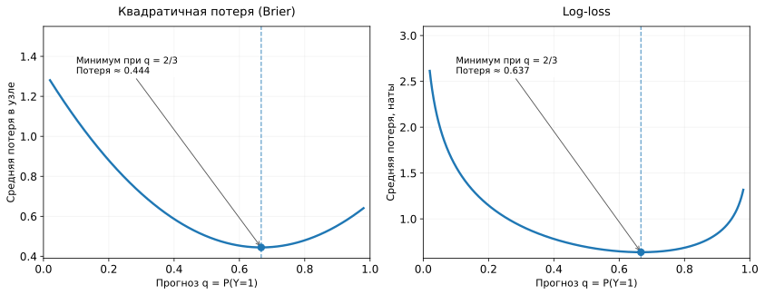

*Рисунок 17. Узел содержит 2 нуля и 4 единицы, поэтому $`p=2/3`$. На обеих панелях по горизонтали — предсказываемая вероятность класса 1, $`q`$; минимум достигается при $`q=p`$. Масштабы вертикальных осей различаются: слева Brier score для вектора $`(1-q,q)`$, справа log-loss с натуральным логарифмом.*

#### Если классов больше двух

Для $K$ классов лист выдаёт вектор $q=(q_1,\ldots,q_K)$ с $q_k\ge0$ и $\sum_kq_k=1$. Потеря объекта класса $k$ равна $-\ln q_k$. Поэтому средняя потеря в узле с классовыми долями $p_k$ равна

```math
R_S(q)=-\sum_{k=1}^{K}p_k\ln q_k.
\qquad\text{(44)}
```

Теперь оптимизируем **все компоненты $q_k$ одновременно**, не забывая, что они должны суммироваться в единицу. В случае, когда все $p_k>0$, это можно сделать через метод множителей Лагранжа. Вспомогательный множитель $\lambda$ позволяет учитывать ограничение $\sum_kq_k=1$ при дифференцировании:

```math
F(q,\lambda)=-\sum_kp_k\ln q_k+\lambda\left(\sum_kq_k-1\right).
```

Для допустимого вероятностного вектора добавленное слагаемое равно нулю. Приравняем частные производные по $q_k$ к нулю:

```math
\frac{\partial F}{\partial q_k}=-\frac{p_k}{q_k}+\lambda=0
\quad\Longrightarrow\quad q_k=\frac{p_k}{\lambda}.
```

Просуммируем по классам: $1=\sum_kq_k=(1/\lambda)\sum_kp_k=1/\lambda$. Значит, $\lambda=1$ и **$q_k=p_k$ для всех $k$**. Средняя log-loss выпукла по допустимым положительным вероятностям, поэтому найденная точка даёт минимум. Если некоторых классов в узле нет ($p_k=0$), оптимум приписывает им нулевую вероятность; остальные доли сохраняются. Для выражений с $p_k=0$ используем стандартное соглашение $0\ln0=0$.

В результате

```math
\boxed{q^*=(p_1,\ldots,p_K),\qquad
H_{\log}(S)=-\sum_{k=1}^{K}p_k\ln p_k.}
\qquad\text{(45)}
```

Так мы получили многоклассовую энтропию из той же задачи минимизации потери постоянного прогноза. А выражение «информационный выигрыш» из §4.4 означает уменьшение **именно этой неоднородности**, если энтропию считать в согласованных единицах. Дополнительного алгоритма построения дерева для information gain не требуется.

### 6.4. Что объединяет эти результаты

В §3–5 мы использовали критерии, чтобы обучить структуру дерева. Теперь можно увидеть, почему для разных типов ответов возникают знакомые формулы:

| Что прогнозирует лист | Локальная функция потерь | Оптимальный постоянный прогноз | Минимальная потеря (неоднородность) |
|---|---|---|---|
| Число | $(y-a)^2$ | Среднее $y$ в узле | Средняя квадратичная ошибка, $H_{\mathrm{MSE}}$ |
| Класс | $I[y\ne a]$ | Самый частый класс | $1-\max_kp_k$ |
| Вероятности классов | Многоклассовый Brier score (34) | Вектор долей $p$ | $G=1-\sum_kp_k^2$ |
| Вероятности классов | Log-loss | Вектор долей $p$ | $H_{\log}=-\sum_kp_k\ln p_k$ |

Таблица показывает два разных эффекта выбора функции потерь. Во-первых, она определяет, какой **постоянный прогноз** оптимален для объекта, дошедшего до листа. Во-вторых, минимальная потеря этого прогноза даёт **меру качества узла**, которая участвует в сравнении возможных разбиений.

Любопытно, что для Brier score и log-loss оптимальные вероятности внутри фиксированного листа **совпадают**, но значения минимальных потерь различаются. Поэтому, даже если на одной и той же выборке использовать два этих критерия для роста дерева, можно получить **разные структуры разбиений**. И напротив, одинаковый листовой прогноз ещё не означает, что критерии при построении дерева эквивалентны.

На практике алгоритму не обязательно на каждом пороге явно искать оптимальный вектор $q$ с помощью процедуры оптимизации. Мы уже вывели его аналитически: достаточно подсчитать частоты классов и подставить их в формулу критерия. Для регрессии с MSE аналогично достаточно среднего и суммы квадратов отклонений. Так математический вывод объясняет быстрые вычисления, которые использует алгоритм построения.

### Итак

- Оптимальный постоянный прогноз и минимальная потеря этого прогноза — **две разные величины**; обе получаются из одной задачи минимизации.
- Для регрессии с MSE минимум достигается на среднем, а минимальная потеря совпадает с неоднородностью по среднему квадрату.
- Для многоклассового Brier score оптимальные вероятности равны долям классов, а минимальная потеря даёт **Gini** в выбранной нормировке.
- Для log-loss оптимальные вероятности также равны долям классов, а минимальная потеря даёт **энтропию Шеннона**. Основание логарифма меняет единицы, но не порядок разбиений.
- Разные критерии могут выбирать разные структуры дерева; общий жадный алгоритм построения при этом остаётся тем же.

## 7. Почему дерево переобучается и как ограничить его сложность

В §2–5 мы познакомились с алгоритмом дерева и разобрали, как выбирать разбиения; в §6 увидели математические основания критериев. Теперь перед нами уже не вопрос о том, **как построить разбиение**, а вопрос о том, **какие разбиения стоит разрешать**, чтобы полученное дерево предсказывало хорошо на новых объектах. Но у этого алгоритма пока есть опасное свойство: почти всегда можно продолжить дробить данные, если снять ограничения на размер дерева. Из того, что очередное разбиение уменьшает ошибку **на обучающих объектах**, ещё не следует, что оно улучшит прогноз на новых.

Вспомним маленькое классификационное дерево из §5. Оно остановилось на трёх чистых листьях. Это удобно: каждый лист предсказывает только один класс. Но **чистота листьев не является сама по себе гарантией хорошего качества**. В искусственном примере классы были устроены очень просто, и трёх листьев оказалось достаточно для правильного описания правила. В реальных данных встречаются шум в признаках, ошибки разметки и объекты, для которых похожие наборы признаков соответствуют разным классам.

Представим, что алгоритм последовательно выделяет всё меньшие группы. В конце некоторые листья могут содержать лишь одно наблюдение. Тогда лист всегда точно предсказывает метку этого наблюдения. Если совпадающих по признакам объектов с противоречащими метками нет и разрешены достаточно глубокие разбиения, дерево с числовыми порогами способно добиться нулевой ошибки на конечной обучающей выборке. Но оно запомнит и случайные особенности конкретных наблюдений: для нового объекта соседний узкий прямоугольник может оказаться плохим ориентиром.

Похожая ситуация возникает в регрессии. При квадратичной потере прогноз листа — среднее ответов в нём. Если в листе остался один объект, прогноз совпадает с его $y_i$, и тренировочная квадратичная ошибка в этом листе равна нулю. При этом наблюдавшееся $y_i$ может содержать шум: модель запомнила не только закономерность, но и случайное отклонение от неё.

### 7.1. Что происходит при росте глубины

Рассмотрим две картинки одной и той же проблемы. На первой — двумерная классификация. Неглубокое дерево создаёт несколько крупных областей. Глубокое дерево получает свободу рисовать всё более узкие полосы и маленькие прямоугольники вокруг отдельных обучающих объектов.

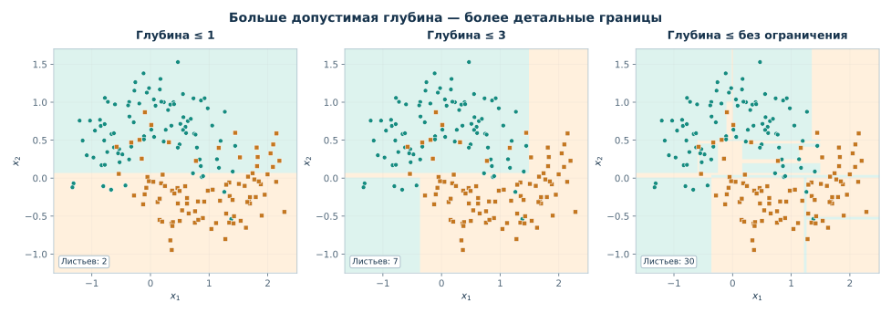

*Рисунок 18. Три дерева обучены на одних и тех же шумных данных. Увеличение глубины позволяет точнее подогнать обучающие точки, но создаёт всё более сложную разделяющую границу. Цвет фона — прогноз класса, точки — обучающая выборка.*

На второй картинке — регрессия. При малой глубине ступени довольно крупные: дерево обобщает несколько наблюдений одним средним. При большой глубине ступени становятся многочисленными и начинают следовать за отдельными шумными значениями.

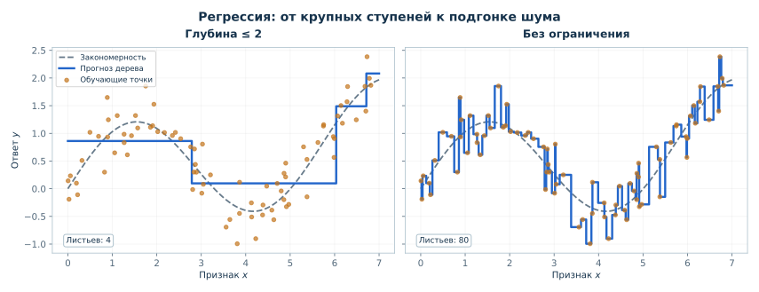

*Рисунок 19. Одна и та же шумная зависимость и два регрессионных дерева. Глубокая модель лучше подстраивается под обучающие точки, но заметно сильнее колеблется относительно закономерности, по которой были сгенерированы данные.*

Проблема проверяется не по внешней «красоте» границы. Мы обучаем деревья разной сложности на *train* и оцениваем каждый вариант на независимой от обучения *validation*-выборке. Типичная картина показана на рисунке 20.

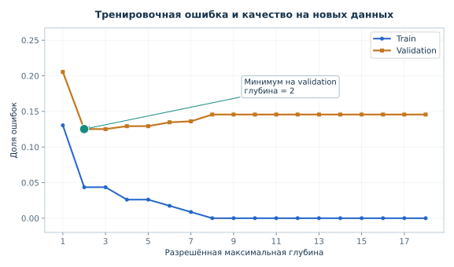

*Рисунок 20. Учебный вычислительный эксперимент: по мере увеличения допустимой глубины ошибка на train снижается, а на validation сначала улучшается, затем перестаёт улучшаться и может расти. Конкретная форма кривых зависит от данных; универсальной «лучшей глубины» нет.*

Важно различать **возможность** и **гарантию**: увеличение допустимой глубины не обязывает алгоритм использовать все уровни, а ошибка на validation не обязана строго возрастать после некоторой точки. Однако механизм риска понятен: больше разрешённых разбиений — больше возможностей подстроиться под детали обучающей выборки.

Задача регуляризации дерева поэтому звучит просто: **не разрешать алгоритму строить произвольно сложную структуру, если её дополнительная сложность не помогает обобщению**. Есть два основных подхода: ограничивать рост сразу или сначала вырастить дерево, а потом упростить его.

### 7.2. Ограничиваем рост заранее: pre-pruning

**Предварительная обрезка** (*pre-pruning*, или ограничение роста) означает, что ещё во время построения дерева мы запрещаем некоторые разбиения. Разбиение называется **допустимым**, если оно удовлетворяет ограничениям, установленным для алгоритма: например, не создаёт слишком маленьких дочерних групп и не превышает разрешённую глубину. Даже среди допустимых кандидатов алгоритм выбирает только разбиение с подходящим улучшением критерия. Рассмотрим четыре распространённых ограничения.

**Ограничение глубины.** Глубина корня равна нулю; каждый переход к дочернему узлу увеличивает её на единицу. Если максимальная глубина равна двум, на глубине 2 уже нельзя создавать новых потомков. Даже если такой лист содержит смесь классов, он останется листом и будет предсказывать класс большинства и соответствующие доли классов. В регрессии в нём останется среднее целевых значений.

**Минимальное число объектов для попытки разбиения.** Например, при минимуме 6 объектов узел с 5 наблюдениями нельзя делить дальше, а узел с 6 наблюдениями ещё можно *рассмотреть* как кандидат на разбиение. Но из права рассмотреть split не следует, что существует допустимый split или что его действительно выберут.

**Минимальный размер каждого дочернего листа.** Допустим, мы требуем не менее 4 объектов в каждой части. Для узла из 12 объектов разбиение $6+6$ допустимо, а $3+9$ — запрещено, хотя в исходном узле объектов достаточно. Это более сильное локальное ограничение на допустимые кандидаты: проверять нужно **обе** образующиеся группы. Оно действует не только на окончательные листья, но и на группы, которые в будущем могут быть разделены снова.

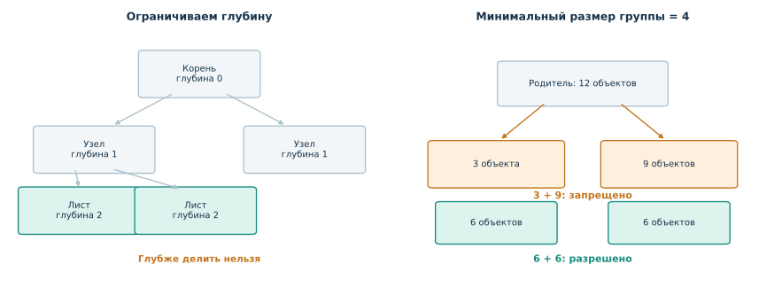

*Рисунок 21. Ограничение глубины и минимальный размер дочерней группы отвечают на разные вопросы. На схеме справа при требовании хотя бы четырёх объектов в каждой группе кандидат $`3+9`$ недопустим, а $`6+6`$ допустим.*

**Минимальное улучшение качества разбиения.** Предположим, до разбиения взвешенная неоднородность равнялась $0.32$, а после — $0.31$. Улучшение составляет $0.01$. Если алгоритм требует улучшения хотя бы $0.02$ в выбранной нормировке, этот split не принимается. Такое правило отличается от ограничений на число наблюдений: оно сравнивает пользу разбиения, а не только размеры получившихся групп. В промышленных реализациях изменение неоднородности может дополнительно взвешиваться долей объектов текущего узла во всей обучающей выборке, поэтому значения порога нужно трактовать в используемой нормировке.

Эти ограничения иногда срабатывают одновременно. Узел может быть достаточно большим и располагаться неглубоко, но не иметь ни одного допустимого разделения с требуемым улучшением. И наоборот: хороший по Gini split может быть запрещён, поскольку создаёт слишком маленький лист. Каждый раз алгоритм заканчивает построение **обычным прогнозирующим листом**, а не «необученным» узлом.

У ограничения роста есть понятный недостаток: решение «продолжать или остановиться» приходится принимать **до того**, как построены более глубокие ветви. Иногда первое разделение почти не улучшает критерий, но создаёт две группы, каждая из которых хорошо разделится на следующем уровне. Жёсткое правило минимального улучшения может остановиться слишком рано. Рассмотрим небольшой пример **XOR**: класс равен 1, если ровно один из двух бинарных признаков равен 1.

| $x_1$ | $x_2$ | Класс $y$ |
|---:|---:|---:|
| 0 | 0 | 0 |
| 0 | 1 | 1 |
| 1 | 0 | 1 |
| 1 | 1 | 0 |

В корне два объекта класса $0$ и два класса $1$, поэтому $G(S)=1/2$. Если сначала проверить $x_1\le0.5$, слева окажутся объекты $(0,0)$ и $(0,1)$ с разными классами, а справа — $(1,0)$ и $(1,1)$, также с разными классами. Неоднородность обеих групп равна $1/2$. Следовательно, выигрыш первого разбиения равен

```math
\Delta G=\frac12-\left(\frac24\cdot\frac12+\frac24\cdot\frac12\right)=0.
```

Проверка $x_2\le0.5$ вместо $x_1\le0.5$ даст тот же результат: каждое дочернее множество всё ещё содержит по одному представителю каждого класса.

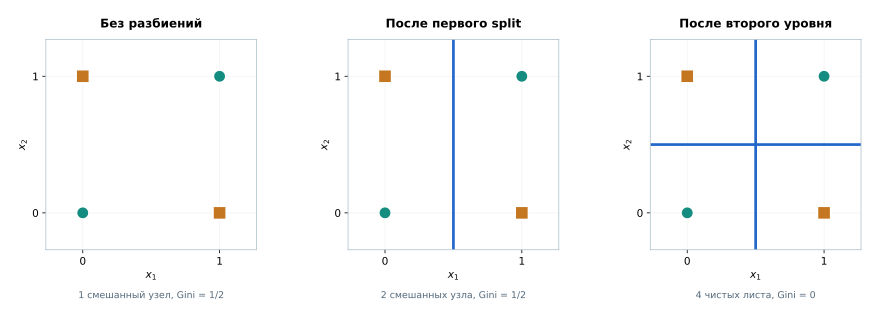

*Рисунок 22. После первого разбиения по $`x_1`$ обе группы остаются смешанными. Второе разбиение по $`x_2`$ внутри каждой группы создаёт четыре чистых листа. Цвет и форма маркеров обозначают классы.*

Однако **после первого разбиения можно продолжить обучение**. В левой группе проверка $x_2\le0.5$ отделит $(0,0)$ от $(0,1)$, а в правой — $(1,0)$ от $(1,1)$. Теперь каждый из четырёх листьев содержит один объект, и его Gini равен нулю. Дерево глубины 2 идеально описывает эти четыре обучающих примера.

Таким образом, дерево **способно выразить XOR**, но критерий, оценивающий только непосредственный выигрыш, не показывает полезности первого шага. Если алгоритм требует **строго положительного уменьшения Gini** при каждом split, он остановится в корне и не построит такую структуру. Если же допускает нулевой первый выигрыш и дальнейшее разделение не запрещено другими ограничениями, нужное дерево может быть построено.

Это одна из причин не делать минимальное улучшение единственным ограничением роста. При этом сама последующая обрезка не исправит остановку в корне: post-pruning способен только удалять уже построенные ветви. Он предлагает иной способ контролировать сложность большого дерева, а не гарантирует глобально оптимальную структуру.

### 7.3. Сначала вырастить, затем упростить: post-pruning

**Постобрезка** (*post-pruning*) начинается с относительно большого дерева. Затем некоторые его поддеревья заменяют одним листом. Представим внутренний узел с двумя дочерними ветвями и несколькими конечными листьями. После удаления всего поддерева этот узел сам становится листом; его прогноз рассчитывается по всем обучающим объектам, которые доходят до него.

Если исходное дерево было построено минимизацией тренировочной неоднородности, такая замена **не может уменьшить её при том же критерии и неизменных данных**: у более сложной структуры было больше свободы подгонки. Но зато дерево становится проще. Возможно, потеря небольшой части тренировочного качества окупится более надёжными прогнозами на новых данных.


*Рисунок 23. Схематическая последовательность вложенных деревьев: исходное дерево с пятью листьями, его упрощение с тремя листьями и дерево из одного листа. При каждом шаге удаляется целое поддерево, а не произвольный набор ветвей.*

Это общая идея post-pruning; существует несколько способов решать, **какие** ветви удалять. Например, можно проверять влияние удаления на отложенной выборке (*reduced-error pruning*). Для подробного изучения одного стандартного подхода рассмотрим **cost-complexity pruning**, где к ошибке подгонки добавляется штраф за число листьев.

Пусть $T$ — некоторое поддерево исходного большого дерева $T_0$, а $L(T)$ — множество его листьев. Чтобы количественно сравнивать большое дерево с его упрощениями, нужна **одна общая мера ошибки для всей обучающей выборки**. Для каждого листа мы знаем его неоднородность $H(S_m)$ и число попавших в него объектов $n_m$. Если учесть, какую долю выборки обслуживает каждый лист, получим тренировочный риск $R(T)$ — среднее значение соответствующей потери или неоднородности по объектам всего дерева:

```math
R(T)=\sum_{m\in L(T)}\frac{n_m}{n}H(S_m).
\qquad\text{(46)}
```

Здесь $n$ — количество обучающих объектов во всём дереве, $n_m$ — число объектов в $m$-м листе, $S_m$ — соответствующее подмножество обучающих данных, а $H$ — критерий, который мы использовали для построения дерева. Для регрессии с MSE это средняя по всей обучающей выборке квадратичная ошибка дерева; для классификации с Gini — взвешенная неоднородность его листьев, а **не** доля неправильных классификаций.

Теперь добавим штраф:

```math
\boxed{C_\alpha(T)=R(T)+\alpha\,|L(T)|,\qquad \alpha\ge0.}
\qquad\text{(47)}
```

Здесь $|L(T)|$ обозначает **мощность множества** $L(T)$, то есть просто число листьев, а не модуль числа или вектора. Чем больше листьев, тем больше штраф. Параметр $\alpha$ отвечает на вопрос: насколько большое улучшение тренировочного риска оправдывает дополнительную сложность дерева? При $\alpha=0$ предпочтительны деревья с наименьшим тренировочным риском; при достаточно большом $\alpha$ выгодным становится очень маленькое дерево.

Разберём числа. Для простоты представим три **условных вложенных дерева**, а не повторим наш набор из 12 объектов: нам нужны три конструкции, на которых будет видно изменение предпочтения. Предположим, что для них получился следующий тренировочный риск в одной и той же нормировке (значения иллюстративные, но совместимы с тем, что упрощение не уменьшает ошибку обучения):

| Дерево | Число листьев | $R(T)$ | $C_\alpha(T)$ |
|---|---:|---:|---|
| Большое | 5 | $0.04$ | $0.04+5\alpha$ |
| Среднее | 3 | $0.12$ | $0.12+3\alpha$ |
| Корневой лист | 1 | $0.40$ | $0.40+\alpha$ |

При $\alpha=0.02$ значения критерия соответственно равны $0.14$, $0.18$ и $0.42$: из этих трёх вариантов побеждает большое дерево. При $\alpha=0.08$ получаем $0.44$, $0.36$ и $0.48$: теперь предпочтительнее дерево с тремя листьями. При $\alpha=0.20$ получаем $1.04$, $0.72$ и $0.60$: лучше всего одно-листовое дерево.

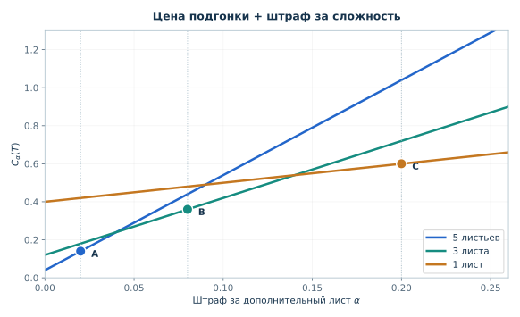

*Рисунок 24. Каждая линия — $`R(T)+\alpha |L(T)|`$ для одной из трёх иллюстративных структур. По мере роста $`\alpha`$ минимум среди показанных вариантов смещается от большого дерева к меньшему. В реальном алгоритме рассматривается последовательность кандидатов, сформированная из одного выращенного дерева.*

На этом примере можно увидеть два порога предпочтения. Большое и среднее деревья сравняются при $0.04+5\alpha=0.12+3\alpha$, то есть $\alpha=0.04$. Среднее и дерево из одного листа — при $0.12+3\alpha=0.40+\alpha$, то есть $\alpha=0.14$. Но это пока только сравнение **трёх заранее выбранных вариантов**. Как получить кандидатов из настоящего дерева, не перебирая все возможные способы обрезки?

В стандартном алгоритме **weakest-link pruning** исходное большое дерево $T_0$ последовательно упрощают. Для каждого внутреннего узла $t$ можно рассчитать значение штрафа, при котором оставить поддерево $T_t$ и заменить его одним листом становится одинаково выгодно. Обозначив через $R(t)$ вклад этого единственного листа в риск всей модели, а через $R(T_t)$ — общий вклад листьев поддерева, получаем

```math
\alpha_{\mathrm{eff}}(t)=
\frac{R(t)-R(T_t)}{|L(T_t)|-1}.
\qquad\text{(48)}
```

Знаменатель — число листьев, которое будет убрано, **за вычетом одного**: поддерево заменяется одним листом. Числитель — насколько при этой замене возрастёт тренировочный риск. Поэтому $\alpha_{\mathrm{eff}}(t)$ показывает, какую прибавку риска приходится заплатить за каждый удаляемый лист. Выбирают самое слабое поддерево — с минимальным эффективным штрафом — и обрезают его. Повторяя операцию, получают **вложенную последовательность деревьев** от большого к одному листу.

Затем эта последовательность рассматривается как набор кандидатов на модель. Размер штрафа выбирают по validation или кросс-валидации, а не по train: у нас нет основания предпочитать дерево с минимальным значением самого $C_\alpha$ при произвольно взятом $\alpha$. Процедура pruning определяет доступные упрощения; **валидация определяет, какое из них полезнее для будущего прогноза**.

### 7.4. Как выбрать сложность и не обмануть себя

Обе стратегии — ограничение роста и последующая обрезка — решают одну задачу: найти разумный компромисс между подгонкой и сложностью дерева. В повседневной работе с отдельными деревьями часто начинают с ограничений глубины и минимального числа объектов в листе: они непосредственно меняют механизм роста и легко объясняются. Post-pruning остаётся полноценной альтернативой, особенно когда удобно сначала вырастить большое дерево, а затем выбрать из последовательности его упрощений.

Выбор конкретных ограничений нельзя делать по итоговой тестовой выборке. Корректная схема знакома нам по предыдущим неделям: на обучающей части данных рассматриваем разные настройки, оцениваем их с помощью validation или кросс-валидации, выбираем настройку и лишь после этого проверяем итоговую модель на независимом test. При кросс-валидации поиск подходящего $\alpha$ также должен проводиться без использования проверочного фолда для обучения соответствующего дерева.

Здесь полезно помнить ещё одну вещь: **самое маленькое дерево не всегда лучше**. Если глубины недостаточно, дерево не сумеет описать реальную зависимость. На рисунке 18 это проявляется как высокая ошибка недостаточно гибких моделей. Цель не «сделать дерево как можно мельче», а выбрать сложность, которая помогает прогнозировать новые наблюдения.

### Итак

- Дерево растёт сверху вниз: в каждом узле выбирается допустимое разбиение по заданному критерию, а на дочерних данных процедура повторяется.
- **Чистота листьев на train не гарантирует качество** на новых наблюдениях: мелкие области могут запоминать шум и случайные особенности выборки.
- **Pre-pruning** ограничивает возможные ветвления непосредственно при построении дерева; **post-pruning** сначала выращивает большую структуру и затем заменяет некоторые поддеревья листьями.
- Параметры сложности выбирают по validation или CV, оставляя test для итоговой проверки. Обучение определяет правила и листовые прогнозы; при `predict` уже обученное дерево лишь проверяет эти правила.

## 8. Свойства решающих деревьев: следствия из их устройства

Теперь мы знаем, как возникает дерево и как ограничивается его сложность. Можно перейти от описания алгоритма к тому, **как будет вести себя обученная модель в разных ситуациях**. Все свойства ниже вытекают из двух уже известных фактов: дерево разбивает пространство последовательными предикатами и выдаёт постоянный прогноз в каждом листе.

### 8.1. Нелинейность и взаимодействия признаков

Линейный классификатор без специальных нелинейных преобразований может создать границу вида $w_0+w_1x_1+w_2x_2=0$, то есть прямую на плоскости. У дерева граница складывается из отрезков осевых линий, причём выбор следующего условия зависит от того, какие предыдущие условия уже выполнились.

Построим пример, в котором класс $1$ соответствует объектам внутри прямоугольной области, а вне её находится класс $0$. Одной прямой невозможно выделить внутренний прямоугольник от объектов со всех четырёх сторон. Несколько последовательных пороговых проверок, напротив, позволяют сделать это точно.

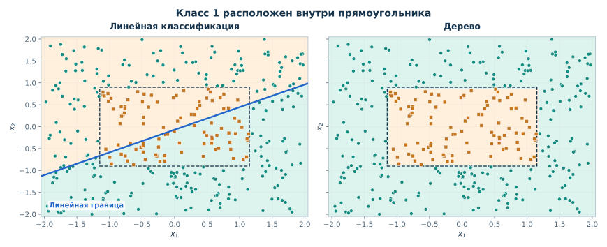

*Рисунок 25. Обе модели обучены на одном синтетическом наборе. Синяя прямая на левом графике — граница линейного классификатора (с балансировкой весов классов для видимого сравнения); он не может одной прямой выделить центр. На правом графике дерево приближает прямоугольную область последовательными осевыми разбиениями. *

Здесь есть и понятие **взаимодействия признаков**. Например, один и тот же признак $x_2$ может проверяться только среди объектов, для которых $x_1$ превысил порог. Его роль, следовательно, зависит от другого признака. Для линейной модели подобную зависимость пришлось бы задавать отдельными сконструированными признаками или менять семейство модели. Дерево находит такую структуру непосредственно во время обучения.

Однако гибкость не означает, что любая геометрия получается компактной. Диагональная граница часто требует множества коротких осевых ступенек, тогда как линейная модель представляет её одной прямой. Поэтому деревья не превосходят линейные методы на всех задачах: характер зависимости и количество данных имеют значение.

### 8.2. Почему деревьям обычно не нужно масштабирование числовых признаков

При изменении относительных масштабов нескольких признаков в kNN могут измениться расстояния и ближайшие соседи. Простая смена единиц единственного признака умножает все расстояния на один положительный коэффициент и сама по себе не меняет соседей. Пороговое дерево использует другое свойство — **порядок числовых значений**.

Пусть дерево разделяет клиентов условием «возраст $\le20$ лет». Если возраст перевести в месяцы, соответствующее условие станет «возраст $\le240$ месяцев». Объекты попадут ровно в те же группы. При умножении признака на положительную константу $a$ и прибавлении $b$ правило $x_j\le t$ переписывается как $ax_j+b\le at+b$, и результат проверки не меняется.

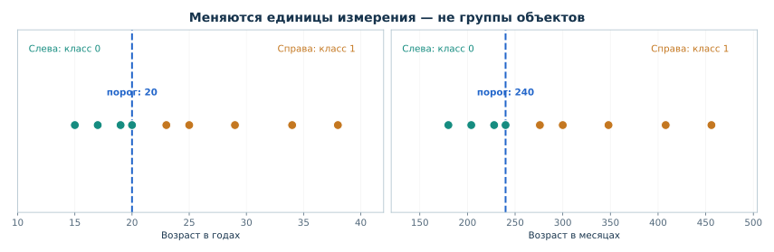

*Рисунок 26. Один и тот же split в двух системах единиц: возраст в годах и месяцах. Порог меняет числовую запись, но не принадлежность объектов к ветвям.*

Это верно не только для смены единиц, но и для любого строго возрастающего преобразования признака: оно сохраняет порядок объектов, а значит, и набор разбиений между соседними наблюдениями. Следовательно, при идеальном переборе порогов обученное дерево может сохранить то же разбиение и прогнозы, хотя численные пороги изменятся.

Здесь важны оговорки. При округлении и грубой дискретизации разные значения могут слиться в одно; при изменениях, которые **не сохраняют порядок**, разбиения могут измениться. В реальных реализациях также имеют значение точность вычислений, обработка пропусков и правила разрешения равенств между кандидатами. Поэтому корректнее говорить: **обычным осевым деревьям, в отличие от методов на расстояниях, стандартное масштабирование не требуется по смыслу алгоритма**.

### 8.3. Почему регрессионное дерево не продолжает тренд

Пусть мы наблюдали растущую зависимость только при $x\in[0,5]$. На этом интервале линейная модель может подобрать возрастающую прямую, а регрессионное дерево — несколько ступеней. Теперь попросим прогнозы для $x=6,7,8$.

Линейная модель продолжит вычислять значение прямой. Дерево не строит нового правила за пределами обучающих значений: все такие объекты пройдут по уже известным условиям и попадут в крайний лист, получив **одну и ту же константу**.

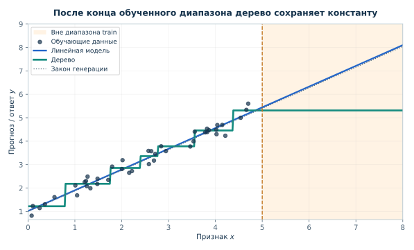

*Рисунок 27. За правой границей обучающего диапазона линейная модель продолжает свой тренд, а дерево с постоянными прогнозами в листьях сохраняет уровень последней области. Заштрихована зона вне диапазона обучающих $`x`$.*

При MSE прогноз листа — среднее обучающих ответов в этом листе. Любое такое среднее лежит между минимальным и максимальным обучающим значением $y$. Следовательно, **обычное регрессионное дерево с MSE не выдаёт прогноз вне диапазона ответов, наблюдавшихся при обучении**, даже если истинная зависимость продолжает расти.

Это не делает дерево бесполезным. Для прогноза *внутри* изученного диапазона его гибкость может быть преимуществом. Но если ключевая задача — экстраполяция устойчивого тренда, ограничение нужно учитывать при выборе семейства моделей.

### 8.4. Почему небольшое изменение выборки может изменить дерево

Вернёмся к поиску лучшего split. В некотором узле два кандидата могут иметь почти одинаковое улучшение Gini. Достаточно изменения нескольких наблюдений, чтобы их порядок поменялся. Если другой кандидат выбран уже **в корне**, последующие группы объектов тоже станут другими. Таким образом, небольшое изменение данных иногда приводит к заметно отличающейся структуре дерева.

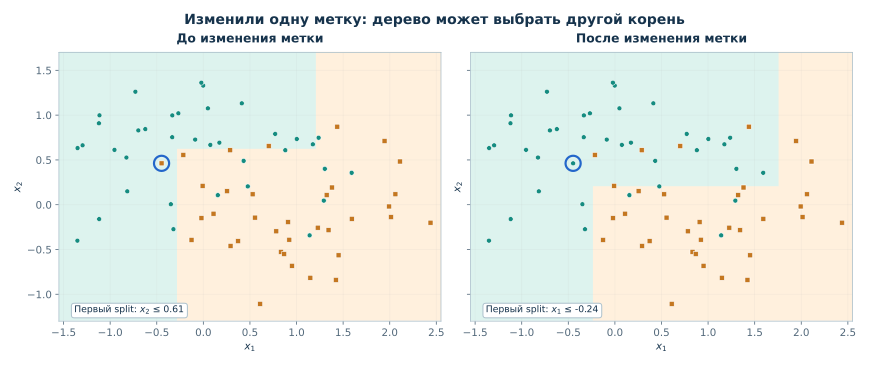

*Рисунок 28. Два дерева одинаковой разрешённой глубины, обученные на близких вариантах одной шумной выборки. Корневые разбиения могут различаться, а за ними меняется и геометрия последующих областей. Это демонстрация возможности нестабильности, а не утверждение, что любое изменение данных обязательно меняет дерево.*

Нестабильность — не то же самое, что гарантированно плохое качество. Два разных дерева могут одинаково хорошо предсказывать на validation. Однако если нам нужен устойчивый набор правил или прогнозы меняются от небольших изменений обучающей выборки, это повод проверить результаты внимательнее. Именно такая чувствительность одиночных деревьев станет важной мотивацией для будущего разговора об ансамблях, но их устройство мы здесь ещё не изучаем.

### 8.5. Насколько дерево действительно интерпретируемо

У небольшого дерева понятное достоинство: для конкретного объекта можно перечислить проверенные условия и показать, почему он попал в определённый лист. Например: «первое условие не выполнилось; второе тоже; в соответствующем листе большинство обучающих объектов имело класс 1». Это точное описание **работы модели**.

Но не следует путать три разных утверждения:

- **Путь по дереву:** какие правила модель проверила для данного объекта. Это можно восстановить точно.
- **Роль признаков в модели:** как изменились бы прогнозы при других значениях признаков или насколько часто они используются. Это уже отдельная задача анализа, и для сложного дерева одного пути недостаточно.
- **Причина события в реальном мире:** например, почему клиент действительно совершил покупку. Правила дерева сами по себе не доказывают причинно-следственную связь.

Кроме того, небольшое дерево можно охватить целиком, а дерево из сотен узлов — уже нет, хотя технически каждый его путь всё ещё можно прочитать. Поэтому **интерпретируемость зависит от размера структуры, задачи и того, что мы хотим объяснить**. Развёрнутые методы исследования влияния признаков и диагностики модели будем изучать отдельно; здесь важно не обещать дереву больше, чем оно позволяет установить.

### Итак

- Осевые пороги позволяют дереву моделировать нелинейности и взаимодействия, но не всякую форму границы удаётся представить компактно.
- Строго возрастающее преобразование числового признака сохраняет порядок объектов, поэтому обычному пороговому дереву не нужно стандартное масштабирование; грубое округление — другое дело.
- Обычное регрессионное дерево с прогнозом среднего в листьях не продолжает тренд за пределами обученных областей. Структура дерева также может быть чувствительна к небольшим изменениям данных.
- Путь объекта по дереву объясняет **принцип работы модели**, но не устанавливает причинных связей в реальном мире.

## 9. Категориальные признаки и пропущенные значения

До сих пор все рассмотренные условия имели вид $x_j\le t$, то есть предполагали числовой признак. В реальных таблицах встречаются категории и отсутствующие значения. Теоретически это не запрещает пользоваться деревьями, но требует определить, **какое условие мы разрешаем проверять** и что делать, когда значение отсутствует.

### 9.1. Как дерево может проверять категорию

Возьмём признак `city` со значениями `Москва`, `Казань`, `Пермь`, `Омск`. Это **номинальные категории**: их названия не задают естественного числового порядка. Рассмотрим три способа работы с таким признаком.

**Целочисленные коды (ordinal encoding).** Присвоим Москве код $1$, Казани — $2$, Перми — $3$, Омску — $4$. Тогда условие `city_code ≤ 2.5` отделит Москву и Казань от Перми и Омска. Порог использует порядок, возникший только из нашего кодирования: если поменять коды Казани и Перми местами, тот же порог отделит Москву и Пермь от Казани и Омска. При фиксированной кодировке один порог может разделить только соседние группы в заданном порядке, а не произвольные подмножества городов.

**One-hot encoding** — знакомое по неделе 7 создание бинарного признака-индикатора для каждой категории:

| Город | `city_Москва` | `city_Казань` | `city_Пермь` | `city_Омск` |
|---|---:|---:|---:|---:|
| Москва | 1 | 0 | 0 | 0 |
| Казань | 0 | 1 | 0 | 0 |
| Пермь | 0 | 0 | 1 | 0 |
| Омск | 0 | 0 | 0 | 1 |

Теперь дерево может проверять, например, `city_Москва ≤ 0.5`. При выполнении условия объект относится к Казани, Перми или Омску; иначе — к Москве. Одно такое разбиение отделяет **одну категорию от остальных**, а несколько последовательных разбиений могут задавать более сложные правила. При большом числе уникальных категорий one-hot создаёт много дополнительных столбцов; разбиение вида «Москва или Пермь против Казани или Омска» требует нескольких проверок индикаторов. Это не делает one-hot ошибочным, но иногда приводит к большему дереву, чем непосредственное разбиение категорий на две группы.

**Непосредственное категориальное разбиение.** Разрешим внутренним узлам **категориальные предикаты** вида

```math
b_{j,C}(x)=I\lbrace x_j\in C\rbrace ,
\qquad\text{(49)}
```

где $C$ — некоторое подмножество категорий. Например, условие `city ∈ {Москва, Пермь}` сразу отделит Москву и Пермь от Казани и Омска. Здесь не нужен порядок числовых кодов, и один предикат способен разделить четыре категории на две пары. Но возникает новая задача поиска: для признака с большим числом категорий существует очень много способов разделить их на две группы. Именно поэтому реализация такого split требует специального алгоритма или ограничения допустимых вариантов.


*Рисунок 29. Три способа проверки признака `city`. Слева порог использует произвольный порядок кодов; в центре один one-hot индикатор отделяет Москву от остальных; справа непосредственный предикат отделяет Москву и Пермь от Казани и Омска.*

Эти три схемы не тождественны. Целочисленная кодировка задаёт порядок категорий, one-hot превращает исходную категорию в несколько числовых признаков, после чего используется обычный механизм пороговых split. Прямой категориальный предикат умеет проверять принадлежность сразу группе категорий. Выбор зависит от реализации и требований задачи.

Наконец, нужно отличать **возможности математической модели** от **возможностей конкретной библиотеки**. Стандартные деревья scikit-learn не принимают номинальные категориальные признаки как самостоятельный тип предиката: перед обучением их требуется кодировать численно. В других реализациях есть прямые категориальные split; поддержка в библиотеках развивается, поэтому при практической работе следует сверяться с документацией используемой версии.

### 9.2. Что делать, если значение признака неизвестно

Предположим, в узле выбран порог `age ≤ 30`. Для нового клиента возраст неизвестен. Нельзя ни подтвердить, ни опровергнуть условие. Значит, нужно заранее определить **правило маршрутизации пропуска**.

Рассмотрим три содержательно разных подхода.

**Заполнить пропуск до обучения дерева.** Например, вместо отсутствующего возраста записать медиану, оценённую только по обучающей выборке. После заполнения обычный пороговый предикат снова определён. Это простой путь, но результат зависит от способа заполнения, а различие между «возраст равен медиане» и «возраст неизвестен» при такой замене может потеряться. При необходимости к данным добавляют отдельный индикатор отсутствия признака. Значения для заполнения следует вычислять внутри обучающей части каждого разбиения на train и validation, чтобы не допустить утечки.

**Научиться направлять пропуски в одну из ветвей.** Пусть в текущем узле пять обучающих объектов:

| Объект | Возраст $x$ | Класс $y$ |
|---|---:|---:|
| A | 20 | 0 |
| B | 25 | 0 |
| C | 36 | 1 |
| D | 40 | 1 |
| E | неизвестен | 1 |

Для порога $x\le30$ первые два объекта попадут влево, C и D — вправо. А объект E можно попробовать отправить и влево, и вправо, **вычисляя качество каждого направления**. Если отправить E вправо, оба дочерних узла станут чистыми: слева два нуля, справа три единицы. Взвешенный Gini тогда равен нулю. Если отправить E влево, левый узел будет содержать $0,0,1$, а правый — две единицы. Неоднородность левого узла равна $1-(2/3)^2-(1/3)^2=4/9$. После взвешивания по размеру групп получаем

```math
\begin{aligned}
G_{\mathrm{after}}(E\to L)
&=\frac35\cdot\frac49+\frac25\cdot 0
=\frac4{15},\\[0pt]
G_{\mathrm{after}}(E\to R)
&=\frac25\cdot0+\frac35\cdot0=0.
\end{aligned}
```

Таким образом, отправить пропуск вправо выгоднее по Gini. Поэтому для этого кандидата разумнее сохранить правило «пропущенный возраст → вправо» и применять его для новых объектов. Мы действительно **сравнили качество двух маршрутов**, а не произвольно выбрали направление.

**Использовать запасное правило по другому признаку.** Допустим, главным условием было `age ≤ 30`, но у нового объекта возраст неизвестен, зато указан стаж работы. Во время обучения можно подобрать второй предикат по стажу, который на объектах с известным возрастом чаще всего отправляет их в ту же ветвь, что и основное условие. Тогда при пропуске возраста используется **суррогатный предикат** (*surrogate split*) по стажу. Он не восстанавливает истинный возраст, а лишь приближает решение о ветви.

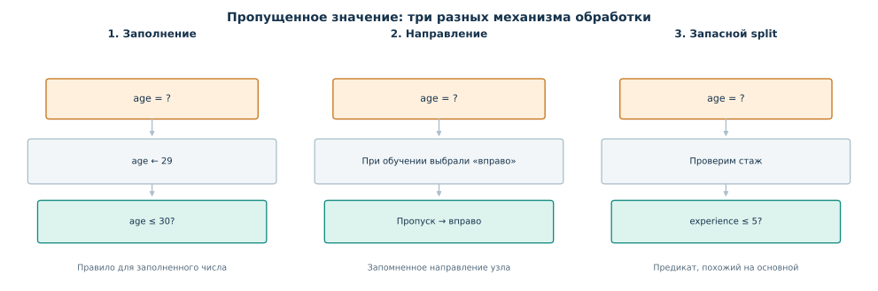

*Рисунок 30. Один и тот же пропуск можно обработать до построения дерева, направить по изученному правилу внутри узла или использовать запасной предикат. Это альтернативные схемы; не нужно выполнять все три одновременно.*

Различие между обучением и применением особенно важно. При втором подходе направление для пропусков выбирается **на train**, а при прогнозировании нового объекта используется сохранённое правило. Тем самым работа с `NaN` — часть обученной модели, а не произвольное решение, принимаемое каждый раз заново. При третьем подходе запасной предикат тоже должен быть подготовлен по обучающим данным. Иначе прогноз модели зависел бы от информации, которой ещё не было в момент обучения.

В современных версиях scikit-learn для числовых признаков у стандартных деревьев есть встроенная обработка `NaN`: при поиске разделения для обычного `best`-split алгоритм сравнивает направления для пропусков и запоминает подходящее. Если при обучении в соответствующем узле пропусков по выбранному признаку не было, при предсказании новый объект с `NaN` направляется в более многочисленную дочернюю группу — резервное правило этой реализации. При такой обработке пропуск направляется в одну из ветвей основного разбиения. Запасной предикат по другому признаку, в отличие от метода *surrogate splits*, здесь не строится. Конкретные режимы поддержки зависят от версии, критерия и настроек дерева.

### Итак

- Категориальные признаки можно представить бинарными индикаторами или, если алгоритм это допускает, проверять принадлежность целому множеству категорий.
- Пропуски можно заполнить заранее или обрабатывать **во время построения дерева**, сохраняя маршрут для последующих прогнозов; суррогатные предикаты — ещё один механизм.
- Поддержка категорий и `NaN` зависит от конкретной реализации и её параметров. Корректность обработки пропусков оценивают на отложенных данных, а заполнение не обучают по validation/test.

## 10. Как не пересчитывать каждый порог с нуля

Теперь вернёмся к одной вычислительной задаче, оставшейся за кадром. В §§3 и 5 мы перебирали несколько порогов и каждый раз заново подсчитывали состав дочерних групп. На маленькой таблице это несложно. Но если в узле сотни тысяч объектов и десятки признаков, многократный полный пересчёт становится дорогим.

**Основная идея ускорения:** отсортировать значения одного признака и двигаться по возможным порогам слева направо, обновляя небольшие наборы статистик. Между соседними допустимыми порогами из правой группы в левую переходит только очередной объект (или несколько объектов с одинаковым значением признака). Поэтому необязательно каждый раз заново просматривать обе группы.

### 10.1. Классификация: обновляем счётчики классов

Возьмём восемь отсортированных объектов с одним признаком и бинарными метками:

| $x$ | 1 | 2 | 3 | 4 | 5 | 6 | 7 | 8 |
|---|---:|---:|---:|---:|---:|---:|---:|---:|
| $y$ | 0 | 0 | 1 | 0 | 1 | 1 | 0 | 1 |

Для бинарной классификации поддерживаем **четыре счётчика**: число нулей слева $n_{L,0}$, число единиц слева $n_{L,1}$, число нулей справа $n_{R,0}$ и число единиц справа $n_{R,1}$. Вначале слева нет объектов: $(n_{L,0},n_{L,1})=(0,0)$, справа находятся все восемь: $(n_{R,0},n_{R,1})=(4,4)$. Когда порог проходит значение $x=1$, левый счётчик нулей увеличивается на единицу, а правый уменьшается на единицу. После следующего объекта повторяем то же действие. Если метка перемещённого объекта равна 1, обновляются счётчики единиц.

Рассмотрим два соседних порога:

| Порог | Слева: $(n_0,n_1)$ | Справа: $(n_0,n_1)$ | Взвешенный Gini после split |
|---|---|---|---:|
| $t=3.5$ | $(2,1)$ | $(2,3)$ | $\frac38\cdot\frac49+\frac58\cdot\frac{12}{25}=\frac7{15}\approx0.4667$ |
| $t=4.5$ | $(3,1)$ | $(1,3)$ | $\frac48\cdot\frac38+\frac48\cdot\frac38=\frac38=0.375$ |

При переходе от $3.5$ к $4.5$ **только один объект класса 0 переходит из правой группы в левую**. Именно поэтому второй результат можно получить обновлением четырёх счётчиков, а не повторным подсчётом восьми меток. В корневом узле Gini был $0.5$, так что улучшение для $t=4.5$ равно $0.5-0.375=0.125$, а для $t=3.5$ — приблизительно $0.0333$.

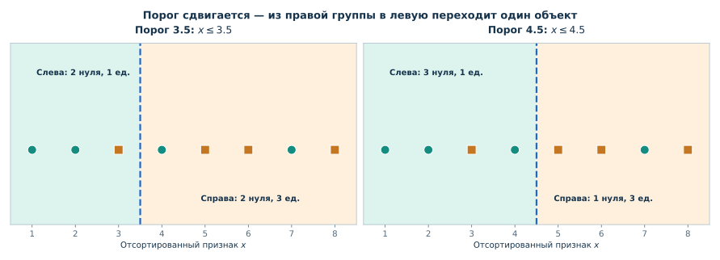

*Рисунок 31. Отсортированные объекты, два соседних порога и изменение счётчиков. Один объект с классом 0 переходит из правой группы в левую; всё остальное остаётся неизменным.*

### 10.2. Регрессия: достаточно трёх чисел на группу

Для регрессии с квадратичной потерей полезна формула, которую можно вывести из раскрытия квадрата:

```math
\begin{aligned}
RSS(S)&=\sum_{i\in S}(y_i-\bar y_S)^2\\[0pt]
&=\sum_{i\in S}y_i^2-2\bar y_S\sum_{i\in S}y_i+|S|\bar y_S^2\\[0pt]
&=\boxed{\sum_{i\in S}y_i^2-\frac{\left(\sum_{i\in S}y_i\right)^2}{|S|}}.
\end{aligned}
\qquad\text{(50)}
```

Значит, чтобы быстро пересчитывать RSS дочерней группы, достаточно хранить три числа: количество объектов $n_S$, сумму ответов $\sum y_i$ и сумму квадратов $\sum y_i^2$. При перемещении очередного объекта с ответом $y$ из правой группы в левую мы обновляем количество на $\pm1$, сумму на $\pm y$, сумму квадратов на $\pm y^2$.

Проверим на регрессионных данных из §3: $y=(1,2,1,7,8,9)$ при $x=(1,2,3,4,5,6)$. Для порога $t=3.5$ слева находятся ответы $(1,2,1)$:

```math
RSS_L=\underbrace{(1^2+2^2+1^2)}_{6}-\frac{\underbrace{(1+2+1)^2}_{16}}{3}=6-\frac{16}{3}=\frac23.
```

Справа — $(7,8,9)$:

```math
RSS_R=\underbrace{(7^2+8^2+9^2)}_{194}-\frac{\underbrace{(7+8+9)^2}_{576}}{3}=194-192=2.
```

Итого $RSS_L+RSS_R=8/3$ — точно то же значение, которое мы получили прямым подсчётом в §3. При переходе к порогу $4.5$ достаточно перенести ответ $7$ из правых накопленных статистик в левые: слева станет $(n,\sum y,\sum y^2)=(4,11,55)$, справа — $(2,17,145)$. Новая сумма ошибок: $RSS_L=55-121/4=99/4$, $RSS_R=145-289/2=1/2$, всего $101/4$. Вычислять отклонения всех объектов снова не нужно.

Такое накопление статистик действительно используется при точном поиске порога. Другой распространённый приём — **гистограммное построение**: сначала разбить диапазон признака на ограниченное число корзин, накопить статистики по корзинам и искать пороги между ними. В этом случае сравнивается меньше кандидатов, но результат может отличаться от точного перебора отдельных значений. Гистограммные схемы важны, в частности, в современных реализациях градиентного бустинга на деревьях.

Сортировка признака тоже требует вычислений. В типичной реализации при явной сортировке одного признака основная стоимость составляет порядка $O(n\log n)$ для $n$ объектов, после чего проход по отсортированным кандидатам и обновление статистик можно делать за $O(n)$ для фиксированного числа классов. При нескольких признаках и разных узлах оценки сложности усложняются: порядок значений для подмножеств меняется, существуют и другие стратегии ускорения, например предварительная дискретизация значений в гистограммы. Здесь важнее принцип: **перебор порогов не обязан означать полное повторение расчётов на каждом шаге**.

### Итак

- При точном переборе порогов достаточно один раз упорядочить объекты по признаку и обновлять статистики по мере движения границы.
- В бинарной классификации для Gini нужны количества объектов каждого класса слева и справа; для RSS в регрессии — число объектов, сумма ответов и сумма их квадратов в каждой группе.
- Гистограммный поиск использует тот же принцип накопления статистик, но сравнивает пороги между корзинами вместо всех соседних значений.

## 11. Как собрать всё вместе

Вернёмся к исходному вопросу: как по размеченной таблице получить последовательность правил, которая предсказывает ответ для нового объекта?

Мы начинаем не с готовых правил, а с обучающей таблицы и семейства допустимых предикатов. Алгоритм оценивает, какое разбиение лучше уменьшает локальную потерю, выбирает один кандидат и рекурсивно повторяет ту же процедуру на дочерних подмножествах. Когда рост останавливается, каждому листу соответствует постоянный прогноз: наиболее частый класс или оценки классовых вероятностей в классификации, среднее целевое значение при регрессии с MSE. Так возникает функция, постоянная внутри выученных областей пространства признаков.

Но хорошая подгонка обучающих объектов ещё не означает хорошей предсказательной модели. Ограничения роста и pruning управляют сложностью, а validation и кросс-валидация позволяют выбрать эти ограничения без обращения к итоговому test. У дерева есть сильные стороны — понятный локальный механизм предсказания и способность автоматически строить нелинейные правила, — и ограничения: чувствительность к изменению данных, ступенчатые границы, слабая экстраполяция обычных регрессионных деревьев.

Получившийся алгоритм можно описать короткой последовательностью: **оценить узел → найти допустимый хороший split → построить потомков → остановиться вовремя → использовать листья для прогноза**. Мы подробно изучили именно одиночное дерево; в дальнейшем увидим, что происходит, когда несколько таких моделей начинают использовать совместно.

### Вопросы для самопроверки

1. Что такое пороговый предикат? Почему его проверка разбивает *текущую* область, а не всегда всю обучающую выборку?
2. Из каких объектов дерево берёт оценку вероятности класса при предсказании для нового объекта?
3. Почему классификационная ошибка в узле может не измениться после полезного разбиения, а Gini — уменьшиться?
4. Для чего в критерии разбиения нужны веса $n_L/n$ и $n_R/n$? Почему нельзя просто складывать неоднородности дочерних узлов без весов?
5. Что меняется при переходе от классификационного дерева к регрессионному с MSE, а что остаётся тем же?
6. Почему поиск локально лучшего split не гарантирует глобально лучшую структуру дерева?
7. Чем отличаются запрет split при недостаточном числе объектов в **текущем узле** и запрет split, создающего слишком маленький **дочерний лист**?
8. Почему дерево с чистыми листьями может плохо предсказывать новые объекты? Приведите по одному примеру для классификации и регрессии.
9. Как устроена операция post-pruning? Что изменяется в функции $R(T)+\alpha|L(T)|$, когда поддерево заменяют листом?
10. Почему уменьшение ошибки на train не следует использовать как единственный критерий выбора максимальной глубины?
11. Что произойдёт с разбиениями дерева, если перевести возраст из лет в месяцы? Почему преобразование категорий в произвольные числовые коды — совсем другая операция?
12. Почему дерево с прогнозом среднего в листьях не умеет продолжать линейный рост за пределами обучающего диапазона?
13. В чём различие между заполнением пропуска, выбором направления для пропусков и суррогатным предикатом?
14. Какое минимальное состояние нужно хранить при переборе порогов для быстрого пересчёта Gini в бинарной классификации? А для RSS в регрессии?
15. Чем объяснение пути объекта по дереву отличается от утверждения о причинном влиянии признака на целевую переменную?
16. Чем информационное содержание конкретного исхода отличается от энтропии распределения? Почему редкий исход может приносить много информации, хотя энтропия распределения невелика?
17. Почему уменьшение взвешенной энтропии дочерних узлов подходит для выбора разбиения дерева? Что именно становится менее неопределённым после проверки условия?

### Что почитать дальше

- **G. James, D. Witten, T. Hastie, R. Tibshirani, J. Taylor. _An Introduction to Statistical Learning, with Applications in Python_.** Глава 8, прежде всего §8.1 «The Basics of Decision Trees» (стр. 331–342). Особенно полезны рисунки разбиения пространства и подробная постановка cost-complexity pruning. [Сайт учебника](https://www.statlearning.com/).
- **А. Г. Дьяконов. _Машинное обучение и анализ данных_. Глава «Решающие деревья».** Подробные графики критериев при переборе порога, связь Gini с дисперсией, условия остановки и ограничения метода. [PDF главы](https://github.com/Dyakonov/MLDM_BOOK/blob/main/book_044_trees_202305.pdf).
- **Е. А. Соколов. «Решающие деревья», конспект лекции.** Строгое изложение критерия информативности как минимальной потери постоянного предсказателя, классификационные критерии, pruning и варианты обработки признаков. [Текст конспекта](https://github.com/esokolov/ml-course-hse/blob/master/2024-fall/lecture-notes/lecture07-trees.tex).
- **Яндекс Образование, Хендбук по машинному обучению, §2.4 «Решающие деревья».** Жадное построение, критерии разбиения, регуляризация и более эффективный поиск порогов. [Читать раздел](https://education.yandex.ru/handbook/ml/article/reshayushchiye-derevya).
- **scikit-learn, User Guide: Decision Trees.** Содержательное описание реализованного алгоритма, вариантов критериев и поддержки пропусков. Для практики полезно сверяться с документацией именно своей версии библиотеки. [Руководство](https://scikit-learn.org/stable/modules/tree.html).
- **Даниил Фенелонов. «Энтропия, Information Gain и Cross-Entropy: одна формула» (2026).** Доступное русскоязычное объяснение энтропии и information gain. [Читать статью](https://danya-analyst.ru/blog/entropy-information-gain-cross-entropy/).
- **Christopher Olah. _Visual Information Theory_ (2015).** Наглядное введение в кодирование, длины кодов и энтропию. [Читать статью](https://colah.github.io/posts/2015-09-Visual-Information/).
- **MIT 6.02. _Information, Entropy, and the Motivation for Source Codes_.** Глава 2, прежде всего §2.1–2.3: более систематическое изложение для самостоятельного чтения. [Конспект PDF](https://web.mit.edu/6.02/www/f2011/handouts/2.pdf).
