# Интерпретация и диагностика моделей: что мы узнали после обучения

Мы научились обучать и сравнивать модели, выбирать метрики, работать с валидацией, регуляризацией, расстояниями и деревьями решений. Допустим, построенная модель довольно точно предсказывает стоимость аренды квартиры. Нас устроила её MAE на отложенных данных. Можно ли на этом закончить исследование?

Если от модели требуется исключительно прогноз, главным критерием остаётся качество на данных, соответствующих условиям будущего применения. Но нередко возникают дополнительные вопросы. Почему две квартиры с похожей площадью получают настолько разные прогнозы? Зависит ли решение дерева от района или от случайного номера объявления? Почему прогнозы для дорогого жилья чаще оказываются заниженными? Сохранится ли обнаруженная закономерность на новых данных?

Эти вопросы нельзя решить одним вычислением MAE или accuracy. Они требуют **исследовать поведение уже обученной модели**, а затем сопоставить наблюдаемое поведение с качеством её прогнозов. Этой задаче посвящена неделя.

По ходу лекции мы будем использовать два родственных сюжета: классификацию квартир по уровню аренды и регрессию для прогноза самой цены. Для объяснения математических механизмов встретятся небольшие искусственные примеры, где каждый расчёт можно проверить вручную. А для содержательного исследования графиков будем пользоваться реальными данными о прокате велосипедов Capital Bikeshare, известными по книге Christoph Molnar *Interpretable Machine Learning*. Мы обучим собственные модели и будем интерпретировать действительно полученные результаты.

## 1. Зачем нужно объяснять модели

### 1.1. Проблема интерпретируемости

Обученный алгоритм можно представить как функцию $\hat f(x)$, которая принимает признаки объекта $x$ и возвращает прогноз. Важно различать **понимание алгоритма обучения** и **понимание полученной прогнозной функции**. Мы знаем, как дерево выбирает разбиения, но заранее не знаем, какие признаки, пороги и сочетания условий встретятся в конкретном построенном дереве. Мы умеем вычислять расстояния в kNN, однако конкретный прогноз зависит от состава обучающей выборки, масштаба признаков и выбранной метрики. По мере усложнения моделей проследить все причины конкретного ответа становится труднее.

**Интерпретируемостью** будем называть возможность получить понятное человеку и содержательно полезное описание поведения модели. Иногда такое описание непосредственно следует из её устройства: коэффициенты линейной регрессии или условия небольшого дерева можно прочитать из самой модели. В других случаях приходится проводить специальные исследования: изменять признаки на входе, сравнивать прогнозы, оценивать, как падает качество, или приближать сложную функцию более простым объяснением.

Область методов, предназначенных для получения и анализа подобных объяснений, называют **Explainable Artificial Intelligence (XAI)** — объяснимый искусственный интеллект. В литературе нет единого определения «хорошего объяснения» на все случаи: аналитику, разработчику и человеку, на которого влияет решение системы, могут требоваться разные сведения. Поэтому полезнее начинать с конкретного вопроса к модели, а затем выбирать инструмент.

Представим классификатор, который определяет, относится ли объявление к категории дорогой аренды. Если он часто использует уникальный идентификатор объявления, нас интересует устойчивость найденной зависимости. Если для конкретной квартиры предсказан высокий класс, мы можем захотеть восстановить условия, приведшие к ответу. Если модель систематически ошибается в одном районе, нам нужна диагностика её качества на этой подгруппе. Так возникают **разные задачи интерпретации**, хотя модель остаётся одной и той же.

### 1.2. Какие вопросы можно задать обученной модели

В течение лекции мы будем возвращаться к следующей карте:

| Что хотим узнать | На что смотрим | Чем будем пользоваться |
|---|---|---|
| **Как вычисляется прогноз?** | Коэффициенты, правила и другие элементы конкретной модели | Линейные модели, путь объекта по дереву |
| **Какая информация важна для её работы?** | Вклад разбиений или изменение качества после нарушения информации в признаке | MDI, permutation importance |
| **Как устроена зависимость прогноза от признаков?** | Значения прогнозной функции при изменении входов | PDP, ICE, ALE |
| **На каких объектах модель ошибается?** | Ошибки на отдельных наблюдениях, диапазонах и подгруппах | Остатки, групповые метрики, анализ ошибок |

Таблица помогает заметить важное различие. *Важность признака* и *форма зависимости прогноза от признака* — разные свойства модели. Признак может существенно помогать качеству, но его влияние на прогноз может быть нелинейным, неодинаковым в разных группах и даже менять направление. А анализ ошибок отвечает на третий вопрос: насколько полезно всё это поведение в реальной задаче прогнозирования.

Методы можно описывать также по двум независимым признакам.

**Глобальная интерпретация** характеризует модель на множестве объектов: какие признаки чаще участвуют в разбиениях, как в среднем меняются прогнозы, где качество хуже. **Локальная интерпретация** посвящена отдельному наблюдению: как оно прошло по дереву или как изменился бы его прогноз при другом значении признака.

**Модельно-специфические методы** используют внутреннее устройство конкретного семейства моделей. Например, у линейной регрессии есть коэффициенты, у дерева — узлы и листья. **Модельно-независимые методы** (*model-agnostic*) обращаются к модели как к готовому предиктору: подают ей новые комбинации признаков, получают прогнозы и сравнивают результаты. Их можно применять к дереву, kNN, линейной модели и многим более сложным алгоритмам.

Эти классификации пересекаются. Путь по дереву — локальное, модельно-специфическое объяснение. Permutation importance — обычно глобальная, модельно-независимая оценка. ICE показывает индивидуальные реакции прогнозов и также не требует знать устройство модели внутри.

### 1.3. Объяснение прогноза и реальный причинный эффект

Пусть модель ожидаемой аренды задаёт более высокую цену для квартиры площадью 80 м², чем для квартиры площадью 40 м². Это может быть полезным описанием зависимости, которую использует предиктор. Но из такого сравнения нельзя сразу вычислить, насколько вырастет рыночная стоимость **той же квартиры**, если к ней физически пристроить дополнительные 40 м².

В первом случае мы сравниваем значения прогнозной функции при разных входах. Во втором случае интересуемся последствием реального изменения объекта. Площадь связана с планировкой, районом, типом здания и другими характеристиками. Чтобы оценивать эффект конкретного вмешательства, требуются дополнительные предпосылки и методы причинного анализа.

Поэтому на этой неделе будем особенно тщательно различать три утверждения: «модель использовала признак», «модель изменила прогноз при подстановке другого значения признака» и «изменение признака в действительности вызовет такое изменение результата». Первые два доступны нашим инструментам; третье требует отдельного исследования.

**Итак.** Объяснение должно соответствовать поставленному вопросу. Нам понадобятся инструменты для чтения структуры модели, измерения её зависимости от информации в признаках, изучения формы прогнозной функции и анализа ошибок. Начнём с уже знакомых моделей: иногда многое можно узнать вообще без специальных XAI-алгоритмов.

## 2. Что видно из устройства самой модели

### 2.1. Коэффициенты и предельные эффекты

Для множественной линейной регрессии с числовыми признаками

```math
\hat f(x)=\hat\beta_0+\hat\beta_1x_1+\cdots+\hat\beta_px_p.
\qquad\text{(1)}
```

При увеличении числового признака $x_j$ на единицу и фиксированных остальных аргументах прогноз меняется на $\hat\beta_j$. Ту же мысль можно записать в терминах знакомого из математического анализа **предельного эффекта**:

```math
\frac{\partial\hat f(x)}{\partial x_j}=\hat\beta_j.
\qquad\text{(2)}
```

Предельный эффект в обычной линейной модели постоянен: он не зависит от текущего значения признака и остальных характеристик объекта. Для логистической регрессии всё иначе. Если $\hat p(x)=\sigma(\hat\beta_0+\sum_j\hat\beta_jx_j)$ — прогнозируемая вероятность класса 1, то

```math
\frac{\partial\hat p(x)}{\partial x_j}
=\hat\beta_j\hat p(x)\bigl(1-\hat p(x)\bigr).
\qquad\text{(3)}
```

Коэффициент логистической регрессии задаёт изменение *логарифма шансов*; предельный эффект для вероятности зависит от самого объекта. Например, одинаковое изменение логита в области вероятности около $0.5$ и около $0.99$ по-разному отражается на вероятности.

Такая интерпретация требует аккуратно указать шкалу. Если площадь измерять в квадратных метрах или в сотнях квадратных метров, коэффициенты получатся разными по величине при одних и тех же прогнозах. Ещё сложнее сравнивать коэффициенты для закодированных категорий, взаимодействий и сильно коррелированных признаков.

Из эконометрики вам знакомы стандартные ошибки, доверительные интервалы и проверка статистической значимости коэффициентов. Напомним, что статистическая значимость коэффициента и полезность признака для прогноза — разные вопросы; второй мы будем исследовать на оценочных данных.

### 2.2. Путь конкретного объекта по дереву

У дерева устроить локальное объяснение ещё проще: для данного объекта можно перечислить все условия от корня до листа. Рассмотрим дерево для классификации объявлений по стоимости аренды. Класс 1 означает высокую аренду, класс 0 — умеренную. Оно использует площадь квартиры и время до центра города. Полное изображение дерева с данными и счётчиками объектов приведём в следующем разделе; пока проследим путь одной квартиры.

Допустим, площадь составляет **74 м²**, а путь до центра занимает **51 минуту**. Обученное дерево проверяет:

1. В корне: время до центра $\le33$? Нет, переходим вправо.
2. Следующее условие: площадь $\le66$? Нет, снова вправо.
3. Последнее условие: время до центра $\le51.5$? Да, переходим в лист 9.

В этом листе оказались два обучающих объекта, оба класса 1. Поэтому дерево выдаёт класс 1, а обычная оценка вероятности класса 1 по доле объектов в листе равна $2/2=1$. Это эмпирическая частота **среди обучающих объектов листа**. Уверенная численная оценка, полученная всего по двум объектам, сама по себе ещё не гарантирует хорошо калиброванную вероятность для новых квартир.

Описание пути объясняет, **по каким правилам этот предиктор получил конкретный ответ**. Но оно почти ничего не говорит о роли признаков в работе дерева для всех объектов. Признак может встречаться несколько раз в разных ветвях, а другое полезное свойство данных может вообще не попасть в построенное дерево.

Если дерево разрослось до сотен узлов, чтение каждого пути тоже перестаёт быть удобной общей характеристикой модели. Значит, нужен способ суммировать вклад используемых признаков. Поскольку дерево уже умеет оценивать качество каждого разбиения, попробуем воспользоваться этой информацией.

**Итак.** Коэффициенты и правила дерева дают непосредственные объяснения устройства конкретных моделей. Но локальный путь и линейный коэффициент не образуют универсальную меру важности признака. Для дерева можно сначала построить собственную, внутреннюю оценку важности — на основе выигрышей от разбиений.

## 3. Встроенная важность признаков дерева: MDI

### 3.1. От выигрыша в узле к вкладу признака

При обучении дерева каждый внутренний узел $v$ делит содержащиеся в нём наблюдения на две группы $L$ и $R$. Разбиение выбирается так, чтобы уменьшить неоднородность целевой переменной. Напомним формулу выигрыша:

```math
G(v)=H(v)-\frac{n_L}{n_v}H(L)-\frac{n_R}{n_v}H(R),
\qquad\text{(4)}
```

где $H$ — критерий неоднородности, а $n_v$, $n_L$, $n_R$ — количества обучающих объектов в узле и потомках. В классификационном дереве мы можем использовать индекс Джини, в регрессионном — среднюю квадратичную ошибку внутри узла. При выборе разбиения дерево сравнивает такие величины для кандидатов, как мы подробно делали на предыдущей неделе.

Теперь интересен вклад разбиения в уменьшение неоднородности **всей обучающей выборки**. Разбиение на 500 объектах имеет больший вес, чем столь же успешное разбиение на пяти объектах. Поэтому учитываем долю наблюдений, дошедших до узла:

```math
\Delta(v)=\frac{n_v}{n}G(v),
\qquad\text{(5)}
```

где $n$ — общий размер обучающей выборки.

У каждого внутреннего узла есть признак, по которому выполнено разбиение. Обозначим его $j(v)$. Тогда общий вклад признака $j$ в уменьшение неоднородности внутри дерева составляет

```math
A_j=\sum_{v:\,j(v)=j}\Delta(v).
\qquad\text{(6)}
```

Наконец, нормируем вклады всех использованных признаков:

```math
\mathrm{MDI}_j=\frac{A_j}{\sum_{k=1}^p A_k},
\qquad \sum_{j=1}^p\mathrm{MDI}_j=1.
\qquad\text{(7)}
```

Это и есть одна из стандартных реализаций **mean decrease in impurity (MDI)**, или impurity-based feature importance. Нормировка предполагает, что дерево хотя бы раз уменьшило неоднородность; иначе знаменатель равен нулю. В `scikit-learn` для обученного `DecisionTreeClassifier` или `DecisionTreeRegressor` эти величины доступны в `feature_importances_`.

MDI отвечает на вполне конкретный вопрос: какая доля общего уменьшения обучающей неоднородности в данном дереве получена благодаря разбиениям по указанному признаку? Для понимания этого ответа нам достаточно знакомого алгоритма построения дерева.

### 3.2. Полный пример: дерево глубины 3

Возьмём **24 синтетических объявления о квартирах**. У каждого есть площадь в квадратных метрах, время до центра в минутах и число комнат; целевая переменная равна 1 для высокой аренды. Метки были сформированы из условной модели цены с добавлением шума. В выборке 13 объектов класса 1 и 11 объектов класса 0. Несколько строк помогают представить данные:

| Объект | Площадь, м² | До центра, мин | Комнаты | Класс |
|---|---:|---:|---:|---:|
| 1 | 91 | 12 | 4 | 1 |
| 2 | 74 | 32 | 3 | 1 |
| 4 | 82 | 52 | 3 | 0 |
| 7 | 39 | 51 | 1 | 0 |
| 14 | 76 | 31 | 2 | 0 |
| 17 | 74 | 51 | 3 | 1 |
| 21 | 40 | 9 | 1 | 1 |

Полная таблица наблюдений доступна в файле [`tree_training_data.csv`](tree_training_data.csv), а настройки обучения и проверки расчёта MDI приведены в дополнительном скрипте [`case/tree_case_check.py`](case/tree_case_check.py). Для неё обучено дерево `DecisionTreeClassifier(criterion="gini", max_depth=3, min_samples_leaf=2, random_state=42)`. Набор условий **получен алгоритмом**, а не произвольно нарисован под нужные числа. Здесь мы изучаем уже построенное дерево; снова перебирать каждый возможный split не требуется.

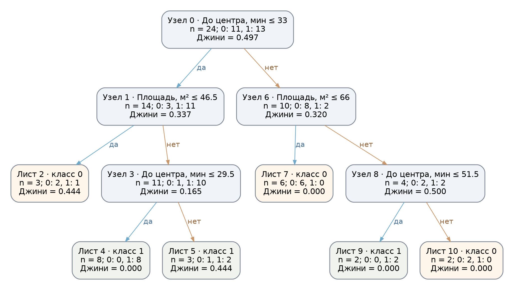

*Рисунок 1. Обученное дерево. В каждом узле указаны число объектов, распределение классов и индекс Джини. Для внутреннего узла его условие разделяет левую (условие выполнено) и правую (условие не выполнено) ветви.*

Посчитаем вклад корня — узла 0. Его неоднородность равна

```math
H(0)=1-\left(\frac{11}{24}\right)^2-\left(\frac{13}{24}\right)^2
\approx0.49653.
```

После разбиения по времени до центра в левую ветвь попали 14 объектов (11 единиц и 3 нуля), в правую — 10 объектов (2 единицы и 8 нулей). Индексы Джини потомков:

```math
H(1)=1-\left(\frac3{14}\right)^2-\left(\frac{11}{14}\right)^2
\approx0.33673,
\qquad
H(6)=1-\left(\frac8{10}\right)^2-\left(\frac2{10}\right)^2=0.32.
```

Поскольку корень содержит все $n=24$ объекта, его взвешенный выигрыш совпадает с обычным выигрышем:

```math
\Delta(0)=0.49653-\frac{14}{24}\cdot0.33673-\frac{10}{24}\cdot0.32
\approx\boxed{0.16677}.
\qquad\text{(8)}
```

Далее дерево использует другие признаки в нижних узлах. Например, узел 1 разделяет свои 14 наблюдений по площади, а узел 3 повторно использует время до центра для одной из ветвей. Для узла 1 сначала вычисляем выигрыш среди его 14 наблюдений, а затем умножаем на $14/24$:

```math
\begin{aligned}
\Delta(1)
&=\frac{14}{24}\left[
0.33673-\frac3{14}\cdot0.44444-\frac{11}{14}\cdot0.16529
\right]\\[0pt]
&\approx\boxed{0.06512}.
\end{aligned}
\qquad\text{(9)}
```

Аналогично рассчитываются остальные внутренние узлы. Получается:

| Узел | Признак разбиения | $n_v$ | Взвешенный выигрыш $\Delta(v)$ |
|---|---|---:|---:|
| 0 | Время до центра | 24 | 0.16677 |
| 1 | Площадь | 14 | 0.06512 |
| 3 | Время до центра | 11 | 0.02020 |
| 6 | Площадь | 10 | 0.05000 |
| 8 | Время до центра | 4 | 0.08333 |
| **Всего** | | | **0.38542** |

Складываем вклады всех узлов, использовавших один и тот же признак:

```math
\begin{aligned}
A_{\text{до центра}}&=0.16677+0.02020+0.08333\approx0.27030,\\[0pt]
A_{\text{площадь}}&=0.06512+0.05000\approx0.11512,\\[0pt]
A_{\text{комнаты}}&=0.
\end{aligned}
```

После нормировки получаем

```math
\mathrm{MDI}_{\text{до центра}}\approx0.701,
\qquad
\mathrm{MDI}_{\text{площадь}}\approx0.299,
\qquad
\mathrm{MDI}_{\text{комнаты}}=0.
\qquad\text{(10)}
```

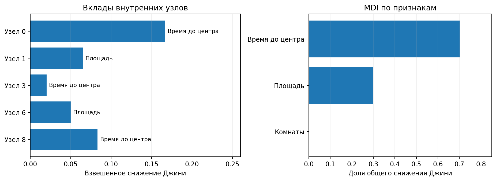

*Рисунок 2. Слева — уменьшение неоднородности в каждом внутреннем узле, справа — нормированные суммы по признакам.*

**Как использовать эти значения?** В обученном дереве около 70% суммарного взвешенного уменьшения Джини обеспечили разбиения по времени до центра, около 30% — по площади. Число комнат не участвовало ни в одном разбиении. Поэтому, когда мы исследуем правила именно этого дерева, **сначала имеет смысл изучить пороги времени до центра и площади**: они определяют разделение обучающих квартир на более однородные группы. Если число комнат представлялось важным по предметным соображениям, можно проверить, не заменила ли его площадь в процессе построения дерева.

Это и есть практическая роль MDI: **быстро увидеть, на какие признаки опиралась структура обученного дерева**, какие признаки были отброшены и какие неожиданности стоит проверить. Важность здесь измеряется долей снижения *обучающего критерия*, поэтому для оценки пользы признака в прогнозах на новых данных нам потребуется следующий метод. С точки зрения классификации §1.2 MDI — **глобальная модельно-специфическая** характеристика: она агрегирует информацию об узлах конкретного дерева.

Есть и полезная проверка расчёта. Если сложить $\Delta(v)$ по всем внутренним узлам дерева, вклады промежуточных потомков сократятся. Останется неоднородность корня за вычетом взвешенной неоднородности листьев:

```math
\sum_{v\text{ — внутренний}}\Delta(v)
=H(\text{корень})-\sum_{\ell\text{ — лист}}\frac{n_\ell}{n}H(\ell).
\qquad\text{(11)}
```

В нашем примере два листа содержат смешанные классы по три объекта каждый, с индексом Джини $4/9$; остальные листья чистые. Следовательно,

```math
0.49653-2\cdot\frac3{24}\cdot\frac49
\approx0.38542,
```

что совпадает с суммой в таблице. Мы тем самым убедились, что распределили между признаками именно общий выигрыш дерева по обучающему критерию.

### 3.3. Когда MDI полезна, а когда ей нужна проверка

MDI ценна прежде всего как **сводка по обученной структуре**. В нашем дереве время до центра используется трижды, а площадь — дважды. MDI помогает учесть не только количество узлов, но и величину уменьшения неоднородности и число наблюдений в этих узлах. Аналитик может сопоставить полученный рейтинг со здравым смыслом, выяснить, почему дерево игнорирует ожидаемый признак, и выбрать узлы, заслуживающие более пристального изучения.

Однако сами разбиения были **подобраны на обучающих данных**. Алгоритм перебирает пороги и выбирает наиболее выгодный из них. Когда признак принимает множество разных значений, кандидатных порогов становится больше. Даже случайный признак может получить преимущество: среди множества порогов иногда находится разбиение, случайно уменьшающее неоднородность именно этой выборки. Поэтому непрерывный числовой идентификатор объявления или случайный шумовой столбец может приобрести заметную MDI, хотя не помогает на новых объявлениях. Пример такого эффекта можно найти и в документации scikit-learn.

Есть и проблема **замещения признаков**. Если число комнат тесно связано с площадью, дерево способно разделять объекты по площади и ни разу не обращаться к числу комнат. Нулевая MDI комнат тогда описывает решение алгоритма **в данном дереве**. Для содержательного вывода о ценности самого признака этого недостаточно.

Поэтому дальнейший ход исследования зависит от цели. Если нужно **прочитать дерево и его правила**, MDI уже дала полезный ответ. Если нужно понять, насколько качество предсказаний на новых объектах зависит от столбца, необходимо поставить эксперимент с **замороженной моделью и новыми оценочными данными**. Именно этим займёмся дальше.

**Итак.** MDI распределяет снижение обучающей неоднородности между признаками и позволяет проверить, как построено дерево. При выборе порогов возможны случайные выигрыши, а зависимые признаки способны заменять друг друга. Для оценки зависимости *прогнозного качества* от информации в признаке перейдём к перестановочной важности.

## 4. Permutation importance: проверяем, насколько нужна информация в признаке

### 4.1. Эксперимент с уже обученной моделью

Пусть модель успешно классифицирует объявления о квартирах. На валидационной выборке известны правильные классы $y$, а модель для каждой строки выдаёт прогноз $\hat y$. Измерим accuracy. Теперь хотим понять, насколько для этих прогнозов была полезна площадь.

Представим, что таблица из шести квартир по ошибке получила **чужие значения площади**: значения внутри столбца обменялись местами, но районы, расстояния до центра, остальные характеристики и правильные метки остались у прежних квартир. Модель, обученная на исходных данных, продолжает работать по своим неизменным правилам. Получив изменённые строки, она может чаще ошибаться. Нас интересует, насколько ухудшилась метрика.

Именно этот мысленный эксперимент лежит в основе **permutation feature importance** — важности признака через перестановки. Его можно применить к любой уже обученной модели, если мы умеем получить прогнозы и измерить выбранное качество.

Под *перестановкой* здесь понимаем обычное переупорядочивание элементов. Например, столбец из значений $(42,62,70,38,55,80)$ можно превратить в $(62,42,70,38,80,55)$. Все шесть исходных чисел остаются в столбце, но часть из них теперь относится к другим объектам. При случайной перестановке конкретный порядок выбирается случайно.

Почему такой опыт содержателен? Изначально значение площади стоит в одной строке с нужным районом, временем до центра и правильным ответом. Перемешивание разрушает часть согласованности исходной таблицы. Если модель сильно зависит от информации в площади, качество её прогнозов может заметно снизиться. Насколько именно — проверяем вычислением метрики на изменённых данных.

### 4.2. Полностью разобранный пример

Для прозрачности пусть наш маленький классификатор задаётся правилом:

```math
\hat f(a,d)=
\begin{cases}
1,& a\ge50\ \text{и}\ d\le25,\\[0pt]
0,&\text{в остальных случаях},
\end{cases}
\qquad\text{(12)}
```

где $a$ — площадь, а $d$ — время до центра. Для шести придуманных квартир это правило первоначально даёт верные ответы. Затем мы переставляем только значения площади, **сохраняя значения $d$, правильные метки и саму модель**.

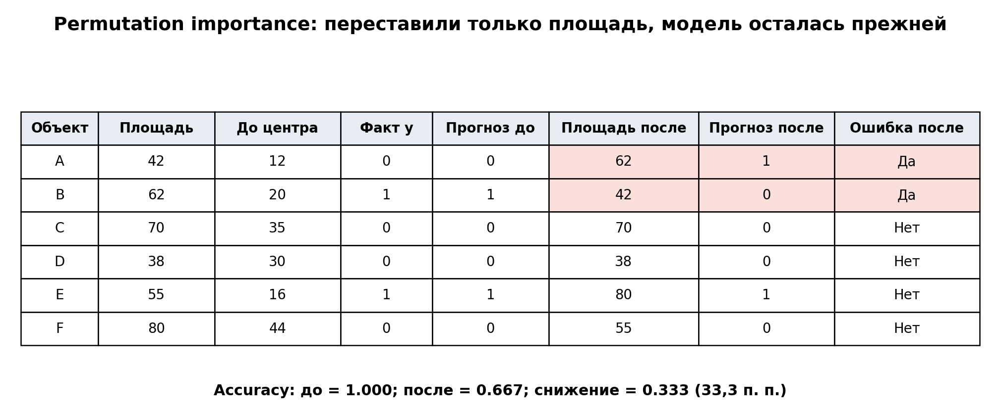

*Рисунок 3. Модель и фактические ответы не меняются. После перестановки площади квартиры A и B получают неправильные прогнозы.*

Разберём две изменившиеся строки. У квартиры A первоначально были $a=42$ и $d=12$, поэтому предиктор возвращал класс 0. После перестановки в той же строке оказалось $a=62$, и условие (12) стало истинным: теперь прогноз равен 1, а правильная метка по-прежнему 0. У квартиры B произошла обратная история: площадь стала меньше 50 м², поэтому вместо правильного класса 1 модель вернула 0. У остальных четырёх квартир прогнозы остались правильными.

До вмешательства accuracy равнялась $6/6=1$. После — $4/6\approx0.667$. Разность:

```math
1-\frac46=\frac26\approx\boxed{0.333}.
\qquad\text{(13)}
```

Значение $0.333$ означает, что **при этой конкретной перестановке** accuracy снизилась на 33,3 процентного пункта. Мы измерили изменение качества фиксированной модели при одной операции над таблицей; при другом порядке значений результат может отличаться.

На практике процедуру повторяют несколько раз и усредняют результаты. Повторения уменьшают зависимость оценки от одной случайной перестановки.

### 4.3. Алгоритм, формула и шкала интерпретации

Пусть $S=(X,y)$ — выборка, на которой мы оцениваем модель, а $Q(\hat f,S)$ — метрика, в которой **большее значение означает лучшее качество**: например, accuracy или ROC-AUC. Для признака $j$ строим изменённую таблицу $X_j^{\pi}$, в которой только $j$-й столбец случайно переставлен между строками; целевая переменная $y$ не переставляется.

Алгоритм состоит из четырёх шагов:

1. Один раз измерить исходное качество $Q(\hat f,S)$.
2. Переставить значения выбранного признака и получить новые прогнозы **той же модели**.
3. Измерить качество $Q(\hat f,S_j^{\pi})$ на изменённой таблице.
4. Повторить случайную перестановку $B$ раз и вычислить среднее снижение качества.

Формула результата:

```math
\widehat{PI}_j=
Q(\hat f,S)
-\frac1B\sum_{b=1}^{B}Q(\hat f,S_j^{\pi_b}).
\qquad\text{(14)}
```

Здесь $B$ — число повторений, $\pi_b$ — перестановка в повторении $b$, а $S_j^{\pi_b}$ — вариант оценочной выборки, где изменён только соответствующий столбец признаков. Первый член — исходная метрика, второй — средняя метрика после разрушения исходных связей выбранного столбца с остальными строками. Их разность показывает наблюдаемое ухудшение.

Если метрика имеет противоположную направленность — например, MAE или MSE, где **меньше означает лучше**, — удобно определить важность как *прирост ошибки*:

```math
\widehat{PI}^{\mathrm{MSE}}_j
=\frac1B\sum_{b=1}^{B}\mathrm{MSE}(\hat f,S_j^{\pi_b})
-\mathrm{MSE}(\hat f,S).
\qquad\text{(15)}
```

Знак в формуле выбран так, чтобы увеличение ошибки обычно давало положительную важность. В `scikit-learn` параметр `scoring` задаёт метрику, у которой **большее число считается лучшим**. При `scoring="accuracy"` библиотека напрямую вычитает accuracy после перестановки из исходной accuracy. Для MSE используется, например, `scoring="neg_mean_squared_error"`: если MSE выросла с 4 до 9, score изменился с $-4$ до $-9$ и важность равна $(-4)-(-9)=5$ — приросту MSE на 5 квадратных единиц. Аналогично `neg_mean_absolute_error` превращает разность score в прирост MAE. Если `scoring` не указан, библиотека обращается к стандартному `score` модели: у обычного классификатора scikit-learn это часто accuracy, а у регрессора — $R^2$. Поэтому метрику для исследовательского вопроса лучше выбирать явно.

**Как читать значения?** Для accuracy важность $0.08$ соответствует среднему снижению точности на 8 процентных пунктов. Для MAE важность 5 в единицах денежной целевой переменной означает среднее увеличение MAE на 5 этих единиц. Для MSE изменение измеряется в квадратах единиц ответа. Поэтому величины, рассчитанные с разными метриками, нельзя напрямую сопоставлять.

При одной и той же модели, выборке и метрике удобно сравнивать важности разных признаков. Но permutation importance не обязана суммироваться до единицы, а отдельная оценка может оказаться отрицательной. Например, случайное перемешивание признака иногда улучшает качество; при достаточном числе повторений отрицательный результат может указывать на нестабильность оценки, переобучение или на то, что особенность исходных данных вредила конкретному предиктору. Практическое использование начинается со сравнения значений с **исходной метрикой**. Если перестановка температуры увеличивает MAE на сотни поездок, именно этот признак стоит внимательно проверить в данных и в устройстве модели. Если перестановка календарного признака почти не меняет MAE, это повод выяснить, игнорирует ли его текущий предиктор или ту же информацию содержат другие столбцы. Необходимо учитывать масштаб эффекта и разброс повторений.

Например, на реальном кейсе Capital Bikeshare, который мы подробно введём в §6, у случайного леса исходная MAE составляет около **1120 прокатов в день** на отложенных месяцах. По 12 перестановкам получены средние приросты MAE: **примерно +573 проката для температуры**, **+167 для влажности**, **+74 для сезона** и **+32 для ветра**. Значение +573 означает, что после перемешивания температуры MAE данной модели на выбранных месяцах в среднем возрастала примерно с 1120 до **1693 прокатов**. Такая проверка показывает, что информация о температуре существенно помогает её оценочному качеству. Дальше мы исследуем форму этой зависимости с помощью PDP. Значения PI не сообщают, растёт или снижается прогноз при потеплении.

### 4.4. Что фиксируем — и что меняется при другом эксперименте

В permutation importance **обучение завершено**. Параметры, пороги дерева и все прочие свойства $\hat f$ фиксируются. Мы изменяем оценочную таблицу и смотрим, как предиктор реагирует на потерю части исходной согласованности данных.

Можно поставить другой вопрос: *какого качества достигла бы новая модель, если бы признак вообще не входил в обучение?* Тогда пришлось бы удалить столбец из обучающих данных, переобучить алгоритм и оценить результат по прежнему протоколу. Такой опыт обычно называют **leave-one-feature-out** (LOFO) или абляцией признака в зависимости от конкретной процедуры. Он способен дать существенно другой результат, потому что новая модель может перераспределить использование информации между остальными признаками.

Это различие особенно важно при сильной корреляции признаков; к нему вернёмся в следующем разделе.

### 4.5. На какой выборке проводить перестановки

MDI получалась из обучающей структуры дерева. Для permutation importance разумно использовать данные, по которым мы хотим судить о **качестве готового предиктора**. Если интересует обобщающая способность, важность следует оценивать на подходящей валидационной или другой независимой оценочной выборке. Иначе можно снова принять закономерности подгонки обучения за надёжный сигнал.

Размер выборки тоже имеет значение. На нескольких десятках наблюдений одна ошибка может заметно изменить accuracy. Повторные перестановки помогут оценить изменчивость самой операции перестановки, но не устранят неопределённость из-за малого числа оценочных объектов.

В ДЗ №1 мы уже исследовали три разных источника изменчивости — стохастическую оптимизацию, обучающую и оценочную выборки. Здесь логика та же. Если мы хотим оценить устойчивость самой важности к изменениям обучающих данных, придётся обучать **разные модели** и повторять анализ. Дополнительные перестановки внутри одной фиксированной модели на одной фиксированной выборке решают более узкую задачу.

**Итак.** Permutation importance показывает **цену перестановки признака в выбранной метрике** для одной фиксированной модели. Это глобальный **модельно-независимый** метод: он применим к дереву, kNN и другим предикторам. На практике он помогает находить признаки, от которых действительно зависит оценочное качество, и выбирать направления для проверки модели. Следующий вопрос — как интерпретировать этот результат, если разные столбцы содержат почти одинаковую информацию.

## 5. Почему коррелированные признаки осложняют оценку важности

### 5.1. Одинаковые данные — разная зависимость моделей от признака

Предположим, у нас два числовых признака, содержащих **в точности одну и ту же информацию**: $x_1=x_2$. Целевая переменная равна $y=x_1$. Возьмём пять наблюдений со значениями $(0,1,2,3,4)$.

Пусть мы построили две модели:

```math
\hat f_A(x_1,x_2)=x_1,
\qquad
\hat f_B(x_1,x_2)=\frac{x_1+x_2}{2}.
\qquad\text{(16)}
```

На исходных данных их прогнозы **совпадают**: обе выдают $(0,1,2,3,4)$, поэтому MSE равна нулю. Однако используются признаки по-разному.

Теперь переставим $x_1$ в обратном порядке, получив $(4,3,2,1,0)$, и сохраним $x_2$ прежним. Для модели A ошибки прогнозов по сравнению с $y$ равны $(4,2,0,-2,-4)$, поэтому

```math
\mathrm{MSE}_A^{\pi_1}
=\frac{16+4+0+4+16}{5}=\boxed{8}.
```

Модель B при той же перестановке усредняет перемешанное значение $x_1$ с исходным $x_2$. Её ошибки вдвое меньше, а MSE становится равна $8/4=\boxed{2}$. Аналогичный прирост MSE получится, если у B переставить только $x_2$.

Для выбранной перестановки получаем следующие изменения MSE:

| Операция | Модель A: $\hat y=x_1$ | Модель B: $\hat y=(x_1+x_2)/2$ |
|---|---:|---:|
| Переставили только $x_1$ | 8 | 2 |
| Переставили только $x_2$ | 0 | 2 |
| Согласованно переставили **оба** признака | 8 | 8 |

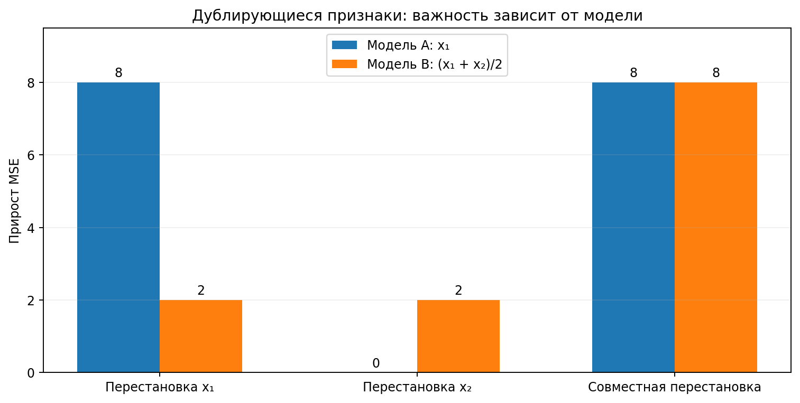

*Рисунок 4. Прирост MSE для одной заданной перестановки. Модели одинаково предсказывают исходные данные, но различаются способом использования признаков.*

Это особенно важный пример. Нулевая индивидуальная важность $x_2$ для модели A не означает отсутствия информации в $x_2$: в данных $x_2$ полностью дублирует $x_1$. Просто конкретная модель A этой колонкой не пользуется. А у модели B информация распределена между двумя аргументами, поэтому разрушение любого одного из них оставляет другой в качестве частичной замены.

В таблице рассчитана **одна конкретная перестановка**. Стандартная PI усредняет результаты случайных перестановок; например, если усреднить по всем возможным перестановкам этих пяти значений, для $x_1$ получится 4 у модели A и 1 у модели B, а не 8 и 2. В обоих случаях различие между моделями сохраняется.

**Главный вывод:** совпадение исходных прогнозов двух моделей не гарантирует совпадения перестановочных важностей. Модель A полностью полагается на $x_1$, поэтому перемешивание $x_2$ ничего не меняет. Модель B использует оба столбца и меньше страдает от перемешивания каждого по отдельности. Когда столбцы дублируют информацию, PI показывает, **как именно фиксированная модель распределила их использование**, а не сколько независимого сигнала содержится в каждом столбце данных.

### 5.2. Какие эксперименты осмысленны при зависимых признаках

В настоящих квартирных данных площадь обычно связана с числом комнат. При свободном перемешивании площади могут появиться редкие сочетания вроде 35 м² и четырёх комнат или 100 м² и одной комнаты. Мы разрушили связь площади с целевой переменной, а заодно связь площади **с остальными признаками**. Поэтому большая PI может отражать в том числе поведение модели на непривычных для неё комбинациях.

Что делать, если мы заметили сильную корреляцию? Сначала нужно уточнить исследовательский вопрос:

| Что хотим узнать | Подходящий эксперимент | Какой результат читаем |
|---|---|---|
| Насколько **обученная модель** использует данный столбец на целевой выборке? | Обычная PI | Ухудшение метрики при свободной перестановке |
| Насколько модель зависит от **всей группы** связанных столбцов? | Переставить их **совместно**, сохраняя соответствие значений внутри группы | Ухудшение метрики при нарушении связи группы с остальными строками |
| Сможем ли мы получить хорошую модель **без признака**? | Удалить признак и повторить обучение по тому же протоколу | Изменение качества новой модели, которая могла перестроить использование остальных столбцов |
| Даёт ли столбец дополнительную информацию **после учёта остальных**? | Условные перестановки или более сложная условная процедура | Изменение качества при замене на правдоподобные значения, согласованные с остальными признаками |

Например, если перестановка площади сильно ухудшает качество дерева, но перестановка комнат почти не влияет, исследователь может проверить корреляцию площади с количеством комнат и провести **переобучение без площади**. Если качество новой модели сохраняется благодаря комнатам, становится понятно, что текущая PI измеряла зависимость именно **первоначального дерева** от площади, а не незаменимость этой информации.

У условных процедур своя цена: требуется оценить, какие значения признака правдоподобны при фиксированных остальных характеристиках. При сильной зависимости это трудно, а сам вопрос о «дополнительной информации» отличается от вопроса об общем использовании признака. Поэтому **обычная PI остаётся хорошим первым диагностическим инструментом**, групповая PI помогает при явной избыточности, а абляция с переобучением подходит для решения об удалении столбца.

В ДЗ №1 мы уже разделяли изменчивость оптимизации, обучения и оценочной выборки. С важностями нужно поступать столь же аккуратно: 12 перестановок одной колонки оценивают изменчивость **операции перестановки** для одной модели; пять новых обучающих выборок потребуют пяти новых моделей и дадут информацию об устойчивости **объяснений к обучению**.

**Итак.** При зависимых признаках PI стоит читать как результат определённого эксперимента над фиксированной моделью. Для выбора следующего действия уточняем цель: изучить использование столбца, роль группы, возможность обойтись без признака или его дополнительную информацию. А если признак оказался важным, следующий практический вопрос — **в какую сторону и по какой форме меняются прогнозы при изменении его значения?**

## 6. Как прогноз зависит от признака: PDP

### 6.1. От важности к форме зависимости

Перестановочная важность позволяет выяснить, насколько качество модели зависит от информации в признаке. Но представим, что для модели спроса на прокат велосипедов температура оказалась одной из наиболее важных переменных. Практически сразу возникает другой вопрос: **что именно делает модель с температурой?** Предсказывает ли она одинаковое увеличение спроса при потеплении с 5 до 10 °C и с 25 до 30 °C? Может ли связь перестать усиливаться или изменить направление?

Для обычной линейной регрессии без преобразований признаков и взаимодействий ответ содержится в коэффициенте при температуре: один дополнительный градус меняет прогноз на постоянную величину. У дерева зависимость обычно ступенчатая. Для kNN она определяется соседями и потому может заметно меняться вдоль оси температуры. Нам нужен инструмент, который позволяет **увидеть форму прогнозной функции**, независимо от внутреннего устройства модели.

Начнём со знакомого эконометристам принципа *ceteris paribus* — «при прочих равных». Берём один наблюдавшийся день из оценочной выборки: в его строке записаны температура, влажность, ветер, сезон, рабочий день и погодная категория. Создадим копии этой строки и по очереди подставим в **поле температуры** разные значения, например 10, 15, 20, 25 и 30 °C. Все остальные поля каждого экземпляра остаются такими же, как у выбранного дня. Для каждой изменённой строки запросим прогноз **той же обученной модели**.

Получится ряд точек, а затем кривая, показывающая, как меняется **прогноз для этого конкретного дня** при разных подставленных температурах:

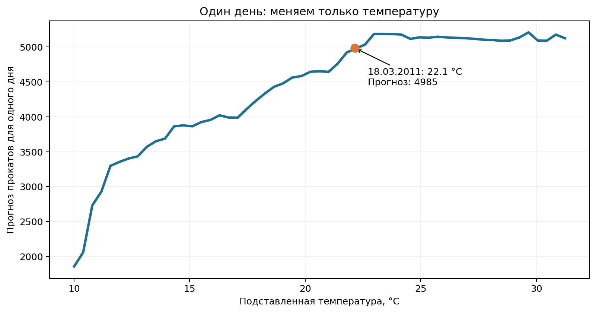

*Рисунок 5. Для одного дня из отложенных месяцев варьируем только температуру; остальные признаки фиксированы. Отмеченная точка — прогноз при первоначально наблюдавшейся температуре, остальные точки кривой получены подстановкой новых значений.*

Для одного дня такая кривая может быть весьма информативна, но в другие дни модель может реагировать иначе. Чтобы получить **среднюю картину поведения предиктора**, повторим подстановку для целого набора дней. При каждом значении температуры усредним полученные прогнозы. Это задаёт **частичную зависимость** (*partial dependence*, PD); её графическое представление — **график частичной зависимости** (*Partial Dependence Plot*, PDP).

### 6.2. Небольшой расчёт перед графиком

Вернёмся ненадолго к жилью, чтобы операция усреднения была полностью прозрачной. Пусть условный предиктор в тысячах денежных единиц имеет вид

```math
\hat f(a,d)=20+0.6a-0.2d+0.02a(20-d),
\qquad\text{(17)}
```

где $a$ — площадь в квадратных метрах, $d$ — время до центра в минутах. Рассматриваем три квартиры, у которых $d=5$, $20$ и $50$. Для каждой по очереди подставляем одну и ту же площадь — 40, 60, 80 м². Например,

```math
\hat f(40,5)=20+0.6\cdot40-0.2\cdot5+0.02\cdot40(20-5)=55.
```

| Квартира | При 40 м² | При 60 м² | При 80 м² |
|---|---:|---:|---:|
| A: до центра 5 мин | 55 | 73 | 91 |
| B: до центра 20 мин | 40 | 52 | 64 |
| C: до центра 50 мин | 10 | 10 | 10 |
| **Средний прогноз** | **35** | **45** | **55** |

При площади 60 м² средний прогноз составляет $(73+52+10)/3=45$. Аналогично получаем точки $(40,35)$, $(60,45)$, $(80,55)$. Это уже маленькая PDP: горизонтальная ось обозначает подставляемую площадь, вертикальная — **среднее из трёх прогнозов**.

Почему понадобились именно эти три квартиры? Они образуют **выборку, по которой проводится усреднение** (*reference sample*). Её состав определяет, чьи остальные характеристики учитываются при построении PDP. На практике берут достаточно представительную для исследовательского вопроса выборку, например независимые от обучения наблюдения из целевой области применения модели. При каждом новом значении площади набор остальных характеристик сохраняется прежним: мы меняем только один столбец. Если возьмём квартиры из совершенно другого рынка, изменится и усреднённая кривая.

В данном учебном примере линия оказалась прямой, потому что исходная функция линейна по $a$ при каждом фиксированном $d$. Именно для демонстрации **нелинейной** формы теперь обратимся к реальным данным.

### 6.3. Реальный кейс: погода и прокат велосипедов

Перейдём к настоящей задаче регрессии. В книге Christoph Molnar *Interpretable Machine Learning* используются данные о прокате велосипедов в Вашингтоне — **Capital Bikeshare**. Исходный [Bike Sharing Dataset](https://archive.ics.uci.edu/dataset/275/bike+sharing+dataset) подготовлен H. Fanaee-T и J. Gama и опубликован UCI Machine Learning Repository ([CC BY 4.0](https://creativecommons.org/licenses/by/4.0/)). Наши модели, вычисления и графики построены самостоятельно на адаптированном дневном наборе; они не воспроизводят численные результаты Molnar.

**Одна строка — один календарный день** 2011–2012 годов. Целевая переменная `cnt` — число прокатов велосипедов за день. Из исходных 731 строк исключён один день с нулевой влажностью: осталось **730** наблюдений. Для базовой модели используем семь признаков:

| Признак | Что содержит | Тип / единицы |
|---|---|---|
| `temp` | Фактическая температура за день | Число, °C |
| `hum` | Относительная влажность | Число, % |
| `windspeed` | Ветер | Число, км/ч |
| `season` | Сезон по кодировке исходных данных | Категория: зима, весна, лето, осень |
| `workingday`, `holiday` | Рабочий день и праздник | Две категориальные переменные |
| `weather` | Наблюдавшаяся погодная категория | Категория |

Здесь **нет числа прокатов в предыдущие дни**, а также нет идентификаторов и столбцов, непосредственно составляющих целевую переменную. Это сознательное отличие нашего нового эксперимента от примера с двухдневным лагом: при случайном распределении дат между train и test ответ отложенного дня мог оказаться в лаговом признаке обучающей строки более позднего дня. Мы устранили такое пересечение, отказавшись от лагов целевой переменной.

Для проверки обучаемся на **487 днях**, оставив для оценки **243 дня целиком из марта, июня, сентября и декабря 2011 и 2012 годов**. Так модель не видит обучающих ответов для отложенных месяцев; каждый из четырёх сезонов представлен в обеих частях данных. Это протокол **ретроспективного исследования обученной функции**, когда погодные показатели уже измерены. Для прогнозирования спроса будущего дня потребовались бы прогноз погоды и хронологическая схема проверки.

Основная модель — готовый **случайный лес регрессии**. Мы изучим устройство ансамблей позже; сейчас достаточно знать, что это предиктор, который принимает признаки дня и выдаёт число прокатов. Дополнительно обучено одно дерево глубины 6 для сравнения. На отложенных месяцах лес получил **MAE ≈ 1120 прокатов/день**, дерево — **MAE ≈ 1157**. Важно, что эти значения характеризуют данную процедуру отложения целых месяцев в пределах двух исторических лет.

Теперь исследуем **PDP температуры** случайного леса. При каждом значении по горизонтальной оси подставляем эту температуру всем 243 отложенным дням, сохраняя остальные признаки; затем усредняем 243 прогноза.

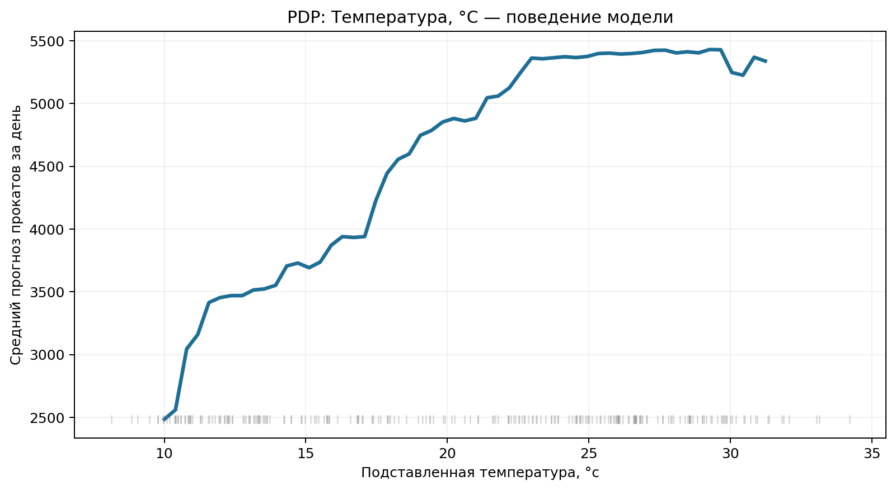

*Рисунок 6. Температурная частичная зависимость обученного леса. Вертикальная ось — средний прогноз прокатов при подставленной температуре, а небольшие штрихи вдоль оси X показывают фактически наблюдавшиеся значения в отложенных месяцах.*

Кривая заметно нелинейна. Около **10 °C** лес в среднем прогнозирует примерно **2485 прокатов**, при **20 °C — 4864**, при **26 °C — 5396**. У более высоких температур рост замедляется: при **31 °C — около 5356**. Таким образом, модель предсказывает сильный рост от прохладной к умеренно тёплой погоде, а затем участок насыщения со слабым снижением у верхней границы. Здесь нельзя описать поведение одной постоянной «прибавкой на градус».

Для практического исследования это полезный результат: мы можем увидеть диапазоны быстрого изменения, плато, возможные пороги и неожиданные изгибы предиктора. Если при одной температуре прогноз резко меняется, следующим шагом будет проверить, где сосредоточены наблюдения и какие свойства модели создали переход. **График описывает предиктор**, поэтому содержательность найденной формы дополнительно проверяют на качестве и устойчивости модели.

PDP получают, вычисляя прогнозы $\hat f$ на сетке подставленных значений; **отдельную регрессию по точкам графика не обучают**. У одного дерева кривая часто ступенчатая, а усреднение многих деревьев леса делает её сравнительно плавной:

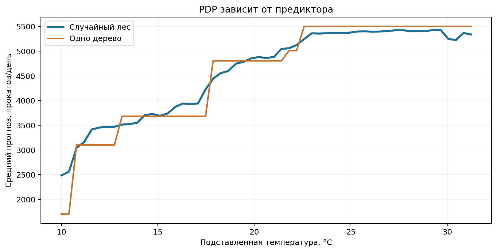

*Рисунок 7. Для одних и тех же 243 дней и одной сетки температур два обученных предиктора дают разные формы PDP. Это характеристика конкретной функции, которую мы исследуем.*

### 6.4. Формула и правила чтения PDP

Запишем операцию математически. Пусть $x=(x_j,x_{-j})$, где $x_j$ — интересующий признак, а $x_{-j}$ — остальные признаки. Возьмём $n$ объектов для построения графика. При значении $t$ подставим его в $j$-ю координату каждого объекта и усредним предсказания:

```math
\widehat{PD}_j(t)=\frac1n\sum_{i=1}^n\hat f(t,x_{i,-j}).
\qquad\text{(18)}
```

Здесь $t$ меняется вдоль горизонтальной оси, а все $x_{i,-j}$ фиксируются. Для набора значений $t_1,\ldots,t_K$ формула даёт $K$ точек графика. В регрессии вертикальная ось показывает средний прогноз целевой переменной, в классификации можно аналогично анализировать среднюю прогнозируемую вероятность выбранного класса. Следует подписывать именно ту величину, которую возвращает модель: для вероятности, логита и метки класса получатся разные графики.

В этой формуле мы усредняем **по распределению остальных признаков в выбранной выборке**. Если выборка достаточно хорошо представляет интересующую популяцию, такая процедура приближает усреднение по её распределению $X_{-j}$. Для каждого $t$ используется одна и та же совокупность остальных характеристик. Это позволяет сравнивать значения кривой между собой, но позднее создаст проблему, когда признаки сильно связаны.

Важно также выбирать осмысленную сетку $t$. На концах диапазона данных может быть мало, и модель будет выдавать прогнозы для редко встречающихся ситуаций. Поэтому штрихи вдоль оси на рисунке 6 имеют учебный смысл: они показывают, на каких температурах интерпретация опирается на плотную область наблюдений.

**Итак.** PDP отвечает на вопрос о том, **как меняется средний прогноз модели**, если подставлять разные значения интересующего признака в одни и те же строки выбранной выборки. В отличие от коэффициента обычной линейной регрессии, она показывает произвольную форму зависимости. Но на графике мы видим среднее, а разные объекты могут реагировать на изменение признака существенно по-разному.

## 7. ICE: один средний график и множество индивидуальных реакций

### 7.1. Из каких линий складывается PDP

Вернёмся к операции построения PDP. В каждой точке сетки температуры или влажности мы получали отдельный прогноз для **каждой** строки. До усреднения у нас уже есть целый набор кривых. Почему бы не показать их все?

**Individual Conditional Expectation (ICE)** — график прогноза для конкретного объекта при подстановке разных значений одного признака и сохранении остальных признаков этого объекта. Для $i$-го объекта:

```math
ICE_i(t)=\hat f(t,x_{i,-j}).
\qquad\text{(19)}
```

Их связь с PDP теперь очевидна:

```math
\widehat{PD}_j(t)=\frac1n\sum_{i=1}^n ICE_i(t).
\qquad\text{(20)}
```

Для ICE выберем другой признак — **влажность**. Её permutation importance в нашем эксперименте составила около +167 прокатов MAE, и на влажности особенно наглядно различается поведение отдельных дней. Построим 50 ICE-кривых, отобранных случайно внутри сезонных групп (14 зимних и по 12 дней остальных сезонов). Каждая линия представляет день, у которого меняем только влажность, сохраняя температуру, сезон, ветер и календарные характеристики. Чёрная PDP рассчитана **по всем 243 отложенным дням**, поэтому она не обязана совпадать со средним именно этих 50 линий.

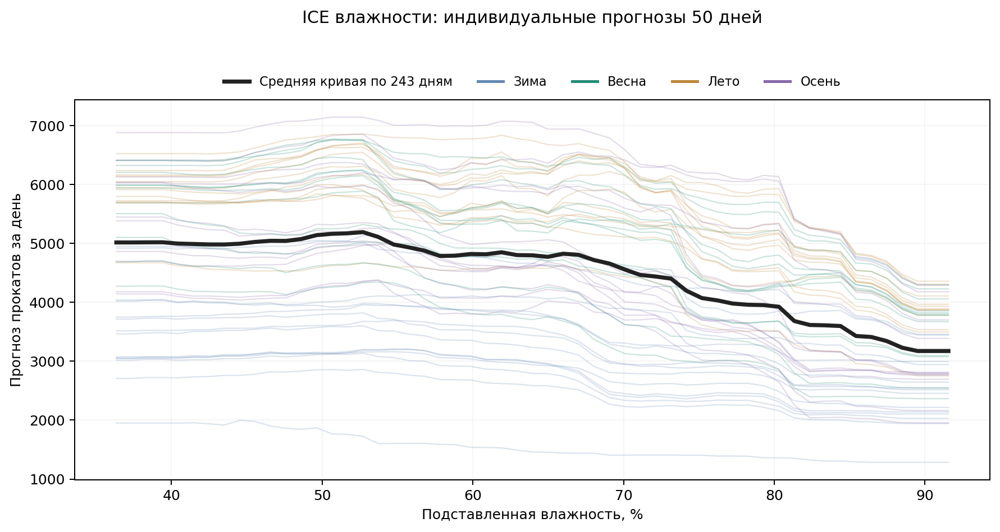

*Рисунок 8. Цветные линии — 50 индивидуальных ICE, окрашенных по сезону. Чёрная кривая — PDP по всем 243 дням отложенных месяцев. Различия стартовых уровней возникают из-за остальных признаков дня.*

Первое наблюдение: индивидуальные прогнозы сильно различаются по **уровню** — одни дни начинаются около 2000 прокатов, другие существенно выше. Это неудивительно: летние и зимние дни, рабочие дни и праздники различаются по остальным признакам. Второе наблюдение интереснее: наклон линий тоже неодинаков. На высокой влажности одни прогнозы резко снижаются, другие реагируют слабее. Средняя PDP передаёт общий спад, но скрывает его неоднородность.

Такой график помогает обнаруживать **взаимодействия** в прогнозной функции. Если наклон ICE меняется с характеристиками дня, реакция модели на влажность зависит от других признаков. Сама картинка ещё не говорит, какой именно признак объясняет различие. Цвет по сезону позволяет сформулировать первую проверяемую гипотезу.

### 7.2. Как интерпретировать сезонные различия

Чтобы рассмотреть линии без визуального перегруза, усредним ICE отдельно для каждого сезона. Здесь каждая сезонная кривая — средний прогноз модели **для дней данного сезона**, а чёрный пунктир показывает общую PDP.

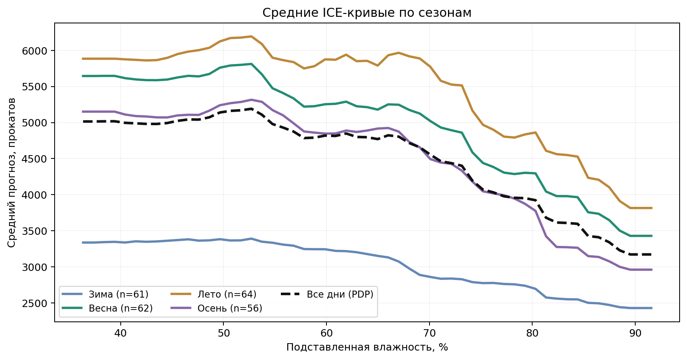

*Рисунок 9. Сезонные групповые средние индивидуальных кривых влажности. В отличие от общей PDP здесь видно, как модель реагирует на изменение влажности при разных наборах остальных характеристик дней.*

Посмотрим на конкретное сравнение. Повысим подставленную влажность с 60 до 80 процентов и вычислим среднее изменение прогнозов внутри каждого сезона:

| Сезон | Дней в оценочной выборке | Среднее изменение прогноза, поездок |
|---|---:|---:|
| Зима | 61 | −532 |
| Весна | 62 | −956 |
| Лето | 64 | −1020 |
| Осень | 56 | −1042 |

На этом отложенном наборе модель сильнее меняет прогноз при переходе от 60% к 80% влажности для **летних и осенних дней** (около −1020 и −1042 прокатов), чем для **зимних** (около −532). Это результат двух подстановок в **фиксированную модель**; фактическая влажность объектов могла отличаться от обоих значений. Наблюдение подсказывает исследовать взаимодействия и связанные характеристики сезонов. В других вариантах разбиения данных сила сезонных различий менялась, поэтому таблица не устанавливает устойчивого порядка реакций по сезонам.

Получен содержательный результат: одинаковая подстановка влажности даёт различные изменения прогнозов у разных групп дней. Для линейной модели это могло бы мотивировать проверку взаимодействий влажности с сезонными индикаторами; для нашего леса — более подробный анализ того, какие другие характеристики сопровождают различия ICE. В обоих случаях проверять найденную гипотезу следует отдельным экспериментом на данных.

### 7.3. Центрированные ICE: сравниваем изменения, а не стартовый уровень

На рисунке 8 очень много кривых, причём их стартовые уровни отличаются на тысячи поездок. Из-за этого трудно сравнивать только **форму** реакции. Можно вычесть из каждой кривой её значение в одной общей точке $t_0$:

```math
ICE_i^{c}(t)=ICE_i(t)-ICE_i(t_0).
\qquad\text{(21)}
```

Все линии теперь начинаются с нуля при $t=t_0$. Это **центрированные ICE** (*centered ICE*). Горизонтальная ось остаётся влажностью, а вертикальная показывает изменение прогноза данного дня относительно выбранной начальной влажности.

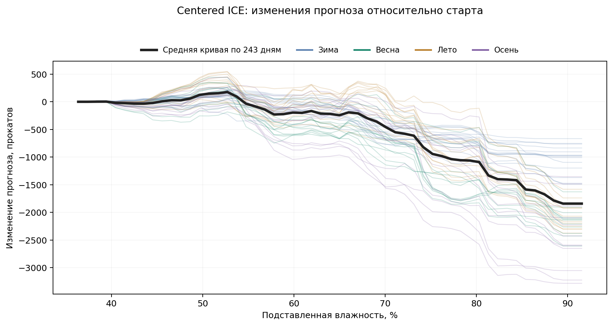

*Рисунок 10. Те же 50 отобранных дней: из каждой ICE вычтен прогноз при минимальной влажности сетки. Чёрная линия — аналогично центрированная PDP по всем 243 дням.*

Теперь сразу видна неоднородность реакции: при высокой влажности некоторые дни теряют по прогнозу почти две тысячи прокатов, другие — значительно меньше. Мы убрали различия базовых уровней, но сохранили различия в форме линий. **Центрирование не меняет саму модель и не устраняет взаимодействия**; оно делает их удобнее для визуального сравнения.

### 7.4. Предельный пример: средняя зависимость полностью исчезла

Для проверки понимания рассмотрим маленькую искусственную модель

```math
\hat f(x,z)=(2z-1)x,\qquad z\in\lbrace 0,1\rbrace .
\qquad\text{(22)}
```

Если $z=1$, прогноз увеличивается вместе с $x$; если $z=0$, прогноз уменьшается. При равном числе объектов двух групп:

```math
\widehat{PD}(x)=\frac12x+\frac12(-x)=0.
\qquad\text{(23)}
```

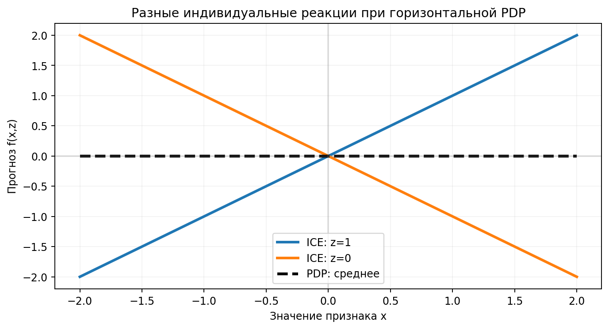

*Рисунок 11. Две группы имеют противоположную реакцию прогноза на $`x`$. PDP горизонтальна, хотя обе ICE существенно зависят от $`x`$.*

Этот пример доводит логику до предела: **горизонтальная PDP может скрывать сильные противоположные реакции**. В реальной задаче со многими объектами ситуация обычно менее симметрична. Именно поэтому полезно смотреть и среднюю PDP, и множество ICE, особенно когда предполагаются взаимодействия.

Можно строить частичную зависимость сразу по двум признакам и показывать поверхность или тепловую карту. Такой график пригоден для исследования взаимодействий, но мы оставим его как расширение, чтобы сосредоточиться на тщательном чтении одномерных PDP и ICE.

**Итак.** PDP показывает среднее поведение модели, ICE — поведение для отдельных объектов при фиксированных остальных признаках. Цвет, групповые средние и центрирование помогают увидеть неоднородность. Пока мы сохраняли остальные признаки каждого объекта и свободно изменяли один выбранный столбец. Но что произойдёт, если такие сочетания почти никогда не встречаются в действительных данных?

## 8. Когда признаки связаны: почему появился ALE

### 8.1. Проблема PDP на данных с зависимыми признаками

Вернёмся к данным Capital Bikeshare. В новой модели лагов спроса нет, но **температура связана с сезоном**. В исходной оценочной выборке почти все летние дни были тёплыми, а зимние преимущественно холодными. Это видно из графика фактических температур по сезонным категориям:

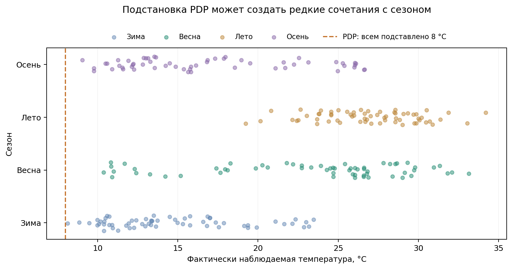

*Рисунок 12. По горизонтали — наблюдавшаяся температура, по вертикали — сезон дня. Пунктир показывает подстановку 8 °C всем объектам. Для летних дней комбинация «лето, 8 °C» почти отсутствует в исходной выборке.*

Если строить PDP температуры при 8 °C, мы получим прогнозы **для всех 243 дней**, в том числе для дней с категорией «лето». Эти искусственно созданные летние дни с очень низкой температурой могут оказаться далеко от условий, на которых учился лес. В такой области прогнозы хуже обеспечены похожими наблюдениями, а форма PDP может частично зависеть от этих плохо проверенных значений функции.

Для гибких предикторов это особенно существенно: два обученных алгоритма могут давать похожие прогнозы в типичных сочетаниях, но различаться в редких. Поэтому сначала стоит посмотреть, какие комбинации создаёт подстановка в PDP. Можно ли изучать **локальные изменения прогноза**, выбирая для каждого температурного диапазона объекты, чья фактическая температура уже находится рядом с этим диапазоном? Именно эту конструкцию использует **Accumulated Local Effects (ALE)** — накопленные локальные эффекты.


### 8.2. ALE: локальные изменения и их накопление

Построение ALE начнём с диапазонов значений исследуемого признака. Для температуры это могут быть интервалы $[5,10)$, $[10,15)$, $[15,20)$ °C и так далее; на практике границы часто выбирают по квантилям, чтобы в интервалах оказалось достаточно наблюдений.

Для каждого интервала $(b_{k-1},b_k]$ берём **только дни, чья фактическая температура попала в него**. Для каждого такого дня получаем два прогноза: подставляем нижнюю границу интервала, затем верхнюю, оставляя остальные признаки дня неизменными. Разность двух прогнозов показывает изменение модели на небольшом температурном шаге **возле наблюдаемого значения**. Усредняем эти разности внутри интервала:

```math
\widehat\delta_k=
\frac1{n_k}
\sum_{i:\,b_{k-1}\lt x_{ij}\le b_k}
\left[\hat f(b_k,x_{i,-j})-\hat f(b_{k-1},x_{i,-j})\right].
\qquad\text{(24)}
```

Здесь $n_k$ — число наблюдений в интервале. Если $\widehat\delta_k=150$, то на данном участке при переходе от его нижней к верхней границе прогноз для соответствующих дней **в среднем возрастает на 150 прокатов**. Если $\widehat\delta_k=-70$, среднее локальное изменение отрицательно.

Мы получили набор локальных приращений. Чтобы восстановить общую форму зависимости, их **последовательно суммируют**:

```math
\widetilde{ALE}(b_m)=\sum_{k=1}^{m}\widehat\delta_k.
\qquad\text{(25)}
```

Полученная функция определена с точностью до вертикального сдвига. Обычно выбирают сдвиг так, чтобы её среднее по наблюдаемым значениям признака было равно нулю. Тогда вертикальная ось показывает **отклонение накопленного эффекта от его среднего уровня**, а не ожидаемое число поездок за день. Для сравнения на одном графике PDP тоже можно центрировать.

### 8.3. Рассчитаем ALE вручную

Рассмотрим условный численный пример с тремя температурными интервалами и несколькими днями в каждом. Приведённые ниже изменения прогнозов придуманы специально для расчёта алгоритма; они не взяты из наблюдений Capital Bikeshare. Для них уже рассчитаны изменения прогнозов при переходе между границами интервала. Покажем процесс на маленькой таблице:

| Интервал температуры | Среднее изменение прогноза на интервале $\widehat\delta_k$ | Накопленная сумма |
|---|---:|---:|
| 5–10 °C | +120 | +120 |
| 10–15 °C | +260 | +380 |
| 15–20 °C | +100 | +480 |

Например, в первом интервале для трёх выбранных дней модель могла выдать разности $+90$, $+150$, $+120$. Тогда их среднее равно $(90+150+120)/3=120$. Во втором интервале рассчитываем изменения **у других дней**, попавших в диапазон 10–15 °C; если среднее равно 260, к накопленной сумме добавляется ещё 260. Так постепенно собирается кривая по всем интервалам.

Отличие от PDP теперь можно сформулировать точно. В PDP мы задаём температуру 10 °C **каждому дню** оценочной выборки и усредняем абсолютные прогнозы. В ALE при движении по интервалу 5–10 °C вычисляем изменение прогноза **только для дней, которые действительно находятся в этом температурном интервале**. Следующий участок использует новую группу дней, соответствующую следующему диапазону температуры.

Центрирование не изменяет разностей между участками: если к каждой накопленной сумме прибавить или вычесть одну константу, форма кривой останется прежней. Поэтому именно **рост, спад и перепады** ALE следует интерпретировать в первую очередь.

Здесь есть тонкость: если мы изменим границы интервалов, оценки локальных приращений могут измениться. Очень узкие интервалы страдают от малого числа наблюдений; слишком широкие усредняют поведение модели на большом участке. ALE тоже требует методических решений и аккуратной проверки плотности данных.

### 8.4. Что получилось на тех же реальных данных

Построим для нашей модели PDP и ALE влажности. Чтобы сравнение было честным по вертикальной шкале, предварительно центрируем PDP: из её значений вычитаем среднее по фактически наблюдаемым влажностям. ALE уже центрирована по собственному определению.

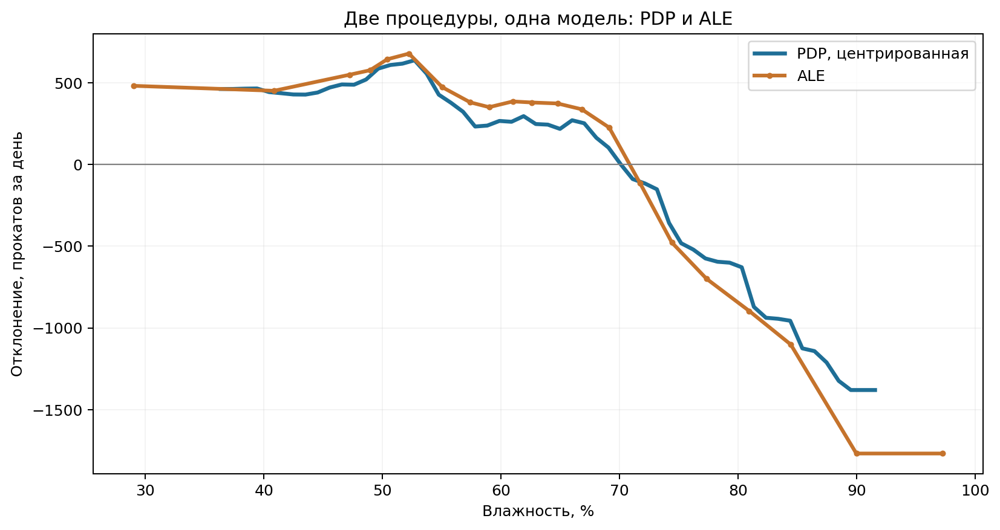

*Рисунок 13. Две разные процедуры исследования одной и той же модели. Вертикальная ось — отклонение прогноза в поездках от выбранного нулевого уровня.*

Обе кривые меняются сравнительно мало до умеренной влажности, а после приблизительно 70% показывают заметное снижение. На высоких значениях ALE иногда уходит ниже центрированной PDP, однако основное направление и участок спада совпадают. Таким образом, **в данном эксперименте методы дают содержательно близкую, но не идентичную картину**. Для выбора между ними важно понимать постановку и распределение признаков, а не требовать совпадения графиков.

На температуре кривые тоже в целом согласуются, хотя на отдельных участках и краях диапазона видны различия:

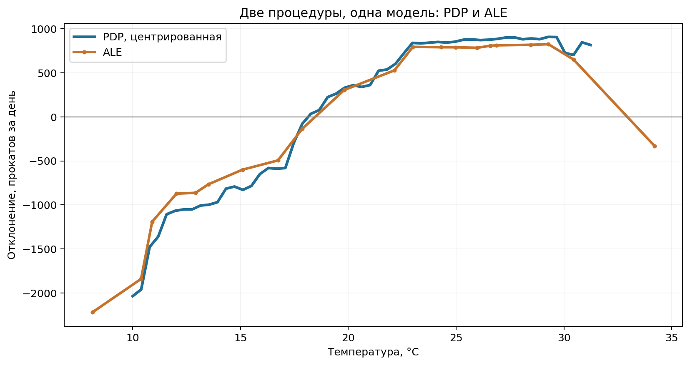

*Рисунок 14. Центрированная PDP и ALE температуры. Обе показывают рост и участок насыщения; при самых низких и высоких температурах кривые расходятся заметнее. Области с малым числом наблюдений читаем особенно осторожно.*

Почему же вообще понадобилась ALE, если на наших данных всё так похоже? Чтобы понять, **когда различие становится принципиальным**, рассмотрим отдельный контролируемый пример, устроенный по мотивам Molnar.

### 8.5. Контрпример: модель в области, где нет наблюдений

Сгенерируем два сильно связанных признака: $x_2\approx x_1$, оба от 0 до 1. Большинство наблюдений лежит возле диагонали плоскости $(x_1,x_2)$. Определим модельную функцию

```math
\hat f(x_1,x_2)=
\begin{cases}
2, & x_1>0.7\text{ и }x_2\lt 0.3,\\[0pt]
x_1+x_2,&\text{в остальных случаях}.
\end{cases}
\qquad\text{(26)}
```

Особое условие относится к сочетанию большого $x_1$ с маленьким $x_2$. При $x_2\approx x_1$ такие строки практически отсутствуют. Поэтому **на фактически наблюдаемых данных** прогнозная функция в основном ведёт себя как $x_1+x_2$. Но при построении PDP мы подставим большие $x_1$ и в строки с маленькими $x_2$ — модель попадёт в искусственно созданную область и включит специальное условие.

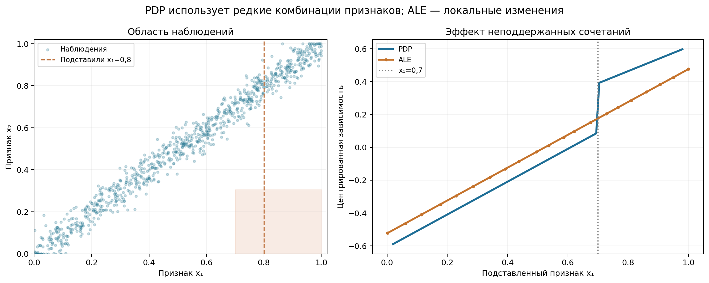

*Рисунок 15. Слева — наблюдаемые сочетания $`x_1`$ и $`x_2`$ и выделенная область, для которой почти нет данных; справа — результаты двух методов. PDP получает дополнительный скачок возле $`x_1=0.7`$, потому что усредняет прогнозы и для искусственных сочетаний. ALE накапливает локальные изменения для наблюдений около диагонали и такого скачка не показывает.*

Теперь видно, что именно делает ALE полезной при зависимых признаках. Она исследует изменение прогнозной функции **в тех локальных областях, для которых имеются наблюдения**. Но и её кривая остаётся характеристикой предиктора, а не причинной оценкой воздействия $x_1$. Кроме того, ALE и PDP могут отвечать на немного разные вопросы: первая агрегирует локальные изменения вдоль наблюдаемого распределения, вторая усредняет прогнозы при фиксированной подстановке признака всем объектам.

**Итак.** PDP позволяет увидеть форму среднего прогноза, ICE — различия отдельных реакций, ALE — накопленные локальные изменения в областях, где есть данные. Для реальной модели эти графики иногда согласуются, иногда существенно расходятся. Выбирать их следует по вопросу исследования и зависимости признаков, а выводы обязательно сопоставлять с качеством прогноза.

## 9. От интерпретации к диагностике ошибок

### 9.1. Почему правильное объяснение модели ещё не означает хорошего прогноза

Мы выяснили, что модель приписывает температурам от 20 до 30 °C относительно высокий спрос и сильнее реагирует на рост влажности в одних сезонных группах, чем в других. Эти графики довольно подробно описывают **поведение самой модели**. Но из них ещё не следует, что прогнозы достаточно точны во всех сезонах и погодных условиях. Теперь вернём в исследование реальные ответы $y$.

Диагностика ошибок состоит в последовательном поиске: **где модель ошибается → какой механизм мог породить ошибку → что следует проверить следующим экспериментом**. Первое действие знакомо нам с недели 2, когда мы строили графики остатков линейной регрессии. Новым здесь становится применение общей логики к нелинейной модели и соединение диагностики с тем, что мы узнали из PDP, ICE и важностей.

Для регрессии остаток $e_i=y_i-\hat y_i$ имеет знак: положительный — модель занизила прогноз, отрицательный — завысила. Абсолютная ошибка $|e_i|$ позволяет оценить масштаб промаха. Для группы $G$ из $n_G$ объектов определим:

```math
\mathrm{MAE}_G=\frac1{n_G}\sum_{i\in G}|y_i-\hat y_i|,
\qquad
\mathrm{ME}_G=\frac1{n_G}\sum_{i\in G}(y_i-\hat y_i).
\qquad\text{(27)}
```

MAE показывает типичный **размер** ошибки в группе, ME — её среднее **направление**. Эти характеристики дополняют друг друга: у двух групп может совпадать MAE, но у одной предиктор чаще завышает прогноз, у другой — занижает.

### 9.2. На каких днях предиктор ошибается: разрез по годам

На отложенных месяцах базовая модель имеет общую **MAE ≈ 1120 прокатов в день**. Этого числа недостаточно, чтобы понять направление ошибок. Для начала разделим те же 243 наблюдения по двум календарным годам. Год **не был входным признаком базовой модели**, хотя он известен из даты.

| Оценочная группа | Дней | MAE, прокатов | Средний остаток ME = факт − прогноз |
|---|---:|---:|---:|
| 2011 год | 121 | 958 | **−911** |
| 2012 год | 122 | 1281 | **+1171** |

Средний остаток 2011 года отрицателен: модель, использующая погоду и календарь без указания года, в среднем **завышает** число прокатов. Для 2012 года знак меняется — предиктор **занижает** спрос. Разница существенна и для абсолютной ошибки: 1281 прокат против 958. На рисунке хорошо видна структура остатков, которой не было видно из общей MAE.

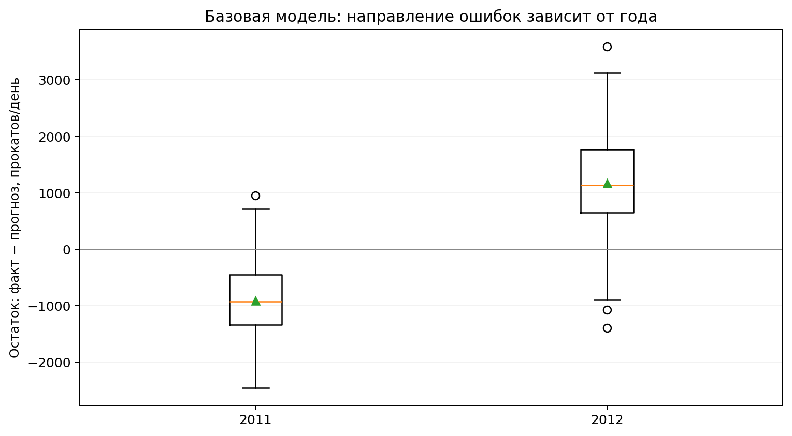

*Рисунок 16. Остатки $`y-\hat y`$ в отложенных месяцах 2011 и 2012 годов. Нулевая горизонтальная линия означает точный прогноз; треугольник показывает среднее по группе. Отрицательные значения — завышение моделью, положительные — занижение.*

Посмотрим, откуда возникло направление ошибок. Среднее фактическое число поездок на наших отложенных месяцах составляло около **3485 в 2011 году** и **5820 в 2012-м**. Базовая модель давала средние прогнозы около **4396** и **4648** соответственно: она в значительной степени сглаживала различие между годами. Такая картина естественно порождает гипотезу: без указания года модель может смешивать два периода с разными уровнями спроса.

Мы обнаружили **систематическое различие между группами**, но пока не знаем его причину. Вместе с годом могли изменяться популярность проката, доступность станций, организация системы и другие условия. Следующий шаг — проверить, улучшится ли модель, если информация о годе будет ей доступна.

### 9.3. Проверяем гипотезу: добавим год в признаки

Сформулируем проверку заранее. В исходном эксперименте использовались семь погодных и календарных столбцов. Обучим **новый случайный лес** по той же процедуре и с теми же настройками, но добавим восьмой вход `year`, принимающий значения 2011 и 2012. Обучающие и отложенные месяцы остаются прежними. Таким образом, мы изменяем **только состав признаков и переобучаем модель**.

| MAE, прокатов/день | Без года | После добавления года |
|---|---:|---:|
| Все 243 отложенных дня | **1120** | **569** |
| 2011 год, 121 день | 958 | 452 |
| 2012 год, 122 дня | 1281 | 686 |

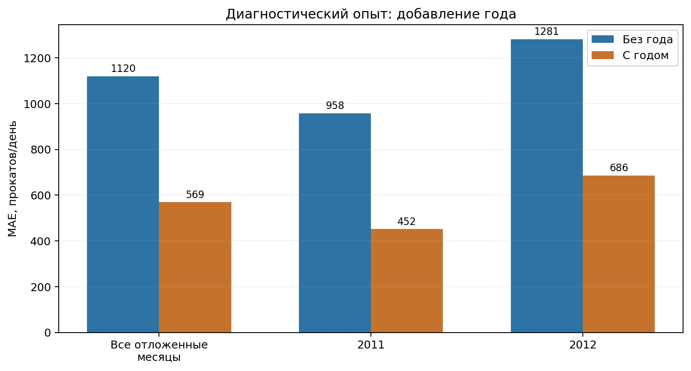

*Рисунок 17. Общая и групповые MAE на тех же отложенных месяцах. Различие — результат нового обучения с дополнительным календарным признаком.*

Общая MAE снизилась примерно на **551 прокат за день**; ошибки обеих годовых групп также уменьшились. Это подтверждает **внутри данного опыта**, что явное различение 2011 и 2012 годов помогло предиктору описывать ретроспективный спрос по погоде и календарю. Это практический результат диагностики: анализ остатков подсказал конкретную модификацию признаков, а сравнение моделей показало пользу такой модификации.

Важна граница вывода. Год 2013 отсутствовал в обучающей выборке; полученное улучшение ничего не говорит об экстраполяции на следующий год. Кроме того, **те же отложенные месяцы** использовались и для обнаружения проблемы, и для оценки предложенного улучшения. Полученный эффект следует считать разведочным, а не независимым подтверждением заранее выбранной гипотезы. Для подтверждения нужна отдельная, заранее выделенная проверочная часть данных или новый временной период с корректной прогнозной постановкой.

В повторных технических экспериментах с другими наборами отложенных месяцев и числом объектов в листьях леса улучшение от добавления года сохранялось. Его точная величина, как и форма сезонных ICE, менялась: **переносимость выводов проверяется отдельно от правильности формул интерпретации**.

### 9.4. Что ещё можно проверять и какие есть границы

**Для классификации** тот же принцип работает с долями ошибок, precision, recall и другими знакомыми нам метриками. Например, общая accuracy может быть высокой, хотя в небольшой, но важной подгруппе модель пропускает значительную часть положительных объектов. В этом случае нужно определить группу по доступным признакам, сравнить её recall с общей оценкой и посмотреть на число действительно положительных наблюдений, от которого зависит надёжность вывода. Повторять всю тему метрик классификации здесь не требуется.

**Для регрессии** полезны графики остатков против прогнозов и отдельных признаков, сравнение распределений ошибок по заранее определённым группам и анализ крупнейших промахов. Но особенно осторожно следует читать график остатка против самого фактического $y$: при больших фактических значениях остаток может выглядеть преимущественно положительным даже у разумного предиктора из-за регрессии к среднему. Чтобы обсуждать дефект модели, нужно проверить структуру ошибок также против **признаков и прогнозов**, а не только фактического значения ответа.

**При поиске подгрупп** есть ещё одна статистическая проблема. Если после просмотра результата перебрать десятки районов, временных периодов и погодных условий, некоторые группы покажут необычно большие ошибки случайно. Чем меньше группа и чем больше вариантов разреза мы пробуем, тем легче принять шум за закономерность. Это продолжает опыт из ДЗ №1: метрика на конечной выборке случайна. Стоит заранее формулировать содержательные группы, показывать число объектов и проверять наиболее интересные находки на новых данных.

**Итак.** Диагностика дополняет графики поведения прогнозной функции анализом фактических ошибок. На нашем кейсе групповые остатки обнаружили противоположное направление ошибок в 2011 и 2012 годах. Добавление известного из даты признака года заметно снизило MAE на отложенных месяцах. Это полезный разведочный результат, который нуждается в независимом подтверждении и не обещает хорошего прогноза новых лет.


## Итак: что важно запомнить

Мы начинали с модели, у которой уже измерили качество на новых данных. Затем задали к ней четыре последовательных вопроса.

1. **Как устроен прогноз?** Коэффициенты, предельные эффекты и путь по дереву объясняют работу знакомых нам моделей. Это модельно-специфические способы чтения обученной структуры.
2. **Какие признаки использует модель?** MDI распределяет уменьшение обучающей неоднородности дерева между признаками. Permutation importance показывает, насколько заданная метрика ухудшается при перемешивании столбца на выбранных данных. Оба результата полезны, но измеряют разные свойства.
3. **Как изменяются прогнозы?** PDP усредняет прогнозы для одинаковых подставленных значений признака. ICE сохраняет кривые отдельных объектов, а centered ICE помогает сравнить их изменения. ALE накапливает локальные изменения в областях, где встречались наблюдения, и полезна при зависимых признаках.
4. **Где модель ошибается и что проверить?** Остатки и групповые метрики выявляют проблемы, скрытые общей оценкой. В Capital Bikeshare противоположные знаки средних остатков по годам подсказали эксперимент с календарным признаком года. Он снизил MAE на отложенных месяцах; надёжность и переносимость такого улучшения нужно проверять отдельно.

Инструменты интерпретации показывают **поведение обученного предиктора**. Для выводов о причинных последствиях изменения температуры, площади квартиры или любого другого признака необходима отдельная исследовательская постановка. Хороший результат XAI — обоснованное понимание того, **что делает модель**, и ясная гипотеза о том, **что проверить дальше**.

## Вопросы для самопроверки

1. Что показывает коэффициент линейной модели и почему его величину нельзя сравнивать между признаками без учёта шкалы?
2. В каком смысле MDI — глобальная модельно-специфическая мера? Как прочитать значения 0,701 и 0,299 для нашего дерева?
3. Почему числовой идентификатор с множеством уникальных значений может получить большую MDI?
4. Что именно меняется при перестановке одного столбца и что остаётся фиксированным? Как читать PI, равную 150 при использовании MAE?
5. Почему для MSE scikit-learn использует `neg_mean_squared_error`? Как из двух отрицательных score получить прирост ошибки?
6. При $x_1=x_2$ две модели дают одинаковые прогнозы. Почему их PI могут различаться? Как проверить роль пары признаков вместе?
7. Объясните, как получить одну точку PDP из выборки из трёх объектов. Нужна ли при этом новая подгонка регрессии?
8. Что позволяет увидеть нелинейная PDP температуры для модели проката велосипедов? Как выглядит аналогичный график для одного дерева?
9. Почему ICE-кривые влажности различаются по сезонам? Что изменится на графике после центрирования ICE?
10. При каких условиях PDP вынуждает модель прогнозировать на редких сочетаниях признаков? Как именно ALE меняет процедуру вычисления?
11. Для одного интервала ALE получены локальные разности +90, +150, +120 поездок. Как вычислить вклад интервала и как использовать его при переходе к следующему интервалу?
12. В базовой модели прогнозов проката средний остаток в 2011 году отрицателен, а в 2012-м положителен. Какую гипотезу об устройстве модели это предлагает? Почему снижение MAE после добавления года ещё требует независимого подтверждения?
13. Почему графики PDP/ICE/ALE не отвечают напрямую на причинный вопрос о последствиях изменения температуры или влажности?

## Что почитать и посмотреть дальше

Разобранные методы — лишь небольшая часть области XAI. Если тема заинтересовала, полезно двигаться от уже знакомых инструментов к объяснению отдельных прогнозов, затем к оценке надёжности самих объяснений и интерпретации более сложных моделей.

**Для закрепления основ**

- **Christoph Molnar — [Interpretable Machine Learning](https://christophm.github.io/interpretable-ml-book/).** Открытый учебник о целях интерпретации, прозрачных моделях, PDP, ICE, ALE, permutation importance и многих других инструментах. Хорошее продолжение этой лекции: каждый метод разобран с определением, визуализацией и ограничениями.
- **James, Witten, Hastie, Tibshirani, Taylor — [An Introduction to Statistical Learning with Applications in Python](https://www.statlearning.com/).** Особенно глава 8, где важность признаков связана с устройством решающих деревьев и ансамблей. Удобно перечитать после недели о деревьях.
- **[scikit-learn: Inspection](https://scikit-learn.org/stable/inspection.html).** Документация и рабочие примеры permutation importance и PDP/ICE. Полезно сравнить изученные определения с тем, что именно вычисляет библиотека.
- **[AI Interpretability School](https://ai-interpretability.school/)** — образовательный проект Елены Еричевой (Elena Ericheva) и Сабрины Садиех (Sabrina Sadiekh). В проекте есть русскоязычные и англоязычные материалы и открытые уроки по классическим методам XAI. Их можно использовать уже для закрепления тем этой недели. Дальше можно изучать SHAP, LIME, контрфактуальные объяснения и интерпретацию более сложных моделей; доступность отдельных уроков зависит от программы.

**Для следующего шага в XAI**

- **SHAP и значения Шепли.** Позволяют распределять отличие прогноза отдельного объекта от выбранного базового уровня между признаками. Особенно интересно познакомиться с [TreeSHAP](https://christophm.github.io/interpretable-ml-book/shap.html) после изучения ансамблей деревьев. Интерпретация результата зависит от определения «отсутствующего» признака и выбранного фонового распределения.
- **LIME и локальные суррогатные модели.** Идея — приблизить поведение сложной модели в окрестности выбранного объекта простой интерпретируемой моделью. Многое зависит от того, как задаётся окрестность и насколько точна локальная аппроксимация. Начать можно с [раздела Molnar о LIME](https://christophm.github.io/interpretable-ml-book/lime.html).
- **Контрфактуальные объяснения и Anchors.** Первые ищут изменения входа, при которых прогноз поменяется в интересующую сторону; вторые предлагают локальные правила, достаточно устойчивые при заданной процедуре изменения прочих условий. См. разделы [Counterfactual Explanations](https://christophm.github.io/interpretable-ml-book/counterfactual.html) и [Anchors](https://christophm.github.io/interpretable-ml-book/anchors.html). Особенно важно различать изменение **входа модели** и реально осуществимое действие.

**Для более широкого исследования области**

- **[Mrs Wallbreaker Maps](https://mrswallbreakermaps.com/)** — интерактивные карты исследовательских вопросов и литературы в смежной области AI safety, в том числе по валидности исследований и надёжности выводов. Это не учебник по классическому XAI, а пример того, как систематизировать открытую исследовательскую проблематику и находить ещё не решённые вопросы.
