# Смещение, разброс и ансамбли: от нестабильного дерева к случайному лесу

В предыдущих лекциях мы научились строить решающие деревья, управлять глубиной и размером листьев, проверять качество на отложенных данных и исследовать поведение обученной модели. Теперь вернёмся к свойству деревьев, которое до сих пор обсуждали лишь качественно: их прогнозы могут заметно меняться, если обучить тот же алгоритм на другой выборке.

С этим свойством сталкиваются и другие модели. При изменении обучающих наблюдений сдвигаются коэффициенты регрессии, меняются ближайшие соседи объекта, перестраиваются границы дерева. Нас интересует, как такие изменения связаны с ошибкой на новых данных и можно ли уменьшить их влияние.

Для начала разберём **смещение и разброс** (*bias* и *variance*) — две составляющие ожидаемой ошибки, которые позволяют рассуждать о сложности модели и обобщающей способности. Затем рассмотрим усреднение нескольких прогнозов. Его польза зависит от того, насколько различаются ошибки базовых моделей. Наконец, изучим **бутстреп**, **бэггинг** (*bagging*) и **случайный лес** (*Random Forest*): методы, с помощью которых усреднение превращается в алгоритм обучения.

## 1. Почему одна процедура обучения даёт разные прогнозы

Представим задачу одномерной регрессии. Признак $x$ принимает значения от $-1$ до $1$, а ответ формируется по некоторой гладкой зависимости с добавлением случайного шума. Мы получили небольшую выборку, обучили регрессионное дерево глубины не более семи и построили его прогноз на всём диапазоне $x$.

Теперь представим, что сбор данных повторился. Количество наблюдений, их распределение, алгоритм построения дерева и все гиперпараметры остались прежними. Изменился только конкретный набор наблюдений и случайные отклонения их ответов. После повторного обучения структура дерева может стать другой.

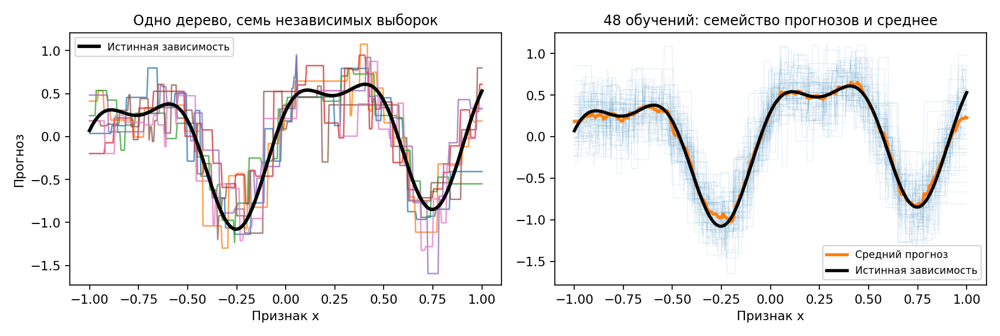

*Рисунок 1. Прогнозы деревьев при повторном обучении.*

Разберём обе панели рисунка 1. По горизонтальной оси отложен признак $x$, по вертикальной — прогноз ответа. **Чёрная гладкая линия** показывает истинную зависимость, по которой исследователь сгенерировал синтетические данные. Именно поэтому мы можем её нарисовать; в обычной прикладной задаче она неизвестна.

На **левой панели** семь цветных ступенчатых линий соответствуют семи деревьям, обученным на семи независимо собранных выборках. Посмотрите на область около $x=0.75$. Прогнозы сильно различаются: у некоторых деревьев ступень находится заметно ниже, чем у других. Перемещаясь по оси $x$, можно найти и участки, где семь линий близки друг к другу. Значит, чувствительность к обучающим данным зависит ещё и от того, **в какой точке мы запрашиваем прогноз**.

Ступени возникают из устройства регрессионного дерева: на каждом листе оно выдаёт постоянное значение. При смене выборки меняются оценки качества возможных разбиений. Дерево может выбрать другой порог в корне, после чего дочерние узлы получат другие группы наблюдений. В результате изменятся и границы ступеней, и значения прогнозов в листьях.

На **правой панели** обучение повторили уже 48 раз. Тонкие голубые линии — прогнозы отдельных деревьев. Оранжевая линия получена следующим способом: в каждой точке оси $x$ сложили прогнозы всех 48 деревьев и разделили на 48. Это **поточечное среднее прогнозов**.

Оранжевая линия выглядит стабильнее отдельных голубых: многие случайные скачки компенсировались при усреднении. На значительной части интервала она идёт близко к чёрной линии. Однако справа, у $x$ около $1$, заметно систематическое расхождение: среднее остаётся ниже истинной зависимости. Усреднение само по себе не гарантирует устранения такой ошибки.

Получился интересный результат: **один и тот же алгоритм может давать сильно различающиеся прогнозы, а среднее многих его запусков ведёт себя иначе, чем отдельный запуск**. Но почему? Чтобы ответить, нужно рассматривать не только одну обученную функцию, но и множество функций, которые алгоритм мог бы построить на разных выборках.

### От одного дерева к процедуре обучения

Обозначим совместное распределение признаков и ответов через $P(X,Y)$. Обучающая выборка размера $n$ имеет вид

```math
D=\lbrace (X_1,Y_1),\ldots,(X_n,Y_n)\rbrace ,
\qquad (X_i,Y_i)\overset{\mathrm{iid}}{\sim}P.
```

Здесь *iid* означает, что наблюдения независимы друг от друга и имеют одинаковое распределение. Это наша исходная статистическая постановка; для временных рядов или зависимых наблюдений её пришлось бы менять.

Пусть $A$ — заданная процедура обучения. Например, «построить регрессионное дерево глубины не более семи с выбранным критерием разбиения». Применение процедуры к выборке $D$ даёт обученную функцию

```math
\hat f_D=A(D).
```

Индекс $D$ напоминает, что результат зависит от данных. Если взять другую выборку $D'$, то та же процедура может построить другую функцию $\hat f_{D'}$.

Вернёмся к рисунку 1 и выберем **одну конкретную точку** на горизонтальной оси, например $x_0=0.75$. Сейчас нас интересуют прогнозы именно для объекта с этим фиксированным значением признака. Мы много раз обучаем дерево, но всякий раз спрашиваем его об одном и том же $x_0$:

```math
\hat f_{D_1}(x_0),\quad
\hat f_{D_2}(x_0),\quad
\hat f_{D_3}(x_0),\quad\ldots
```

Смысл последовательности простой: $D_1$ — первая возможная обучающая выборка, $D_2$ — вторая и так далее. Разные значения возникают из-за изменения **выборки, на которой обучали дерево**. Сам объект прогноза $x_0$ всё время остаётся одним и тем же.

Поскольку $D$ случайна, то и число $\hat f_D(x_0)$ можно рассматривать как случайную величину. У неё есть своё распределение. Оно показывает, какие ответы может выдавать процедура в точке $x_0$ при повторном сборе данных. Если эти значения сильно различаются, процедура здесь нестабильна. В другой точке $x_1$ разброс может быть совсем иным.

Дальше будем считать, что **при фиксированной выборке процедура обучения детерминирована**. В такой постановке вся случайность прогноза связана с возможными обучающими выборками. Этого достаточно, чтобы строго разобраться со смещением, разбросом и ошибкой обобщения.

### Итак

- Одна процедура обучения может порождать разные прогнозные функции на разных обучающих выборках.
- В фиксированной точке $x_0$ выражение $\hat f_D(x_0)$ — случайный прогноз, потому что обучающая выборка $D$ случайна.
- На рисунке 1 среднее 48 прогнозов оказалось устойчивее отдельных деревьев. Теперь выясним, какую именно составляющую ошибки способно уменьшать усреднение.

## 2. Откуда возникает ошибка на новых данных

Для начала отделим свойства обученной модели от изменчивости самих наблюдений. Даже если два дома имеют одинаковую площадь и одинаковое число жильцов, их расход электроэнергии за месяц может различаться. На него влияют режим использования приборов, погода и другие факторы, которые мы не включили в признаки.

Для всех домов с одним набором характеристик $x$ существует **условное распределение ответа** $Y\mid X=x$. Оно описывает, какие значения расхода возможны при зафиксированных признаках. Среди всех чисел, которыми можно предсказывать этот ответ, особую роль играет условное математическое ожидание

```math
m(x)=\mathbb E[Y\mid X=x].
```

Во второй лекции (§1.1–1.2) мы уже доказали два связанных результата: выборочное среднее минимизирует сумму квадратов ошибок среди постоянных прогнозов, а в вероятностной постановке для объекта с признаками $X=x$ оптимальным прогнозом по ожидаемой квадратичной ошибке служит $m(x)$. Именно его мы будем считать ориентиром при оценке регрессионных моделей.

Выбор ориентира зависит от функции потерь. При абсолютной ошибке оптимальный прогноз — условная медиана, при квантильной функции потерь (*pinball loss*) с уровнем $\tau$ — условный $\tau$-квантиль. В дальнейшем рассматриваем квадратичную ошибку: для неё особенно удобно анализировать ошибку обученной модели относительно $m(x)$.

### Шум: почему даже лучший прогноз ошибается

Определим отклонение наблюдаемого ответа от условного среднего:

```math
\varepsilon=Y-m(X),\qquad Y=m(X)+\varepsilon.
```

Эту запись легко ошибочно принять за дополнительное предположение о данных. На самом деле мы **определили** $\varepsilon$ как остаток относительно условного среднего. При фиксированном $X=x$ выполнено

```math
\begin{aligned}
\mathbb E[\varepsilon\mid X=x]
&=\mathbb E[Y-m(x)\mid X=x]\\[0pt]
&=\mathbb E[Y\mid X=x]-m(x)\\[0pt]
&=0.
\end{aligned}
```

Нулевое условное математическое ожидание следует из определения $\varepsilon$. Дополнительных предположений о распределении шума мы не вводили.

Чтобы измерить размер случайных отклонений, используем условную дисперсию

```math
\boxed{
\begin{aligned}
\sigma^2(x)&=\mathrm{Var}(Y\mid X=x)\\[0pt]
&=\mathrm{Var}(\varepsilon\mid X=x)\\[0pt]
&=\mathbb E[\varepsilon^2\mid X=x].
\end{aligned}
}
\qquad\text{(1)}
```

При фиксированных признаках $x$ число $m(x)$ постоянно. Вычитание этой константы из ответа $Y$ сдвигает все возможные значения на одну величину, поэтому дисперсия ответа и дисперсия отклонения $\varepsilon$ совпадают. Последнее равенство следует из нулевого условного среднего $\varepsilon$: его дисперсия равна среднему квадрату отклонения от нуля.

Рассмотрим пример с энергопотреблением. Пусть для домов с заданными площадью и числом жильцов возможны три значения месячного расхода: 200, 300 и 400 кВт·ч, каждое с вероятностью $1/3$. Тогда $m(x)=300$ кВт·ч. Даже если мы совершенно точно знаем это среднее и предсказываем 300, в двух случаях из трёх прогноз будет отличаться от фактического ответа. Его ожидаемая квадратичная ошибка составляет

```math
\sigma^2(x)=\frac{(200-300)^2+(300-300)^2+(400-300)^2}{3}
=\frac{20\,000}{3}\;\text{(кВт·ч)}^2.
```

Никакой выбор глубины дерева, числа соседей или коэффициентов регрессии не позволит систематически различать эти три случая, пока всем домам соответствует один и тот же набор известных признаков. Поэтому $\sigma^2(x)$ называют **неустранимым шумом** (*irreducible noise*): при квадратичной потере это нижняя граница ожидаемой ошибки для прогноза, основанного только на $X=x$. Она может быть нулевой, если ответ полностью определяется признаками.

Слово «неустранимый» относится к имеющейся информации. Если дополнительно узнать тип отопления или потребляемую мощность приборов, часть различий между домами может стать предсказуемой. При расширении набора доступных признаков минимально достижимая MSE в среднем по объектам может уменьшиться. Разумеется, добавление признака само по себе ещё не гарантирует улучшения конкретной обученной модели: её тоже нужно оценивать на новых данных.

### Средний прогноз, смещение и разброс

Теперь вернёмся к случайной **обученной** модели из раздела 1. Для ясности снова зафиксируем точку $x_0$. Например, это может быть дом площадью 80 м² с тремя жильцами; в одномерном эксперименте рисунка 1 — просто число на оси $x$. Все модели получают на входе один и тот же $x_0$.

Предположим, мы многократно собрали независимые обучающие выборки $D_1,D_2,\ldots,D_M$. Для одного и того же $x_0$ получаем $M$ прогнозов и вычисляем их арифметическое среднее:

```math
\bar f_M(x_0)=\frac1M\sum_{j=1}^{M}\hat f_{D_j}(x_0).
```

Именно так мы получили оранжевую линию на рисунке 1: для каждой точки отдельно усреднили 48 прогнозов. Если повторить эксперимент с другим набором из 48 выборок, среднее тоже немного изменится. Хотелось бы описать характерный прогноз самой процедуры обучения независимо от конкретного набора повторений.

Обозначим через $\mu(x_0)$ математическое ожидание прогноза по всем возможным обучающим выборкам размера $n$:

```math
\boxed{\mu(x_0)=\mathbb E_D[\hat f_D(x_0)].}
\qquad\text{(2)}
```

$\mu(x_0)$ — теоретический средний прогноз процедуры обучения. По закону больших чисел при независимых одинаково распределённых выборках и существовании ожидания среднее $\bar f_M(x_0)$ приближается к $\mu(x_0)$ по мере увеличения $M$. Таким образом, экспериментальное среднее позволяет оценить величину (2).

Теперь у нас есть два разных средних. $m(x_0)$ характеризует возможные **ответы объектов** с заданными признаками, а $\mu(x_0)$ — возможные **прогнозы обученной модели** для этих признаков. Второе среднее зависит от процедуры обучения и может не совпадать с первым.

Сравним $\mu(x_0)$ с истинным условным средним ответом $m(x_0)$. Их разность — **смещение** (*bias*):

```math
\boxed{\mathrm{Bias}(x_0)=\mu(x_0)-m(x_0).}
\qquad\text{(3)}
```

Смещение характеризует систематическую ошибку **среднего** прогноза процедуры. Оно может быть положительным, отрицательным или нулевым и изменяться в разных точках пространства признаков. Например, если в точке $x_0$ истинное среднее равно $10$, а средний прогноз по независимым выборкам равен $8$, смещение составляет $-2$.

Но одинаковое среднее ещё не означает, что отдельные обученные модели ведут себя одинаково. Одни могут выдавать $7.9$, $8.0$, $8.1$, а другие — $3$, $8$, $13$. Во втором случае отдельные прогнозы гораздо менее устойчивы, хотя среднее осталось равным $8$. Эту изменчивость описывает **разброс**, или дисперсия прогноза:

```math
\boxed{
\mathrm{Var}_D(\hat f_D(x_0))
=\mathbb E_D\!\left[(\hat f_D(x_0)-\mu(x_0))^2\right].
}
\qquad\text{(4)}
```

Внутри квадрата стоит отклонение прогноза конкретной обученной модели от среднего прогноза процедуры. Чем сильнее различаются отдельные прогнозы, тем больше эта величина.

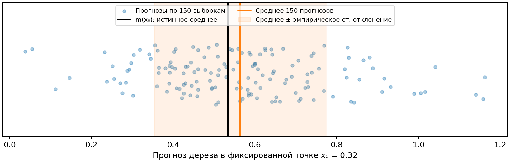

*Рисунок 2. Смещение и разброс прогнозов в одной точке.*

Рисунок 2 позволяет увидеть все элементы определения. Здесь зафиксировано $x_0=0.32$; **по горизонтальной оси отложены значения прогнозов**, полученных после 150 независимых обучений. Каждый голубой кружок соответствует одному прогнозу $\hat f_{D_j}(x_0)$. Кружки расположены на разных высотах только для наглядности: вертикальная координата не является второй характеристикой модели.

Чёрная вертикальная линия отмечает истинное условное среднее $m(x_0)\approx0.534$, а оранжевая — вычисленное по 150 прогнозам среднее $\bar f_{150}(x_0)\approx0.564$, оценку величины $\mu(x_0)$. Оранжевая линия расположена чуть правее чёрной: в этом эксперименте средний прогноз немного завышает истинное среднее. Горизонтальное расстояние между линиями показывает оценку модуля смещения. Облако точек при этом имеет заметную ширину: отдельные деревья выдают существенно разные числа. Светлая полоса показывает интервал в одно эмпирическое стандартное отклонение по обе стороны среднего. Она помогает оценить масштаб разброса и не является доверительным или предсказательным интервалом.

Представим теперь стрельбу по мишени. Мы можем использовать её как аналогию: центр соответствует истинному условному среднему, а каждое попадание — прогнозу после очередного независимого обучения. Расположение центра группы попаданий показывает смещение, а рассеяние вокруг этого центра — разброс прогнозов.

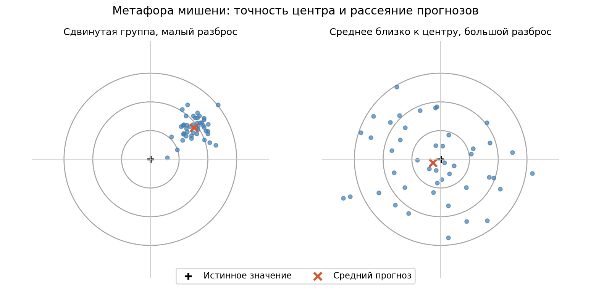

*Рисунок 3. Мишень как аналогия смещения и разброса.*

На левой панели рисунка 3 попадания расположены близко друг к другу, но в стороне от центра. Это пример устойчивого, однако систематически смещённого прогноза. На правой панели средняя точка попаданий ближе к центру, но сами попадания разбросаны по большой области. Это пример меньшего смещения при более высокой изменчивости. Мишень помогает запомнить две разные характеристики, однако у настоящей модели есть существенное отличие: **смещение и разброс зависят от входа $x$**, поэтому одной такой мишени недостаточно для описания поведения модели во всём пространстве признаков.

### Как появляется разложение ожидаемой ошибки

Мы рассматриваем два мысленных эксперимента. В первом один и тот же обученный предиктор используется для множества новых домов с признаками $x_0$. Сами ответы домов различаются, даже если предиктор каждый раз выдаёт одно и то же число. Во втором эксперименте мы оставляем признаки $x_0$ неизменными, но заново собираем обучающие данные и обучаем модель. Теперь различаться могут уже прогнозы. Первый эксперимент связан с шумом ответа $\sigma^2(x_0)$, второй — с разбросом прогноза из (4). Смещение показывает, насколько центр распределения прогнозов во втором эксперименте удалён от оптимального прогноза $m(x_0)$.

Нас интересует, какую среднюю квадратичную ошибку даст процедура обучения, если повторять оба эксперимента: обучать модель на новой выборке $D$ и проверять её на новом независимом наблюдении $(X_0,Y_0)$ с признаками $X_0=x_0$. Будем считать, что у ответа и прогнозов существуют конечные вторые моменты. Для начала выясним, какую ошибку можно ожидать, когда прогноз уже известен.

Пусть мы выбрали фиксированное число $a$ в качестве прогноза. Его ошибка на одном новом наблюдении равна $(Y_0-a)^2$, а средняя ошибка по всем возможным ответам при $X_0=x_0$ составляет

```math
\mathbb E_{Y_0}[(Y_0-a)^2\mid X_0=x_0].
```

Хотим отделить изменчивость самого ответа от ошибки выбранного прогноза. Для этого воспользуемся условным средним $m=m(x_0)$ как точкой отсчёта:

```math
Y_0-a=\underbrace{(Y_0-m)}_{\text{отклонение ответа}}+\underbrace{(m-a)}_{\text{ошибка прогноза относительно среднего}}.
```

Возведём это равенство в квадрат. Получим выражение для квадратичной ошибки на одном наблюдении:

```math
\begin{aligned}
(Y_0-a)^2={}&(Y_0-m)^2+(m-a)^2\\[0pt]
&+2(Y_0-m)(m-a).
\end{aligned}
```

Теперь возьмём условное математическое ожидание от обеих частей равенства. Чтобы не перегружать запись, в промежуточном вычислении обозначим ожидание по $Y_0$ при $X_0=x_0$ через $\mathbb E_0$:

```math
\begin{aligned}
\mathbb E_0[(Y_0-a)^2]
&=\mathbb E_0[(Y_0-m)^2]+\mathbb E_0[(m-a)^2]\\[0pt]
&\quad+2\mathbb E_0[(Y_0-m)(m-a)]\\[0pt]
&=\sigma^2(x_0)+(m-a)^2+2(m-a)\mathbb E_0[Y_0-m]\\[0pt]
&=\sigma^2(x_0)+(m-a)^2.
\end{aligned}
```

В первой строке использована линейность ожидания. Во второй вынесены постоянные относительно $Y_0$ величины, а средний квадрат $Y_0-m$ заменён условной дисперсией. Смешанное слагаемое равно нулю, поскольку $\mathbb E_0[Y_0-m]=0$. Возвращаясь к полной записи, получаем

```math
\boxed{
\mathbb E_{Y_0}[(Y_0-a)^2\mid X_0=x_0]
=\sigma^2(x_0)+(m(x_0)-a)^2.
}
\qquad\text{(5)}
```

Теперь видно, как именно проявляется неустранимый шум. При любом выборе $a$ первое слагаемое остаётся одним и тем же. Если выбрать $a=m(x_0)$, второе слагаемое исчезнет; уменьшить ошибку ещё сильнее за счёт изменения прогноза невозможно.

Однако в машинном обучении число $a$ заранее неизвестно. Мы получаем его, обучая модель на выборке $D$. При фиксированной $D$ прогноз $\hat f_D(x_0)$ — конкретное число, поэтому равенство (5) можно использовать для этой модели:

```math
\mathbb E[(Y_0-\hat f_D(x_0))^2\mid X_0=x_0,D]
=\sigma^2(x_0)+(m(x_0)-\hat f_D(x_0))^2.
```

Здесь требуется независимость нового наблюдения от обучающей выборки: знание $D$ не меняет условное распределение $Y_0$ при заданном $X_0=x_0$. Таким образом, мы уже получили ожидаемую ошибку конкретной обученной модели на новых ответах. Чтобы оценить всю процедуру обучения, усредним это равенство по возможным $D$. По закону полного математического ожидания получаем

```math
\begin{aligned}
R(x_0)
&=\mathbb E_D\left[\mathbb E[(Y_0-\hat f_D(x_0))^2\mid X_0=x_0,D]\right]\\[0pt]
&=\sigma^2(x_0)+\mathbb E_D[(m(x_0)-\hat f_D(x_0))^2].
\end{aligned}
\qquad\text{(6)}
```

$R(x_0)$ обозначает ожидаемую ошибку процедуры при фиксированных признаках нового объекта. Шум ответа уже отделён. Осталось понять, почему прогноз обученной модели отклоняется от $m(x_0)$.

Второе слагаемое (6) может быть большим по двум причинам. Возможно, процедура в среднем предсказывает слишком мало или слишком много. Возможно также, что средний прогноз близок к истине, но отдельные модели сильно отклоняются от него. Чтобы измерить оба эффекта, воспользуемся определённым ранее средним прогнозом $\mu(x_0)$. Обозначим для краткости $m=m(x_0)$, $\mu=\mu(x_0)$, $\hat f=\hat f_D(x_0)$:

```math
m-\hat f=(m-\mu)+(\mu-\hat f).
```

Первая разность — систематическая ошибка (с противоположным знаком к определению смещения), вторая — отклонение конкретного прогноза от среднего. Раскрыв квадрат и взяв ожидание по обучающим выборкам, получим

```math
\begin{aligned}
\mathbb E_D[(m-\hat f)^2]
={}&(m-\mu)^2+\mathbb E_D[(\mu-\hat f)^2]\\[0pt]
&+2(m-\mu)\mathbb E_D[\mu-\hat f].
\end{aligned}
```

Величины $m$ и $\mu$ при фиксированном $x_0$ постоянны. По определению среднего прогноза

```math
\mathbb E_D[\mu-\hat f]=\mu-\mathbb E_D[\hat f]=\mu-\mu=0.
```

Поэтому смешанное слагаемое исчезает. Первое оставшееся слагаемое — квадрат смещения из (3), второе — дисперсия прогноза из (4):

```math
\mathbb E_D[(m-\hat f)^2]
=\underbrace{(m-\mu)^2}_{\mathrm{Bias}^2(x_0)}
+\underbrace{\mathbb E_D[(\mu-\hat f)^2]}_{\mathrm{Var}_D(\hat f_D(x_0))}.
```

Подставляя результат в (6), получаем **разложение смещения и разброса** (*bias–variance decomposition*):

```math
\boxed{
\begin{aligned}
R(x_0)={}&\underbrace{\sigma^2(x_0)}_{\text{неустранимый шум}}\\[0pt]
&+\underbrace{\mathrm{Bias}^2(x_0)}_{\text{систематическая ошибка}}\\[0pt]
&+\underbrace{\mathrm{Var}_D(\hat f_D(x_0))}_{\text{разброс прогноза}}.
\end{aligned}}
\qquad\text{(7)}
```

Мы получили точное математическое равенство для ожидаемой **квадратичной** ошибки при сделанных предпосылках. Каждое слагаемое неотрицательно. Поэтому полная ошибка может оказаться большой из-за любого из этих трёх источников.

**Проверим на числах.** Пусть в выбранной точке истинное среднее $m(x_0)=10$, средний прогноз процедуры $\mu(x_0)=8$, дисперсия прогнозов равна $3$, а условная дисперсия нового ответа равна $1$. Тогда смещение равно $8-10=-2$, а ожидаемая ошибка составляет

```math
\begin{aligned}
R(x_0)&=\underbrace{1}_{\text{шум}}+\underbrace{(-2)^2}_{\text{квадрат смещения}}+\underbrace{3}_{\text{разброс}}\\[0pt]
&=8.
\end{aligned}
```

Если удастся уменьшить разброс с $3$ до $1$, сохранив то же смещение, получим $R(x_0)=1+4+1=6$. Но если вместе с этим смещение возрастёт по модулю до $3$, результат будет другим:

```math
R(x_0)=1+3^2+1=11.
```

Хотя процедура стала устойчивее к смене данных, её качество ухудшилось. Разложение позволяет выяснить, какие изменения в процедуре обучения полезны для прогноза, оценивая их совместное влияние на ошибку.

### От одной точки к качеству на новых объектах

До сих пор мы фиксировали $x_0$: например, дом с определённой площадью и числом жильцов. Но будущие объекты бывают разными. Модель может работать устойчиво для типовых домов и давать нестабильные прогнозы для редких комбинаций характеристик.

**Общий ожидаемый тестовый риск процедуры** учитывает, насколько часто разные $x$ встречаются в популяции. Для этого нужно усреднить полученную в каждой точке ошибку $R(x)$ ещё и по распределению признаков нового объекта $X_0$. Например, если в популяции встречаются только два типа объектов с вероятностями $0.9$ и $0.1$, а их условные риски равны $4$ и $20$, общий риск составит $0.9\cdot4+0.1\cdot20=5.6$. Математическое ожидание выполняет такое взвешивание для любого распределения признаков. Подставим разложение (7) внутрь этого ожидания:

```math
\boxed{
\mathcal R(A)=\mathbb E_{X_0}[R(X_0)]
=\mathbb E_{X_0}\!\left[
\sigma^2(X_0)+\mathrm{Bias}^2(X_0)
+\mathrm{Var}_D(\hat f_D(X_0))
\right].
}
\qquad\text{(8)}
```

Формула (8) обобщает вывод для одной точки на распределение новых объектов. Здесь усредняются именно квадраты смещений: положительное смещение в одной группе не компенсирует отрицательное в другой при расчёте MSE.

На реальном датасете обычно неизвестны $m(x)$, $\sigma^2(x)$ и распределение возможных обучающих выборок. Мы можем оценивать общий риск с помощью подходящей валидации, но обычно не можем непосредственно разложить его на три точных числа. Для изучения компонент удобны синтетические задачи, где исследователь знает механизм генерации данных и может многократно повторить обучение.

Разложение даёт нам два направления работы с моделью. Если средний прогноз систематически далёк от истинного, имеет смысл искать более подходящее семейство функций, менять признаки или ограничения. Если результаты обучения слишком сильно меняются от выборки к выборке, полезно искать более устойчивую процедуру. Две модели с одинаковой MSE могут нуждаться в совершенно разных улучшениях. Именно поэтому представление ошибки через её компоненты помогает понять, как управлять обучением.

Для других функций потерь оптимальный прогноз и способ анализа риска отличаются. При MAE ориентиром служит условная медиана, а при pinball loss — условный квантиль. В классификации при обычной потере 0–1 (доля ошибок, равная $1-\mathrm{accuracy}$) оптимально выбирать наиболее вероятный класс; минимальная условная ошибка равна единице минус вероятность этого класса. F1 зависит от совокупности прогнозов и ошибок классификации, поэтому для него уже сам способ определения оптимального решения отличается. Для этих потерь существуют свои способы анализа ошибки; трёхчленное равенство (7) опирается именно на свойства квадрата.

### Итак

- Шум нового ответа остаётся даже у оптимального по MSE условного среднего $m(x)$.
- Смещение характеризует средний прогноз обучающей процедуры, разброс — изменчивость прогнозов между обучающими выборками.
- При MSE ожидаемая ошибка равна сумме шума, квадрата смещения и дисперсии. Это позволяет обсуждать свойства процедуры обучения, а не ограничиваться качеством одного обученного экземпляра.

## 3. Сложность модели и компромисс смещения и разброса

В первой лекции (§4) мы обсуждали недообучение и переобучение и рассматривали кривые ошибки на обучающих и новых данных при увеличении гибкости модели. На обучении ошибка продолжала снижаться, а на новых данных после некоторого уровня сложности начала расти. Разложение (7) позволяет объяснить один из механизмов такого поведения.

Предположим, что истинная зависимость между признаком $x$ и ответом заметно изгибается. Линейная регрессия в исходном признаке может провести только прямую. Даже если бы мы собрали очень много данных, сама форма линейной функции не позволила бы ей точно воспроизвести каждый изгиб. Поэтому средний прогноз такой процедуры может оставаться далеко от $m(x)$: возникает **смещение из-за ограничения семейства моделей**.

Разрешим полиному иметь более высокую степень или дереву — больше разбиений. У процедуры появится возможность лучше приблизить истинную зависимость. Но одновременно увеличится число вариантов, которыми она может подстроиться под случайные детали конкретной обучающей выборки. Так возникает конкуренция между уменьшением систематической ошибки и увеличением изменчивости прогноза.

Зафиксируем задачу: распределение $(X,Y)$, признаки, доступные в момент прогноза, размер обучающей выборки $n$ и квадратичную функцию потерь. Будем менять только процедуру обучения $A_c$, где $c$ — настройка гибкости, например допустимая глубина дерева. В обозначениях (7) получаем

```math
R_{A_c}(x)=\underbrace{\sigma^2(x)}_{\text{свойство задачи}}+\underbrace{\mathrm{Bias}_{A_c}^2(x)+\mathrm{Var}_D(\hat f_{D,A_c}(x))}_{\text{зависят от процедуры обучения}}.
```

При увеличении глубины дерева или переходе от дерева к kNN условное распределение $Y\mid X=x$ остаётся прежним. Поэтому неустранимый шум одинаков для этих моделей. Он определяется доступной информацией о новом объекте; расширение этой информации может изменить границу достижимой точности. Настройки гибкости влияют на два других слагаемых. Если снижение квадрата смещения превышает рост разброса, риск уменьшается. Если дополнительный разброс перевешивает снижение смещения, риск растёт, даже когда ошибка на обучающей выборке продолжает снижаться.

### Как выглядит классический bias–variance trade-off

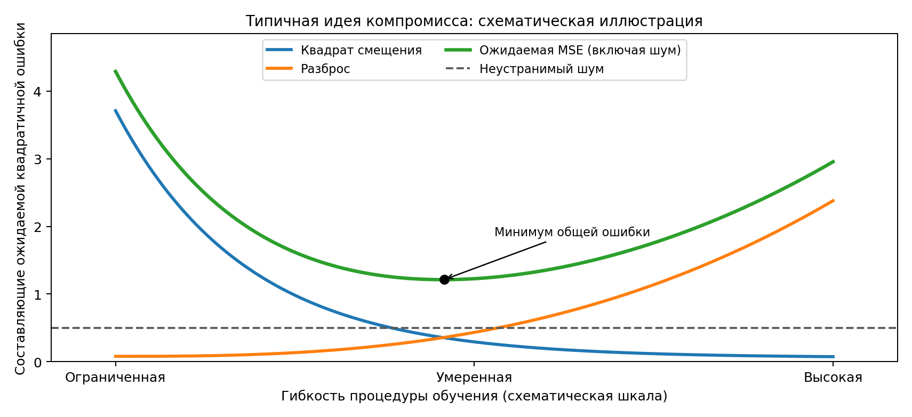

*Рисунок 4. Классическая схема компромисса смещения и разброса.*

На рисунке 4 по горизонтальной оси растёт **гибкость процедуры обучения**: слева она сильно ограничена, справа способна описывать более сложные зависимости. Вертикальная ось показывает составляющие ожидаемой квадратичной ошибки. Это **схематический рисунок**, построенный для объяснения идеи; его линии не являются результатами измерения на конкретном датасете.

Кривая квадрата смещения начинается высоко и снижается. Смысл в том, что дополнительная гибкость позволяет среднему прогнозу точнее следовать истинной зависимости. Кривая разброса, напротив, растёт: всё более гибкая процедура чаще реагирует на случайные особенности отдельных выборок. Штриховая горизонтальная линия показывает неустранимый шум (в среднем по распределению новых объектов). Он остаётся постоянным, поскольку на горизонтальной оси меняется только гибкость процедуры обучения при одной и той же задаче и доступной информации.

Верхняя кривая — **сумма** этих трёх составляющих, то есть ожидаемая квадратичная ошибка. Сначала она уменьшается: выигрыш от снижения смещения больше, чем потери от роста разброса. После некоторой точки снижение смещения становится небольшим, а изменчивость растёт сильнее. Поэтому общая ошибка начинает увеличиваться. Самая низкая точка общей кривой соответствует выгодному балансу двух изменяющихся составляющих.

Это и называют **компромиссом смещения и разброса** (*bias–variance trade-off*). При регулировании сложности модели мы иногда уменьшаем одну составляющую ожидаемой ошибки ценой роста другой. Оптимальной оказывается настройка, при которой их **сумма**, с учётом шума, минимальна для интересующего распределения данных.

Разберём условный численный пример. Пусть шум равен $1$, а при трёх уровнях гибкости получили следующие компоненты:

| Гибкость | Смещение² | Разброс | Шум | Ожидаемая MSE |
|---|---:|---:|---:|---:|
| Низкая | 9 | 0.5 | 1 | 10.5 |
| Умеренная | 3 | 2 | 1 | 6 |
| Высокая | 1 | 7 | 1 | 9 |

Переход от низкой к умеренной гибкости уменьшил квадрат смещения на $6$, а разброс повысил только на $1.5$: ожидаемая ошибка снизилась. Следующий переход уменьшил квадрат смещения на $2$, но увеличил разброс на $5$: общая ошибка выросла. Таблица помогает прочитать смысл кривых независимо от их формы.

**Эта схема не является универсальным законом о монотонности.** Она показывает важный возможный механизм. Реальные зависимости смещения и разброса от гиперпараметра могут колебаться, иметь плато и несколько локальных экстремумов. Поэтому её полезно сначала понять, а затем проверить, где и почему она перестаёт точно описывать данные.

### Как управляют гибкостью знакомые модели

В решающем дереве увеличение `max_depth` разрешает больше последовательных разбиений. Неглубокое дерево описывает зависимость крупными ступенями и может систематически пропускать важные изменения. Очень глубокое дерево способно подстроить границы под отдельные шумные наблюдения. При смене выборки такие границы иногда существенно перестраиваются. Увеличение глубины часто снижает квадрат смещения и повышает разброс. Ограничение глубины обычно делает прогноз устойчивее, но может увеличить смещение.

В методе ближайших соседей похожий компромисс возникает при изменении $k$. Если используется один ближайший сосед, прогноз сильно зависит от того, какой отдельный объект оказался ближе остальных. При увеличении $k$ ответ усредняется по более широкой окрестности: влияние одного случайного наблюдения часто ослабевает, зато локальные детали зависимости могут сглаживаться. Разброс прогноза при этом обычно уменьшается, а смещение может расти. Поэтому **для kNN увеличение $k$ обычно уменьшает гибкость**, а для дерева увеличение допустимой глубины обычно её повышает.

В Ridge-регрессии управление устроено иначе. Мы штрафуем большие коэффициенты с помощью параметра $\lambda$. При сильном штрафе оценённые коэффициенты меньше реагируют на случайную выборку, однако часть реального сигнала тоже может подавляться. Сильный штраф может увеличить смещение среднего прогноза, особенно если для описания сигнала нужны большие коэффициенты. Ослабление штрафа уменьшает это ограничение, но может увеличивать разброс прогнозов между выборками.

Значит, сходную задачу контроля обобщения разные алгоритмы решают разными способами. В частности, **сложность нельзя определять одним только количеством параметров**. У kNN вообще нет привычного вектора обучаемых коэффициентов, но изменение $k$ заметно меняет чувствительность прогноза к выборке.

Посмотрим ещё раз на мишень из раздела 2.


*Повтор рисунка 3. Метафора смещения и разброса.*

Она помогает увидеть, что именно мы меняем при настройке гибкости: можно получить предсказания, близкие друг к другу, но систематически далёкие от истины; можно получить предсказания с небольшим средним смещением и большим разбросом. При изменении настройки модели мы стараемся найти лучший баланс для ожидаемой ошибки по интересующим объектам.

### Проверим идеальную схему на двух разных зависимостях

Теперь рассмотрим уже **вычислительный эксперимент**. В отличие от рисунка 4, мы действительно многократно обучаем модели и вычисляем значения компонент ошибки по созданным данным.

В первом случае истинная функция гладкая, похожая на синусоиду. Во втором она имеет скачок. Для каждого случая сгенерировали 100 независимых обучающих выборок по 42 наблюдения, добавив шум со стандартным отклонением $0.2$. На каждой выборке обучали полиномиальные модели разных степеней. Чтобы вычисления высоких степеней были устойчивее, использовали небольшой Ridge-штраф; таким образом, эксперимент относится именно к этой **процедуре** полиномиальной регрессии со слабой регуляризацией.

Поскольку истинная зависимость при синтетической генерации известна, можно оценить средний прогноз, квадрат смещения и разброс на сетке значений $x$. Затем значения усредняются по сетке.

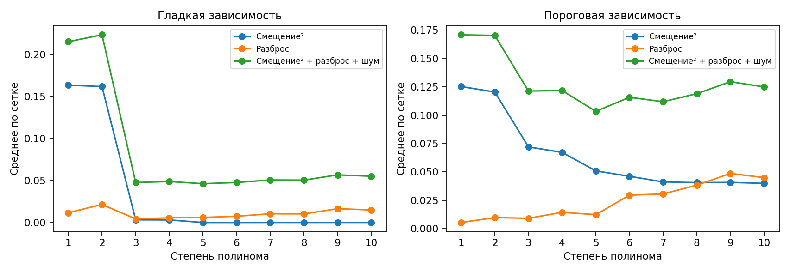

*Рисунок 5. Смещение и разброс полиномиальных моделей на двух синтетических задачах.*

На рисунке 5 в обеих панелях горизонтальная ось — степень полинома от 1 до 10. Вертикальная ось показывает усреднённые по сетке величины: квадрат смещения, дисперсию обученного прогноза и их сумму с дисперсией шума. **Слева** истинная зависимость гладкая; увеличение степени позволяет полиному довольно быстро воспроизводить её форму. **Справа** истинная функция скачкообразная. Полиномы непрерывны, и возле скачка им трудно точно повторить зависимость: снижение смещения происходит иначе.

Посмотрите на форму линий по соседним степеням. Компоненты ошибки ведут себя не столь идеально, как на схематическом рисунке 4: встречаются плато и локальные изменения направления. Причина в том, что мы рассматриваем конкретную истинную функцию, конечную выборку, шум, выбранную процедуру обучения и конкретный диапазон сложности.

Это не опровергает точное равенство (7). **Разложение справедливо независимо от формы кривых.** Оно не утверждает, что квадрат смещения обязан уменьшаться при каждом увеличении степени полинома или что дисперсия должна строго расти. Классическая U-образная схема помогает объяснять типичный компромисс; настоящую форму зависимости нужно исследовать на задаче.

### Как использовать идею на практике

Для настоящих данных мы не знаем истинную функцию $m(x)$. Поэтому нельзя просто построить график из рисунка 5 по одной таблице и точно измерить три компонента. Зато можно сравнивать качество моделей разной сложности на валидационных данных или с помощью кросс-валидации.

Представим, что мы обучили регрессионные деревья разной глубины. Ниже — условные результаты одного разбиения данных (MSE, меньше означает лучше):

| Максимальная глубина | Train MSE | Validation MSE |
|---:|---:|---:|
| 1 | 12 | 13 |
| 3 | 6 | 7 |
| 5 | 3 | 5 |
| 10 | 0.4 | 9 |

Переход от глубины 1 к 5 помогает и на обучающих, и на новых объектах. Глубина 10 значительно улучшает подгонку обучающей выборки, но ухудшает проверочный результат. Это согласуется с механизмом переобучения: дополнительная гибкость может усиливать разброс быстрее, чем снижает смещение. При этом значения в таблице сами по себе не позволяют вычислить bias или variance. Разброс прогнозов из (4) определяется при повторном обучении на разных выборках, а не разностью train-MSE и validation-MSE.

Как действовать дальше? Проверить близкие значения глубины на нескольких корректно выбранных разбиениях, рассмотреть ограничения на минимальный размер листа и сопоставить качество с простым бейзлайном. Если ошибки остаются систематически большими в определённых областях признаков, полезно вернуться к диагностике остатков из предыдущих лекций: возможно, модели не хватает гибкости или информации. Выбираем параметры по оценке обобщающей ошибки, а окончательное качество проверяем на данных, не использованных при выборе.

Так bias–variance помогает сформулировать гипотезу о причинах ошибок и выбрать следующий эксперимент. Валидация показывает, принесло ли изменение пользу.

До сих пор мы в основном контролировали изменчивость **одной** обученной модели: глубиной дерева, числом соседей или регуляризацией коэффициентов. Но можно попробовать сохранить достаточно гибкую базовую модель и уменьшить колебания её прогноза другим способом — **объединить несколько обученных моделей**. К этой идее теперь и перейдём.

### Итак

- Классический trade-off описывает возможный обмен: более гибкая процедура способна уменьшить смещение, но иногда становится чувствительнее к составу данных.
- Оптимальная сложность определяется суммой компонент ожидаемой ошибки. Она зависит от задачи и не обязана давать идеальные монотонные кривые.
- Усреднение нескольких прогнозов открывает ещё один способ воздействовать на изменчивость модели. Нужно выяснить, почему этот способ помогает и при каких условиях его возможности ограничены.

## 4. Почему усреднение моделей может улучшать прогноз

Предположим, несколько регрессионных моделей уже обучены и для одного дома предсказывают месячное потребление электроэнергии $8$, $11$ и $14$ условных единиц. Можно выбрать один из прогнозов, а можно использовать их среднее:

```math
\bar t=\frac{8+11+14}{3}=11.
```

Если настоящий ответ равен $10$, то первый прогноз ошибся на $-2$, второй — на $1$, третий — на $4$, а средний — на $1$. Усреднение компенсировало часть различий. Но если бы все модели предсказали $14$, их среднее тоже равнялось бы $14$. Результат зависит от того, **как связаны ошибки составляющих моделей**.

**Ансамблем** (*ensemble*) называют предиктор, объединяющий результаты нескольких базовых моделей. Эти модели могут быть устроены одинаково или различаться. В классификации можно использовать голосование, в регрессии — среднее, а иногда полезны другие способы агрегации. Сейчас будем рассматривать обычное арифметическое среднее числовых прогнозов, чтобы понять его математические свойства.

### Что даёт среднее при отсутствии корреляции

Пусть для фиксированной точки $x$ мы получили случайные числовые прогнозы $T_1(x),\ldots,T_B(x)$. Их среднее:

```math
\boxed{
\bar T_B(x)=\frac1B\sum_{b=1}^{B}T_b(x).
}
\qquad\text{(9)}
```

Сначала рассмотрим идеализированную ситуацию. Предположим, что все прогнозы имеют одну дисперсию $\tau^2$, а их попарные ковариации равны нулю. Тогда дисперсия суммы равна сумме дисперсий, поэтому

```math
\begin{aligned}
\mathrm{Var}(\bar T_B(x))
&=\mathrm{Var}\left(\frac1B\sum_{b=1}^{B}T_b(x)\right)\\[0pt]
&=\frac1{B^2}\sum_{b=1}^{B}\mathrm{Var}(T_b(x))\\[0pt]
&=\boxed{\frac{\tau^2}{B}.}
\end{aligned}
\qquad\text{(10)}
```

Вот математический смысл выгоды от усреднения: при этих предпосылках **дисперсия среднего уменьшается обратно пропорционально числу моделей**. Если дисперсия одного прогноза $\tau^2=4$, то у среднего из четырёх некоррелированных прогнозов она равна $1$, а у среднего из шестнадцати — $0.25$.

При этом мы пока ничего не сказали о смещении. Если все составляющие прогнозы систематически завышают ответ на $3$ единицы, одно усреднение не обязано исправить их общий сдвиг. Выгода в (10) относится именно к **разбросу** случайного среднего.

Реальные модели, обучаемые для одной задачи, обычно зависят друг от друга. Они могут видеть похожие данные и использовать одни сильные признаки. Значит, предпосылку нулевых ковариаций нужно ослабить.

### Что меняется, когда прогнозы связаны

Сначала представим крайний случай: у нас десять **полностью одинаковых** моделей. При каждом изменении обучающих данных все десять одновременно сдвигают прогноз на одно и то же число. Усреднение десяти совпадающих ответов возвращает тот же ответ. Дисперсия не уменьшится.

Вспомним определение ковариации из второй лекции:

```math
\mathrm{Cov}(U,V)=\mathbb E[(U-\mathbb E U)(V-\mathbb E V)].
```

Положительная ковариация означает, что в среднем отклонения $U$ и $V$ от своих средних имеют одинаковое направление. Такие колебания хуже компенсируются при усреднении. Рассмотрим сначала два прогноза. Поскольку $\mathbb E[(T_1+T_2)/2]=(\mathbb E T_1+\mathbb E T_2)/2$, по определению дисперсии

```math
\begin{aligned}
\mathrm{Var}\left(\frac{T_1+T_2}{2}\right)
&=\frac14\mathbb E[((T_1-\mathbb ET_1)+(T_2-\mathbb ET_2))^2]\\[0pt]
&=\frac14\bigl(\mathrm{Var}(T_1)+\mathrm{Var}(T_2)\\[0pt]
&\qquad+2\mathrm{Cov}(T_1,T_2)\bigr).
\end{aligned}
```

В предыдущем выводе (10) смешанное слагаемое было нулевым. Если же прогнозы коррелируют, его нужно сохранить. При одинаковой положительной дисперсии $\tau^2$ и корреляции $\rho$ ковариация равна $\rho\tau^2$, поэтому

```math
\mathrm{Var}\left(\frac{T_1+T_2}{2}\right)=\frac{\tau^2}{2}(1+\rho).
```

При $\rho=0$ дисперсия уменьшается вдвое. При $\rho=0.5$ остаётся уже три четверти исходной дисперсии. При $\rho=1$ усреднение не уменьшает её совсем. Чем больше общей изменчивости у прогнозов, тем меньшую долю разброса удаётся устранить.

Теперь обобщим расчёт на $B$ моделей. Для краткости опускаем аргумент $x$: он по-прежнему фиксирован. Линейность математического ожидания даёт $\mathbb E\bar T_B=B^{-1}\sum_b\mathbb ET_b$. Чтобы найти дисперсию среднего, нужно возвести его отклонение от собственного ожидания в квадрат:

```math
\bar T_B-\mathbb E\bar T_B=\frac1B\sum_{b=1}^{B}(T_b-\mathbb ET_b).
```

При раскрытии квадрата суммы возникают произведения каждого центрированного прогноза с каждым другим, включая его самого. После взятия ожидания эти произведения становятся ковариациями:

```math
\begin{aligned}
\mathrm{Var}(\bar T_B)
&=\mathbb E\left[\left(\frac1B\sum_b(T_b-\mathbb ET_b)\right)^2\right]\\[0pt]
&=\frac1{B^2}\sum_{b=1}^{B}\sum_{c=1}^{B}
\mathbb E[(T_b-\mathbb ET_b)(T_c-\mathbb ET_c)]\\[0pt]
&=\boxed{\frac1{B^2}\sum_{b=1}^{B}\sum_{c=1}^{B}\mathrm{Cov}(T_b,T_c).}
\end{aligned}
\qquad\text{(11)}
```

Двойную сумму удобно представить в виде таблицы $B\times B$: в строке $b$ и столбце $c$ стоит ковариация прогнозов $T_b$ и $T_c$. На диагонали находятся $B$ дисперсий ($b=c$). Остальные $B^2-B=B(B-1)$ клеток содержат ковариации различных моделей; каждая неупорядоченная пара входит дважды, как и смешанное произведение в случае двух прогнозов. Если все эти ковариации равны нулю, (11) снова даёт формулу (10).

Чтобы исследовать влияние корреляции на размер ансамбля, предположим, что дисперсия всех прогнозов одинакова и равна $\tau^2>0$, а попарная корреляция различных прогнозов одинакова и равна $\rho$. Тогда в таблице каждое диагональное слагаемое равно $\tau^2$, каждое внедиагональное — $\rho\tau^2$. Суммируем их:

```math
\begin{aligned}
\mathrm{Var}(\bar T_B)
&=\frac{B\tau^2+B(B-1)\rho\tau^2}{B^2}\\[0pt]
&=\tau^2\left(\frac1B+\frac{B-1}{B}\rho\right)\\[0pt]
&=\boxed{\tau^2\left(\rho+\frac{1-\rho}{B}\right).}
\end{aligned}
\qquad\text{(12)}
```

Для неотрицательной корреляции $0\le\rho\le1$ удобно прочитать результат как сумму двух частей: $\rho\tau^2$ остаётся постоянной при увеличении числа моделей, а $\tau^2(1-\rho)/B$ уменьшается. При $\rho=0$ весь разброс убывает как $1/B$. При $\rho=1$ уменьшаемой части нет. При промежуточных значениях и неизменных $\rho,\tau^2$ предел дисперсии при $B\to\infty$ равен $\rho\tau^2$.

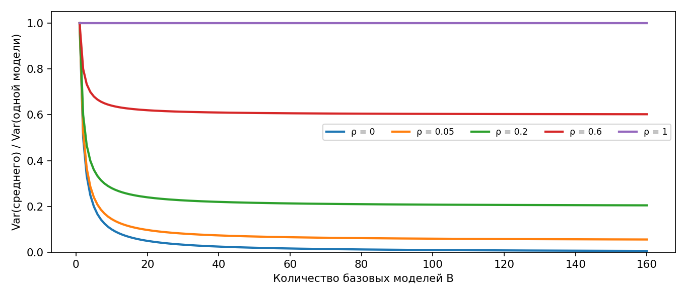

*Рисунок 6. Как корреляция ограничивает выгоду от усреднения.*

На рисунке 6 по горизонтальной оси показано число моделей $B$, по вертикальной — дисперсия среднего относительно дисперсии одного базового прогноза. **Кривая $\rho=0$** быстро приближается к нулю. **Кривая $\rho=1$** остаётся на уровне единицы. Промежуточные кривые сначала снижаются, а затем выходят на плато: добавление сотен моделей почти ничего не изменяет, если остаётся общий источник их колебаний.

Например, при $\rho=0.2$ и $\tau^2=1$ среднее десяти моделей имеет дисперсию $0.28$, а среднее ста — $0.208$. Число моделей выросло в десять раз, но дисперсия уменьшилась гораздо меньше: основное ограничение связано уже с корреляцией.

Рисунок построен по формуле (12) при одинаковых дисперсиях и попарных корреляциях. При сравнении кривых на одном значении $B$ видно, что уменьшение корреляции может принести больший выигрыш, чем добавление ещё сотни сильно связанных моделей. Это объясняет, почему при построении ансамблей стараются получать базовые прогнозы, которые не повторяют одни и те же колебания. Реальные модели не обязаны точно удовлетворять упрощённым предпосылкам формулы.

### Почему нельзя стремиться только к разнообразию

Теперь может возникнуть соблазн сделать базовые модели как можно менее похожими. Но качество ансамбля зависит и от **качества самих моделей**. Если их прогнозы почти случайны и плохо связаны с ответом, низкая корреляция сама по себе не создаст хороший предиктор.

Простой пример: одна модель предсказывает $10$, другая — $12$, третья — $11$ при истинном ответе $11$. Их прогнозы близки и достаточно точны. Если заменить их на $-100$, $20$ и $200$, разнообразие вырастет, но среднее станет значительно хуже. Поэтому смысл ансамблирования состоит в объединении **достаточно полезных** прогнозов, чьи отдельные ошибки могут хотя бы отчасти компенсироваться.

Это подводит нас к двум практическим вопросам. Во-первых, где взять много достаточно хороших, но различающихся моделей? Во-вторых, как уменьшить сходство моделей, если оно мешает усреднению? На первый вопрос ответит бэггинг, на второй — случайный лес.

### Другой взгляд на усреднение: точное алгебраическое тождество

До сих пор мы изучали, как меняется дисперсия случайных прогнозов. Но допустим, модели уже обучены, их ответы известны и мы хотим сравнить ошибку ансамбля со средним уровнем ошибок его компонентов на одном объекте. Для такого сравнения достаточно обычной алгебры, без предположений о распределении прогнозов. Пусть в одной фиксированной точке $B$ моделей выдали конкретные числа $t_1,\ldots,t_B$, их среднее равно $\bar t$, а наблюдаемый ответ — $y$.

Для каждого $t_b$ запишем $t_b-y=(t_b-\bar t)+(\bar t-y)$. После возведения в квадрат и усреднения по $b$ получим:

```math
\begin{aligned}
\frac1B\sum_{b=1}^{B}(t_b-y)^2
={}&\frac1B\sum_{b=1}^{B}(t_b-\bar t)^2\\[0pt]
&+(\bar t-y)^2
+2(\bar t-y)\frac1B\sum_{b=1}^{B}(t_b-\bar t).
\end{aligned}
```

Последняя сумма равна нулю, потому что $\bar t$ — среднее чисел $t_b$. Переносим первый член вправо:

```math
\boxed{
(\bar t-y)^2
=\frac1B\sum_{b=1}^{B}(t_b-y)^2
-\frac1B\sum_{b=1}^{B}(t_b-\bar t)^2.
}
\qquad\text{(13)}
```

Это **разложение неоднозначности ансамбля** (*ambiguity decomposition*). Оно говорит: квадратичная ошибка среднего прогноза равна **средней** квадратичной ошибке составляющих минус их разброс вокруг среднего прогноза.

Проверим на числах из начала раздела. При $y=10$, $t_1=8$, $t_2=11$, $t_3=14$ средняя квадратичная ошибка отдельных прогнозов равна $(4+1+16)/3=7$. Среднее прогнозов $\bar t=11$, его ошибка равна $1$. Разброс прогнозов вокруг $11$ равен $(9+0+9)/3=6$. Равенство действительно выполняется: $1=7-6$.

Из (13) следует, что квадрат ошибки среднего не превышает **средний** квадрат ошибки отдельных моделей на том же объекте. При этом одна из моделей вполне может быть лучше ансамбля. Например, модель, предсказавшая идеальный ответ, имеет нулевую ошибку, а среднее с ошибающимися моделями — положительную. Здесь нет противоречия: сравниваются разные величины.

Тождество (13) гарантирует выигрыш относительно средней квадратичной ошибки компонентов, равный их среднему квадрату отклонения от общего прогноза. При добавлении слабой модели, однако, сама средняя ошибка компонентов может увеличиться. Поэтому разнообразие стоит оценивать вместе с точностью моделей.

Формулы (12) и (13) отвечают на разные вопросы. Первая описывает дисперсию **случайного** среднего и роль ковариаций. Вторая — точное соотношение между квадратами ошибок **фиксированных** прогнозов. Вместе они показывают и возможности усреднения, и причину, по которой одной лишь численности ансамбля недостаточно.

### Итак

- Ансамбль агрегирует несколько базовых прогнозов. Для числовых ответов простой способ агрегации — арифметическое среднее.
- При некоррелированных базовых прогнозах с одинаковой дисперсией разброс среднего равен $\tau^2/B$. Положительная корреляция ограничивает этот эффект.
- Хорошему ансамблю нужны достаточно точные и не полностью совпадающие прогнозы. Следующий шаг — научиться получать такие модели из доступной обучающей выборки.

## 5. Бутстреп и бэггинг: как собрать ансамбль из одной выборки

В выводе bias–variance мы мысленно многократно собирали **новые независимые обучающие выборки из популяции**. На рисунке 1 мы действительно могли сделать это, поскольку синтетические данные генерировались программой. В реальной задаче обычно имеется одна таблица наблюдений. Повторять сбор сотен независимых датасетов часто невозможно.

Статистика предлагает способ исследовать изменчивость оценок, используя только имеющуюся выборку. Он называется **бутстреп** (*bootstrap*). Это самостоятельная процедура, применяемая далеко за пределами ансамблей машинного обучения. Сначала разберём её обычный статистический смысл.

### Бутстреп: повторные выборки из эмпирического распределения

Предположим, мы измерили некоторую величину у пяти объектов и получили значения

```math
2,\quad4,\quad7,\quad9,\quad13.
```

Среднее этих пяти наблюдений равно $7$. Но это среднее зависит от того, какие именно пять объектов попали в выборку. Если бы мы собрали новую выборку из той же популяции, среднее могло бы оказаться другим. Нам хотелось бы представить **изменчивость выборочного среднего**, имея в распоряжении только эти пять наблюдений.

Основная идея бутстрепа такова: будем считать распределение, которое приписывает наблюдавшимся значениям одинаковые вероятности $1/5$, приближением неизвестного распределения популяции. Из этого **эмпирического распределения** можно многократно получать новые наборы данных.

Берём один из пяти исходных объектов случайным образом и записываем его в новую таблицу. Затем **возвращаем объект в исходный набор** и снова случайно выбираем один из пяти. Делаем так пять раз. Поскольку выбор происходит с возвращением, одна и та же строка может встретиться несколько раз, а другая — ни разу.

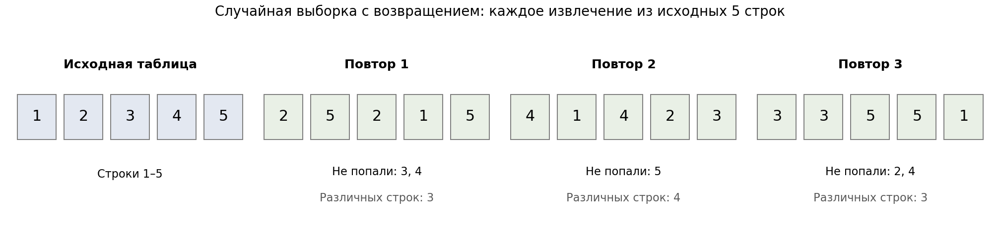

*Рисунок 7. Три бутстреп-выборки из пяти исходных строк.*

На рисунке 7 числа в прямоугольниках — **номера строк**, а не значения самих измерений. Слева показана исходная таблица со строками 1–5. Далее — три независимых бутстреп-повторения, в каждом по пять извлечений с возвращением. В первом наборе записаны номера $(2,5,2,1,5)$. Значит, мы выбрали измерения $4,13,4,2,13$ и получили бутстреп-среднее $7.2$. Строки 3 и 4 в этом повторении отсутствуют.

Во втором наборе индексы $(4,1,4,2,3)$: соответствующее среднее равно $(9+2+9+4+7)/5=6.2$. В третьем — $(3,3,5,5,1)$ со средним $(7+7+13+13+2)/5=8.4$. Из одной исходной таблицы получились разные значения интересующей нас статистики.

Проделав это много раз, мы можем построить распределение бутстреп-средних и оценить, насколько выборочное среднее чувствительно к составу исходной выборки. Разумеется, это приближение: мы не открыли новых объектов популяции и не восстановили её неизвестное распределение в точности. Мы используем имеющуюся информацию и модель повторного отбора из эмпирического распределения.

**Классический непараметрический бутстреп** устроен именно так: при исходном размере выборки $n$ выполняют $n$ извлечений с возвращением. Это соглашение характерно для обычного bootstrap, но не означает, что другие размеры запрещены. Существуют варианты *$m$-out-of-$n$ bootstrap*, где число извлечений $m$ отличается от $n$. Если выбирать строки **без возвращения**, получается другой механизм — случайная подвыборка (*subsampling*); в ансамблях родственную схему называют *pasting*. Для нашего основного алгоритма будем использовать классический вариант с возвращением и размером $n$.

Формально эмпирическое распределение записывают так:

```math
\hat P_D=\frac1n\sum_{i=1}^{n}\delta_{(X_i,Y_i)},
```

где $\delta_z$ — распределение, приписывающее точке $z$ вероятность 1. Эмпирическое распределение объединяет такие распределения с одинаковыми весами $1/n$: при случайном извлечении каждая исходная строка имеет вероятность $1/n$. Если несколько строк совпадают по значениям, их вероятности складываются. Если фиксировать исходную таблицу $D$, то $b$-я бутстреп-выборка размера $n$ имеет условное распределение

```math
D_b^*\mid D\sim\hat P_D^n.
\qquad\text{(14)}
```

Эта запись означает $n$ независимых извлечений **из эмпирического распределения исходной таблицы**. Другое бутстреп-повторение проводится с новыми случайными извлечениями. При фиксированной $D$ два таких повторения можно генерировать независимо.

Здесь стоит вернуться к нашему первому рисунку. В нём мы получали $D_1,D_2,\ldots$ непосредственно из истинного $P$. Теперь получаем $D_1^*,D_2^*,\ldots$ из $\hat P_D$, построенного по **одной** имеющейся таблице. Это разные вероятностные эксперименты, хотя оба позволяют наблюдать, как некоторый алгоритм реагирует на изменение данных.

### От статистического bootstrap к bagging

Мы уже умеем усреднять прогнозы нескольких моделей. Bootstrap позволяет обучать эти модели на разных наборах строк, даже когда исходный датасет единственный. Объединение этих идей называется **бэггингом** (*bagging*, сокращение от *bootstrap aggregating* — «бутстреп-выборки и агрегация»).

Пусть $A$ — произвольная базовая процедура обучения: дерево, регрессионная модель или другой алгоритм. Задаём число моделей $B$ и для каждого $b=1,\ldots,B$ выполняем следующие действия:

1. Формируем свою бутстреп-выборку $D_b^*$ из исходного датасета $D$.
2. Применяем к ней одну и ту же базовую процедуру $A$ и получаем обученный предиктор $T_b=A(D_b^*)$.
3. Сохраняем предиктор $T_b$, чтобы позднее получить его ответы для новых объектов.

После обучения всех базовых моделей для нового объекта $x$ вычисляем их прогнозы $T_1(x),\ldots,T_B(x)$ и усредняем:

```math
\boxed{
\hat f_{\mathrm{bag}}(x)=\frac1B\sum_{b=1}^{B}T_b(x).
}
\qquad\text{(15)}
```

Результат по-прежнему является одной прогнозной функцией, хотя внутри неё используется множество обученных моделей. Для классификации можно аналогично агрегировать оценки вероятностей классов или голоса моделей; подробнее разберём это на случайном лесе.

Смысл bagging не привязан к решающим деревьям. Различаются **обучающие наборы строк**; базовый алгоритм может оставаться одним и тем же. Модели, которые заметно реагируют на изменения обучающей выборки, будут давать разные прогнозы. При одинаковой дисперсии базовых прогнозов и попарной корреляции меньше единицы усреднение уменьшает их разброс, как показывает формула (12). Общий систематический сдвиг при этом может сохраниться.

### Одно учебное воплощение алгоритма

Реализуем этот алгоритм на регрессионных деревьях: сначала сформируем набор обученных моделей, затем усредним их прогнозы для одних и тех же проверочных объектов.

```python
import numpy as np
from sklearn.tree import DecisionTreeRegressor

rng = np.random.default_rng(42)
B = 30
trees = []

for _ in range(B):
    idx = rng.integers(0, len(X_train), size=len(X_train))
    tree = DecisionTreeRegressor(
        random_state=int(rng.integers(1_000_000))
    )
    tree.fit(X_train[idx], y_train[idx])
    trees.append(tree)

predictions = np.array([
    tree.predict(X_valid) for tree in trees
])
ensemble_prediction = predictions.mean(axis=0)
```

Здесь `X_train` и `y_train` — заранее подготовленные массивы NumPy с обучающими признаками и ответами, а `X_valid` содержит новые для этих деревьев объекты проверки. Число `B = 30` означает, что мы строим 30 базовых моделей.

В начале каждой итерации `rng.integers(0, len(X_train), size=len(X_train))` создаёт **ровно столько случайных индексов, сколько строк в исходной обучающей таблице**. Поскольку числа генерируются с возвращением, один индекс может повториться, а другой отсутствовать. Выражения `X_train[idx]` и `y_train[idx]` выбирают соответствующие строки признаков и ответов. Важно, что и признаки, и целевые значения используют **один и тот же массив индексов**: пары $(x_i,y_i)$ не разрушаются.

Затем обычное регрессионное дерево обучается на полученной бутстреп-выборке. Мы сохраняем его в `trees` и повторяем процедуру с новыми индексами. На этапе прогнозирования каждое дерево получает весь `X_valid`; список его прогнозов превращаем в массив `predictions`. Если на валидации $m$ объектов, форма массива будет $(B,m)$: одна строка на дерево и один столбец на объект. Последняя строка `predictions.mean(axis=0)` усредняет **по деревьям**, оставляя по одному итоговому прогнозу для каждого из $m$ объектов.

В коде не пришлось менять сам алгоритм дерева. Бэггинг получился из повторного построения базовых моделей и агрегирования их результатов — как в формуле (15). В прикладных задачах для этого существуют готовые реализации, но смысл метода уже виден из нескольких строк.

### Почему одни базовые модели выигрывают больше других

Вернёмся к нестабильности дерева. Если состав обучающих данных немного меняется, глубокое дерево может выбрать другие ранние разбиения и существенно перестроить прогнозную функцию. Именно такие изменения создаёт bootstrap. Поэтому деревья — естественный кандидат для bagging: мы получаем много достаточно гибких моделей, чьи прогнозы различаются на отдельных участках.

Но возьмём **очень неглубокое дерево**, например пень глубины один. В одномерной регрессии такой пень может разделить ось всего одним порогом и выдать лишь два постоянных прогноза. Если истинная зависимость несколько раз возрастает и убывает, один пень систематически не способен воспроизвести её форму. Смена бутстреп-выборки поменяет порог и высоту двух ступеней, однако возможностей самого базового алгоритма по-прежнему мало.

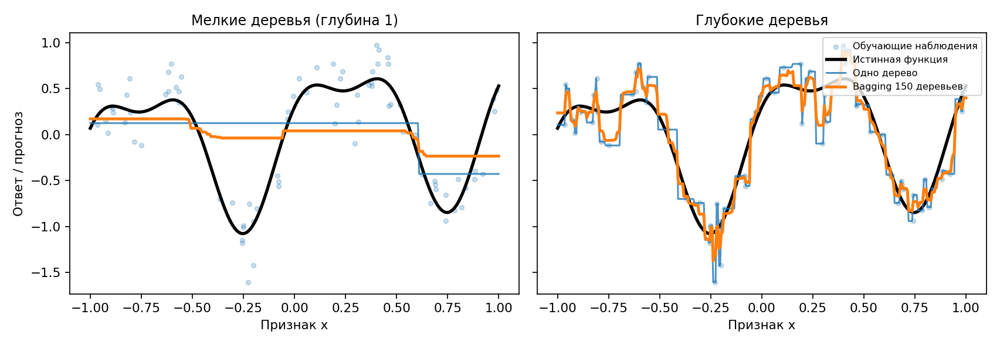

*Рисунок 8. Одно дерево и ансамбль деревьев разной глубины.*

На рисунке 8 слева рассматриваются пни глубины один, справа — глубокие деревья. В обеих панелях показаны **одни и те же обучающие наблюдения**: точки. Чёрная кривая — истинная зависимость в синтетической задаче. Отдельная цветная линия отображает прогноз **одного дерева**, другая — средний прогноз 150 деревьев, полученных на бутстреп-выборках.

**Слева** отдельный пень делит всю ось на две области. Усреднение многих пней делает итоговую линию менее зависимой от одного порога: пороги отдельных деревьев расположены в разных местах, и их ступени складываются. Однако ансамблю трудно воспроизвести сложную форму чёрной зависимости, потому что базовые модели сильно ограничены. **Справа** глубокое дерево подстраивает множество ступеней к конкретной выборке, включая её шум. Усреднение большого количества таких деревьев сглаживает отдельные скачки и на некоторых участках оказывается ближе к истинной функции. Здесь сохранена способность моделировать сложную зависимость, а часть нестабильности отдельных деревьев компенсируется.

Этот результат помогает понять замечание из исходной работы Бреймана о bagging: **наибольший выигрыш часто получается для нестабильных процедур обучения**. Если алгоритм почти не меняет прогноз при бутстрепировании, все базовые модели будут похожи, и усреднение мало что даст. Если алгоритм имеет высокое систематическое смещение, большое число его бутстреп-копий не обязано решить эту проблему.

Нужно аккуратно понимать и утверждение «бэггинг уменьшает variance, не изменяя bias». Для одинаково распределённых случайных базовых прогнозов линейность ожидания действительно даёт

```math
\mathbb E\left[\frac1B\sum_{b=1}^{B}T_b(x)\right]
=\mathbb E[T_1(x)].
```

Усреднение само по себе сохраняет **средний прогноз именно базовой процедуры, которую мы усредняем**. При этом дерево, построенное напрямую на всей исходной выборке, и дерево, обученное на её бутстреп-копии, являются разными статистическими процедурами. Поэтому их смещения не обязаны совпадать. Следовательно, улучшение по сравнению с одиночным деревом нужно проверять на новых данных. На рисунке 1 мы усредняли результаты обучения на независимых выборках из популяции, а на рисунке 8 все деревья получают повторные выборки из одной таблицы. В первом случае смена выборки может заметно изменить прогноз; во втором усреднение ограничено информацией исходной таблицы. Поэтому ансамбль глубоких деревьев на рисунке 8 на некоторых участках остаётся близок к одиночному дереву, хотя отдельные резкие скачки сглаживаются. Кроме того, размеры выборок в этих экспериментах различаются (45 и 82 наблюдения), так что сравнивать величину выигрыша по двум рисункам напрямую нельзя.

### Какая проблема остаётся после bagging

Бутстреп-деревья строятся на разных наборах строк, но **исходная таблица одна**. Их выборки часто пересекаются, признаки одинаковые, целевая зависимость общая. Если некоторый признак исключительно информативен, многие деревья независимо друг от друга могут выбрать его в самом первом разбиении. Дальше их структуры тоже нередко оказываются похожими.

В такой ситуации увеличение числа деревьев перестаёт давать большой выигрыш. Мы уже знаем причину: когда прогнозы сильно связаны, среднее хуже подавляет их общие колебания. Следующая задача — получить **менее похожие, но по-прежнему полезные деревья**. Так мы приходим к случайному лесу.

### Итак

- Бутстреп — статистический метод многократного отбора с возвращением из эмпирического распределения имеющейся выборки. Классический вариант использует $n$ извлечений из $n$ исходных строк.
- Bagging соединяет bootstrap с агрегированием прогнозов базовых моделей. Метод применим к разным алгоритмам, но особенно полезен для нестабильных моделей, в частности глубоких деревьев.
- Разнообразие bootstrap-деревьев может оказаться недостаточным: они используют одни признаки и могут строить похожие разбиения. Эту проблему будем решать в следующем разделе.

## 6. Random Forest: разнообразие деревьев без отказа от хороших разбиений

Вспомним, как обучается обычное решающее дерево. В корне алгоритм рассматривает кандидатов по доступным признакам, для каждого подбирает порог, вычисляет качество разбиения и выбирает лучший вариант. После этого повторяет поиск в дочерних узлах.

Предположим, мы прогнозируем стоимость квартиры. В данных есть площадь, район, этаж, возраст здания, наличие лифта и число комнат. Площадь может оказаться настолько информативной, что **почти любое дерево**, обученное на разных бутстреп-выборках, поставит её в корень. Тогда верхние части многих деревьев будут похожими. Bootstrap изменяет строки, но не заставляет алгоритм перестать рассматривать площадь при каждом разбиении.

**Random Forest** добавляет ещё один источник разнообразия: при поиске каждого разбиения алгоритм видит **случайную часть доступных признаков**. Такое ограничение иногда вынуждает дерево выбрать другое, тоже содержательное разбиение. Благодаря этому прогнозы деревьев могут стать менее коррелированными.

### Как строится одно дерево в лесу

Пусть всего $p=6$ признаков, а для каждого узла разрешено рассматривать $m=3$ из них. В начале обучения одного дерева формируем его бутстреп-выборку строк. Теперь мы должны построить дерево обычным жадным способом, но с изменённым правилом перебора кандидатов.

В корневом узле случайно выбираем три признака, например площадь, этаж и лифт. Среди их возможных порогов ищем разбиение с наилучшим значением знакомого критерия. Допустим, победила площадь. Получили левый и правый дочерние узлы.

**Для левого потомка** снова случайно выбираем три признака. На этот раз могут выпасть район, возраст здания и число комнат. Теперь площадь вообще не участвует в поиске разбиения этого узла. **Для правого потомка** проводится новое извлечение: например, площадь, возраст здания и лифт. В нём площадь снова доступна, но лучший порог может обнаружиться по возрасту.

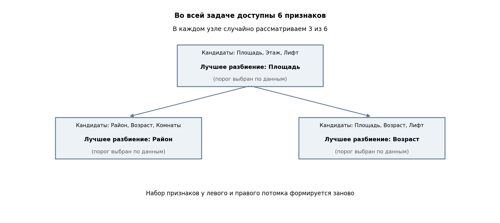

*Рисунок 9. Случайный набор признаков-кандидатов для каждого узла.*

На рисунке 9 показаны первые три узла одного дерева. В верхнем прямоугольнике перечислены кандидаты корня, ниже — кандидаты двух потомков. **Наборы отличаются**, поскольку для каждого узла выбор проводится заново. После случайного отбора признаков алгоритм по-прежнему ищет **лучший порог по данным** среди доступных кандидатов. Его решение не становится полностью случайным: случайность ограничивает список вариантов, а критерий разбиения выбирает лучший из них.

Случайный набор кандидатов действует только в текущем узле. Поэтому за время роста одно дерево может использовать даже все исходные признаки. Существует и другой способ рандомизации — *метод случайных подпространств* (*random subspaces*): для каждой базовой модели один раз выбирают подмножество признаков, доступных на протяжении всего обучения. Например, если в подпространство дерева не попала площадь квартиры, это дерево нигде не сможет использовать площадь. В случайном лесу площадь может отсутствовать в корне, но оказаться доступной в потомках. Благодаря этому лес сохраняет больше возможностей для построения разбиений по разным признакам и их взаимодействиям. Выбор подпространства на целую модель тоже применяется на практике, в том числе через `max_features` у `BaggingClassifier` или `BaggingRegressor`; эта настройка имеет иной смысл, чем одноимённая настройка леса.

### Формальное правило разбиения

Пусть $\mathcal F_v$ — случайное множество из $m$ признаков, доступных при построении узла $v$:

```math
\mathcal F_v\subseteq\lbrace 1,\ldots,p\rbrace ,
\qquad |\mathcal F_v|=m.
```

Обозначим через $Q_v(j,t)$ качество разбиения узла $v$ по признаку $j$ с порогом $t$. Например, это может быть взвешенная неоднородность дочерних узлов, основанная на Gini, энтропии или квадратичной ошибке. Мы подробно выводили эти критерии в лекции о решающих деревьях.

Тогда поиск разбиения в текущем узле записывается как

```math
\boxed{
(j_v^*,t_v^*)\in
\arg\min_{\substack{j\in\mathcal F_v\\t\in\mathcal T_j}}Q_v(j,t).
}
\qquad\text{(16)}
```

Здесь $\mathcal T_j$ обозначает допустимые пороги для признака $j$ на объектах текущего узла. По сравнению с обычным деревом изменилось **только множество рассматриваемых признаков**. Жадный выбор лучшего доступного разделения сохранился.

В полной процедуре Random Forest для каждого из $B$ деревьев обычно сначала формируют свою бутстреп-выборку строк. Затем строят дерево с новым случайным набором признаков при каждом разбиении. После обучения прогнозы деревьев агрегируются. Поэтому классический лес сочетает два механизма: разнообразие **объектов обучения** и разнообразие **кандидатов на разбиение**. При заданной исходной выборке каждое дерево можно строить независимо от остальных: при обучении ему не нужны их прогнозы. Это позволяет обучать деревья параллельно, например с помощью параметра `n_jobs` в scikit-learn.

### Как число признаков-кандидатов влияет на качество

Рассмотрим крайние значения $m$.

Если $m=p$, то в каждом узле доступны все признаки. Дополнительная рандомизация набора признаков исчезает, и лес с бутстрепом становится по механизму близок к обычному bagging деревьев. Если $m=1$, в каждом узле случайно выбирается единственный признак; по нему можно найти хороший порог, но остальные признаки в этом узле недоступны. Иногда это даёт более разнообразные деревья, но может вынуждать их использовать слабые разбиения.

У нашего примера с шестью признаками вероятность, что при простом равномерном выборе трёх признаков в заданный узел попадёт конкретный признак, равна $3/6=1/2$. Если самый сильный признак — площадь, то примерно в половине таких случайных наборов он отсутствует. Разные деревья смогут использовать вместо него другие характеристики. Но при слишком малом $m$ дереву может многократно не доставаться ни одного достаточно информативного признака. Тогда отдельные деревья станут слабее.

Таким образом, у нас появляется компромисс: **более широкий выбор кандидатов** часто помогает отдельному дереву найти хорошее разделение, но может сделать деревья похожими друг на друга; **более узкий набор** усиливает рандомизацию, но иногда ухудшает разбиения.

В scikit-learn число признаков-кандидатов в лесу задаётся параметром `max_features`. Реализация может проверить дополнительные признаки, если среди первоначально выбранных не нашлось допустимого разбиения. Основная идея остаётся прежней: в каждом узле поиск начинается со случайного набора кандидатов.

### Увидим компромисс в эксперименте

Вспомним формулу (12): при сильной зависимости базовых прогнозов усреднение уменьшает разброс ограниченно. У Random Forest дополнительная рандомизация помогает уменьшить сходство деревьев. Но не обязана улучшать их качество при любом значении `max_features`.

Чтобы проверить обе стороны этого механизма, возьмём синтетическую задачу классификации из двух переплетённых полумесяцев. К двум информативным координатам добавим восемь случайных неинформативных признаков. Получится десять признаков, из которых полезны далеко не все. Зафиксируем обучающую и валидационную выборки. Для разных значений `max_features` обучим леса из 150 деревьев с одинаковыми остальными настройками.

После обучения измерим две разные величины: **ROC AUC всего леса на validation** и **сходство прогнозов отдельных деревьев**. Для второго показателя возьмём векторы вероятностей положительного класса, которые отдельные деревья выдают на одних и тех же валидационных объектах, и вычислим среднюю корреляцию этих векторов по 200 случайно выбранным парам различных деревьев.

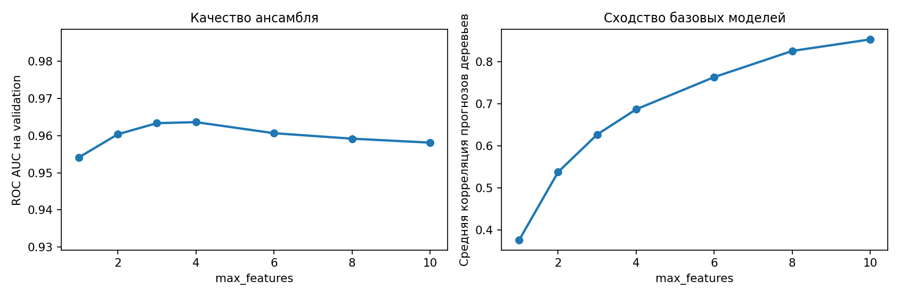

*Рисунок 10. Влияние числа признаков-кандидатов на качество и сходство деревьев.*

На рисунке 10 горизонтальная ось в обеих панелях — число признаков, которые допускаются к рассмотрению при одном разбиении. **Слева** показано качество итогового леса по ROC AUC на фиксированной валидационной выборке. **Справа** — средняя эмпирическая корреляция вероятностных прогнозов отдельных деревьев на этих же объектах.

С увеличением `max_features` корреляция деревьев в данном эксперименте в целом возрастает: у деревьев чаще появляются общие информативные кандидаты, и они склонны выбирать похожие разбиения. Качество ансамбля ведёт себя иначе. На нём появляется область хороших промежуточных значений, после которой дальнейший рост числа кандидатов почти не даёт выигрыша и может немного ухудшать результат. **Самая низкая корреляция не совпадает с максимальным ROC AUC.**

Этот опыт подтверждает содержательную идею: нужно сочетать силу отдельных деревьев с достаточным разнообразием. Но конкретные кривые зависят от данных, метрики, случайного разбиения и настроек. Правая панель позволяет оценить сходство функций двух уже обученных деревьев: если для одних и тех же объектов оба дерева часто дают высокие или низкие вероятности, их прогнозы коррелируют. В формуле (12) мы измеряли другую зависимость — между прогнозами в одной фиксированной точке при повторных обучениях. Для прямой оценки той корреляции пришлось бы многократно собирать исходные выборки и строить ансамбли заново. Здесь мы располагаем одним лесом для каждой настройки и сравниваем его деревья по проверочным объектам; полученная корреляция служит диагностикой сходства, её нельзя подставлять в (12) в качестве оценки теоретического $\rho$.

### Что усредняет лес в регрессии и классификации

В регрессии каждое дерево $T_b$ возвращает число. Итоговый прогноз леса получается средним:

```math
\boxed{
\hat f_{\mathrm{RF}}(x)=\frac1B\sum_{b=1}^{B}T_b(x).
}
\qquad\text{(17)}
```

Здесь всё совпадает с тем механизмом усреднения, который мы уже изучили для bagging.

В классификации дерево может выдавать **метку класса** либо **оценки вероятностей классов**. На уровне идеи ансамбля можно провести голосование: каждый классификатор отдаёт один голос за выбранный класс, а итог определяет большинство. Однако широко используемая реализация `RandomForestClassifier` в scikit-learn действует несколько иначе: она усредняет **оценки вероятностей классов** от отдельных деревьев и затем выбирает класс с максимальным средним значением.

Если дерево $b$ выдаёт оценку вероятности класса $k$, обозначим её $\hat p_b(k\mid x)$. Для леса получаем

```math
\hat p_{\mathrm{RF}}(k\mid x)
=\frac1B\sum_{b=1}^{B}\hat p_b(k\mid x),
\qquad
\hat y_{\mathrm{RF}}(x)=\arg\max_k\hat p_{\mathrm{RF}}(k\mid x).
\qquad\text{(18)}
```

У обычного классификационного дерева вероятность класса оценивается долей обучающих объектов данного класса в листе, в который попал новый объект (либо соответствующей взвешенной долей). Этот механизм нам знаком по лекции о деревьях.

**Пример.** Три дерева дали для бинарной классификации оценки вероятности класса 1: $0.90$, $0.49$, $0.49$. Если каждое сразу превратить в жёсткую метку при пороге $0.5$, голоса будут $1$, $0$, $0$, и большинство выберет класс 0. Если сначала усреднить вероятности, получим $(0.90+0.49+0.49)/3\approx0.627$, и лес выберет класс 1. Значит, голосование по меткам и усреднение вероятностей действительно могут давать разные решения.

Это также объясняет, почему наше строгое разложение ошибки для MSE не следует механически переносить на accuracy. Мы используем математику усреднения числовых прогнозов как мотивацию, а для конкретной задачи классификации отдельно выбираем способ агрегации и оцениваем результат подходящей метрикой.

### Почему глубокие деревья могут хорошо работать внутри леса

В случайных лесах часто используют достаточно глубокие деревья, иногда гораздо глубже, чем выбрали бы для одиночного предиктора. Почему гибкость отдельного дерева здесь может оказаться преимуществом, хотя для одиночной модели она повышала риск переобучения?

Вернёмся к рисунку 8. Глубокое дерево обладает большой выразительностью: оно может провести много разбиений и описать сложную зависимость. Его отдельные ступени иногда подстраиваются под шум конкретной обучающей выборки. Bagging усредняет такие ступени у многих деревьев. Random Forest добавляет разнообразие доступных признаков при разбиениях, поэтому деревья получают ещё меньше причин строить одинаковые структуры.

Типичный полезный случай для леса — базовые деревья с относительно небольшим смещением и большим разбросом: тогда усреднение может заметно снизить разброс, сохранив достаточно точный средний прогноз. Если вместо них использовать исключительно пни, каждый базовый прогноз может быть слишком грубым. Усреднение сгладит изменения порогов, но сложная зависимость может остаться плохо описанной. Поэтому **гибкие деревья с последующим агрегированием** нередко дают хорошее сочетание выразительности и устойчивости.

Однако из этого не следует правило «глубина всегда должна быть максимальной». При очень шумных данных, небольших выборках или специфических ограничениях задачи могут оказаться полезны `max_depth`, `min_samples_leaf` и другие ограничения базовых деревьев. Дополнительные деревья увеличивают стоимость обучения и применения модели, но не отменяют необходимости проверки качества.

### Итак

- Random Forest строит ансамбль деревьев, обычно используя бутстреп-выборки строк и **новый случайный набор признаков-кандидатов при каждом узле**.
- Дополнительная рандомизация может уменьшать сходство деревьев, но слишком маленький набор кандидатов способен ослабить отдельные модели.
- Для регрессии лес усредняет числовые ответы. В распространённой реализации классификационного леса сначала усредняются оценки вероятностей классов, а затем выбирается класс.

## 7. Out-of-bag: оценка качества без отдельного набора для каждого дерева

Мы многократно обучаем деревья на бутстреп-выборках одной исходной таблицы. Для конкретного дерева некоторые строки исходной таблицы вообще не были выбраны. Это даёт возможность оценить, как оно предсказывает **наблюдения, на которых само не обучалось**.

Рассмотрим один объект с номером $i$. При построении бутстреп-выборки размера $n$ мы $n$ раз выбираем одну из $n$ строк с возвращением. Объект $i$ может появиться несколько раз, один раз или ни разу. В последнем случае он остаётся **вне бутстреп-выборки** данного дерева. Такие наблюдения называют *out-of-bag*, сокращённо **OOB**.

### Какие наблюдения остаются вне обучения дерева

Вероятность **не выбрать** строку $i$ при одном извлечении равна $1-1/n$, поскольку из $n$ исходных строк выбираем любую, кроме одной конкретной. Для классического бутстрепа выполняем $n$ независимых извлечений, поэтому вероятность ни разу не выбрать этот объект составляет

```math
\boxed{
P(i\notin D_b^*)=\left(1-\frac1n\right)^n.
}
\qquad\text{(19)}
```

Например, при $n=5$ вероятность равна $(4/5)^5\approx0.328$. При больших $n$ используется **второй замечательный предел**:

```math
\lim_{n\to\infty}\left(1-\frac1n\right)^n
=\frac1e\approx0.368.
\qquad\text{(20)}
```

Значит, для достаточно большой исходной таблицы конкретная строка **в среднем отсутствует примерно в 36,8% бутстреп-выборок**. Соответственно, в бутстреп-выборке в среднем представлено около 63,2% *различных* исходных объектов. Это не противоречит тому, что мы делаем ровно $n$ извлечений: некоторые объекты попадают несколько раз.

Если построено $100$ деревьев, для одной исходной строки можно в среднем ожидать около $37$ деревьев, которые на ней не обучались. Это даёт материал для особого вида проверки модели.

### Получаем OOB-прогноз конкретного объекта

Представим пять деревьев, обученных на пяти разных бутстреп-выборках. Возьмём объект №1 из исходной таблицы и посмотрим, в обучении каких деревьев он присутствовал.

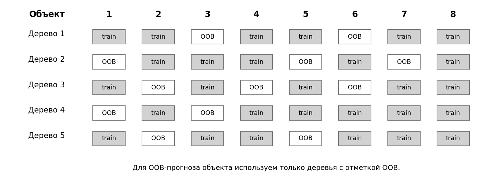

*Рисунок 11. Какие деревья видели каждый исходный объект при обучении.*

В матрице рисунка 11 **столбцы** соответствуют исходным объектам с номерами от 1 до 8, **строки** — пяти деревьям. В клетках с надписью `train` объект встречался в бутстреп-выборке соответствующего дерева, а `OOB` обозначает его отсутствие. Достаточно одного попадания строки в бутстреп-выборку, чтобы считать, что дерево «видело» этот объект при обучении; повторные попадания в таблице не отображаются.

Посмотрим на **первый столбец**. Объект №1 присутствует в обучении деревьев 1, 3 и 5, но отсутствует в выборках деревьев 2 и 4. Поэтому для OOB-прогноза объекта №1 мы должны взять только прогнозы деревьев **2 и 4**. Ни одно из них не использовало ответ именно этого объекта при обучении.

В общем виде обозначим через $\mathcal B_i$ множество индексов деревьев, для которых объект $i$ оказался OOB:

```math
\mathcal B_i=\lbrace b:i\notin D_b^*\rbrace .
```

В регрессии OOB-прогноз вычисляется как среднее ответов только этих деревьев:

```math
\boxed{
\hat f_{\mathrm{OOB}}(x_i)
=\frac1{|\mathcal B_i|}\sum_{b\in\mathcal B_i}T_b(x_i),
\qquad |\mathcal B_i|>0.
}
\qquad\text{(21)}
```

Для классификации можно аналогично усреднить вероятностные прогнозы OOB-деревьев и получить метку класса. Если деревьев много, подавляющее большинство исходных объектов получает достаточно OOB-прогнозов. При очень малом числе деревьев для некоторых объектов множество $\mathcal B_i$ может оказаться пустым, поэтому соответствующий прогноз не определён.

Когда OOB-прогнозы получены для объектов обучающей таблицы, их сравнивают с известными ответами и вычисляют привычную метрику: MSE, MAE, accuracy или другую, соответствующую задаче. Так возникает **оценка качества ансамбля** на основе тех деревьев, которые не обучались на ответе оцениваемого объекта. Она приближённая: для каждого объекта используется только часть деревьев, а не весь обученный лес.

Важно соблюдать порядок действий: **сначала агрегировать прогнозы OOB-деревьев для каждого объекта, затем вычислять ошибку ансамбля**. Если отдельно посчитать ошибки каждого дерева на его OOB-объектах и усреднить эти ошибки, получится вообще говоря другая величина. Для MSE причина видна из алгебры: квадрат среднего отклонения обычно не совпадает со средним квадратом отклонений.

### Что OOB даёт и чего не гарантирует

При обычном случайном разбиении на train и validation часть данных приходится отложить, чтобы не использовать её для обучения проверяемой модели. OOB использует другую конструкцию: каждый исходный объект исключён из обучения некоторой части деревьев, поэтому по нему можно получить прогноз **от этой части ансамбля**.

Это удобно, особенно когда не хочется дополнительно уменьшать обучающую выборку ради промежуточной проверки. Но OOB остаётся оценкой в рамках принятой схемы формирования данных. Например, если в таблице несколько строк одного клиента, исключение одной строки не исключает другие строки этого клиента: в обучении может остаться почти та же информация. Для временного ряда обычный bootstrap может смешивать прошлые и будущие наблюдения. Поэтому при зависимых данных нужна схема проверки, отражающая их структуру.

Как соотнести OOB с уже знакомыми способами проверки? Представим, что нам нужно подобрать глубину дерева и минимальный размер листа для леса. Вычислить ошибку на обучении полезно, чтобы увидеть степень подгонки, но для выбора модели нужен прогноз на объектах, не использованных при обучении соответствующего предиктора. Для бутстреп-ансамбля можно воспользоваться OOB, а можно провести обычное разбиение или кросс-валидацию.

| Где оцениваем | Для чего нужна оценка | Что учитывать |
|---|---|---|
| Train | Диагностика подгонки, сопоставление с проверочной ошибкой | Обычно оптимистичная оценка качества на новых данных |
| OOB | Промежуточная оценка бутстреп-ансамбля, выбор гиперпараметров | Каждый объект оценивается по своей части деревьев; структура данных должна допускать такую проверку |
| Validation | Сравнение моделей и настроек | Результат зависит от выбранного разбиения |
| Кросс-валидация | Сравнение настроек по нескольким разбиениям | Требует нескольких обучений; разбиения должны учитывать структуру данных |
| Независимый test | Итоговая оценка выбранной модели | Не используется при подборе и других решениях о модели |

Поиск по сетке гиперпараметров можно проводить обоими способами. При кросс-валидации для каждой комбинации настроек обучают несколько лесов и усредняют проверочные оценки. При OOB-подборе для каждой комбинации достаточно обучить один лес и вычислить его OOB-метрику; при необходимости эксперимент повторяют с другими случайными состояниями. Такой поиск может быть существенно дешевле, хотя OOB и кросс-валидация не обязаны давать одинаковые оценки или выбирать одинаковые настройки.

В scikit-learn для первого варианта есть `GridSearchCV`. Для второго можно перебирать комбинации через `ParameterGrid`, обучать ансамбль с `bootstrap=True, oob_score=True` и сравнивать значения `oob_score_`. И бэггинг, и случайный лес поддерживают OOB-оценивание. В стандартном классификационном лесу OOB-оценка по умолчанию — accuracy, в регрессионном — $R^2$. При выборе по другой метрике нужно проверить её расчёт по OOB-прогнозам (и наличие этих прогнозов для всех оцениваемых объектов). У случайного леса они доступны через `oob_decision_function_` в классификации и `oob_prediction_` в регрессии.

После того как мы выбрали гиперпараметры по OOB, validation или кросс-валидации, эти оценки уже участвовали в выборе. Окончательное качество выбранной процедуры в нашем обычном учебном эксперименте следует проверить на независимой тестовой выборке. Сохраняем её до завершения подбора.

### Итак

- Для классического bootstrap вероятность не выбрать конкретную строку стремится к $e^{-1}\approx36.8\%$ при увеличении размера выборки.
- OOB-прогноз объекта строится только из деревьев, не обучавшихся на его ответе. После агрегации этих прогнозов можно вычислить ошибку ансамбля.
- OOB полезен для промежуточной оценки, но не устраняет ограничения валидации при зависимых данных и не заменяет независимую проверку после выбора модели.

## 8. Свойства случайного леса: что выигрываем и какие ограничения сохраняются

Мы разобрали механизм Random Forest, но для реальной задачи нужно понимать, как он ведёт себя при изменении числа деревьев, их сложности и распределения данных. Начнём с того, что непосредственно следует из уже изученного усреднения.

### Число деревьев и предел полезности усреднения

Представим, что исходная таблица уже зафиксирована и мы многократно строим деревья: каждый раз заново выбираем бутстреп-строки и наборы кандидатов для разбиений. Если усреднить очень много таких деревьев, результат будет близок к среднему по всем возможным случайным построениям для этой таблицы. Увеличение числа деревьев $B$ помогает приблизиться к этому среднему.

Представим, что при $B=5$ лес предсказывает для квартиры среднюю цену по пяти деревьям. Добавление шестого дерева заметно меняет среднее, если его прогноз сильно отличается. Когда в лесу уже несколько сотен деревьев, влияние одного нового прогноза на итоговое среднее обычно значительно меньше. При независимом построении деревьев с одной и той же фиксированной таблицей и одинаковыми настройками это следствие закона больших чисел.

Однако **валидационная ошибка не обязана улучшаться после каждого добавленного дерева**. Допустим, для одного объекта правильный ответ равен $10$, и первые три дерева предсказывают $9$, $11$ и $10$. Их среднее идеально. Если четвёртое дерево предскажет $14$, среднее станет $11$ и ошибка для этого объекта увеличится. При дальнейшем добавлении моделей среднее может снова приблизиться к хорошему значению. Большой ансамбль обычно менее чувствителен к одному добавленному дереву, но это дерево всё равно может немного ухудшить результат на проверочной выборке.

Число деревьев влияет также на стоимость: обучение, хранение и получение прогноза обычно становятся дороже по мере роста ансамбля. Поэтому полезно строить кривую качества от числа деревьев и смотреть, после какой области улучшения становятся невелики по сравнению с дополнительными вычислениями.

### Глубина, размер листьев и шум

Во второй половине раздела 5 мы сравнивали пни и глубокие деревья. Пень ограничен одним разбиением, поэтому в сложной регрессии может иметь большое смещение. Глубокое дерево способно приблизить зависимость гораздо точнее, но иногда запоминает шум отдельных наблюдений.

Вернёмся к мишени. Рассмотрим полезный для леса случай: отдельные глубокие деревья в среднем предсказывают близко к истинному условному среднему, но дают сильно различающиеся прогнозы. На схеме ниже слева большой разброс и небольшое смещение, справа — результат усреднения в идеализированной ситуации, когда среднее базовых прогнозов остаётся прежним, а их дисперсия снижается.

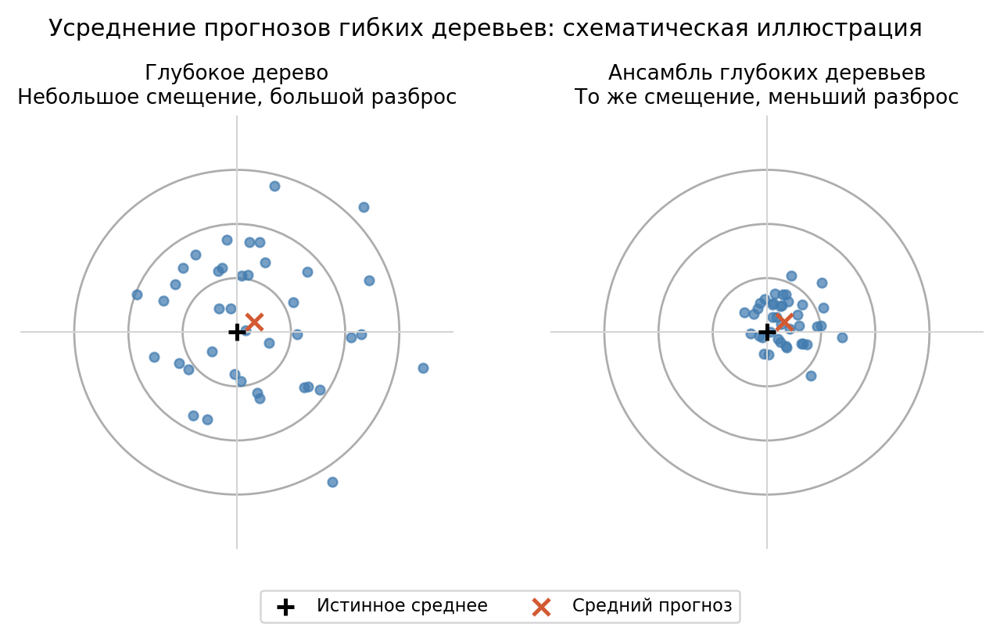

*Рисунок 12. Смещение и разброс отдельного дерева и ансамбля (схема).*

Каждая точка справа соответствует прогнозу целого ансамбля после очередного повторения обучения. Если среднее базовых прогнозов уже близко к истине, уменьшение разброса приближает предиктор к нижней границе риска. Это типичная причина использовать в лесу гибкие, достаточно глубокие деревья. Схема показывает возможный механизм, а не гарантированное поведение любого леса: рандомизация и бутстреп могут изменить смещение, а общий систематический сдвиг усреднение само по себе не устраняет.

Вместе с тем ограничения `max_depth` и `min_samples_leaf` по-прежнему меняют свойства базовых моделей, а значит, и свойства всего ансамбля.

Представим очень маленький датасет, содержащий несколько ошибок измерения. Если листья многих деревьев состоят из одного наблюдения, отдельные прогнозы могут резко реагировать на необычные ответы. Даже после усреднения результат не обязан быть оптимальным. Увеличение минимального размера листа делает прогнозы деревьев более сглаженными, но иногда ухудшает воспроизведение реальной локальной структуры. Проверять этот компромисс следует на данных, соответствующих будущему применению.

Глубина и число деревьев поэтому решают связанные, но разные задачи. У одного дерева ограничение глубины часто уменьшает изменчивость ценой большей систематической ошибки. У ансамбля дополнительно появляется возможность снижать изменчивость через агрегирование. Эти механизмы взаимодействуют, поэтому настройки отдельного дерева **остаются значимыми**, даже когда деревьев много.

### Почему случайный лес плохо экстраполирует

Вспомним устройство регрессионного дерева. Для нового объекта алгоритм последовательно выбирает ветви и достигает некоторого листа. Прогноз в листе равен среднему ответов обучающих объектов, попавших в него. Такое среднее находится в пределах диапазона обучающих ответов данного дерева.

В регрессионном лесу прогнозы листьев затем усредняются между деревьями. Следовательно, при обычных неотрицательных весах листовых средних итоговый прогноз **не может выйти за минимум и максимум наблюдавшихся целевых значений исходной обучающей таблицы**. Это само по себе уже ограничивает способность предсказывать ранее не наблюдавшиеся экстремальные значения.

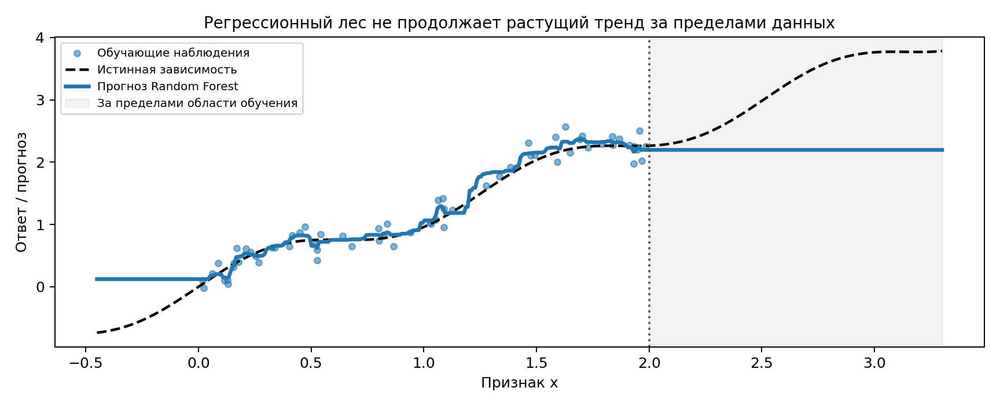

*Рисунок 13. Регрессионный лес вне диапазона обучающих наблюдений.*

На рисунке 13 мы обучили регрессионный лес на числовом признаке $x$ примерно в диапазоне от $0$ до $2$. Голубые точки — обучающие наблюдения. Чёрная пунктирная линия — истинная зависимость, которую мы специально сделали возрастающей с небольшими колебаниями. Цветная линия — прогноз леса. Справа от вертикальной границы $x=2$ начинается область, в которой **обучающих наблюдений нет**.

Посмотрите именно туда. Истинная зависимость продолжает расти, а прогноз леса становится практически постоянным. Причина следует из разбиений деревьев. Для значений $x$ за правой границей обучающего диапазона каждый объект попадает в один из крайних листьев; там хранится среднее **уже наблюдавшихся** ответов. Увеличение числа деревьев не добавляет механизма продолжения линейного тренда.

Это отличие от модели, которая явно задаёт зависимость вида $\hat y=\beta_0+\beta_1x$ и может продолжать её за диапазон обучения. Линейная экстраполяция, конечно, тоже может быть ошибочной, если реальная закономерность за пределами данных изменилась. Важна сама способность семейства моделей выражать такую форму прогноза. У обычного регрессионного леса её нет.

### Можно ли считать прогноз леса оценкой уверенности?

В классификации деревья могут возвращать доли классов в листьях, а лес — их средние. Но число $0.8$ от `predict_proba` ещё не доказывает, что событие с таким прогнозом действительно происходит в 80% соответствующих случаев. Для интерпретации как вероятности требуется отдельно проверять **калибровку** на подходящих данных.

В регрессии можно посмотреть, насколько сильно различаются прогнозы деревьев для одного объекта. Это полезная диагностическая характеристика: дерево, которое выдаёт необычно высокий или низкий ответ по сравнению с остальными, показывает неоднозначность построенных разбиений. Однако стандартное отклонение прогнозов деревьев **не является автоматически доверительным или предсказательным интервалом** с заданным уровнем покрытия. Оно отражает лишь определённый тип разнообразия внутри ансамбля и зависит от способа его построения.

Наконец, случайный лес умеет оценивать важности признаков и позволяет применять permutation importance, PDP и другие методы анализа уже обученной модели. Их смысл и ограничения мы обсуждали на предыдущей неделе. Для леса сохраняются те же вопросы: влияние коррелированных признаков, выбранной меры важности и данных, на которых мы проводим диагностику.

### Итак

- При увеличении числа деревьев усреднённый прогноз обычно стабилизируется, но конкретная валидационная метрика может колебаться.
- Глубина и размер листьев влияют на свойства базовых моделей даже внутри большого ансамбля.
- Лес наследует некоторые ограничения деревьев, прежде всего слабую экстраполяцию. Вероятности классов и численные оценки неопределённости требуют отдельной проверки.

## 9. Заключение: как связаны сложность, нестабильность и ансамбли

Начали мы с одной необычной особенности дерева: даже при фиксированных алгоритме и гиперпараметрах смена обучающей выборки может изменить структуру разбиений и прогноз для одного объекта. Поэтому, чтобы анализировать обучение, полезно рассматривать **процедуру**, которая могла бы быть применена ко множеству разных выборок.

Для квадратичной ошибки мы получили разложение ожидаемой ошибки на три составляющие. Неустранимый шум характеризует изменчивость нового ответа вокруг его условного среднего. Смещение показывает, насколько средний прогноз процедуры далёк от истинной регрессионной функции. Разброс измеряет изменчивость самих обученных прогнозов между возможными выборками.

Эта конструкция объясняет привычные явления переобучения и недообучения на более глубоком уровне. Ограничивая гибкость модели, мы часто уменьшаем разброс, но можем увеличить смещение. Разрешая более сложные функции, иногда улучшаем аппроксимацию истинной зависимости, однако повышаем чувствительность к случайным данным. Конкретная форма компромисса зависит от задачи; её нельзя заранее определить по одной универсальной картинке.

Затем появился другой способ уменьшить изменчивость прогноза: **усреднение**. Мы вывели, что при низкой корреляции базовых прогнозов дисперсия среднего может значительно уменьшаться с числом моделей. Когда прогнозы сильно коррелируют, их общие колебания остаются и после усреднения. Поэтому для ансамбля важны одновременно качество базовых моделей и разнообразие их ошибок.

**Бутстреп** дал нам возможность формировать разные обучающие наборы из одной исходной таблицы. Он опирается на эмпирическое распределение наблюдений и сам по себе является статистическим методом исследования изменчивости. **Бэггинг** использует его для построения нескольких базовых моделей и последующей агрегации прогнозов. Особенно полезен такой подход для нестабильных алгоритмов, к которым относятся глубокие решающие деревья.

**Random Forest** добавляет к bagging ещё один механизм: в каждом узле дерева случайно выбирается набор признаков, среди которых производится жадный поиск лучшего разбиения. Деревья могут стать менее похожими, но слишком сильная рандомизация способна ухудшить их индивидуальное качество. Наконец, из бутстрепа возникает возможность **OOB-оценивания**: каждый объект проверяется по тем деревьям, которые не использовали его ответ при обучении.

Соберём мысленно всю историю в одну цепочку:

```math
\underbrace{\text{случайная выборка}}_{\text{разные обученные модели}}
\;\longrightarrow\;
\underbrace{\text{смещение и разброс}}_{\text{анализ ошибки}}
\;\longrightarrow\;
\underbrace{\text{усреднение}}_{\text{уменьшение колебаний}}
\;\longrightarrow\;
\underbrace{\text{бэггинг и Random Forest}}_{\text{построение ансамбля}}.
```

На каждом этапе мы добавляли ровно тот механизм, который был нужен для решения возникшей задачи. Разложение ошибки объясняет, **какую проблему хотим уменьшить**; формула дисперсии среднего — **когда может помочь усреднение**; бутстреп — **откуда взять разные обученные модели**; случайный выбор признаков — **как дополнительно уменьшить сходство деревьев**.

Получив лес, мы не освобождаемся от необходимости выбирать подходящую метрику, соблюдать схему валидации, проверять ошибки на важных группах объектов и учитывать ограничения экстраполяции. Зато у нас есть ещё один мощный инструмент управления обобщающей способностью: вместо единственного обученного дерева использовать ансамбль, который объединяет сильные стороны многих деревьев.

---

## Дополнительная математика: два уровня случайности в ансамбле

Чем больше деревьев мы строим по одной таблице, тем меньше итоговый прогноз зависит от случайного выбора строк и признаков при построении конкретного дерева. Однако если заново собрать саму таблицу, все деревья будут построены на других данных. Поэтому даже бесконечно большой лес может зависеть от того, какая исходная выборка нам досталась.

Это наблюдение помогает понять, как согласуются два результата: формула дисперсии среднего коррелированных прогнозов из раздела 4 и возможность независимо генерировать бутстреп-выборки в разделе 5.

Пусть $D$ — исходная обучающая выборка, случайно полученная из популяции. Через $R_b$ обозначим все случайные решения при построении $b$-го дерева: бутстреп-индексы, а для случайного леса ещё и наборы признаков в узлах. Прогноз дерева в фиксированной точке $x$ запишем как $T_b(x)=T(D,R_b;x)$.

Представим два эксперимента. В первом мы оставляем $D$ прежней и заново строим деревья, меняя только $R_b$. Если случайные решения для разных деревьев генерируются независимо, при фиксированной таблице их прогнозы условно независимы. Во втором эксперименте заново собираем всю исходную выборку и уже на ней строим лес. Тогда меняется общая основа обучения всех деревьев.

Например, исходная выборка может случайно содержать непропорционально много дорогих квартир. Все бутстреп-выборки формируются из этой таблицы. Если следующая исходная выборка будет содержать меньше дорогих квартир, средний прогноз целого леса может измениться. Условная независимость построения отдельных деревьев не устраняет общего влияния исходных данных.

Это можно строго выразить через **закон полной дисперсии**. Пусть $\bar T_B(x)=B^{-1}\sum_b T_b(x)$. Тогда

```math
\begin{aligned}
\mathrm{Var}_{D,R}(\bar T_B(x))
={}&\mathrm{Var}_D\!\left(
\mathbb E_R[\bar T_B(x)\mid D]
\right)\\[0pt]
&+\mathbb E_D\!\left[
\mathrm{Var}_R(\bar T_B(x)\mid D)
\right].
\end{aligned}
\qquad\text{(22)}
```

Прочитаем правую часть. В первом слагаемом мы сначала усредняем прогнозы всех случайных построений для данной таблицы (это условное ожидание по $R$), а затем измеряем, насколько это среднее меняется между исходными выборками $D$. Во втором слагаемом измеряем разброс конечного ансамбля при фиксированной таблице, после чего усредняем полученную дисперсию по возможным таблицам. Обе величины описывают изменчивость прогноза, но на разных уровнях эксперимента.

Если при фиксированной $D$ прогнозы базовых моделей независимы и одинаково распределены по $R_b$, дисперсия их среднего равна дисперсии одного дерева, поделённой на $B$:

```math
\mathrm{Var}_R(\bar T_B(x)\mid D)
=\frac1B\mathrm{Var}_R(T_1(x)\mid D).
```

Тогда (22) превращается в

```math
\boxed{
\begin{aligned}
\mathrm{Var}_{D,R}(\bar T_B(x))
={}&\mathrm{Var}_D\!\left(
\mathbb E_R[T_1(x)\mid D]
\right)\\[0pt]
&+\frac1B\,\mathbb E_D\!\left[
\mathrm{Var}_R(T_1(x)\mid D)
\right].
\end{aligned}}
\qquad\text{(23)}
```

Теперь видно, что именно происходит при увеличении числа деревьев. Второе слагаемое убывает как $1/B$. Первое слагаемое от $B$ не зависит. Если средний прогноз меняется при смене исходной выборки, соответствующая часть дисперсии остаётся положительной даже в пределе.

Можно также применить закон полной ковариации. Для двух деревьев, условно независимых и одинаково распределённых при фиксированной $D$, получим

```math
\mathrm{Cov}(T_1(x),T_2(x))
=\mathrm{Var}_D\!\left(
\mathbb E_R[T_1(x)\mid D]
\right).
\qquad\text{(24)}
```

Их безусловная ковариация положительна, если средний прогноз зависит от исходной таблицы. Так два объяснения усреднения согласуются: независимость случайных запусков **при известных данных** вполне совместима с зависимостью прогнозов, если случайность самой таблицы тоже включена в эксперимент.

**Итак.** Увеличение числа деревьев уменьшает случайность, связанную с построением конечного ансамбля на данной таблице. Оно не устраняет автоматически изменчивость между разными исходными выборками и не добавляет новых сведений о популяции. Именно поэтому сбор новых информативных наблюдений и увеличение числа деревьев решают разные задачи.

---

## Вопросы для самопроверки

1. На рисунке 1 алгоритм и гиперпараметры дерева фиксированы. Почему прогнозы цветных линий различаются? Что означают чёрная и оранжевая линии справа?
2. Что именно мы фиксируем, когда пишем $\hat f_D(x_0)$? Что остаётся случайным?
3. Почему для квадратичной ошибки оптимальным постоянным прогнозом при $X=x$ является $m(x)=\mathbb E[Y\mid X=x]$?
4. Пусть $\varepsilon=Y-m(X)$. Докажите, что $\mathbb E[\varepsilon\mid X=x]=0$. Нужно ли для этого предполагать нормальность шума?
5. Какое ожидание задаёт средний прогноз $\mu(x_0)$? Почему среднее большого числа прогнозов по независимым обучающим выборкам приближается к нему?
6. Объясните, что на рисунке 2 характеризуют расстояние между вертикальными линиями и ширина облака точек. Почему положение точек по вертикали не имеет статистического смысла?
7. В какой момент при выводе bias–variance требуется независимость будущего ответа от обучающей выборки? Почему смешанное слагаемое исчезает?
8. Сначала выведите ожидаемую ошибку **фиксированного** прогноза $a$, затем получите разложение для прогноза $\hat f_D(x_0)$, который зависит от обучающей выборки.
9. В точке $x_0$ дисперсия шума равна $0.5$, смещение — $-2$, дисперсия обученного прогноза — $1.5$. Найдите ожидаемую MSE. Что произойдёт, если дисперсия уменьшится вдвое, а модуль смещения увеличится до $3$?
10. Чем риск в фиксированной точке $R(x_0)$ отличается от общего риска $\mathcal R(A)$? Почему распределение новых объектов влияет на общую ошибку?
11. Объясните участки классической кривой bias–variance trade-off. Что именно уменьшается и увеличивается при переходе к более гибкой процедуре?
12. Почему классическая U-образная схема не является теоремой о том, как ошибка изменяется при **каждом** увеличении глубины дерева или степени полинома?
13. Почему рост $k$ в kNN и рост `max_depth` дерева обычно действуют на гибкость в противоположных направлениях?
14. Предположим, дисперсия каждого из четырёх некоррелированных прогнозов равна $9$. Какова дисперсия их среднего? Какие предпосылки вы использовали?
15. Покажите, откуда в формуле дисперсии среднего появляются ковариации между различными моделями. Что происходит при корреляции $\rho=1$?
16. Для $B=20$, $\rho=0.3$ и $\tau^2=1$ найдите дисперсию среднего по формуле (12). Сравните её с дисперсией при $B=100$.
17. Разложение неоднозначности говорит о сравнении средней модели со **средней** ошибкой базовых моделей. Почему ансамбль при этом может оказаться хуже самой точной из них?
18. Объясните bootstrap человеку, который раньше использовал только случайную подвыборку без возвращения. Для чего нужны возвращение и повторные выборки?
19. По рисунку 7 восстановите средние трёх бутстреп-выборок, если значения пяти исходных строк равны $2,4,7,9,13$.
20. Чем выборка $D_b^*$ из эмпирического распределения отличается от новой независимой выборки $D_b$ из популяции?
21. Из каких двух операций образовано название *bagging*? Почему метод можно применять к различным базовым алгоритмам?
22. В учебном коде bagging зачем один массив `idx` применяется и к `X_train`, и к `y_train`? Каково назначение `predictions.mean(axis=0)`?
23. Почему бэггинг над деревьями глубины один не гарантирует хорошего восстановления сложной зависимости? Почему глубокие деревья могут лучше подходить для ансамбля?
24. Какую общую проблему деревьев, построенных на разных бутстреп-выборках, пытается решить Random Forest?
25. На рисунке 9 указаны разные наборы признаков в корне и в его потомках. Чем это отличается от выбора одного подмножества признаков на всё дерево?
26. Почему уменьшение `max_features` способно одновременно снижать сходство деревьев и ухудшать качество их отдельных разбиений?
27. Три дерева дали вероятности положительного класса $0.90$, $0.49$, $0.49$. Почему большинство голосов по меткам и усреднение вероятностей дают разные ответы?
28. Как вывести вероятность $(1-1/n)^n$ для одного объекта? Как она связана со вторым замечательным пределом?
29. На рисунке 11 какие деревья можно использовать для OOB-прогноза объекта №1? Почему нельзя включить в этот прогноз все пять деревьев?
30. Почему ошибка ансамбля по агрегированным OOB-прогнозам отличается от средней OOB-ошибки отдельных деревьев?
31. Почему регрессионный лес на рисунке 13 перестаёт продолжать возрастающий тренд за правой границей данных?
32. Объясните, почему OOB не заменяет корректную оценку качества для временных рядов или данных с несколькими строками одного клиента.
33. **Углубление.** При каких условиях на случайное построение деревьев дисперсия их среднего при фиксированной $D$ убывает как $1/B$? Почему при этом безусловная зависимость всех деревьев от $D$ остаётся?

34. Почему при одной и той же информации неустранимый шум одинаков для дерева и kNN? Что может измениться при добавлении нового информативного признака?
35. Чем поиск гиперпараметров по OOB отличается от `GridSearchCV`? Какие данные следует оставить для итоговой оценки?
36. Почему глубокие деревья с небольшим смещением и большим разбросом могут быть полезны в ансамбле? При каких обстоятельствах эта интуиция не сработает?

---

## Что почитать дальше

- **ISLP, §2.2.2 и §8.2.** В учебнике удобно сопоставить общий статистический компромисс с конкретными алгоритмами bagging и Random Forest. [Сайт и бесплатная книга](https://www.statlearning.com/).
- **А. Г. Дьяконов, «Сложность алгоритмов, переобучение, смещение и разброс».** Полезные экспериментальные примеры, показывающие ограничения идеальной U-образной схемы. [Глава PDF](https://github.com/Dyakonov/MLDM_BOOK/blob/main/book_048_bias_variance_202306.pdf).
- **Яндекс Хендбук, §2.5 «Ансамбли».** Дополнительное русскоязычное объяснение bootstrap, bagging и RF. [Читать](https://education.yandex.ru/handbook/ml/article/ansambli-v-mashinnom-obuchenii).
- **scikit-learn MOOC: Bagging and Random Forest.** Практические эксперименты с числом деревьев, случайным выбором признаков и оцениванием качества. [Bagging](https://inria.github.io/scikit-learn-mooc/python_scripts/ensemble_bagging.html), [Random Forest](https://inria.github.io/scikit-learn-mooc/python_scripts/ensemble_random_forest.html).
