# Бинарная классификация: вероятность, метрики и решение

На предыдущей лекции мы разобрали общую механику обучения на линейной регрессии. Модель задавала семейство прогнозов, функция потерь определяла, какие ошибки считаются дорогими, а численный решатель или градиентный спуск подбирал параметры. После обучения качество прогнозов можно было оценивать отдельно от процедуры их получения.

Теперь целевая переменная будет категориальной. На этой лекции мы подробно разберём бинарную классификацию, в которой нужно различать два исхода, и увидим, как знакомая линейная конструкция становится вероятностной моделью — логистической регрессией. Но получить вероятность ещё не значит решить прикладную задачу. В одних ситуациях требуется обнаружить как можно больше редких событий; в других — сформировать короткую очередь для ручной проверки; в третьих — оценить численный риск. Одну и ту же модель в этих случаях придётся оценивать по-разному. К задачам с несколькими классами вернёмся на следующей неделе.

Ключевой маршрут этой лекции:

```math
\underbrace{\text{линейная оценка}\ \longrightarrow\ \text{вероятность}}_{\text{модель}}
\ \longrightarrow\
\underbrace{\text{порог}\ \longrightarrow\ \text{решение}}_{\text{правило применения}}
\ \longrightarrow\
\underbrace{\text{метрики и диагностика}}_{\text{оценка качества}}.
```

По ходу лекции мы будем возвращаться к простой задаче: модель оценивает вероятность мошенничества в транзакции. Положительным классом назовём мошенническую операцию. Предположим, что по положительному прогнозу транзакция попадает на дополнительную проверку. Такой пример позволяет отдельно обсуждать пропущенное мошенничество, ложные срабатывания и ограниченную пропускную способность команды проверки.

## 1. От количественного ответа к бинарной классификации

До сих пор мы прогнозировали количественную величину: стоимость, спрос, время выполнения заказа. Теперь ответ будет **категорией**: транзакция мошенническая или обычная, клиент уйдёт или останется. Числа в таблице лишь обозначают категории. Например, условимся кодировать интересующее нас событие единицей, а другой исход — нулём:

```math
Y\in\lbrace 0,1\rbrace ,\qquad
Y=1\ \text{— мошенническая транзакция}.
```

Прежде чем обучать модель, важно определить смысл единицы. «Положительный класс» означает выбранную категорию, а не обязательно хороший или желательный исход.

### 1.1. Почему в бинарной задаче естественно говорить о вероятности

Пусть $X=x$ обозначает характеристики транзакции, известные к моменту прогноза. Обозначим через

```math
p^*(x)=P(Y=1\mid X=x)
```

истинную условную вероятность мошенничества. Она нам неизвестна; именно её хотелось бы оценить по данным. Поскольку $Y$ принимает только два значения,

```math
\begin{aligned}
\mathbb E[Y\mid X=x]
&=0\cdot P(Y=0\mid X=x)+1\cdot P(Y=1\mid X=x)\\[0pt]
&=p^*(x).
\end{aligned}
```

Итак, **условное среднее бинарного ответа совпадает с вероятностью положительного класса**. Это объясняет, почему в такой задаче вообще возникает идея использовать знакомую регрессионную модель.

### 1.2. Линейная модель вероятности и её границы

Можно попытаться задать условную вероятность линейно:

```math
\widehat p(x)=\widehat\beta_0+x^\top\widehat\beta.
```

Такой подход называют **линейной моделью вероятности** (*linear probability model*, LPM). Коэффициенты в нём оценивают, в частности, обычным МНК. Почему здесь вообще допустим МНК? Пусть при фиксированных признаках истинная вероятность положительного класса равна $q=p^*(x)$, а мы предсказываем некоторое число $a$. Тогда ожидаемая квадратичная потеря равна

```math
\begin{aligned}
\mathbb E[(Y-a)^2\mid X=x]
&=q(1-a)^2+(1-q)a^2\\[0pt]
&=(a-q)^2+q(1-q).
\end{aligned}
```

Второе слагаемое не зависит от $a$, поэтому минимум достигается при $a=q$. **Квадратичная потеря в среднем поощряет предсказание условной вероятности.** Но при ограничении семейства прогнозов линейной формой МНК ищет *лучшую линейную аппроксимацию*, а не обязательно саму неизвестную функцию $p^*(x)$.

Если исследователь интересуется **приближённой линейной связью** между признаками и долей положительных исходов в определённой области данных, LPM может служить простой и интерпретируемой моделью. Например, коэффициент при признаке в LPM непосредственно задаёт изменение линейного прогноза вероятности на единицу этого признака при фиксированных остальных.

Но здесь необходимо ясно понимать пределы такого решения:

- линейное выражение может давать значения меньше $0$ или больше $1$;
- даже значения внутри $[0,1]$ сами по себе не гарантируют хорошей калибровки на новых данных;
- постоянный по всему диапазону признаков наклон может плохо приближать фактическую зависимость;
- если мы собираемся использовать прогноз именно как **вероятность для нового объекта**, выход за $[0,1]$ делает эту интерпретацию недопустимой: число $-0.12$ не является вероятностью.

Таким образом, LPM допустима как осознанная линейная аппроксимация в конкретном диапазоне признаков, но **не гарантирует корректного диапазона вероятностных прогнозов**. Для вероятностного классификатора нам нужна модель, обеспечивающая этот диапазон самой своей формой. При этом и она потребует последующей проверки качества: правильный диапазон не равен правильным вероятностям.

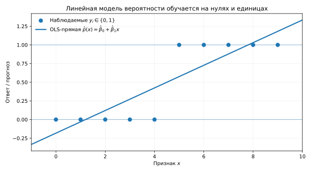

*Рисунок 1. Линейный прогноз может выйти за пределы $`[0,1]`$; сигмоида линейной оценки остаётся внутри этого диапазона.*

**Итак:** бинарная целевая переменная естественным образом связана с вероятностью события; МНК в среднем поощряет прогнозирование условной вероятности, но линейная форма $\widehat\beta_0+x^\top\widehat\beta$ не гарантирует значения из $[0,1]$. Это и мотивирует переход к другой модели.

Хочется сохранить главное удобство линейной регрессии — выражение $\beta_0+x^\top\beta$ — и при этом получать допустимые вероятности. **Идея логистической регрессии состоит в том, чтобы сделать линейной не саму вероятность, а подходящее преобразование вероятности.** Сначала построим это преобразование и выясним, почему оно работает.

## 2. Шансы, логит и сигмоида

### 2.1. Шансы: событие по отношению к несобытию

Вероятность можно интерпретировать через относительную частоту события при большом числе сопоставимых случаев. Представим, что среди $100$ транзакций с похожими характеристиками $20$ оказались мошенническими, а $80$ — обычными. Тогда наблюдаемая доля мошеннических операций равна $20/100=0.2$: в знаменателе находятся **все сто транзакций**.

Иногда удобнее сопоставить два исхода непосредственно: сколько мошеннических операций приходится на обычные? В нашем примере это отношение $20:80=1:4$. В англоязычной литературе его называют *odds*, по-русски — **шансы**. Если вероятность события равна $p$, а вероятность отсутствия события — $1-p$, то

```math
\boxed{\mathrm{odds}(p)=\frac{p}{1-p}.}
```

| Вероятность $p$ | События : несобытия | Шансы (*odds*) |
|---:|---:|---:|
| $0.2$ | $20:80$ | $1:4=0.25$ |
| $0.5$ | $50:50$ | $1:1=1$ |
| $0.8$ | $80:20$ | $4:1=4$ |

Важно не смешивать две величины: **вероятность $0.2$ соответствует шансам $0.25$**, а не шансам $0.2$. Если шансы равны $r$, восстановить вероятность можно по формуле $p=r/(1+r)$.

Диапазоны значений также различаются. Вероятность всегда лежит в $[0,1]$. Для последующих преобразований сначала будем рассматривать $0<p<1$: тогда шансы строго положительны и могут принимать любое значение из $(0,+\infty)$. При $p=0.5$ они равны единице; при $p<0.5$ — меньше единицы, при $p>0.5$ — больше.

На границе $p=0$ шансы равны нулю. При $p\to1$ знаменатель $1-p$ стремится к нулю, поэтому шансы неограниченно растут. В частности, при $p=1$ выражение $p/(1-p)$ уже не является конечным числом. Эти крайние случаи понадобятся, когда будем переходить к логарифму шансов.

Однако одних шансов ещё недостаточно, чтобы использовать привычное линейное выражение $\beta_0+x^\top\beta$: оно может быть и отрицательным, тогда как шансы положительны. Следующий шаг — подобрать преобразование с диапазоном значений на всей числовой прямой.

### 2.2. Логит: шкала для линейной модели

Логарифм переводит положительные числа во всю вещественную прямую. Поэтому возьмём логарифм шансов:

```math
\boxed{\mathrm{logit}(p)=\log\frac{p}{1-p}.}
```

Здесь и далее $\log$ обозначает натуральный логарифм. Полученную величину также называют **логарифмом шансов** (*log-odds*).

| Вероятность $p$ | Шансы | Логит $\log\frac{p}{1-p}$ |
|---:|---:|---:|
| $0.1$ | $1:9\approx0.111$ | $-2.197$ |
| $0.2$ | $1:4=0.25$ | $-1.386$ |
| $0.5$ | $1:1=1$ | $0$ |
| $0.8$ | $4:1=4$ | $1.386$ |
| $0.9$ | $9:1=9$ | $2.197$ |

Теперь диапазоны совместимы:

```math
0\lt p\lt 1
\quad\xrightarrow{\;\mathrm{odds}\;}\quad
(0,+\infty)
\quad\xrightarrow{\;\log\;}\quad
\mathbb R.
```

Логарифм сохраняет порядок шансов, а умножение шансов превращает в **прибавление** к логиту. Поэтому логит удобен не только по диапазону значений, но и для интерпретации коэффициентов.

Логистическая регрессия делает основное модельное предположение:

```math
\boxed{
\mathrm{logit}\bigl(p_\beta(x)\bigr)
=\log\frac{p_\beta(x)}{1-p_\beta(x)}
=\beta_0+x^\top\beta.
}
```

Правую часть назовём **линейной оценкой** (*linear score*):

```math
z_\beta(x)=\beta_0+x^\top\beta.
```

Тем самым мы задаём **конкретное семейство моделей**: линейной функцией признаков становится логит предсказываемой вероятности. Коэффициенты пока неизвестны; их значения определит обучение на данных.

### 2.3. Сигмоида возвращает нас к вероятности

Чтобы получить прогноз вероятности из score, обратим логит. Если $z=\log[p/(1-p)]$, то

```math
e^z=\frac{p}{1-p}
\quad\Longrightarrow\quad
e^z(1-p)=p
\quad\Longrightarrow\quad
p=\frac{1}{1+e^{-z}}.
```

Полученное преобразование называют **сигмоидой**:

```math
\boxed{\sigma(z)=\frac{1}{1+e^{-z}},\qquad
p_\beta(x)=\sigma\bigl(\beta_0+x^\top\beta\bigr).}
```

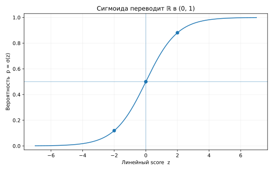

*Рисунок 2. Конечная линейная оценка превращается в число строго между нулём и единицей.*

Полезны три опорные точки: $\sigma(0)=0.5$, $\sigma(-2)\approx0.119$, $\sigma(2)\approx0.881$. При очень отрицательном score вероятность приближается к нулю, при очень положительном — к единице. **Сигмоида строго возрастает**, поэтому переход от score к вероятности не меняет порядка объектов. К этому свойству вернёмся при обсуждении ROC-AUC.

### 2.4. Что означает коэффициент логистической регрессии

В обычной линейной регрессии $\beta_j$ определяет изменение числового прогноза при изменении $x_j$ на единицу. Здесь линейным является логит. При фиксированных остальных признаках увеличение $x_j$ на единицу даёт

```math
\log\mathrm{odds}_{\mathrm{new}}-
\log\mathrm{odds}_{\mathrm{old}}=\beta_j.
```

Экспоненцируя, получаем

```math
\boxed{
\frac{\mathrm{odds}_{\mathrm{new}}}
{\mathrm{odds}_{\mathrm{old}}}=e^{\beta_j}.
}
```

Число $e^{\beta_j}$ называют **отношением шансов** (*odds ratio*) для изменения признака на единицу. Например, при $\beta_j=\log 2$ шансы удваиваются. Но **вероятность не удваивается**. Если до изменения она была $0.2$, шансы составляли $0.25$. После удвоения шансов получим $0.5$, а соответствующая вероятность равна $0.5/(1+0.5)=1/3\approx0.333$, а не $0.4$.

Почему одинаковый коэффициент вызывает разное изменение вероятности в разных точках? Из $p_\beta(x)=\sigma(z_\beta(x))$ по правилу цепочки следует

```math
\boxed{\frac{\partial p_\beta(x)}{\partial x_j}
=\beta_j\,p_\beta(x)\bigl(1-p_\beta(x)\bigr).}
```

Это **локальный** эффект при непрерывном признаке и фиксированных остальных. Множитель $p(1-p)$ максимален при $p=0.5$ и уменьшается около нуля и единицы. Для большого изменения признака точный эффект находят сравнением двух прогнозов, а не умножением производной на большой шаг.

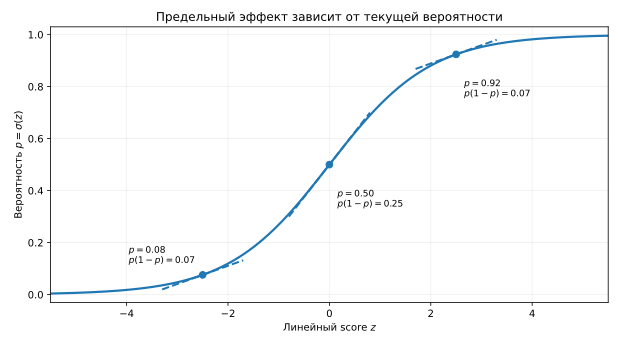

*Рисунок 3. Один и тот же сдвиг линейной оценки сильнее влияет на вероятность в средней части сигмоиды, чем у её краёв.*

Единицы измерения признака, состав остальных признаков и ограничения наблюдательных данных важны для интерпретации коэффициентов. **Ни коэффициент, ни отношение шансов сами по себе не доказывают причинного эффекта.**

**Итак, что мы построили:**

- Шансы $p/(1-p)$ сопоставляют вероятность события с вероятностью его отсутствия, а логит переводит шансы на всю вещественную прямую.
- Логистическая регрессия задаёт линейную модель **логита**, а сигмоида возвращает результат на шкалу вероятности $(0,1)$.
- Коэффициент $\beta_j$ изменяет логарифм шансов на $\beta_j$ при изменении признака на единицу; это не равнозначно постоянному изменению самой вероятности.

Итак, мы получили семейство функций $p_\beta(x)$, выдающих прогнозы в допустимом вероятностном диапазоне. Однако коэффициенты $\beta$ пока не выбраны. Следующий вопрос — **какие из них лучше согласуются с наблюдёнными данными и как их найти**.

## 3. От вероятностной модели к функции потерь и обучению

На прошлой неделе мы разделяли три вещи: семейство прогнозов, целевую функцию и численный способ подбора параметров. Теперь семейство уже задано:

```math
p_i=p_\beta(x_i)=\sigma(x_i^\top\beta),
```

где свободный член включён в $x_i$. Осталось определить, **какие значения коэффициентов будут считаться лучшими на наблюдённых данных**. Один из естественных подходов использует вероятность самих наблюдённых ответов — принцип максимального правдоподобия.

### 3.1. Бинарная вероятностная модель: Бернулли

Для каждого объекта фиксируем признаки $x_i$, а ответ $Y_i$ рассматриваем как случайный бинарный исход:

```math
Y_i\mid X_i=x_i\sim\mathrm{Bernoulli}(p_i).
```

Это означает, что $Y_i=1$ с вероятностью $p_i$, а $Y_i=0$ с вероятностью $1-p_i$. Оба случая можно записать одной формулой:

```math
\boxed{P_\beta(Y_i=y_i\mid X_i=x_i)
=p_i^{y_i}(1-p_i)^{1-y_i}.}
```

При $y_i=1$ получаем $p_i$, при $y_i=0$ — $1-p_i$. Здесь $p_i$ зависит от коэффициентов через сигмоиду, поэтому и вероятность наблюдённого ответа зависит от $\beta$.

### 3.2. Принцип максимального правдоподобия и вывод log loss

Мы задали вероятность каждого бинарного ответа через модель Бернулли. Теперь нужно определить правило выбора коэффициентов $\beta$ по обучающей выборке $D=\lbrace (x_i,y_i)\rbrace _{i=1}^n$.

В **методе максимального правдоподобия** (ММП, *maximum likelihood estimation*, MLE) уже наблюдённые значения $y_1,\ldots,y_n$ считаются фиксированными. Мы меняем коэффициенты $\beta$ и спрашиваем: **при каких параметрах именно полученные ответы были бы наиболее вероятны согласно нашей модели?** Это не вероятность самих коэффициентов; это функция параметров при фиксированных данных.

Предположим, что при заданных признаках ответы разных объектов условно независимы. Тогда совместная вероятность наблюдённых ответов равна произведению их отдельных вероятностей:

```math
\begin{aligned}
\mathcal L(\beta;D)
&=\prod_{i=1}^{n}P_\beta(Y_i=y_i\mid X_i=x_i)\\[0pt]
&=\prod_{i=1}^{n}p_i^{y_i}(1-p_i)^{1-y_i},
\qquad p_i=\sigma(x_i^\top\beta).
\end{aligned}
```

Функцию $\mathcal L(\beta;D)$ называют **правдоподобием** (*likelihood*). Для наглядности возьмём всего два объекта. Если первый имеет $y_1=1$, а второй — $y_2=0$, их совместный вклад равен $p_1(1-p_2)$. Например, при прогнозах $p_1=0.8$, $p_2=0.3$ получим $0.8\cdot0.7=0.56$. Другие значения коэффициентов дадут другие $p_1,p_2$, а значит, и другое правдоподобие.

Принцип ММП выбирает коэффициенты с **наибольшим** правдоподобием:

```math
\boxed{\widehat\beta_{\mathrm{MLE}}\in\arg\max_\beta\mathcal L(\beta;D).}
```

Запись $\arg\max$ означает не само максимальное значение функции, а **значения параметров, при которых оно достигается**, если максимум существует. Как перейти от этой задачи к знакомой минимизации среднего значения функции потерь?

**Шаг 1. Заменим произведение суммой.** Логарифм строго возрастает: если одна положительная величина больше другой, то и её логарифм больше. Поэтому логарифмирование не меняет, какие параметры максимизируют правдоподобие:

```math
\arg\max_\beta\mathcal L(\beta;D)
=\arg\max_\beta\log\mathcal L(\beta;D).
```

При этом логарифм произведения превращается в сумму. Для каждого наблюдения

```math
\begin{aligned}
\log\bigl[p_i^{y_i}(1-p_i)^{1-y_i}\bigr]
&=\log p_i^{y_i}+\log(1-p_i)^{1-y_i}\\[0pt]
&=y_i\log p_i+(1-y_i)\log(1-p_i).
\end{aligned}
```

Следовательно, **логарифм правдоподобия всей выборки** равен

```math
\boxed{
\ell(\beta)=\log\mathcal L(\beta;D)
=\sum_{i=1}^n\bigl[y_i\log p_i+(1-y_i)\log(1-p_i)\bigr].
}
```

Это и есть удобство логарифма: вместо произведения большого числа вероятностей работаем с суммой вкладов отдельных объектов.

**Шаг 2. Перейдём от максимизации к минимизации.** Для любой функции $f(\beta)$ максимизировать её — то же самое, что минимизировать $-f(\beta)$. Значит, максимизация $\ell(\beta)$ эквивалентна минимизации **отрицательного логарифма правдоподобия**:

```math
\arg\max_\beta\ell(\beta)
=\arg\min_\beta[-\ell(\beta)].
```

**Шаг 3. Возьмём среднее по объектам.** Деление на $n>0$ не меняет положения минимума, поскольку это умножение целевой функции на положительную константу. Поэтому можем минимизировать

```math
\begin{aligned}
R_n(\beta)
&=-\frac1n\ell(\beta)\\[0pt]
&=-\frac1n\sum_{i=1}^n
\bigl[y_i\log p_i+(1-y_i)\log(1-p_i)\bigr].
\end{aligned}
```

У нас снова получилась уже знакомая структура **эмпирического риска** — среднего по наблюдениям от индивидуальной функции потерь:

```math
\boxed{
R_n(\beta)=\frac1n\sum_{i=1}^n L(y_i,p_i),\qquad
L(y,p)=-y\log p-(1-y)\log(1-p).
}
```

Индивидуальную функцию $L$ называют **бинарной логарифмической потерей** (*binary log loss*, *binary cross-entropy*). При $y=1$ второе слагаемое исчезает, остаётся $-\log p$; при $y=0$ остаётся $-\log(1-p)$. В нашем примере с двумя объектами потери соответственно равны $-\log0.8$ и $-\log0.7$; средняя потеря составляет $-\tfrac12\log(0.56)\approx0.290$.

| Наблюдённый ответ | Потеря | Когда мала | Когда велика |
|---|---|---|---|
| $y=1$ | $-\log p$ | $p$ близко к 1 | $p$ близко к 0 |
| $y=0$ | $-\log(1-p)$ | $p$ близко к 0 | $p$ близко к 1 |

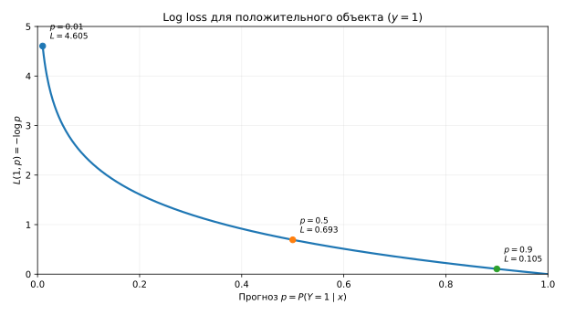

*Рисунок 4. Log loss быстро возрастает, если модель приписывает очень малую вероятность реально наступившему исходу.*

**Вывод.** Мы не постулировали loss из соображений удобства. При выбранной Bernoulli-модели и предположении условной независимости максимизация правдоподобия ведёт к минимизации средней log loss. Сам этот переход **не говорит, каким алгоритмом** искать минимум; к оптимизации перейдём после обсуждения статистического смысла функции потерь.

### 3.3. Почему log loss подходит именно для вероятностей

Минимизация log loss **в среднем** поощряет прогнозирование истинной условной вероятности, а не просто правильного класса. Это полезное теоретическое свойство, которое можно увидеть без длинного доказательства.

Зафиксируем признаки $X=x$ и обозначим истинную условную вероятность $q=P(Y=1\mid X=x)$. В этом мысленном эксперименте считаем $q$ известной, а прогноз модели $p\in(0,1)$ будем варьировать. При повторении одних и тех же условий возможны два исхода: с вероятностью $q$ получаем $Y=1$ и потерю $L(1,p)=-\log p$; с вероятностью $1-q$ — $Y=0$ и потерю $L(0,p)=-\log(1-p)$.

**Ожидаемая log loss** — средняя потеря одного и того же прогноза $p$ при многократном повторении условий $X=x$. Усредняя потери двух исходов с их вероятностями, получаем

```math
\begin{aligned}
\Phi(p)
&=\mathbb E[L(Y,p)\mid X=x]\\[0pt]
&=qL(1,p)+(1-q)L(0,p)\\[0pt]
&=-q\log p-(1-q)\log(1-p).
\end{aligned}
```

Для $0<p<1$ её производная имеет простой вид:

```math
\Phi'(p)=-\frac qp+\frac{1-q}{1-p}
=\frac{p-q}{p(1-p)}.
```

При $0<p<1$ знаменатель $p(1-p)$ положителен, поэтому знак производной определяется только разностью $p-q$. Если $0<q<1$, то для $p<q$ производная отрицательна, при $p=q$ равна нулю, а для $p>q$ положительна. Функция убывает до $q$ и растёт после него. Значит, **минимум ожидаемой log loss достигается при $p=q$**.

Если $q=0$, положительный исход в этих условиях не возникает: $\Phi(p)=-\log(1-p)$ уменьшается по мере приближения $p$ к нулю. Если $q=1$, положительный исход возникает всегда: $\Phi(p)=-\log p$ уменьшается по мере приближения $p$ к единице. В обоих случаях потеря стремится к нулю, но **внутри интервала $(0,1)$ минимум не достигается**. Сигмоида конечного score не выдаёт ровно $0$ или $1$: эти значения получаются только как пределы при $z\to-\infty$ или $z\to+\infty$ соответственно.

Это объясняет, почему log loss подходит для обучения вероятностных прогнозов. Но **не доказывает**, что конкретная логистическая регрессия после обучения на конечной выборке восстановит истинные вероятности: линейный logit может оказаться неверным предположением, данных может не хватить, а обучение — содержать регуляризацию. Качество численных вероятностей проверяют на новых данных отдельно; к этому мы вернёмся в конце лекции.

### 3.4. Вычисляем градиент и используем знакомый алгоритм

Как именно найти коэффициенты, минимизирующие $R_n(\beta)$? Здесь не нужна новая схема оптимизации. Как и для MSE, можно использовать градиентный спуск. Поменяется лишь градиент целевой функции.

Для отдельного объекта $z_i=x_i^\top\beta$, $p_i=\sigma(z_i)$. Ключевое сокращение при дифференцировании:

```math
\frac{\partial L_i}{\partial p_i}
=-\frac{y_i}{p_i}+\frac{1-y_i}{1-p_i},
\qquad
\frac{\partial p_i}{\partial z_i}=p_i(1-p_i),
```

```math
\begin{aligned}
\frac{\partial L_i}{\partial z_i}
&=\left(-\frac{y_i}{p_i}+\frac{1-y_i}{1-p_i}\right)p_i(1-p_i)\\[0pt]
&=-y_i(1-p_i)+(1-y_i)p_i\\[0pt]
&=\boxed{p_i-y_i}.
\end{aligned}
```

Поскольку $\nabla_\beta z_i=x_i$, по правилу цепочки получаем градиент потери одного объекта по параметрам:

```math
\boxed{\nabla_\beta L_i
=\frac{\partial L_i}{\partial z_i}\nabla_\beta z_i
=(p_i-y_i)x_i.}
```

Пусть $X\in\mathbb R^{n\times d}$ — матрица признаков, где $d$ — число параметров с учётом свободного члена. Усредняя градиенты по $n$ объектам, получаем

```math
\boxed{\nabla_\beta R_n(\beta)=\frac1n X^\top(p-y),\qquad p=\sigma(X\beta).}
```

Градиент имеет размерность $d\times1$, как и вектор параметров. Формула напоминает градиент MSE: сначала прогнозы, затем ошибки и их вклад в каждую координату параметров. Только теперь прогнозы — вероятности, а функция потерь — log loss.

Шаг алгоритма не меняется:

```math
\beta^{(t+1)}=\beta^{(t)}-\eta\nabla_\beta R_n(\beta^{(t)}).
```

При обычной логистической регрессии log loss является **выпуклой** функцией параметров: локальный минимум, если он существует, не может оказаться хуже глобального. Однако выпуклость сама по себе не гарантирует существование конечного решения или его единственность. Например, если обучающая выборка линейно разделима без ошибок, можно всё сильнее увеличивать модуль коэффициентов в разделяющем направлении: значения log loss будут приближаться к нулю, но нулевой потери при конечных коэффициентах не получится. Регуляризация, к которой мы вернёмся на следующей неделе, помогает контролировать величину коэффициентов.

На практике библиотечные решатели подбирают коэффициенты численно; в `sklearn.linear_model.LogisticRegression` по умолчанию добавляется **регуляризация**, поэтому библиотечная целевая функция отличается от записанной выше чистой log loss. Важная мысль остаётся прежней: *семейство прогнозов + целевая функция + процедура оптимизации* определяют обученные коэффициенты.

### 3.5. Что мы получили после обучения

Теперь вместо произвольного $\beta$ у нас есть обученные коэффициенты $\widehat\beta$. Для нового объекта можно вычислить линейную оценку $\widehat z(x)$ и вероятностный прогноз $\widehat p(x)=\sigma(\widehat z(x))$.

**Итак, что мы теперь знаем об обучении логистической регрессии:**

- Семейство вероятностных прогнозов задаётся линейным score и сигмоидой; Bernoulli-модель задаёт вероятность наблюдённых бинарных ответов.
- При предположении условной независимости максимизация правдоподобия эквивалентна минимизации среднего значения log loss.
- Градиент вычисляется через разности $p_i-y_i$, после чего можно использовать знакомый градиентный метод или библиотечный решатель. Результат — обученные коэффициенты и функция, вычисляющая оценку вероятности для нового объекта.

**Но вероятность — ещё не окончательное действие.** Например, прогноз $0.35$ означает, что модель оценивает вероятность мошенничества в 35%, но не говорит, нужно ли задержать платёж или отправить его сотруднику на проверку. Для принятия решения нужна ещё одна часть системы: **правило, которое использует этот прогноз**.

## 4. Как прогноз становится решением

Представим две системы, использующие одну и ту же обученную логистическую регрессию. Первая отправляет подозрительную транзакцию на недорогую ручную проверку. Вторая автоматически блокирует платёж. Прогнозы могут быть одинаковыми, однако ошибки и затраты двух действий существенно различаются. Поэтому нельзя считать, что обученная модель сама по себе однозначно определяет правильную метку.

Для объекта $x$ в нашем распоряжении есть три последовательных уровня:

```math
\underbrace{\widehat z(x)=x^\top\widehat\beta}_{\text{линейная оценка}}
\ \xrightarrow{\;\sigma\;}\
\underbrace{\widehat p(x)=\sigma(\widehat z(x))}_{\text{оценка вероятности}}
\ \xrightarrow{\;\text{правило решения}\;}\
\underbrace{\widehat y(x)\in\lbrace 0,1\rbrace }_{\text{метка класса}}.
```

Если итогом должен быть один из двух классов, простейшее правило использует **порог** $t\in(0,1)$:

```math
\boxed{
\widehat y_t(x)=
\begin{cases}
1,&\widehat p(x)\ge t,\\[0pt]
0,&\widehat p(x)\lt t.
\end{cases}}
```

При $t=0.5$ положительный класс получают объекты с вероятностью не меньше половины. Но $0.5$ — лишь стандартное начальное правило. При дешёвой дополнительной проверке целесообразным может оказаться более низкий порог; при автоматической блокировке со значительной ценой ложного срабатывания — иной. **Какой порог оправдан, определяется задачей, а не формулой сигмоиды.**

Поскольку сигмоида строго возрастает,

```math
\widehat p(x)\ge t
\quad\Longleftrightarrow\quad
\widehat z(x)\ge \log\frac{t}{1-t}.
```

При $t=0.5$ значение logit в правой части равно нулю. Если признаков два, граница $\widehat\beta_0+\widehat\beta_1x_1+\widehat\beta_2x_2=0$ представляет собой **прямую на плоскости признаков**; при большем числе признаков — гиперплоскость. При изменении порога уравнение становится $\widehat\beta_0+\widehat\beta_1x_1+\widehat\beta_2x_2=\mathrm{logit}(t)$: для фиксированной обученной модели это параллельное смещение границы, если хотя бы один коэффициент признака ненулевой. Сами коэффициенты и вероятностные прогнозы **не переобучаются**.

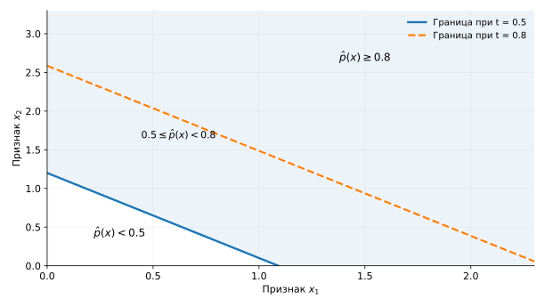

*Рисунок 5. Учебная модель $`\widehat p(x)=\sigma(-1.2+1.1x_1+x_2)`$. Сплошная прямая отвечает порогу $`t=0.5`$, пунктирная — $`t=0.8`$. Повышение порога уменьшает область положительных решений, не изменяя вычисленные вероятности.*

В библиотеке `scikit-learn` это различие отражено в методах `decision_function` (линейная оценка), `predict_proba` (вероятности классов) и `predict` (метки по стандартному правилу классификатора). Конкретные вызовы и устройство возвращаемых массивов мы разберём на семинаре, поэтому здесь достаточно различать их роли.

**Итак, после обучения нужно различать три объекта:**

- **Score** $\widehat z(x)$ — числовую линейную оценку, которая не обязана лежать между нулём и единицей.
- **Вероятностный прогноз** $\widehat p(x)$ — значение сигмоиды score, лежащее между нулём и единицей; его численная достоверность требует отдельной проверки.
- **Решение** $\widehat y_t(x)$ — метку после применения порога; порог можно менять без повторного обучения коэффициентов.

Теперь уже можно спрашивать о качестве принятых решений. Для этого сравним полученные метки с настоящими исходами — и увидим, что ошибки бывают разных видов.

## 5. Матрица ошибок и метрики бинарной классификации

### 5.1. Один набор из двенадцати транзакций

Пусть логистическая модель уже выдала прогнозы для двенадцати условных транзакций. Мы знаем и вероятности мошенничества, и истинные исходы. Набор специально создан для объяснения: доля мошеннических операций здесь велика по сравнению с реальным антифродом, и эту долю не следует считать типичной.

| № | $\widehat p$ | Истинный класс $y$ |
|---:|---:|---:|
| 1 | 0.95 | 1 |
| 2 | 0.88 | 0 |
| 3 | 0.82 | 1 |
| 4 | 0.75 | 1 |
| 5 | 0.68 | 0 |
| 6 | 0.61 | 0 |
| 7 | 0.55 | 1 |
| 8 | 0.48 | 0 |
| 9 | 0.35 | 1 |
| 10 | 0.30 | 0 |
| 11 | 0.18 | 0 |
| 12 | 0.08 | 0 |

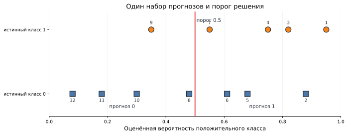

*Рисунок 6. Транзакции упорядочены по прогнозируемой вероятности. При пороге $`0.5`$ положительную метку получают первые семь объектов.*

При $t=0.5$ положительный прогноз получают объекты 1–7. Среди них четыре настоящих мошенничества и три обычные операции. Из всех пяти мошеннических операций мы пропустили одну — объект 9. Оставшиеся четыре обычные операции правильно получили класс 0.

### 5.2. Что означают TP, FP, FN и TN

Каждый объект попадает ровно в одну из четырёх категорий:

| | Прогноз 0 | Прогноз 1 |
|---|---:|---:|
| Истинный 0 | **TN** — верно оставили в классе 0 | **FP** — ложное срабатывание |
| Истинный 1 | **FN** — пропустили событие | **TP** — нашли событие |

Здесь положительный класс — мошенничество, хотя само событие нежелательно. Термины «положительный» и «отрицательный» обозначают выбранные классы, а не нашу оценку события.

Для двенадцати транзакций получаем:

```math
TN=4,\quad FP=3,\quad FN=1,\quad TP=4.
```

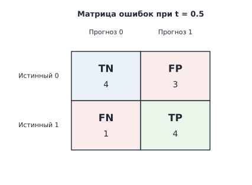

*Рисунок 7. Строки матрицы соответствуют истинным классам, столбцы — предсказанным. Четыре числа полностью определяют пороговые метрики бинарной классификации.*

Полезная проверка: объектов с истинным классом $1$ — $TP+FN=5$, с истинным классом $0$ — $TN+FP=7$, всего $5+7=12$. **К TP относятся только правильно распознанные положительные объекты**, а пропущенные — к FN. Аналогично TN учитывает только правильно распознанные отрицательные объекты. Число положительных прогнозов равно $TP+FP=7$.

### 5.3. Accuracy: сколько ответов правильные?

**Доля верных классификаций** (*accuracy*) отвечает на вопрос, какая часть всех объектов получила правильную метку:

```math
\boxed{\mathrm{Accuracy}=\frac{TP+TN}{N}.}
```

В нашем примере $\mathrm{Accuracy}=(4+4)/12\approx0.667$. Число верно отражает общую долю правильных решений, но не раскрывает, каких ошибок было больше.

### 5.4. Precision: кто оказался среди положительных решений?

**Точность положительного прогноза** (*precision*) начинает отсчёт со всех объектов, которым модель присвоила класс $1$:

```math
\boxed{\mathrm{Precision}=\frac{TP}{TP+FP}.}
```

Из семи транзакций, направленных на проверку, четыре мошеннические. Поэтому precision равна $4/7\approx0.571$. Эта метрика особенно непосредственно описывает **состав потока положительных срабатываний**. Если проверка дорогая, высокая доля ложных срабатываний создаёт затраты.

Если положительных прогнозов вообще нет, знаменатель обращается в ноль и математически precision не определена. Библиотеки обычно позволяют выбрать техническое соглашение для такого случая; его не следует путать с содержательным результатом.

### 5.5. Recall: какую долю событий нашли?

**Полнота** (*recall*), или чувствительность, начинает отсчёт со всех объектов с истинным классом $1$ — как найденных, так и пропущенных:

```math
\boxed{\mathrm{Recall}=\frac{TP}{TP+FN}.}
```

Из пяти мошеннических операций мы обнаружили четыре, следовательно, $\mathrm{Recall}=4/5=0.8$. В терминологии ROC эта же величина называется *true positive rate* (TPR).

Precision и recall используют одинаковый числитель, но разные знаменатели. Для precision мы спрашиваем: «какая доля **отобранных** оказалась положительной?». Для recall: «какую долю **всех положительных** удалось отобрать?».

### 5.6. Specificity: сколько обычных операций оставили обычными?

**Специфичность** (*specificity*), или *true negative rate* (TNR), равна

```math
\boxed{\mathrm{Specificity}=\frac{TN}{TN+FP}.}
```

В нашем примере она составляет $4/7\approx0.571$. Это доля объектов с истинным классом $0$, которые модель не отправила в положительный класс. Специфичность можно понимать как recall отрицательного класса.

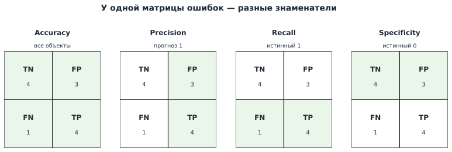

*Рисунок 8. Все показатели используют одну матрицу ошибок, но каждый начинает счёт с другой группы объектов.*


Смысл знаменателей можно собрать в таблицу:

| Метрика | С чего начинаем считать? | Какой вопрос задаём? |
|---|---|---|
| Accuracy | Все объекты | Какую долю разметили правильно? |
| Precision | Объекты с **положительным прогнозом** | Какая доля срабатываний соответствует событию? |
| Recall / TPR | Все объекты с **истинным классом $1$** | Какую долю событий мы нашли? |
| Specificity / TNR | Все объекты с **истинным классом $0$** | Какую долю обычных объектов мы не затронули? |

В терминах условных частот различие между precision и recall особенно отчётливо:

```math
\mathrm{Precision}\approx P(Y=1\mid\widehat Y=1),
\qquad
\mathrm{Recall}\approx P(\widehat Y=1\mid Y=1).
```

Это **разные условные вероятности**. Переставить условие и событие местами — значит изменить вопрос. Например, «какая доля задержанных транзакций была мошеннической?» и «какая доля мошеннических транзакций была задержана?» — далеко не одно и то же.

### 5.7. F1 и F-мера

Иногда хотят одним числом учесть одновременно precision и recall. Для этого используют их гармоническое среднее — **F1**:

```math
\boxed{F_1=2\frac{\mathrm{Precision}\cdot\mathrm{Recall}}{\mathrm{Precision}+\mathrm{Recall}}
=\frac{2TP}{2TP+FP+FN}.}
```

В нашем примере $F_1=8/(8+3+1)=2/3\approx0.667$. Гармоническое среднее заметно падает, если одно из двух значений мало: высокая precision при очень низком recall не даёт высокой F1.

Более общий показатель — **$F_\beta$**:

```math
\boxed{
F_\beta=(1+\beta^2)\,
\frac{\mathrm{Precision}\cdot\mathrm{Recall}}
{\beta^2\mathrm{Precision}+\mathrm{Recall}},\qquad \beta>0.
}
```

При $\beta=1$ возвращаемся к F1; при $\beta>1$ относительно большее значение придаётся recall, при $0<\beta<1$ — precision. Обозначение $\beta$ здесь относится **к параметру F-меры**, а не к вектору коэффициентов логистической регрессии. Выбирая $\beta$, мы задаём предпочтение одной метрике перед другой, но не строим полноценную модель затрат.

Ни F1, ни $F_\beta$ не учитывают TN непосредственно и не заменяют явного анализа стоимости ошибок и ресурсных ограничений конкретной системы.

### 5.8. Когда accuracy вводит в заблуждение

Представим 10 000 операций, из которых лишь 100 мошеннических. Модель, всегда предсказывающая «обычная операция», получит accuracy $9900/10000=0.99$. Но её recall положительного класса будет нулевой: ни одно мошенничество не найдено. Если цель системы — обнаружение редких событий, такая модель непригодна, несмотря на 99% правильных меток.

При выраженном **дисбалансе классов** полезно сравнивать результаты с простым базовым правилом и смотреть отдельно на разные виды ошибок. Однако сам дисбаланс не определяет, какую одну метрику следует выбрать: это зависит от применения прогноза.

В таких задачах иногда полезна **balanced accuracy** — среднее из recall двух классов:

```math
\mathrm{BalancedAccuracy}
=\frac{\mathrm{Recall}+\mathrm{Specificity}}{2}.
```

У классификатора, который всегда предсказывает ноль, recall положительного класса равен нулю, а specificity — единице. Поэтому balanced accuracy равна $0.5$, хотя обычная accuracy достигает $0.99$. Это позволяет увидеть односторонность решения, но также не заменяет анализ стоимости ошибок.

**Итак.** Матрица ошибок фиксирует четыре вида исходов при конкретном пороге. Accuracy измеряет общую долю верных решений, precision — состав положительных прогнозов, recall — долю найденных положительных объектов, specificity — долю правильно оставленных отрицательных. F1 объединяет precision и recall, но не заменяет разбор последствий FP и FN.

## 6. Порог как часть прикладного решения

### 6.1. Одна модель, разные пороги

В разделе 4 мы ввели правило $\widehat y_t=I[\widehat p\ge t]$. Теперь посмотрим, что происходит с качеством решений, когда **модель и её прогнозы зафиксированы**, а мы меняем только $t$.

Возьмём прежние двенадцать транзакций:

| Порог | TP | FP | FN | TN | Precision | Recall |
|---:|---:|---:|---:|---:|---:|---:|
| $0.80$ | 2 | 1 | 3 | 6 | $2/3\approx0.667$ | $2/5=0.40$ |
| $0.50$ | 4 | 3 | 1 | 4 | $4/7\approx0.571$ | $4/5=0.80$ |
| $0.35$ | 5 | 4 | 0 | 3 | $5/9\approx0.556$ | $5/5=1.00$ |

При снижении порога мы относим к положительному классу всё больше объектов. Поэтому число TP и recall **не могут уменьшиться**, но могут увеличиваться и FP. Precision при этом **не обязана монотонно падать**: когда через порог проходит настоящий положительный объект, доля TP среди срабатываний может, наоборот, вырасти. Поэтому из одного порога нельзя заранее вывести, что другой «лучше».

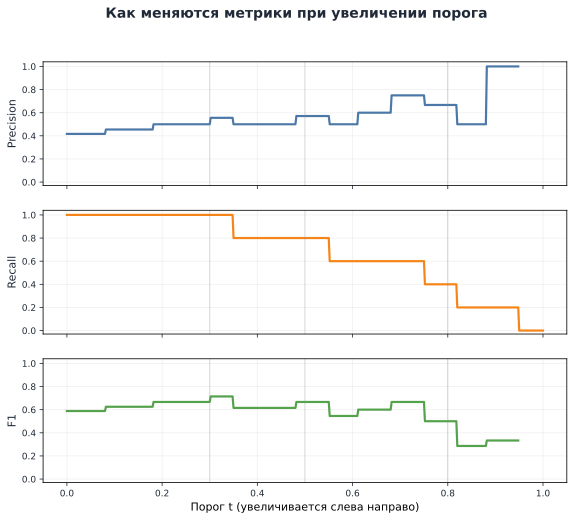

*Рисунок 9. Один набор вероятностей даёт разные матрицы ошибок и значения метрик при изменении порога.*

### 6.2. Почему прикладная задача определяет правило выбора

Представим три системы. Модель в них может быть одной и той же, но **действие после положительного прогноза различается**.

**Скрининг и последующая диагностика.** Первый этап обследования выделяет людей для более точного теста. Если пропуск опасного состояния может иметь тяжёлые последствия, для предварительного отбора можно поставить требование $\mathrm{Recall}\ge0.98$. Однако низкая precision приведёт к большому числу дополнительных обследований. Поэтому среди порогов, удовлетворяющих требованию к recall, можно выбрать наиболее высокий precision или непосредственно минимальное число лишних обследований. Конкретная допустимость решения зависит от возможностей следующего этапа и последствий ошибок, а не только от названия «медицинская задача».

**Блокировка или ручная модерация.** Если положительное решение автоматически блокирует обычного пользователя, ошибочное срабатывание затрагивает его работу и требует апелляции. Если та же модель только направляет случай модератору, последствия FP другие. Соответственно, требования к precision, specificity и числу срабатываний тоже могут отличаться. Для этих двух действий не обязательно выбирать одинаковый порог.

**Ограниченная очередь антифрода.** Допустим, из $200$ транзакций сотрудники физически могут проверить не более $50$. Система должна сформировать очередь из $50$ наиболее подозрительных операций или меньше, если есть дополнительные условия. При одинаковой стоимости проверки и отсутствии других ограничений выбираем $50$ объектов с наибольшими score: именно такой список максимизирует ожидаемое число обнаруженных событий, **если оценки являются содержательными вероятностями**. При сравнении решений важно учитывать число найденных мошеннических операций и precision среди отобранных, а не только общую accuracy.

Эти три случая показывают: «высокая recall», «высокая precision» или «хорошая accuracy» — не самостоятельные прикладные цели. Сначала определяется действие и его ограничение, а затем подбирается показатель и правило выбора.

Если хочется одновременно учитывать precision и recall, можно использовать F1 или $F_\beta$, меняющую относительный вес recall. Но даже выбранная F-мера **не заменяет** явную формулировку ограничения вроде «не более 50 проверок» или «не меньше 98% обнаруженных событий».

### 6.3. Дополнительный пример: порог при известных стоимостях ошибок

Если для обоих действий известны сопоставимые денежные или иные числовые издержки ошибочных решений $c_{FP}>0$ и $c_{FN}>0$, можно попытаться выбрать порог не по отдельной метрике, а по **ожидаемым затратам**. Пусть правильное решение имеет нулевую дополнительную стоимость, ошибки разных типов оцениваются одинаково для всех объектов, а $p$ — достаточно надёжная условная вероятность. Если присвоить класс $1$, ошибкой будет случай $Y=0$, вероятность которого равна $1-p$: ожидаемые затраты составят $c_{FP}(1-p)$. Если присвоить класс $0$, ошибкой будет случай $Y=1$ с вероятностью $p$: ожидаемые затраты равны $c_{FN}p$. Выбираем класс $1$ тогда, когда его ожидаемые затраты не выше:

```math
\underbrace{c_{FP}(1-p)}_{\text{затраты при решении 1}}
\le
\underbrace{c_{FN}p}_{\text{затраты при решении 0}}
\quad\Longleftrightarrow\quad
\boxed{p\ge\frac{c_{FP}}{c_{FP}+c_{FN}}.}
```

Например, при $c_{FN}=4c_{FP}$ получаем порог $0.2$: пропуск события стоит в четыре раза дороже ложного направления на проверку. Это **не универсальная формула выбора порога**: она предполагает одинаковые затраты для объектов и отсутствие общих ограничений на число действий. Подобные ограничения требуют отдельной задачи оптимизации. У формулы есть ясный смысл, но вне этих предпосылок порог нужно искать как часть прикладной постановки, а не подставлять стоимости механически.

### 6.4. Порог тоже выбирают по данным

До этого мы рассматривали порог как заданное правило. На практике порог часто **подбирают**: например, ищут значение, при котором recall высок, а число направлений не превосходит лимит. Такой подбор использует ответы наблюдённых объектов и потому является частью процедуры разработки системы.

Если подобрать $t$ по тестовой выборке, итоговая проверка перестанет быть независимой. Поэтому полезно развести роли данных:

```math
\underbrace{\text{train}}_{\text{подбор }\widehat\beta}
\ \longrightarrow\
\underbrace{\text{validation}}_{\text{выбор }t\text{ и других настроек}}
\ \longrightarrow\
\underbrace{\text{test}}_{\text{однократная проверка зафиксированной системы}}.
```

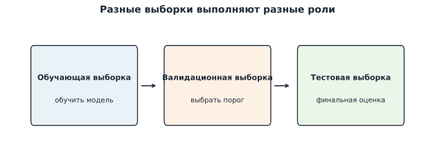

*Рисунок 10. Тестовые ответы не используют для выбора порога. Сначала фиксируют модель и правило применения, затем оценивают их на новых данных.*

Необходимо учитывать и случайную изменчивость: на маленькой validation-выборке несколько объектов около порога могут существенно поменять его «оптимальное» значение. Поэтому стоит смотреть на абсолютные числа TP и FP, число срабатываний и близкие варианты порога, а не только на максимум выбранной метрики. Более систематический протокол выбора модели и обработки данных мы построим на следующей неделе.

Итак, **порог меняет решение, а не обученную модель**. Его выбор определяется действием после прогноза и проверяется отдельной процедурой. Но иногда порог заранее не задан. Тогда полезно оценивать, как модель ранжирует объекты и какие рабочие режимы вообще позволяет получить.

## 7. ROC: от порога к ранжированию

### 7.1. Как множество порогов образует ROC-кривую

До сих пор мы изучали отдельные пороги. Теперь представим, что порог будем постепенно снижать от значения выше всех оценок до значения ниже всех оценок. Каждый объект в какой-то момент перейдёт из класса 0 в класс 1.

Напомним, что recall также называется **true positive rate**:

```math
TPR(t)=\frac{TP(t)}{TP(t)+FN(t)}.
```

Для отрицательного класса введём **false positive rate** — долю ошибочно отмеченных среди всех действительно отрицательных:

```math
\boxed{FPR(t)=\frac{FP(t)}{FP(t)+TN(t)}
=1-\mathrm{Specificity}(t).}
```

ROC (*Receiver Operating Characteristic*) изображает все пороговые режимы как точки $\bigl(FPR(t),TPR(t)\bigr)$: **по горизонтали FPR, по вертикали TPR**.

У нашего учебного набора пять положительных и семь отрицательных транзакций. В начале никто не выбран: $(FPR,TPR)=(0,0)$. Снижая порог, включаем объекты по убыванию score:

| Объект прошёл порог | Истинный класс | TP | FP | Координата $(FPR,TPR)$ |
|---|---:|---:|---:|---|
| Никто | — | 0 | 0 | $(0,0)$ |
| №1 | 1 | 1 | 0 | $(0,1/5)$ |
| №2 | 0 | 1 | 1 | $(1/7,1/5)$ |
| №3 | 1 | 2 | 1 | $(1/7,2/5)$ |
| №4 | 1 | 3 | 1 | $(1/7,3/5)$ |
| №5 | 0 | 3 | 2 | $(2/7,3/5)$ |
| №6 | 0 | 3 | 3 | $(3/7,3/5)$ |
| №7 | 1 | 4 | 3 | $(3/7,4/5)$ |
| №8 | 0 | 4 | 4 | $(4/7,4/5)$ |
| №9 | 1 | 5 | 4 | $(4/7,1)$ |
| №10 | 0 | 5 | 5 | $(5/7,1)$ |
| №11 | 0 | 5 | 6 | $(6/7,1)$ |
| №12 | 0 | 5 | 7 | $(1,1)$ |

Каждый следующий положительный объект даёт **вертикальный шаг** $1/5$, каждый отрицательный — **горизонтальный шаг** $1/7$. Пройдя все объекты, получим ROC-кривую.

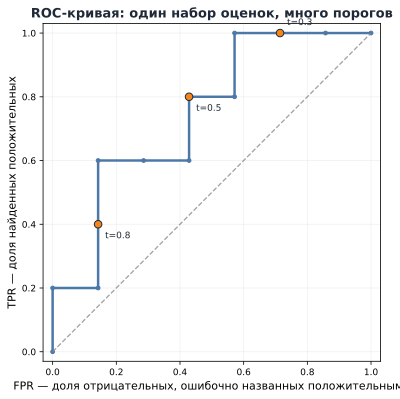

*Рисунок 11. ROC получается при последовательном снижении порога на одном и том же ранжированном списке.*

Точка $(0,0)$ соответствует решению «никого не выбирать», точка $(1,1)$ — «выбрать всех». Идеальная последовательность сначала пропустила бы все положительные объекты и только потом отрицательные, пройдя через $(0,1)$. Ориентир неинформативного ранжирования — диагональ $TPR=FPR$: при случайном порядке примерно одинаковая доля положительных и отрицательных пересекает порог.

При одинаковых score несколько объектов могут перейти через порог одновременно. Тогда ROC не обязана состоять только из вертикальных и горизонтальных шагов между **достижимыми** точками; прямой отрезок на графике не обязательно соответствует отдельному детерминированному порогу.

### 7.2. ROC-AUC: не только геометрическая площадь

**ROC-AUC** — площадь под ROC-кривой. Содержательно она измеряет качество ранжирования: если случайно выбрать один положительный и один отрицательный объект, ROC-AUC равна вероятности того, что score положительного объекта выше, с **половинным зачётом равенств**.

В наших двенадцати транзакциях пять положительных и семь отрицательных объектов, то есть $5\cdot7=35$ разноимённых пар. Посмотрим, скольких отрицательных объектов по оценке опережает каждый из пяти положительных: соответственно $7$, $6$, $6$, $4$ и $3$. Всего получаем $7+6+6+4+3=26$ правильно упорядоченных пар; одинаковых оценок нет. Следовательно,

```math
\boxed{\mathrm{ROC\text{-}AUC}=\frac{26}{35}\approx0.743.}
```

Почему это одновременно площадь под ROC? При прохождении каждого отрицательного объекта ROC делает горизонтальный шаг шириной $1/7$. Его высота — число положительных объектов с более высоким score, делённое на $5$. Поэтому площадь под этим шагом равна числу правильно упорядоченных пар с соответствующим отрицательным объектом, делённому на $5\cdot7=35$. Складывая площади под семью шагами, считаем те же пары, но теперь по отрицательным объектам:

```math
\mathrm{ROC\text{-}AUC}
=\frac{1+3+3+4+5+5+5}{35}
=\frac{26}{35}.
```

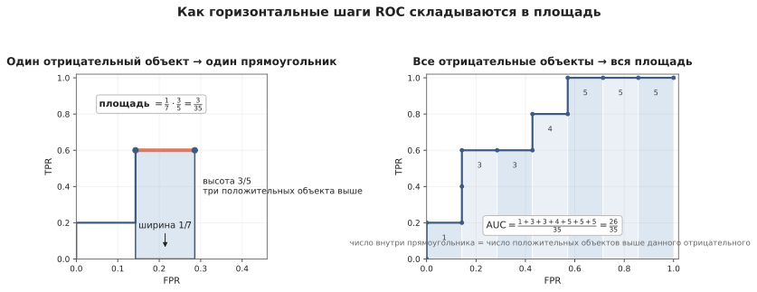

*Рисунок 12. Площадь под ROC соответствует доле правильно упорядоченных положительно-отрицательных пар с учётом равенств.*

Это не означает «74.3% правильных меток» — accuracy появляется только после выбора порога. ROC-AUC зависит **от порядка score, а не от их абсолютных значений**. Любое строго возрастающее преобразование score оставляет её неизменной. Поэтому для логистической регрессии ROC-AUC по линейному score и по сигмоиде этого score совпадает.

Из высокой ROC-AUC не следует, что на выбранном пороге будет мало FP или что верхняя сотня кандидатов окажется особенно качественной. Порой интересна лишь часть списка, которая реально обрабатывается системой. Тогда следует оценивать и конкретный рабочий режим.

## 8. Precision–Recall: взгляд на состав положительных решений

### 8.1. Та же последовательность порогов, другие координаты

ROC отвечает на вопрос, какую долю положительных мы нашли и какую долю отрицательных ошибочно включили. Но если положительное событие редко, небольшая **доля** FP среди многочисленных отрицательных объектов всё равно может означать большое **число** ложных срабатываний.

Поэтому для каждого порога можно рассмотреть другую пару:

```math
\boxed{\bigl(\mathrm{Recall}(t),\mathrm{Precision}(t)\bigr).}
```

Так строят **PR-кривую** (*Precision–Recall curve*): по горизонтали откладывают recall, по вертикали — precision.

При снижении порога и добавлении нового объекта истинного класса $1$ recall увеличивается, а precision либо увеличивается, либо остаётся прежней, если все выбранные и так были положительными. Если добавляется объект истинного класса $0$, recall не меняется, а precision уменьшается. Это та же последовательность решений, что и в ROC, только в других координатах.

Рассмотрим первые шаги того же ранжированного списка. Сначала отобрали объект №1, который действительно положителен: precision равна $1$, recall — $1/5$. Затем добавился отрицательный объект №2: precision снизилась до $1/2$, а recall осталась $1/5$. Когда добавили положительный объект №3, получили precision $2/3$ и recall $2/5$. Продолжая, получаем:

| Отобрано первых объектов | Положительных среди них | Recall | Precision |
|---:|---:|---:|---:|
| 1 | 1 | $1/5$ | $1$ |
| 2 | 1 | $1/5$ | $1/2$ |
| 3 | 2 | $2/5$ | $2/3$ |
| 4 | 3 | $3/5$ | $3/4$ |
| 7 | 4 | $4/5$ | $4/7$ |
| 9 | 5 | $1$ | $5/9$ |

Точки между показанными строками вычисляются точно так же. Начальное состояние, когда никого не выбрали, имеет recall $0$, но precision математически не определена (нет положительных прогнозов). На PR-графике для удобства часто добавляют начальную условную точку $(0,1)$ — её нельзя трактовать как точность реально отобранных объектов.

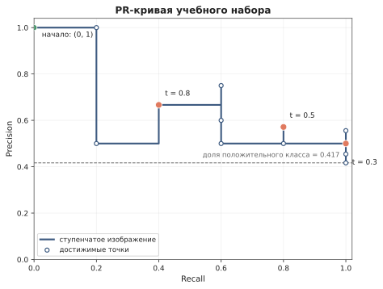

*Рисунок 13. ROC и PR строятся по одним порогам и одному ранжированному списку, но отвечают на разные вопросы.*

В крайнем режиме, когда выбраны все объекты, $\mathrm{Recall}=1$, а precision равна **доле положительного класса** в оценочной выборке. Если порядок не содержит информации об исходе, средняя precision достаточно больших верхних частей списка будет примерно соответствовать этой же доле. Поэтому базовый горизонтальный ориентир PR связан с распространённостью события, а не всегда равен $0.5$.

### 8.2. Почему PR особенно полезна при редких событиях

Пусть $\pi=N_+/N$ — **доля положительных объектов в рассматриваемой оценочной выборке**. Для выбранного порога

```math
\boxed{
\mathrm{Precision}
=\frac{TPR\cdot\pi}{TPR\cdot\pi+FPR\cdot(1-\pi)}.
}
```

Формула получается из определений: $TP=TPR\cdot N_+$, $FP=FPR\cdot N_-$, поэтому $TP/(TP+FP)$ после деления числителя и знаменателя на $N$ имеет указанный вид. Она показывает, почему два набора данных могут давать одинаковую ROC-точку, но разную precision. Для выводов о будущей системе важно также понимать, соответствует ли доля положительного класса на оценочных данных его распространённости в реальном потоке.

Пусть $\pi=0.01$, $TPR=0.8$, $FPR=0.05$. Получаем

```math
\mathrm{Precision}
=\frac{0.8\cdot0.01}{0.8\cdot0.01+0.05\cdot0.99}
\approx0.139.
```

Модель обнаруживает 80% всех положительных объектов и ошибочно отмечает только 5% отрицательных, но среди её срабатываний **лишь около 14% соответствуют настоящим событиям**. ROC ничего не скрывает и не становится «неверной» при дисбалансе: она корректно описывает внутриклассовые доли. PR делает явным **состав очереди положительных решений**, часто ключевой для практики.

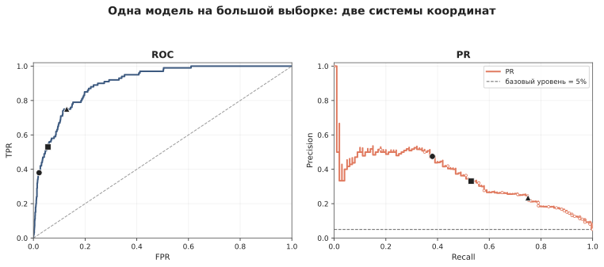

*Рисунок 14. При редком положительном классе baseline PR соответствует его распространённости, а не универсальному уровню.*

### 8.3. Average Precision — кратко

Для обобщённой оценки PR по разным порогам используют **Average Precision (AP)**. В простой ситуации с различными score AP можно понимать как среднюю precision в тех точках ранжированного списка, где встречается очередной положительный объект.

В нашем учебном наборе положительные объекты находятся на позициях 1, 3, 4, 7 и 9. Соответствующие значения precision: $1$, $2/3$, $3/4$, $4/7$, $5/9$. Их среднее равно

```math
\boxed{AP=\frac15\left(1+\frac23+\frac34+\frac47+\frac59\right)\approx0.709.}
```

В общем случае AP вычисляют как сумму значений precision, взвешенных на **прирост recall**. Такая запись корректно учитывает и одинаковые оценки. AP не тождественна трапецеидальной площади под PR, если точки соединены прямыми: метод интерполяции имеет значение. Подробный вывод нужен редко; важнее понимать, **насколько чистым остаётся список по мере включения положительных объектов**.

При этом даже высокая AP не отвечает автоматически на вопрос, сколько событий найдено **среди первых 100 кандидатов**, если у команды именно такой лимит. Для этой задачи следует дополнительно оценить top-100.

**Вывод разделов 7–8.** ROC и PR оценивают одну и ту же последовательность пороговых решений. ROC удобно читает доли найденных и ошибочно отмеченных внутри классов; PR — долю настоящих событий среди срабатываний. ROC-AUC и AP сводят ранжирование к числам, но практические ограничения требуют проверки конкретного участка кривой или конкретного порога.

## 9. Выбор оценки качества начинается с прикладного вопроса

Представим три разных применения бинарного классификатора.

**Медицинский скрининг.** Положительный прогноз означает приглашение на дополнительное обследование. Пропуск опасного случая может иметь высокую цену. В таком сценарии разумно сначала сформулировать требование к recall, а затем оценивать precision, число направленных пациентов и возможности следующего этапа.

**Поиск редких научных объектов.** Автоматическая система ранжирует кандидатов в пульсары, но специалисты успевают проверить только первые $100$. Здесь хорошая глобальная ROC-AUC ещё не гарантирует, что конкретная верхняя сотня будет лучшей. Непосредственный результат — сколько настоящих объектов попало в отобранный список. Можно сравнивать precision и recall верхних $k$ кандидатов, а AP использовать как дополнительную характеристику общего ранжирования.

**Оценка риска портфеля.** Банку иногда нужно не выбрать отдельных клиентов, а оценить ожидаемое число дефолтов во всей группе. Если вероятностные оценки содержательны, сумма $\sum_i\widehat p_i$ служит оценкой ожидаемого количества событий. Для такой задачи недостаточно, чтобы клиенты были правильно отсортированы: сами значения вероятностей имеют прямое значение.

Здесь мы подошли к третьему уровню оценки классификатора. Модель может хорошо различать высокий и низкий риск, но давать неверные численные вероятности. Это свойство нужно проверять отдельно.

## 10. Вероятностный прогноз: ранжировать правильно ещё недостаточно

Логистическая регрессия выдаёт числа в интервале $(0,1)$, но это гарантирует лишь **допустимый диапазон**, а не соответствие чисел действительным вероятностям. В предыдущем разделе мы увидели, что для оценки ожидаемого числа дефолтов по портфелю важна именно эта численная шкала, а не только порядок клиентов. Теперь разберём, как проверить её качество.

### 10.1. Одинаковый порядок, разные вероятности

Представим две модели, которые расположили всех клиентов одинаково: наиболее рискованные наверху, наименее рискованные внизу. Первая модель оценивает вероятность дефолта некоторой группе как $0.80$, а вторая — как $0.98$. Пока порядок объектов одинаков, **ROC-AUC и AP на одной и той же оценочной выборке не различают эти две шкалы**. Но если среди клиентов этой группы дефолт фактически происходит в 80% случаев, первая модель описывает численную вероятность лучше.

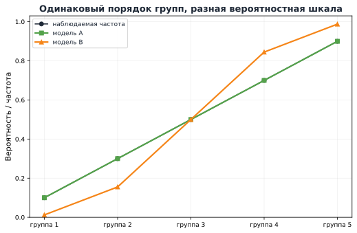

*Рисунок 15. Строго возрастающее преобразование оценок сохраняет ранжирование, но может резко изменить численные прогнозы вероятностей.*

Так возникает третья, отличная от качества решений и ранжирования задача: **насколько значения $\widehat p$ согласуются с наблюдаемыми частотами событий?**

### 10.2. Калибровка вероятностей

Если модель выдаёт примерно $0.8$ большой группе объектов, то среди них положительное событие должно происходить примерно в 80% случаев. Именно такое согласование называют **калибровкой вероятностей** (*probability calibration*).

Для идеальной калибровки формально требуется

```math
\boxed{P(Y=1\mid\widehat p(X)=s)=s}
```

для соответствующих значений $s$. Важно правильно прочитать это выражение: мы говорим **не об отдельном человеке или объекте**, у которого реализовался только один исход $0$ или $1$, а о частоте события среди множества объектов с похожим прогнозом.

В прикладной оценке точные совпадения чисел встречаются редко. Поэтому близкие предсказанные вероятности группируют в интервалы $B_k$. В каждом интервале сравнивают:

```math
\overline p_k=\frac{1}{|B_k|}\sum_{i\in B_k}\widehat p_i,
\qquad
\overline y_k=\frac{1}{|B_k|}\sum_{i\in B_k}y_i.
```

Первая величина — **средний прогноз**, вторая — **фактическая доля событий**. Отмечая точки $(\overline p_k,\overline y_k)$, получаем **калибровочную диаграмму** (*reliability diagram*).

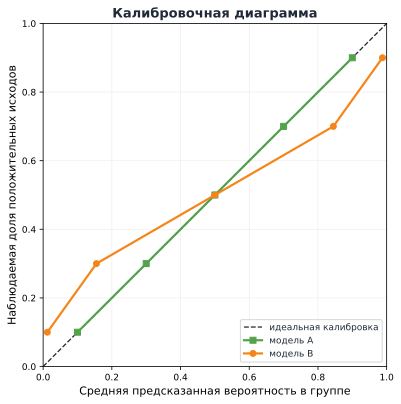

*Рисунок 16. Диагональ соответствует совпадению средней вероятности и наблюдаемой частоты. Точки ниже неё означают завышение вероятности, выше — занижение.*

Эта диаграмма — оценка по конечным данным, а не безошибочная проверка. При малом числе объектов в интервале наблюдаемая частота заметно шумит. Кроме того, её вид зависит от числа и границ интервалов. Поэтому для больших выводов о калибровке нужна достаточная оценочная выборка и осторожность при чтении графика.

Отдельно подчеркнём: **хорошая калибровка не означает хорошего ранжирования**. Если положительное событие встречается у 10% объектов, а модель каждому сообщает $0.1$, её общий прогноз может быть отлично согласован с частотой. Но она не различает объекты вообще. Другая модель может тоже быть хорошо откалибрована и при этом разделять группы с вероятностями $0.02$ и $0.18$, полезно ранжируя их по риску. Следовательно, одной калибровки недостаточно, чтобы судить о качестве индивидуального прогноза.

### 10.3. Log loss и Brier score: качество чисел в одной метрике

Выше log loss определяла **обучение** логистической регрессии. Но после фиксации модели ту же формулу можно вычислить на **отложенной оценочной выборке**:

```math
\mathrm{LogLoss}
=-\frac1m\sum_{i=1}^{m}
\left[y_i\log\widehat p_i+(1-y_i)\log(1-\widehat p_i)\right].
```

В этом случае log loss выступает уже как **метрика**, а не как инструкция подбора параметров. Она особенно сильно штрафует уверенные неправильные вероятностные прогнозы.

Другой показатель — **оценка Брайера** (*Brier score*) для бинарных событий:

```math
\mathrm{Brier}
=\frac1m\sum_{i=1}^{m}(y_i-\widehat p_i)^2.
```

Это средний квадрат ошибки, но в его аргументах — **вероятность** и бинарный исход. Обе метрики чувствительны к численной шкале, в отличие от ROC-AUC. При корректной вероятностной интерпретации меньшее значение соответствует лучшему вероятностному прогнозу на выбранных данных.

Однако log loss и Brier измеряют **общее качество вероятностного прогноза**, а не одну только калибровку: они также учитывают, насколько модель умеет различать более и менее рискованные объекты. Поэтому сравнение этих чисел и диаграмма калибровки дополняют друг друга. Подробную процедуру исправления некалиброванных вероятностей мы здесь не изучаем.

**Итак, три свойства нельзя подменять друг другом:** решение оценивают после выбора порога, ранжирование — через порядок объектов и соответствующие кривые, числовую вероятностную шкалу — через сопоставление прогнозов с исходами. При этом калибровочная диаграмма и log loss/Brier отвечают на разные вопросы о вероятностных прогнозах и дополняют друг друга.

## 11. От модели до решения и оценки качества

Вернёмся к задаче, с которой началась лекция: по признакам транзакции оценить риск мошенничества, а затем решить, требуется ли дополнительная проверка. За этот путь мы фактически выполнили **две разные задачи**: обучили вероятностную модель и выбрали способ применять её прогнозы.

### 11.1. Как получаем вероятностную модель

1. Определяем бинарную целевую переменную и момент, когда известны признаки.
2. Выбираем **семейство моделей**: логистическую регрессию, где $z_\beta(x)=\beta_0+x^\top\beta$, а $p_\beta(x)=\sigma(z_\beta(x))$.
3. Задаём **вероятностное описание** бинарного исхода через Бернулли.
4. Получаем **целевую функцию** — среднюю log loss (при необходимости дополняем её регуляризацией).
5. **Оптимизатор** подбирает коэффициенты $\widehat\beta$ на обучающих данных.

Таким образом, обучение заканчивается **оценёнными параметрами и функцией прогноза вероятности**, а не приказом автоматически проверять или блокировать конкретную транзакцию.

### 11.2. Как прогноз превращаем в действие

Для нового объекта считаем:

```math
x\ \longrightarrow\ \widehat z(x)
\ \longrightarrow\ \widehat p(x)
\ \xrightarrow{\text{выбранное правило}}\ \text{действие}.
```

Если решение бинарно, правило может использовать порог $t$. Но его значение определяется ценой FP/FN, ограничением ресурса и другими требованиями задачи. Подбирая порог на validation, мы настраиваем **систему принятия решения**, а не переобучаем саму логистическую модель. После фиксации всех настроек оцениваем её на независимом test.

### 11.3. Как отвечаем на вопрос «хорошо ли работает?»

Ни одного числа, одинаково достаточного для всех применений, нет.

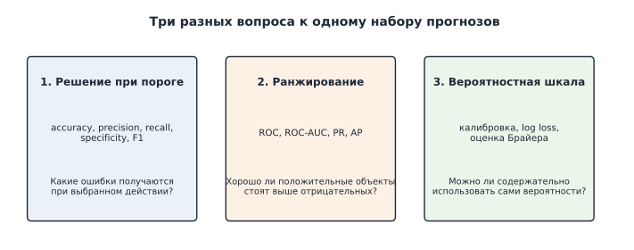

*Рисунок 17. Для одной и той же модели различаются качество порогового решения, ранжирования и вероятностных оценок.*

| Что требуется от системы | Что проверяем | Подходящие инструменты |
|---|---|---|
| **Действие / класс** | Кого ошибочно включили и кого пропустили при выбранном правиле? | Матрица ошибок, precision, recall, specificity, F1, число срабатываний |
| **Ранжирование / очередь** | Ставим ли события выше несобытий и насколько хорош выбранный верхний фрагмент списка? | ROC-AUC, ROC, PR, AP, precision@k / recall@k |
| **Численный риск** | Согласуются ли предсказываемые вероятности с наблюдаемыми исходами? | Калибровочная диаграмма, log loss, Brier |

Это не три независимых классификатора, а три способа задать вопрос **одним и тем же прогнозам**. Высокая ROC-AUC не определяет правильный порог, высокая precision может сопровождаться низкой полнотой, а хорошая калибровка не гарантирует полезного ранжирования.

Именно поэтому проектирование классификатора начинается с предметной задачи, а не с выбора любимой метрики. На следующей неделе мы расширим постановку на несколько классов и разберём, как организовать честное сравнение моделей: регуляризацию, kNN, кросс-валидацию, обучаемые преобразования и защиту от утечек.

## Вопросы для самопроверки

1. Почему условное среднее бинарного ответа равно вероятности положительного класса?
2. Когда линейная модель вероятности может служить осознанной аппроксимацией? Почему она не гарантирует допустимую вероятность для новых объектов?
3. Чем шансы отличаются от вероятности? Чему равны шансы и логит при $p=0.2$?
4. Почему логистическая регрессия делает линейным logit, а не вероятность?
5. Что означает $e^{\beta_j}$? Почему удвоение шансов не означает удвоения вероятности?
6. Как из модели Бернулли и принципа максимального правдоподобия возникает log loss?
7. Почему ожидаемая log loss минимальна при прогнозе истинной условной вероятности? Почему из этого не следует хорошая калибровка любой обученной модели?
8. Как связаны градиент $X^\top(p-y)/n$ и известное правило градиентного спуска?
9. Чем различаются линейная оценка, предсказанная вероятность и метка класса? Какие роли выполняют `decision_function`, `predict_proba`, `predict`?
10. Как читаются четыре клетки матрицы ошибок? Почему positive не означает «хороший исход»?
11. Чем отличаются знаменатели precision, recall и specificity?
12. Почему высокая accuracy может скрывать неумение находить редкие события? Чем здесь полезна balanced accuracy?
13. Чем $F_\beta$ отличается от $F_1$? Почему F-мера не заменяет прикладную оценку стоимости ошибок?
14. Что произойдёт с recall при снижении порога? Почему precision может изменяться в обе стороны?
15. Какие разные ограничения на решение возникают при скрининге, автоматической блокировке и ограниченной очереди проверок?
16. При каких предпосылках получается порог $c_{FP}/(c_{FP}+c_{FN})$?
17. Почему нельзя выбирать порог по тестовой выборке?
18. Как последовательное снижение порога формирует ROC-кривую? Что меняется, когда через порог проходит положительный или отрицательный объект?
19. Что означает ROC-AUC в терминах положительно-отрицательных пар? Почему это не accuracy?
20. Почему одна ROC-точка может соответствовать низкой precision при редком положительном классе?
21. Что показывает PR-кривая? Как объяснить AP на ранжированном списке без подробного вывода формул?
22. Почему две модели могут иметь одинаковые ROC-AUC и AP, но разные численные вероятности?
23. Что показывает калибровочная диаграмма? Почему хорошая калибровка не означает хорошего ранжирования?
24. Чем различаются log loss как критерий обучения и log loss на отложенной оценочной выборке?


## Что почитать дальше

- **James G., Witten D., Hastie T., Tibshirani R., Taylor J. — _An Introduction to Statistical Learning with Applications in Python_, Chapter 4, §§4.2–4.3.** Переход от линейной модели вероятности к логистической регрессии, интерпретация коэффициентов, likelihood и применение классификации. [Официальный сайт](https://www.statlearning.com/).
- **Дьяконов А. Г. — _Машинное обучение и анализ данных_.** Подробный русскоязычный разбор бинарных метрик, ROC и задач оценки качества. [Репозиторий книги](https://github.com/Dyakonov/MLDM_BOOK).
- **Соколов Е. А. — _Машинное обучение 1_, лекции и семинары по линейной классификации.** Более математический подход к log loss, градиентам, кодировкам классов, ROC-AUC и методам обучения. [Материалы курса](https://github.com/esokolov/ml-course-hse/tree/master/ml1-2026-spring).
- **Machine Learning in Python with scikit-learn MOOC — _Classification metrics_.** Короткие воспроизводимые примеры confusion matrix, precision/recall, дисбаланса и кривых качества. [Учебный материал](https://inria.github.io/scikit-learn-mooc/python_scripts/metrics_classification.html).
- **scikit-learn User Guide.** Практический справочник по [метрикам](https://scikit-learn.org/stable/modules/model_evaluation.html), [выбору порога](https://scikit-learn.org/stable/modules/classification_threshold.html) и [калибровке вероятностей](https://scikit-learn.org/stable/modules/calibration.html).
- **Hardt M., Recht B. — _Patterns, Predictions, and Actions_, раздел _Decision Making_.** Связь статистического прогноза с действием, ограничениями и последствиями ошибок. [Открытая книга](https://mlstory.org/decision.html).
- **Fawcett T. — _An Introduction to ROC Analysis_. Pattern Recognition Letters, 2006.** Геометрия ROC-пространства, рабочие режимы и чтение ROC-AUC. [DOI](https://doi.org/10.1016/j.patrec.2005.10.010).
- **Davis J., Goadrich M. — _The Relationship Between Precision-Recall and ROC Curves_. ICML, 2006.** Математическая связь между кривыми ROC и PR. [Открытая версия](https://mlanthology.org/icml/2006/davis2006icml-relationship/).
- **Murphy K. P. — _Probabilistic Machine Learning: An Introduction_.** Вероятностная постановка классификации, log loss и теория решений. [Официальная страница](https://probml.github.io/pml-book/).
