# Регуляризация, кросс-валидация и выбор модели

В предыдущих главах мы последовательно разобрали линейную регрессию, функции потерь и обучение моделей, а затем перешли к бинарной классификации, логистической регрессии и оцениванию её прогнозов. Теперь вернёмся к вопросу, который возникает почти в любом машинном обучении: **как выбрать модель и её настройки, чтобы хорошие результаты на имеющихся данных не оказались случайностью?**

Здесь есть две разные задачи. Первая относится к самому правилу обучения: как ограничить чрезмерную подгонку и получить менее чувствительные к особенностям выборки коэффициенты? Для линейных моделей эту задачу будем решать с помощью **регуляризации**. Вторая относится к проверке результата: как сравнивать несколько вариантов модели, если оценка на одном случайном разбиении данных может быть неустойчивой? Для этого изучим **кросс-валидацию** и подбор гиперпараметров.

Затем познакомимся с методом $k$ ближайших соседей (*k-nearest neighbors*, **kNN**). В отличие от линейных моделей он строит прогноз по соседним обучающим наблюдениям, однако вопрос о выборе сложности и честной оценке качества остаётся тем же. Наконец, расширим знакомую бинарную классификацию на несколько классов: разберём стратегии **One-vs-Rest**, **softmax-регрессию** и способы усреднения классификационных метрик.

Все эти методы соединяются в одну практическую процедуру: подготовить данные, выбрать семейства моделей, определить гиперпараметры, сравнить варианты по корректной проверке и обучить окончательную модель. Программную реализацию такой процедуры с помощью `Pipeline`, `ColumnTransformer` и `GridSearchCV` разберём отдельно на семинаре.

## 1. Хорошая подгонка ещё не означает хороший прогноз

При обучении мы минимизируем некоторую функцию потерь на наблюдаемых объектах. Например, для линейной регрессии с $p$ признаками

```math
f_{\beta_0,\beta}(x)=\beta_0+x^\top\beta
=\beta_0+\sum_{j=1}^p\beta_jx_j,
```

где $\beta_0$ — свободный член, а $\beta=(\beta_1,\ldots,\beta_p)^\top$ — коэффициенты при признаках. Метод наименьших квадратов выбирает их, минимизируя среднюю квадратичную ошибку:

```math
R_n(\beta_0,\beta)=\frac1n\sum_{i=1}^n
\left(y_i-\beta_0-x_i^\top\beta\right)^2.
\qquad\text{(1)}
```

Индекс $n$ напоминает, что **эмпирический риск** вычислен по конкретной выборке из $n$ объектов. Малое значение $R_n$ означает хорошее соответствие *этим* наблюдениям. Для новых объектов ошибка может оказаться значительно выше, особенно если модель использует случайные особенности данных. Это и есть знакомая проблема **переобучения** (*overfitting*).


*Рисунок 1. Иллюстративная зависимость обучающей и проверочной ошибок от гибкости модели. Это не универсальный закон о монотонности test-ошибки, а схема возможного поведения.*

### 1.1. Похожие признаки и неустойчивые коэффициенты

Особенно наглядна проблема в линейной модели с сильно связанными признаками. Допустим, стоимость условной квартиры прогнозируется по общей площади $x_1$ и жилой площади $x_2$; свободный член для простоты положим равным нулю. Сравним две модели:

```math
f_A(x)=3x_1-3x_2,\qquad f_B(x)=x_1.
```

| Квартира | Общая площадь $x_1$ | Жилая площадь $x_2$ | $f_A(x)$ | $f_B(x)$ |
|---|---:|---:|---:|---:|
| 1 | 60 | 40 | 60 | 60 |
| 2 | 75 | 50 | 75 | 75 |
| Новая | 60 | 50 | 30 | 60 |

На двух исходных объектах прогнозы полностью совпадают: там $x_2=\tfrac23x_1$. Но для нового соотношения площадей результаты различаются вдвое. Из одного только совпадения на известных примерах мы ещё не можем решить, какая модель лучше для новых квартир.


*Рисунок 2. На наблюдениях с близким соотношением признаков модели трудно различить по качеству подгонки, хотя их поведение при изменении этого соотношения разное.*

В предельном случае $x_2=x_1$ прогноз зависит лишь от суммы коэффициентов:

```math
f_\beta(x)=(\beta_1+\beta_2)x_1.
```

Поэтому все пары с $\beta_1+\beta_2=1$ дают одинаковый прогноз на этих данных. Но величина их коэффициентов различается:

| $\beta_1$ | $\beta_2$ | $\beta_1+\beta_2$ | $\beta_1^2+\beta_2^2$ |
|---:|---:|---:|---:|
| 3 | −2 | 1 | 13 |
| 1 | 0 | 1 | 1 |
| 0,5 | 0,5 | 1 | 0,5 |

Если у нового объекта $x_2=x_1+\delta$, прогноз уже равен $x_1+\beta_2\delta$. Даже небольшое отклонение $\delta$ по-разному воздействует на модели с разными коэффициентами.

Так проявляется знакомая по линейной регрессии **мультиколлинеарность**. При точно зависимых столбцах МНК может не определять коэффициенты однозначно. При почти зависимых столбцах небольшое изменение данных способно заметно изменить отдельные коэффициенты.

Важно различать **устойчивость коэффициентов** и **качество прогноза**. Два неустойчивых коэффициента могут меняться в противоположных направлениях так, что итоговые прогнозы почти не изменятся. Следовательно, нельзя судить о качестве модели только по размеру или разбросу её коэффициентов.

### 1.2. Можно ли изменить правило выбора коэффициентов?

МНК выбирает параметры только по величине суммы квадратов остатков. Если несколько решений обеспечивают почти одинаковую подгонку, можно предпочесть одно из них на основании дополнительного требования — например, не допускать слишком больших коэффициентов. Такой способ изменения процедуры обучения называется **регуляризацией** (*regularization*).

Управлять гибкостью можно по-разному: ограничивать глубину дерева, число используемых признаков, величину коэффициентов или сложность другого компонента модели. Далее сосредоточимся на регуляризации линейных моделей. Она удобна тем, что позволяет увидеть и саму идею, и математические последствия её применения.

## 2. Регуляризация линейных моделей

### 2.1. От ограничения коэффициентов к штрафной функции

Вектор коэффициентов $\beta$ имеет евклидову, или $L_2$-норму

```math
\|\beta\|_2=\sqrt{\beta_1^2+\cdots+\beta_p^2}.
```

Её квадрат $\|\beta\|_2^2=\sum_{j=1}^p\beta_j^2$ удобно использовать как измеритель общей величины коэффициентов. Можно искать наилучшую подгонку только среди векторов, удовлетворяющих ограничению:

```math
\min_{\beta_0,\beta} R_n(\beta_0,\beta)
\quad\text{при условии}\quad \|\beta\|_2^2\le t.
\qquad\text{(2)}
```

Чем меньше допустимое $t$, тем уже множество коэффициентов, из которых разрешено выбирать. Если наилучшее решение МНК уже лежит внутри этого множества, дополнительное ограничение может не повлиять на результат.

Вместо жёсткого ограничения удобно добавить величину $\|\beta\|_2^2$ к функции, которую минимизируем:

```math
\boxed{
J_{\lambda}^{\mathrm{Ridge}}(\beta_0,\beta)
=R_n(\beta_0,\beta)+\lambda\|\beta\|_2^2
},\qquad \lambda\ge0.
\qquad\text{(3)}
```

Это критерий **Ridge-регрессии** (*гребневая регрессия*). Первое слагаемое поощряет точность подгонки; второе — умеренные значения коэффициентов. Параметр $\lambda$ определяет относительную силу этих требований.

- При $\lambda=0$ критерий совпадает с МНК.
- При положительном $\lambda$ модель может согласиться на некоторый рост обучающей MSE, если это позволяет заметно уменьшить норму коэффициентов.
- При увеличении $\lambda$ обычно усиливается сжатие коэффициентов к нулю, хотя отдельные коэффициенты при коррелирующих признаках не обязаны меняться монотонно.

Задачи (2) и (3) связаны через множитель Лагранжа. Для подходящих соответствующих значений $t$ и $\lambda$ их оптимальные решения совпадают; это не означает, что $t=\lambda$ или что каждому произвольному $t$ отвечает единственный $\lambda$. В штрафной форме легче проводить численную оптимизацию и сравнивать разные уровни регуляризации.

**Почему свободный член $\beta_0$ не участвует в штрафе?** Он отвечает за общий сдвиг прогноза. Если все целевые значения увеличились на одну константу, естественно изменить intercept на ту же константу, не пересматривая степень регуляризации наклонов. По этой причине стандартная Ridge-регрессия не штрафует $\beta_0$.

### 2.2. Как Ridge выбирает между одинаково подогнанными решениями

Вернёмся к паре совпадающих признаков $x_1=x_2$. Пусть для хорошей подгонки достаточно условия $\beta_1+\beta_2=1$. Минимум штрафа среди таких пар найдём из

```math
\beta_1^2+\beta_2^2
=\frac{(\beta_1+\beta_2)^2}{2}
+\frac{(\beta_1-\beta_2)^2}{2}
=\frac12+\frac{(\beta_1-\beta_2)^2}{2}.
```

Наименьшая величина здесь равна $\tfrac12$ и достигается при $\beta_1=\beta_2=\tfrac12$. Таким образом, если прогнозы одинаковы, L2-штраф предпочитает *разделить общий вклад между одинаковыми признаками*, а не компенсировать большой положительный коэффициент большим отрицательным.

Это показывает важное свойство Ridge в понятном частном случае. Но регуляризация не гарантирует меньшую ошибку на новых данных: уменьшение изменчивости оценок может сопровождаться дополнительным смещением прогноза. Проверять фактическую пользу придётся на отложенных наблюдениях.

### 2.3. Матричное решение Ridge и устойчивость

Для МНК мы получили нормальные уравнения. Аналогичная конструкция возникает и для Ridge. Здесь $X\in\mathbb R^{n\times p}$ содержит только значения признаков, **без столбца единиц**, $y\in\mathbb R^n$, а свободный член $\beta_0$ рассматривается отдельно. Ниже $I=I_p$ — единичная матрица размера $p\times p$. Чтобы не штрафовать intercept, сначала центрируем признаки и ответы:

```math
X_c=X-\mathbf1\bar x^\top,\qquad
y_c=y-\bar y\mathbf1,
```

где $\bar x$ — вектор средних значений столбцов $X$, а $\bar y$ — среднее по $y$. Для фиксированного $\beta$ оптимальный свободный член равен

```math
\hat\beta_0=\bar y-\bar x^\top\beta.
```

Поэтому задачу можно переписать без отдельного intercept:

```math
J_\lambda(\beta)=\frac1n\|y_c-X_c\beta\|_2^2+\lambda\|\beta\|_2^2.
```

Взяв градиент по $\beta$ и приравняв его нулю, получим

```math
-\frac2nX_c^\top(y_c-X_c\beta)+2\lambda\beta=0,
```

откуда

```math
\boxed{
(X_c^\top X_c+n\lambda I)\hat\beta=X_c^\top y_c
}.
\qquad\text{(4)}
```

При $\lambda>0$ матрица слева всегда обратима, поскольку для любого ненулевого $v$

```math
v^\top(X_c^\top X_c+n\lambda I)v
=\|X_cv\|_2^2+n\lambda\|v\|_2^2>0.
```

Следовательно, при выбранной нормировке

```math
\boxed{
\hat\beta_{\mathrm{Ridge}}
=(X_c^\top X_c+n\lambda I)^{-1}X_c^\top y_c
},\qquad \lambda>0.
\qquad\text{(5)}
```

Даже если столбцы $X_c$ линейно зависимы, регуляризованная матрица остаётся положительно определённой. Это обеспечивает единственность решения по коэффициентам. На практике, как и для МНК, выражение с обратной матрицей описывает математический ответ, а не предписывает явно вычислять `inv`: численные библиотеки применяют устойчивые решатели.

Улучшение обусловленности объясняет, почему Ridge часто стабилизирует коэффициенты. Важно, однако, не обещать абсолютной устойчивости прогнозов на любых новых данных: всё зависит от распределения признаков, шума и выбранной силы регуляризации.


*Рисунок 3. В специально построенном примере с сильно связанными признаками Ridge делает оценённые коэффициенты менее изменчивыми между обучающими выборками. На рисунке оценивается устойчивость коэффициентов, а не test-качество.*

### 2.4. Траектории коэффициентов и выбор масштаба признаков

Пусть мы обучаем Ridge на одном и том же датасете при последовательности значений $\lambda$. Для каждого признака можно построить зависимость $\hat\beta_j(\lambda)$. Такие линии называют **траекториями коэффициентов** (*coefficient paths*).

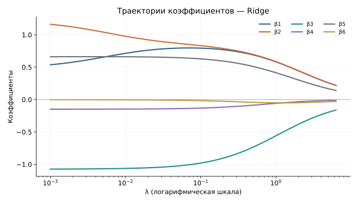

*Рисунок 4. Пример коэффициентных траекторий Ridge: при усилении штрафа коэффициенты в целом приближаются к нулю.*

На таких графиках видно, как дополнительное ограничение изменяет параметры модели. Но по траектории отдельного коэффициента нельзя определить, какая настройка лучше предсказывает новые ответы. Для этого понадобится кросс-валидация.

Есть и практическая трудность. Если один признак — площадь в квадратных метрах, а другой — та же площадь в тысячах квадратных метров, одинаковый физический вклад в прогноз соответствует разным по модулю коэффициентам. При этом L2-штраф зависит именно от чисел $\beta_j$. Следовательно, **смена единиц измерения признаков меняет регуляризованную задачу**.

Поэтому числовые признаки перед Ridge и Lasso часто приводят к сопоставимым масштабам. Например, стандартизируют:

```math
z_j=\frac{x_j-\mu_j}{s_j},
```

где $\mu_j$ и $s_j$ — среднее и стандартное отклонение признака, оценённые по обучающим данным. Масштабирование не гарантирует полезности признаков и должно оцениваться как часть выбранной процедуры обучения. Технически правильно организовать его внутри CV мы научимся на семинаре.

### 2.5. Lasso: штраф по сумме модулей

Ridge ограничивает сумму квадратов коэффициентов. Но иногда хотелось бы, чтобы часть признаков получила **ровно нулевой** коэффициент и перестала участвовать в прогнозе. Для этого рассмотрим другую норму:

```math
\|\beta\|_1=\sum_{j=1}^{p}|\beta_j|.
```

Штрафная задача **Lasso** (*least absolute shrinkage and selection operator*) имеет вид

```math
\boxed{
J_{\lambda}^{\mathrm{Lasso}}(\beta_0,\beta)
=R_n(\beta_0,\beta)+\lambda\|\beta\|_1
},\qquad \lambda\ge0.
\qquad\text{(6)}
```

Обе модели сдерживают величину коэффициентов, но Lasso способна получать **разреженные** (*sparse*) решения: для некоторых $j$ выполняется $\hat\beta_j=0$.

Почему возникает такая разница? Рассмотрим пространство двух коэффициентов. Если два столбца центрированной матрицы признаков линейно независимы, решение МНК единственно, а линии уровня квадратичной ошибки вокруг него имеют вид невырожденных эллипсов. При условии $\|\beta\|_2\le r$ допустимая область — круг, а при $\|\beta\|_1\le t$ — ромб с вершинами на осях координат.

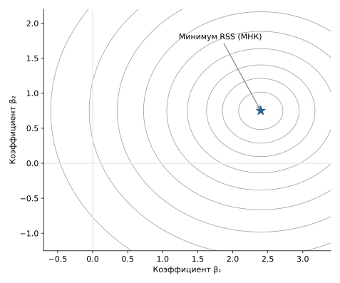

*Рисунок 5. Линии одинаковой ошибки на плоскости двух коэффициентов при единственном решении МНК; без ограничения выбирается центр вложенных эллипсов.*

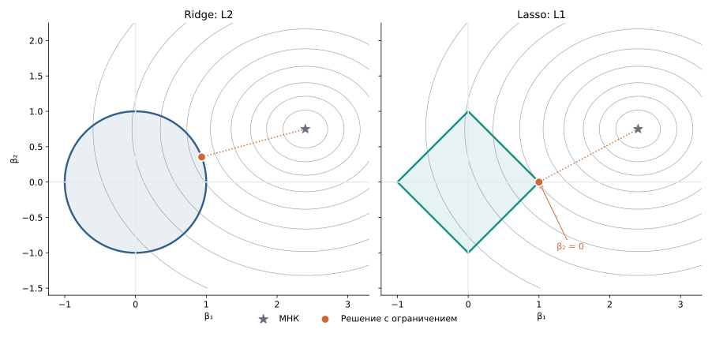

*Рисунок 6. При наложении ограничения мы ищем линию уровня наименьшей ошибки, которая достигает допустимой области. У ромба L1 есть вершины на координатных осях, поэтому касание чаще может происходить при нулевом коэффициенте.*

Геометрическая интуиция не означает, что любое решение Lasso обязано лежать в вершине или что Ridge вообще никогда не даёт нулей. Для конкретной выборки положение минимума и форма линий уровня имеют значение.


*Рисунок 7. L1-область допускает как решение с одним нулевым коэффициентом в вершине ромба, так и решение на стороне ромба, когда оба коэффициента ненулевые.*

#### Откуда берётся точный ноль: одномерный пример

Геометрию можно дополнить небольшим точным расчётом. Пусть задача для одного коэффициента имеет вид

```math
J_\lambda(b)=(b-2)^2+\lambda|b|.
\qquad\text{(7)}
```

При $\lambda=0$ минимум находится в $b=2$. Для $b>0$ производная равна $2(b-2)+\lambda$, и стационарная точка получается при

```math
b=2-\frac\lambda2.
```

Она находится в положительной области только при $\lambda<4$. Для отрицательных $b$ производная равна $2(b-2)-\lambda<0$, так что движение вправо уменьшает функцию. Когда $\lambda\ge4$, движение вправо из нуля уже тоже не уменьшает значение $J_\lambda$. Поэтому минимум достигается в нуле:

```math
\boxed{\hat b_\lambda=\max\!\left(2-\frac\lambda2,\,0\right).}
\qquad\text{(8)}
```

| $\lambda$ | 0 | 1 | 2 | 3 | 4 | 5 |
|---:|---:|---:|---:|---:|---:|---:|
| $\hat b_\lambda$ | 2 | 1,5 | 1 | 0,5 | 0 | 0 |


*Рисунок 8. L1-штраф не просто уменьшает коэффициент: после некоторого порога оптимум становится точно равным нулю.*

Этот простой механизм связан с **soft-thresholding**, который появляется при решении Lasso. В многомерной задаче признаки могут быть коррелированы, поэтому поведение каждого коэффициента зависит и от остальных.

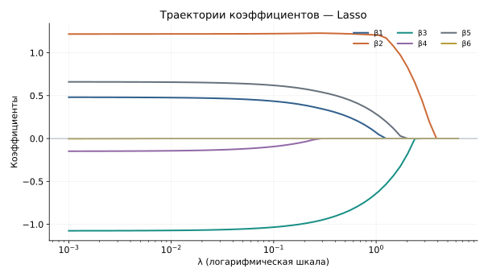

*Рисунок 9. Некоторые коэффициенты Lasso становятся нулевыми при усилении регуляризации, другие остаются ненулевыми дольше.*

Ненулевой коэффициент не доказывает, что переменная причинно связана с ответом; нулевой не доказывает, что переменная бесполезна. При сильно коррелирующих признаках Lasso может выбирать один из нескольких близких заменителей, и выбранный набор способен меняться между выборками. Её следует рассматривать как метод обучения и потенциального отбора признаков, а не как автоматическую процедуру установления «истинных факторов».

### 2.6. Elastic Net: два вида штрафа в одной модели

**Elastic Net** сочетает L1 и L2. При одной распространённой параметризации его критерий записывается как

```math
J_{\lambda,\rho}(\beta_0,\beta)
=R_n(\beta_0,\beta)
+\lambda\left(\rho\|\beta\|_1+(1-\rho)\|\beta\|_2^2\right),
\quad 0\le\rho\le1.
\qquad\text{(9)}
```

Это концептуальная параметризация; в конкретных библиотеках нормирующие множители и имена параметров могут различаться. При $\rho=1$ остаётся L1-компонент, при $\rho=0$ — L2-компонент. В промежуточном случае модель одновременно допускает зануление части коэффициентов и штрафует крупные значения остальных. Такой подход бывает полезен при группах коррелирующих признаков.

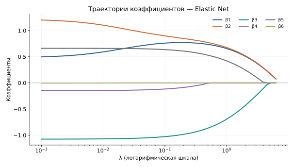

*Рисунок 10. Пример изменения коэффициентов при комбинированной регуляризации.*

Практически полезно помнить: новые гиперпараметры не становятся известны автоматически. Силу штрафа и баланс L1/L2 требуется обосновывать по проверочным данным, а не по величине обучающей ошибки.

### 2.7. Регуляризация логистической регрессии

Идея штрафа относится не только к МНК. В бинарной логистической регрессии мы минимизировали среднюю log-loss. Если $w$ — коэффициенты при признаках, её L2-регуляризованный вариант имеет вид

```math
J_\lambda(w_0,w)
=-\frac1n\sum_{i=1}^{n}
\left[y_i\log p_i+(1-y_i)\log(1-p_i)\right]
+\lambda\|w\|_2^2,
\qquad\text{(10)}
```

где $p_i=\sigma(w_0+x_i^\top w)$. Регуляризация снова воздействует на выбор коэффициентов, но сам тип потерь теперь соответствует классификации.

Есть показательный случай: данные **линейно разделимы**. Возьмём два наблюдения с $x=-1,y=0$ и $x=1,y=1$, модель $p(x)=\sigma(bx)$ и нулевой intercept. При любом $b>0$ классы уже разделены правильно, но средняя log-loss равна

```math
R(b)=\log(1+e^{-b}).
```

По мере роста $b$ эта величина стремится к нулю, не достигая нуля ни при каком конечном $b$. Поэтому нерегуляризованная задача в этом примере **не имеет конечного минимизатора**. Добавление $\lambda b^2$ при $\lambda>0$ меняет ситуацию: чрезмерно большой коэффициент становится невыгодным, и достигается конечный минимум.


*Рисунок 11. Регуляризация ограничивает рост коэффициентов при разделимых классах; штраф влияет на вероятностные прогнозы даже там, где граница между классами остаётся прежней.*

В `sklearn.linear_model.LogisticRegression` силу регуляризации обычно задают параметром `C`: **меньше `C` — сильнее регуляризация; больше `C` — слабее**. Это обратная по смыслу шкала по отношению к $\lambda$ в наших формулах. Точное численное соответствие зависит от нормировки функции потерь, типа штрафа и настроек реализации, поэтому механически приравнивать $\lambda=1/C$ без уточнения соглашений нельзя.

### 2.8. Что мы получили

Ridge, Lasso и Elastic Net не создают нового типа зависимости от признаков: прогноз остаётся линейной комбинацией. Меняется **процедура выбора коэффициентов**. Она может повысить устойчивость, снизить переобучение или сделать решение разреженным. Однако выбор конкретного штрафа и его силы — самостоятельная задача. Даже математически удобная регуляризация способна ухудшить качество прогноза, если выбран слишком большой штраф или нарушен смысл масштаба признаков.

Чтобы выбирать настройки не по обучающей ошибке, нужен метод оценивания на данных, не участвовавших в соответствующем обучении.

## 3. Кросс-валидация: оценивание процедуры обучения

### 3.1. Почему одной проверочной выборки может быть недостаточно

На первой неделе мы отделили данные, используемые для разработки модели, от данных для окончательной проверки. Для конкретного разбиения `train/validation` всё выглядит понятно: обучаем модель на `train`, строим прогнозы для `validation` и вычисляем выбранную метрику. Но **оценка зависит от того, какие именно объекты попали в проверочную часть**.

Представим датасет с неоднородными объектами. В одной случайной проверочной части могут оказаться главным образом типичные наблюдения, в другой — редкие случаи, сложные для классификатора. Даже если алгоритм и его параметры неизменны, значения validation-метрики будут разными.

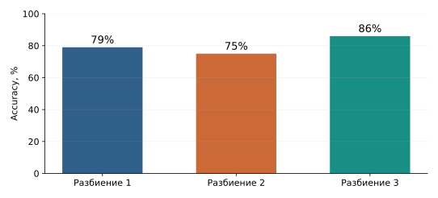

*Рисунок 12. Однократная отложенная проверка может давать разные оценки качества для одной и той же процедуры обучения при изменении состава выборок.*

Отсюда возникает идея: вместо единственного разделения организовать несколько обучений на разных частях исходных данных и несколько отложенных проверок. При каждом таком обучении объект, на котором измеряем качество, должен оставаться за пределами соответствующей обучающей части.

**Кросс-валидация** (*cross-validation*, CV) — семейство процедур, которые организуют повторные обучения и проверки по заранее определённой схеме разбиения. Нас будет прежде всего интересовать $K$-fold CV.

### 3.2. Как устроена K-fold cross-validation

Разделим доступные для разработки модели наблюдения на $K$ непересекающихся частей — **фолдов** (*folds*). Каждая часть по очереди становится validation, а остальные $K-1$ частей объединяются в train.

При $K=5$ получится следующая схема:

| Обучение | Фолд 1 | Фолд 2 | Фолд 3 | Фолд 4 | Фолд 5 |
|---|---|---|---|---|---|
| 1 | **Validation** | Train | Train | Train | Train |
| 2 | Train | **Validation** | Train | Train | Train |
| 3 | Train | Train | **Validation** | Train | Train |
| 4 | Train | Train | Train | **Validation** | Train |
| 5 | Train | Train | Train | Train | **Validation** |

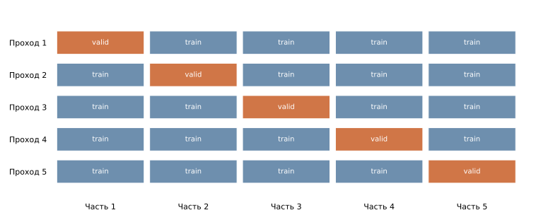

*Рисунок 13. На каждом проходе процедура обучения запускается заново. Каждый объект один раз используется для проверки, но может несколько раз входить в обучающие части.*

Обратите внимание на несколько принципиальных деталей.

Во-первых, это **пять разных обученных моделей**, а не одна модель, которую пять раз проверяют. При каждом обучении коэффициенты, состояние предобработки и другие зависящие от данных величины должны определяться заново по соответствующей обучающей части.

Во-вторых, метрика на очередном validation-фолде измеряется на объектах, по которым именно эта модель не обучалась.

В-третьих, при обычном K-fold каждый объект входит в validation ровно один раз. Это позволяет использовать все имеющиеся для разработки наблюдения для проверки, не требуя пяти отдельных непересекающихся датасетов.

### 3.3. Как получить одно число из $K$ оценок

Обозначим фиксированную конфигурацию процедуры обучения через $\theta$. Это может быть, например, Ridge с данным $\lambda$, логистическая регрессия с данным `C` или kNN с данным числом соседей.

Пусть после обучения без $k$-го фолда получена модель $\hat f_\theta^{(-k)}$. Её качество измеряется на объектах фолда $V_k$. Для квадратичной ошибки:

```math
\mathrm{MSE}_k(\theta)
=\frac{1}{|V_k|}\sum_{i\in V_k}
\left(y_i-\hat f_\theta^{(-k)}(x_i)\right)^2.
```

Если фолды имеют одинаковый размер, стандартная средняя CV-ошибка равна

```math
\boxed{
\mathrm{CV\!\text{-}MSE}(\theta)
=\frac1K\sum_{k=1}^K\mathrm{MSE}_k(\theta)
}.
\qquad\text{(11)}
```

Например, при пяти фолдах модель дала MSE, равные $2{,}3$, $2{,}7$, $2{,}4$, $3{,}1$ и $2{,}5$. Тогда

```math
\mathrm{CV\!\text{-}MSE}
=\frac{2{,}3+2{,}7+2{,}4+3{,}1+2{,}5}{5}
=2{,}6.
```

Это **среднее из пяти проверочных ошибок пяти обученных моделей**. Число $2{,}6$ не является обучающей ошибкой модели, обученной на всей исходной выборке.

При неравных размерах фолдов можно различать среднее *по фолдам* и среднюю ошибку *по всем проверенным объектам*: для MSE вторую величину получим, взвесив $\mathrm{MSE}_k$ пропорционально $|V_k|$. В обычном K-fold размеры фолдов почти одинаковы, поэтому разница обычно невелика. Для нелинейных метрик вроде F1 среднее из фолдовых F1 и F1 по объединённым предсказаниям в общем случае не совпадают. Нужно понимать, какую именно величину возвращает выбранная процедура оценивания.

### 3.4. Что означает разброс результатов по фолдам

Пять чисел полезны не только для вычисления среднего. Если по одним фолдам ошибка близка к единице, а по другим — к десяти, следует разобраться, почему результаты отличаются: возможно, в отдельных частях выборки больше редких объектов, сложных групп или нетипичных значений признаков.

Но **стандартное отклонение по фолдам не является автоматически стандартной ошибкой оценки качества модели**. Обучающие части разных фолдов сильно пересекаются; кроме того, фолды могут различаться собственной сложностью. Поэтому нельзя без дополнительных предпосылок трактовать пять фолдовых результатов как пять независимых экспериментов и строить из них обычный доверительный интервал для качества финальной модели.

Кросс-валидация помогает судить о типичном поведении *процедуры обучения* при данном механизме разбиения. Она не отменяет ограничений самой выборки и не гарантирует, что будущие данные будут устроены точно так же.

### 3.5. Как выбирать число фолдов

Популярные значения — $K=5$ и $K=10$. При меньшем числе фолдов каждая модель обучается на меньшей доле имеющихся наблюдений, зато обучений требуется меньше. При большем $K$ обучающая часть каждого прохода становится ближе по размеру к полной выборке, но вычислительная стоимость растёт. При $K=n$ получается leave-one-out CV: каждый раз проверяем ровно один объект, а обучение повторяем $n$ раз.

Увеличение $K$ не гарантирует монотонного уменьшения всех составляющих ошибки оценивания. Выбор зависит от размера выборки, вычислительной стоимости модели, целевой метрики и устройства данных. Для первого практического знакомства обычно достаточно стратифицированной пятифолдовой схемы.

### 3.6. Не все разбиения одинаково подходят задаче

Сама механика «обучили без части объектов — оценили на этой части» ещё не гарантирует честной проверки. Нужно ответить на вопрос: **какие данные окажутся действительно новыми при реальном применении?**


*Рисунок 14. Сопоставление KFold, ShuffleSplit, StratifiedKFold и GroupKFold на одной условной таблице.*

**Обычный KFold.** Выборка разбивается на непересекающиеся фолды, без дополнительного требования сохранять доли классов или целостность групп. Для случайно упорядоченных независимых наблюдений это нередко разумный вариант. Если строки отсортированы по целевому классу, разбиение без перемешивания может оказаться неудачным.

**StratifiedKFold.** Фолды формируются так, чтобы примерно сохранять относительные частоты классов. Это особенно полезно в многоклассовой классификации, когда один из классов редок. Стратификация помогает избежать ситуаций, когда небольшой validation-фолд почти лишён какого-то класса. Однако если объектов класса меньше числа фолдов, обеспечить его присутствие в каждом validation-фолде невозможно. Стратификация также не решает проблему неслучайной выборки или зависимостей между объектами.

**GroupKFold.** Если несколько строк относятся к одному человеку, устройству или другому объекту, при проверке на *новых группах* их нельзя произвольно распределять между train и validation. Например, данные одного пациента могут включать несколько измерений. Если при использовании модели ожидаются новые пациенты, все записи одного пациента должны оставаться вместе в соответствующем разбиении.

**Временная проверка.** При прогнозировании будущего по прошлому случайно перемешанные фолды могут создавать слишком благоприятную картину. Тогда используются последовательные разбиения, при которых модель обучается на прошлом и проверяется на последующих периодах. Схему выбирают исходя из горизонта прогноза и ожидаемых изменений данных.

**ShuffleSplit.** Создаёт несколько случайных train/validation-разделений; проверочные части разных проходов могут пересекаться, в отличие от обычного K-fold. Это допустимая альтернативная схема, но у неё другая структура использования наблюдений.

Таким образом, выбор фолдов — часть постановки статистического эксперимента, а не исключительно параметр функции в библиотеке.

### 3.7. Где место окончательной тестовой выборки

Нужно различать данные **для разработки** модели и данные **для финальной оценки выбранного решения**. Кросс-валидация выполняется внутри части, выделенной для разработки:


*Рисунок 15. Каждый CV-цикл использует только development-данные; отдельно отложенный test не участвует в обучении и выборе гиперпараметров.*

После завершения выбора процедуры можно обучить окончательную модель на всех development-данных и оценить её на test. Это знакомый принцип, однако у кросс-валидации появляется дополнительная роль: мы будем использовать её не только для оценивания заранее фиксированной модели, но и **для выбора между моделями**. Здесь возникает важное различие, к которому перейдём далее.

## 4. Выбор модели и гиперпараметров по CV

### 4.1. Обучаемые параметры и гиперпараметры

Параметры модели находятся в ходе обучения. Для линейной регрессии это $\hat\beta_0,\hat\beta_1,\ldots,\hat\beta_p$. В логистической регрессии — её коэффициенты; в kNN обучающие объекты и их признаки сохраняются для последующего поиска соседей.

**Гиперпараметры** определяют правило, по которому будет построена модель. Примеры: сила Ridge-регуляризации $\lambda$, параметр `C` логистической регрессии или число соседей $k$ в kNN. Эти значения задаются до одного конкретного вызова обучения.

Однако сам выбор гиперпараметра тоже может зависеть от данных — не через оптимизацию коэффициентов на train, а через сравнение качества нескольких обученных моделей на validation или CV. Поэтому подбор гиперпараметров является **вторым уровнем выбора по данным**.

### 4.2. Почему нельзя выбирать $\lambda$ по train MSE

По определению МНК находит наименьшую обучающую MSE среди всех коэффициентов данного линейного семейства. Добавляя положительный Ridge-штраф, мы ограничиваем выбор решения и допускаем худшую подгонку обучающих объектов. Поэтому регуляризованная модель не может иметь меньшую train MSE, чем глобальный минимум обычного МНК на тех же признаках и объектах.

Если выбрать $\lambda$ только по train MSE, мы не сможем обосновать пользу регуляризации: этот критерий предпочитает $\lambda=0$ или эквивалентное МНК-решение. Но наша цель — качество на новых данных, а не только точность воспроизведения известных ответов.

### 4.3. Один полный CV-цикл для каждой конфигурации

Пусть мы рассматриваем четыре значения регуляризации: $\lambda\in\lbrace 0;\,0{,}1;\,1;\,10\rbrace $. Для каждого значения проводим четырёхфолдовую CV и получаем четыре validation-MSE. Например, для **условного числового примера**:

| $\lambda$ | Фолд 1 | Фолд 2 | Фолд 3 | Фолд 4 | Средняя CV-MSE |
|---:|---:|---:|---:|---:|---:|
| 0 | 2,3 | 3,0 | 4,0 | 3,5 | 3,200 |
| 0,1 | 2,1 | 2,7 | 3,2 | 3,1 | 2,775 |
| 1 | 2,2 | 2,6 | 2,9 | 2,7 | **2,600** |
| 10 | 3,6 | 3,8 | 3,2 | 3,5 | 3,525 |

Обратите внимание на два разных действия:

1. **Внутри одной строки** усредняем результаты разных обучений с одинаковой настройкой.
2. **Между строками** сравниваем средние оценки разных настроек.

Лучшей среди проверенных конфигураций оказывается $\hat\lambda=1$. Это не доказательство того, что для всех возможных значений $\lambda$ или других выборок оптимальна именно единица. Мы выбрали лучшую настройку **среди рассмотренных кандидатов и по заданной процедуре проверки**.

Математически такое правило выбора для ошибки записывается как

```math
\boxed{\hat\lambda\in\arg\min_{\lambda\in\Lambda}
\mathrm{CV\!\text{-}MSE}(\lambda)}.
\qquad\text{(12)}
```

Если основной показатель — macro-F1, направление меняется: выбираем максимум среднего CV-F1.

Важный принцип честного сравнения: при сопоставлении двух вариантов полезно использовать **одни и те же CV-разбиения**. Тогда различия их результатов не смешиваются без необходимости с различиями в составе проверочных фолдов.

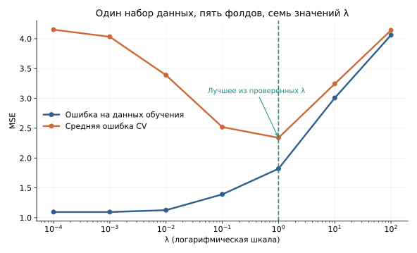

*Рисунок 16. Зависимость проверочной ошибки от силы регуляризации в отдельном синтетическом эксперименте: пять фолдов и семь значений $`\lambda`$, в отличие от условной таблицы выше. Минимум на выбранном наборе настроек определяет решение процедуры подбора, но не является независимой оценкой качества выбранной модели.*

### 4.4. Поиск по сетке и несколько гиперпараметров

Если мы проверяем заранее заданные варианты настроек, это называется **поиском по сетке** (*grid search*). Для одного гиперпараметра сетка — список значений. Для двух — набор сочетаний. Например, в kNN можно сравнить $k\in\lbrace 3,7,15\rbrace $ и веса голосов `uniform` либо `distance`. Получатся шесть конфигураций.

При пятифолдовой CV понадобится $6\times5=30$ отдельных обучений/проверок. Если одновременно сравниваются разные способы представления признаков, к каждой конфигурации должна относиться **полная процедура их подготовки и обучения**.

В `scikit-learn` такие операции организует `GridSearchCV`. В нём задаются оцениваемая модель или pipeline, `param_grid`, схема `cv` и критерий `scoring`. Подробный синтаксис разберём на семинаре, но сам смысл конструкции уже должен быть ясен: перебор конфигураций + CV для каждой конфигурации + выбор по общей метрике.

Сетку следует делать обоснованной. Чем больше проверяется вариантов, тем больше вычислений требуется и тем сильнее может проявляться отбор по случайно благоприятной CV-оценке. С другой стороны, слишком узкая сетка может не включать подходящую область гиперпараметров.

### 4.5. Почему после CV модель обучают заново

Допустим, для выбранного $\hat\lambda$ проведена пятифолдовая CV. После неё у нас было пять моделей, каждая обученная на своих $80\%$ development-данных. Они нужны были, чтобы оценить качество **правила обучения с данным $\lambda$**.

Но если мы хотим выпустить одну итоговую модель, естественно обучить её на **всех данных, отведённых для разработки**. При этом выбранный гиперпараметр уже фиксирован.


*Рисунок 17. Для каждой конфигурации выполняется CV. По результатам выбирается настройка, после чего модель обучается заново на всех development-данных и только затем оценивается на финальном test.*

В `GridSearchCV` этот завершающий этап обычно выполняется автоматически при `refit=True`: после выбора настроек лучший вариант переобучается на всех переданных обучающих данных. Он становится доступен как `best_estimator_`.

### 4.6. Почему лучший CV-score нельзя считать окончательной проверкой

Если бы гиперпараметры были заранее зафиксированы и мы лишь оценивали одну процедуру, средняя CV-метрика имела бы одну интерпретацию. Но теперь мы **просматриваем множество оценок и выбираем лучшую из них**. Даже при одинаковом истинном качестве кандидатов часть полученных CV-оценок окажется выше других из-за случайных особенностей данных.

Выбирая максимум F1 или минимум MSE, мы склонны выбирать также и случайно удачные отклонения. Поэтому **лучший CV-score после подбора может быть оптимистичен как оценка качества выбранной процедуры**.

Это не делает подбор некорректным: мы именно для него и использовали CV. Но важно не смешивать **критерий выбора** и **независимую оценку уже принятого решения**. Последнюю получают на отдельном test, если он был корректно сохранён вне всей процедуры выбора. В более сложных исследованиях применяют внешнюю кросс-валидацию (*nested CV*): внутренний цикл подбирает настройки, внешний оценивает всю процедуру подбора на неиспользованных фолдах.

Нам пока достаточно понимать проблему и не выдавать лучшую оценку из перебора за независимый результат.

### 4.7. Что именно должно повторяться внутри каждого фолда

До сих пор мы писали «обучаем модель» так, будто это единственное действие, которое зависит от тренировочных данных. В реальности часто перед моделью выполняются преобразования: заполнение пропусков по медиане, стандартизация по среднему и стандартному отклонению, выбор категорий для кодирования.

Такие действия **тоже оценивают параметры по данным**. Если посчитать их один раз на всей development-таблице, включая будущие validation-фолды, то валидационные объекты будут косвенно влиять на обучение. Оценка уже не будет соответствовать заявленной процедуре, которая должна учиться только по train-части каждого прохода.

Поэтому корректная единица CV — не обязательно один estimator, а часто **вся составная процедура**: от обучаемой предобработки до финального классификатора. Каждый CV-проход заново оценивает состояние всех её обучаемых шагов на своём train.

На семинаре эта идея получит конкретную форму в `SimpleImputer`, `StandardScaler`, `OneHotEncoder`, `ColumnTransformer` и `Pipeline`. Здесь важно зафиксировать принцип: **CV должна воспроизводить то обучение, которое мы действительно предполагаем выполнять для новых данных**.

### Итак

Кросс-валидация оценивает заданную процедуру обучения при выбранной схеме разбиения. Подбор гиперпараметров использует те же механизмы проверки, но добавляет уровень выбора из нескольких кандидатов. После такого выбора мы обучаем окончательную модель на всех development-данных. При этом ни CV, ни регуляризация не освобождают от необходимости продумать распределение будущих объектов, корректность разбиения и границы доступной информации.

## 5. Метод $k$ ближайших соседей

Мы научились управлять параметрами линейных моделей и сравнивать их настройки. Теперь рассмотрим другой способ построить прогноз. Он не требует искать одну глобальную линейную зависимость между признаками и ответом: вместо этого можно обратиться к **обучающим объектам, похожим на новый**.

### 5.1. От глобального правила к локальному прогнозу

В бинарной логистической регрессии вероятность класса определялась линейным score $w_0+w^\top x$ и сигмоидой. В пространстве исходных признаков правило $p(x)\ge0{,}5$ соответствует гиперплоскости $w_0+w^\top x=0$. Такое семейство границ удобно, но не всякую зависимость естественно разделять одной прямой или плоскостью.

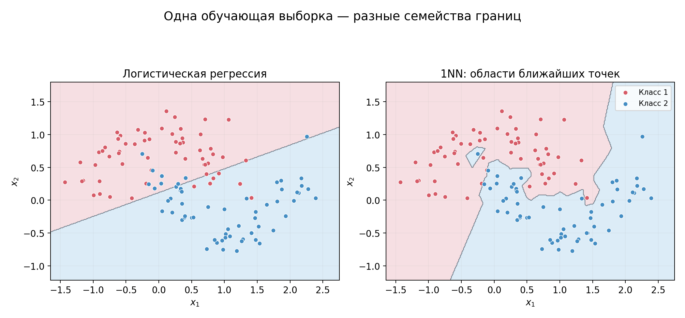

*Рисунок 18. Для одних и тех же данных глобальная линейная модель и правило одного ближайшего соседа создают разные области решений.*

Предположим, мы знаем признаки и правильные классы $n$ обучающих объектов:

```math
D=\lbrace (x_i,y_i)\rbrace _{i=1}^{n}.
```

Для нового объекта $x$ можно измерить расстояние $d(x,x_i)$ до каждого наблюдения и выбрать индекс ближайшего:

```math
i^*(x)\in\arg\min_{i=1,\ldots,n}d(x,x_i).
```

После этого перенести его метку на новый объект:

```math
\hat y(x)=y_{i^*(x)}.
\qquad\text{(13)}
```

Так устроен **метод одного ближайшего соседа** (*1-nearest neighbor*, 1NN). Если два наблюдения оказались одинаково близки, понадобится дополнительное правило разрешения равенства расстояний.

Граница решения получается не из одной обученной прямой, а из расположения обучающих объектов. Можно представить, что пространство разделено на области, в каждой из которых один и тот же объект остаётся ближайшим. Такое геометрическое разбиение связано с **диаграммой Вороного**.

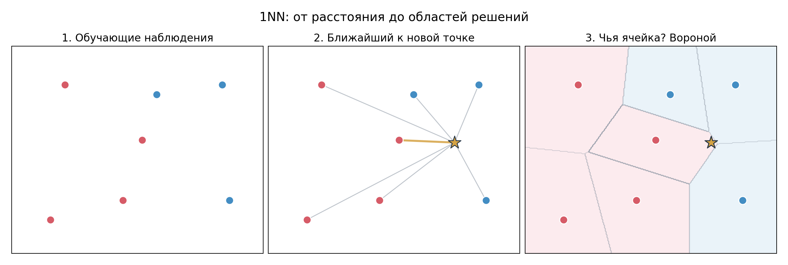

*Рисунок 19. Сначала задан набор размеченных точек, затем для нового объекта выбирается ближайшая точка, а вся плоскость разбивается на области постоянного ближайшего соседа.*

Это гибкое правило: локально оно может воспроизводить сложную границу. Но гибкость означает и чувствительность к отдельным нетипичным точкам. Если обучающий объект размечен ошибочно или случайно оказался в нехарактерном месте, 1NN может создать вокруг него небольшой «остров» другого класса.

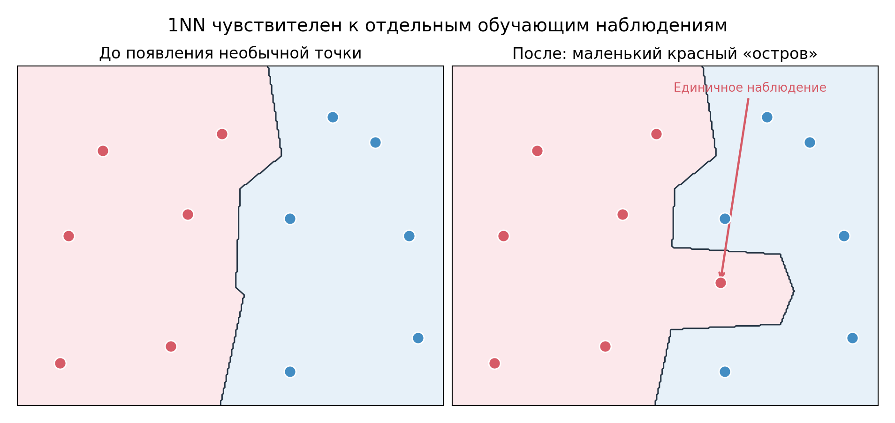

*Рисунок 20. Одна нетипичная обучающая точка меняет границу решений 1NN в своей окрестности.*

### 5.2. От одного соседа к $k$ соседям

Чтобы прогноз не зависел полностью от одного объекта, будем использовать группу ближайших наблюдений. Обозначим через $N_k(x)$ множество индексов $k$ ближайших обучающих объектов для нового $x$.

В классификации каждый сосед отдаёт голос своему классу; побеждает класс, получивший больше голосов:

```math
\boxed{
\hat y(x)\in\arg\max_{c\in\mathcal Y}
\sum_{i\in N_k(x)}\mathbb I(y_i=c)
}.
\qquad\text{(14)}
```

Здесь $\mathbb I(y_i=c)$ — индикатор: он равен единице, если сосед $i$ относится к классу $c$, и нулю иначе. Множество $\mathcal Y$ содержит возможные классы.

Представим, что мы нашли пять ближайших наблюдений:

| Порядок соседа | Расстояние | Класс |
|---|---:|---|
| 1 | 0,4 | A |
| 2 | 0,6 | B |
| 3 | 0,7 | A |
| 4 | 0,9 | C |
| 5 | 1,1 | A |

При $k=1$ прогноз — A. При $k=3$ класс A получает два голоса из трёх. При $k=5$ распределение голосов такое: A — три, B — один, C — один. Побеждает A.

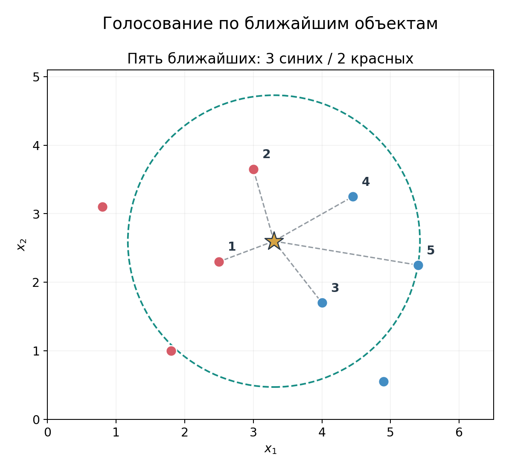

*Рисунок 21. Отдельная бинарная иллюстрация: среди пяти ближайших точек три синих и две красных. Она показывает механизм голосования, но не изображает трёхклассовый числовой пример из таблицы выше.*

Можно вычислить и долю соседей каждого класса:

```math
\boxed{
\hat p_c(x)=\frac1k\sum_{i\in N_k(x)}\mathbb I(y_i=c)
}.
\qquad\text{(15)}
```

В примере получаем $(\hat p_A,\hat p_B,\hat p_C)=(0{,}6,0{,}2,0{,}2)$.

Эти величины неотрицательны и суммируются в единицу, поэтому их можно интерпретировать как **локальные оценки вероятностей**. Но точный смысл результата пока скромнее: $0{,}6$ означает, что три из пяти выбранных соседей принадлежат A. Чтобы считать эту долю хорошей оценкой $P(Y=A\mid X=x)$, нужны дополнительные предпосылки об устройстве данных и выборе соседства. В частности, доли голосов kNN могут быть плохо калиброваны. Калибровку вероятностей мы уже обсуждали при изучении бинарной классификации.

**Что происходит на этапе `fit`?** В стандартном kNN не вычисляется вектор коэффициентов, подобный коэффициентам логистической регрессии. Метод сохраняет обучающие примеры и их метки; реализация может дополнительно строить структуру для поиска соседей. Основная работа по поиску похожих наблюдений происходит во время `predict`. Это не значит, что kNN «не обучается» в смысле интерфейса: без сохранённой обучающей выборки ему не из чего строить прогнозы.

### 5.3. Что значит «похожий»: расстояния между объектами

Пока мы использовали расстояние $d(x,z)$ как готовую величину. Но разные способы его определить могут привести к разному выбору соседей, а значит, и к разным прогнозам.

Для двух числовых векторов $x,z\in\mathbb R^p$ **евклидово расстояние** равно

```math
\boxed{
d_2(x,z)=\sqrt{\sum_{j=1}^p(x_j-z_j)^2}
}.
\qquad\text{(16)}
```

В двух измерениях это обычная длина отрезка между точками. Например, между $A=(1,1)$ и $B=(4,5)$:

```math
d_2(A,B)=\sqrt{(4-1)^2+(5-1)^2}=5.
```

**Манхэттенское расстояние** (*Manhattan distance*, $L_1$) складывает абсолютные отклонения:

```math
\boxed{
d_1(x,z)=\sum_{j=1}^p|x_j-z_j|
}.
\qquad\text{(17)}
```

Для тех же точек $d_1(A,B)=3+4=7$. Геометрически это длина пути по координатной сетке, а не длина прямого отрезка.


*Рисунок 22. Отдельная иллюстрация с приращениями координат 4 и 3; координаты точек отличаются от числового примера выше, но расстояния также равны 5 и 7. Одна пара точек может иметь разные численные расстояния в зависимости от выбранного определения близости.*

Оба расстояния относятся к семейству $L_q$:

```math
d_q(x,z)=\left(\sum_{j=1}^p|x_j-z_j|^q\right)^{1/q},\qquad q\ge1.
\qquad\text{(18)}
```

Здесь $q$ — **порядок нормы**, не число признаков; число признаков в этой главе обозначено $p$. При $q=1$ получаем Manhattan, при $q=2$ — евклидову метрику.


*Рисунок 23. Единичная окрестность в $`L_1`$ имеет форму ромба, а в $`L_2`$ — круга. Разная геометрия означает разное отношение к отклонениям по отдельным признакам.*

Выбор расстояния — часть определения модели. Он должен соответствовать смыслу признаков и способу их представления, а его практическую пользу нужно проверять по валидационному качеству.

### 5.4. Почему масштаб признаков меняет соседей

Пусть новый объект имеет координаты $x=(0,0)$. Два кандидата на ближайшего соседа:

```math
A=(1,8),\qquad B=(3,0).
```

При обычном евклидовом расстоянии $d_2(x,A)=\sqrt{65}\approx8{,}06$, $d_2(x,B)=3$: ближе B. Теперь изменим единицы измерения второго признака так, что все его значения разделятся на 10. Координаты станут $x'=(0,0)$, $A'=(1,0{,}8)$ и $B'=(3,0)$. Новые расстояния: $d_2(x',A')=\sqrt{1+0{,}8^2}\approx1{,}28$ и $d_2(x',B')=3$. Теперь ближайший сосед — A.

Мы не изменили алгоритм, классы или физические объекты. Мы только изменили **представление одной координаты**, и прогноз потенциально изменился.


*Рисунок 24. Изменение масштаба одной координаты может поменять порядок ближайших соседей.*

Поэтому для kNN масштабирование — не косметическая подготовка таблицы, а **часть определения расстояния**. Распространённые преобразования числовых столбцов:

```math
\text{StandardScaler:}\quad
z_j=\frac{x_j-\mu_j}{s_j},
```

```math
\text{MinMaxScaler:}\quad
u_j=\frac{x_j-\min x_j}{\max x_j-\min x_j}.
```

Оба используют статистики, полученные по обучающей выборке. Они меняют масштаб, но **не определяют автоматически, какие признаки важны**. Стандартизация не делает отдельные необычные объекты менее экстремальными относительно других наблюдений; MinMax-масштабирование может быть чувствительно к выбросам.


*Рисунок 25. Разные способы масштабирования изменяют численное представление признаков, но не устраняют автоматически выбросы и шум.*

Для номинальных категорий числовые коды вроде 0, 1, 2 обычно нельзя напрямую подставлять в евклидово расстояние: код навязал бы категориям порядок и величину различий. На семинаре разберём one-hot encoding и объединение числовых и категориальных ветвей предобработки. При этом даже one-hot не снимает вопроса о содержательном весе признаков в расстоянии: несколько индикаторных столбцов могут вносить вклад, несоразмерный тому, который мы хотели бы приписать категориальному полю.

### 5.5. Взвешивание голосов соседей

Обычное правило (14) считает все $k$ голосов равноправными. Однако ближайшая точка на расстоянии $0{,}1$ и сосед на расстоянии $3$ могут нести разное количество информации о новом объекте. Можно назначить каждому соседу неотрицательный вес $w_i(x)$, обычно убывающий с расстоянием:

```math
\hat p_c(x)=
\frac{\sum_{i\in N_k(x)}w_i(x)\mathbb I(y_i=c)}
{\sum_{i\in N_k(x)}w_i(x)}.
\qquad\text{(19)}
```

Например, при весах, обратных расстоянию, один очень близкий сосед может получить большее влияние, чем несколько более дальних.

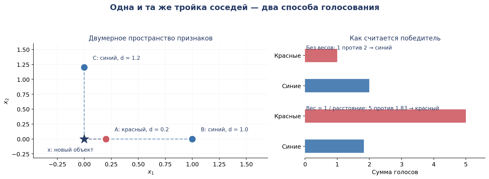

*Рисунок 26. Взвешенное голосование иногда меняет победителя по сравнению с обычным подсчётом количества соседей.*

Это не универсальное улучшение: если ближайшее наблюдение ошибочно размечено, сильное взвешивание может только увеличить вред от него. Выбор `weights='uniform'` или `weights='distance'` — ещё один гиперпараметр, который можно проверить по CV. В вычислениях с нулевыми расстояниями применяются специальные соглашения, чтобы избежать деления на ноль.

### 5.6. Малое и большое $k$: гибкость локального правила

Число соседей определяет, насколько локальным будет прогноз.

При **маленьком $k$** граница часто получается детальной, с небольшими областями около отдельных точек. Метод может хорошо соответствовать обучающим примерам, но сильно реагировать на шум и ошибочные метки.

При **большом $k$** голоса агрегируются из более широкой области. Локальные случайные отклонения могут сглаживаться, зато тонкие закономерности и малые группы объектов могут перестать влиять на результат.


*Рисунок 27. На одной синтетической выборке изменение $`k`$ от 1 к 5 и 25 меняет сложность границы решений.*

Это ещё один пример общего компромисса между гибкостью и обобщающей способностью. Аналогия с регуляризацией полезна на концептуальном уровне: оба механизма управляют сложностью прогноза. Но математически $k$ не является L1- или L2-штрафом, а его увеличение не эквивалентно увеличению $\lambda$ в Ridge.

**Как выбрать $k$?** Уже известным способом: задать несколько кандидатов, для каждого провести одинаковую CV и сравнить качество. Для классификации можно использовать macro-F1, если важно уделять сопоставимое внимание разным классам. Значение с наименьшей train-ошибкой не обязано давать лучший результат на отложенных объектах.

При использовании `GridSearchCV` разумно сравнивать не только `n_neighbors`, но при необходимости и `weights`, способ масштабирования и метрику расстояния. Но каждое добавленное измерение сетки увеличивает число обучений и вычислительные затраты.

### 5.7. Проклятие размерности: почему локальным методам нужны данные

В одномерном пространстве удобно искать объекты в коротком интервале вокруг нового наблюдения. В многомерном пространстве аналогичная небольшая область занимает быстро уменьшающуюся долю всего объёма.

Пусть признаки независимо и равномерно распределены внутри единичного куба $[0,1]^p$. Рассмотрим внутреннюю гиперкубическую окрестность со стороной $r=0{,}2$. Доля объёма такого куба равна

```math
\underbrace{0{,}2\cdot0{,}2\cdots0{,}2}_{p\ \text{множителей}}=0{,}2^p.
\qquad\text{(20)}
```

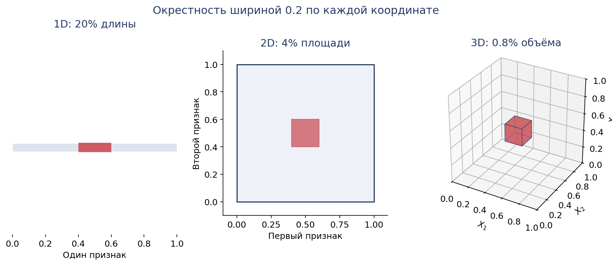

*Рисунок 28. В одном измерении окрестность занимает 20% длины пространства, в двух — 4% площади, в трёх — 0,8% объёма.*

Чтобы в такой области в среднем находилось хотя бы десять обучающих наблюдений, в идеализированной равномерной модели нужно примерно $n=10/0{,}2^p$ объектов:

| Число признаков $p$ | Необходимое $n$ для ожидаемых 10 объектов |
|---:|---:|
| 1 | 50 |
| 2 | 250 |
| 5 | 31 250 |
| 10 | 97 656 250 |

Это не универсальное требование к размеру датасета для kNN. Оно относится к конкретной геометрической окрестности, равномерному распределению и выбранной ширине. Смысл примера в другом: **локальность при росте размерности становится всё дороже по количеству наблюдений**.


*Рисунок 29. В иллюстративной равномерной модели число объектов, необходимое для сохранения фиксированного числа соседей в узкой окрестности, растёт экспоненциально с размерностью.*

В реальных данных признаки могут быть связаны, распределение может концентрироваться около поверхности меньшей размерности, а полезная структура — зависеть лишь от нескольких координат. Поэтому утверждение «kNN перестаёт работать после некоторого фиксированного числа признаков» некорректно.

Но **лишние шумовые координаты** действительно способны изменить порядок расстояний между объектами и помешать поиску содержательно похожих соседей.


*Рисунок 30. При добавлении неинформативных координат ближайшие объекты в полном пространстве могут оказаться совсем не теми, что были ближайшими по двум полезным координатам.*

Отсюда следует, что масштабирование не заменяет разумного конструирования и отбора признаков. Полезность каждого представления проверяется экспериментально.

### 5.8. kNN для регрессии и вычислительные ограничения

Тот же принцип соседства работает, если нужно предсказывать не класс, а числовую величину. Вместо голосования усредняем ответы ближайших наблюдений:

```math
\boxed{
\hat f(x)=\frac1k\sum_{i\in N_k(x)}y_i
}.
\qquad\text{(21)}
```

Если у трёх ближайших квартир стоимость аренды равна 40, 45 и 50 тыс. рублей, прогноз kNN-регрессии составляет 45 тыс. рублей. При взвешивании по расстоянию это будет взвешенное среднее.

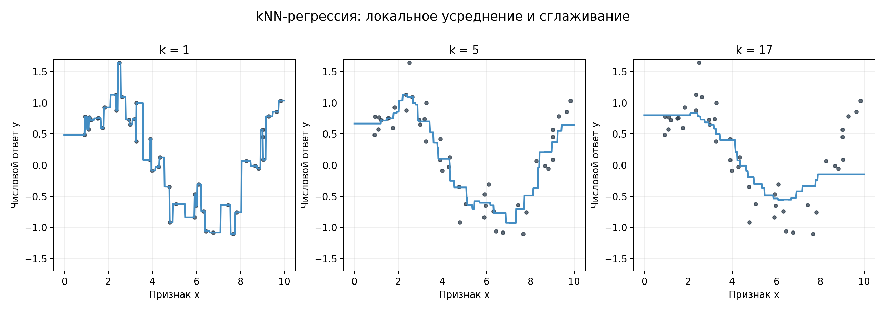

*Рисунок 31. При увеличении числа соседей локальный регрессионный прогноз становится более гладким, но может хуже воспроизводить небольшие изменения зависимости.*

Наконец, у kNN есть практическая цена: при предсказании нужно найти близкие объекты среди обучающих наблюдений. Прямой перебор требует вычисления множества расстояний для каждого запроса; ускоряющие структуры помогают не при любых расстояниях и размерностях. Кроме того, обучающую выборку приходится хранить. Поэтому kNN удобен как содержательный baseline и инструмент изучения локального сходства, но при больших данных и частом прогнозировании вычислительные особенности становятся существенными.

| Свойство | Логистическая регрессия | kNN |
|---|---|---|
| Правило прогноза | Глобальные коэффициенты и линейные scores | Ответы локальных соседей |
| Что оценивается или сохраняется на `fit` | Коэффициенты | Обучающие объекты; возможно индекс поиска |
| Граница решений | Линейна в исходных признаках | Может быть сложной и локальной |
| Основной контроль гибкости | Регуляризация и признаки | Число соседей, метрика, веса |
| Масштаб признаков | Влияет на оптимизацию и действие штрафа | Непосредственно меняет расстояния |
| Стоимость предсказания | Обычно невелика после обучения | Зависит от поиска среди обучающих объектов |

Мы познакомились с альтернативным способом построить классификатор, но пока не уточнили, как формально сравнивать его с логистической регрессией, если возможных классов больше двух. Эта задача приводит к следующей части главы.

## 6. От бинарной к многоклассовой классификации

### 6.1. Один объект — один из нескольких классов

В предыдущей главе мы рассматривали бинарную классификацию: у ответа два возможных значения, которые удобно кодировать как 0 и 1. Многие реальные задачи устроены иначе. Система может выбирать один из нескольких типов документа, диагностировать одну из нескольких категорий неисправностей или определять диапазон длительности поездки.

Пусть допустимы $K$ классов:

```math
\mathcal Y=\lbrace 1,2,\ldots,K\rbrace ,\qquad K\ge3.
```

В **обычной многоклассовой классификации** (*single-label multiclass classification*) каждый объект имеет ровно одну истинную метку $y\in\mathcal Y$, а модель выдаёт одну предсказанную метку. Числа 1, 2, 3 здесь обозначают категории и сами по себе не создают между ними числового расстояния или порядка.

Для kNN такая постановка естественна: просто подсчитываем голоса соседей за все возможные классы. А вот знакомая бинарная логистическая регрессия строилась вокруг единственной вероятности $P(Y=1\mid X=x)$ и её дополнения $P(Y=0\mid X=x)=1-p(x)$. Как перенести её на $K$ классов?

Существуют два разных подхода: обучить **несколько бинарных классификаторов** или построить **одну совместную многоклассовую вероятностную модель**.

### 6.2. One-vs-Rest: несколько знакомых бинарных задач

В стратегии **One-vs-Rest** (OvR, «один против остальных») для каждого класса $c$ мы создаём отдельную бинарную задачу:

```math
y_i^{(c)}=\mathbb I(y_i=c).
```

Положительными считаются наблюдения класса $c$, отрицательными — все остальные. При $K=3$ получаем три бинарных классификатора, обучаемых независимо:

- A против B и C;
- B против A и C;
- C против A и B.


*Рисунок 32. В OvR исходные наблюдения трижды получают бинарные целевые метки. Каждая модель обучается на своей задаче «данный класс или все остальные».*

Пусть у нового объекта независимые бинарные модели выдали следующие scores:

```math
s_A(x)=1{,}8,\qquad s_B(x)=0{,}6,\qquad s_C(x)=-0{,}3.
```

При обычном правиле выбора наибольшего score прогноз будет A:

```math
\hat y(x)\in\arg\max_c s_c(x).
\qquad\text{(22)}
```

Если каждая бинарная модель — логистическая регрессия, вместо scores можно сравнивать её сигмоидные выходы: сигмоида строго возрастает, поэтому порядок сохранится. Однако эти выходы были получены **независимыми обучениями** и не обязаны суммироваться в единицу.

Например, три бинарных классификатора выдали

```math
\hat p_A^{\mathrm{bin}}=0{,}8,\quad
\hat p_B^{\mathrm{bin}}=0{,}7,\quad
\hat p_C^{\mathrm{bin}}=0{,}3.
```

Сумма равна $1{,}8$, а не $1$. Каждое число отвечало на свой бинарный вопрос: «принадлежит ли объект A?», «принадлежит ли он B?», «принадлежит ли он C?».

Для получения согласованных на вид вероятностных выходов иногда используют нормировку:

```math
\hat p_c^{\mathrm{OvR}}(x)
=\frac{\hat p_c^{\mathrm{bin}}(x)}
{\sum_{j=1}^K\hat p_j^{\mathrm{bin}}(x)}.
\qquad\text{(23)}
```

Тогда наш пример превращается приблизительно в $(0{,}444,\,0{,}389,\,0{,}167)$. Такие значения уже суммируются в единицу, но **нормировка после обучения не делает три бинарные модели одной совместно обученной моделью**. Это различие важно при интерпретации и калибровке вероятностей.

Главное достоинство OvR — возможность перенести знакомый бинарный классификатор на несколько классов. Теперь рассмотрим другой путь.

### 6.3. Многоклассовая логистическая регрессия: несколько scores

Для каждого класса $c$ введём свой вектор коэффициентов $w_c$ и свободный член $b_c$. Вычислим линейную оценку (*score*)

```math
s_c(x)=b_c+w_c^\top x.
\qquad\text{(24)}
```

Если собрать строки коэффициентов в матрицу $W\in\mathbb R^{K\times p}$, а свободные члены — в вектор $b\in\mathbb R^K$, то

```math
s(x)=Wx+b.
```

Модель выдаёт $K$ scores, по одному на класс. Например, для одного наблюдения получились

```math
s(x)=(2,1,0).
```

Больший score выражает большее предпочтение класса моделью, но сами значения ещё **не вероятности**: они могут быть отрицательными, больше единицы и не обязаны суммироваться в единицу.

Для взаимно исключающих классов нам нужен вектор положительных величин с суммой 1. Его создаёт функция **softmax**:

```math
\boxed{
p_c(x)=\frac{e^{s_c(x)}}{\sum_{j=1}^{K}e^{s_j(x)}}
},\qquad c=1,\ldots,K.
\qquad\text{(25)}
```

Каждая экспонента положительна, а знаменатель общий. Поэтому $p_c(x)>0$ для всех классов и $\sum_{c=1}^{K}p_c(x)=1$.

Для scores $(2,1,0)$:

```math
\begin{aligned}
p_A&=\frac{e^2}{e^2+e^1+e^0}\approx0{,}665,\\[0pt]
p_B&=\frac{e^1}{e^2+e^1+e^0}\approx0{,}245,\\[0pt]
p_C&=\frac{e^0}{e^2+e^1+e^0}\approx0{,}090.
\end{aligned}
```

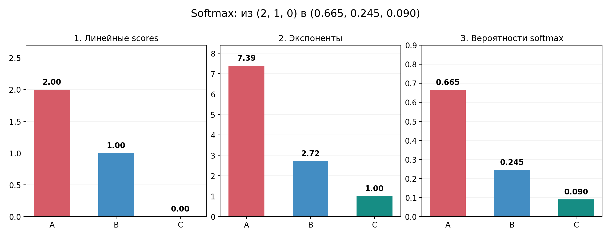

*Рисунок 33. Все классовые scores одновременно входят в знаменатель softmax, поэтому результат является одним совместным распределением вероятностей по классам.*

Поскольку экспонента строго возрастает, класс с наибольшей вероятностью совпадает с классом с наибольшим score:

```math
\hat y(x)\in\arg\max_c p_c(x)
=\arg\max_c s_c(x).
\qquad\text{(26)}
```

Есть полезное свойство softmax: если ко всем scores одного объекта прибавить одинаковое число $a$, вероятности не изменятся,

```math
\frac{e^{s_c+a}}{\sum_j e^{s_j+a}}
=\frac{e^{s_c}}{\sum_j e^{s_j}}.
```

Это позволяет численно устойчиво вычислять softmax: перед возведением в экспоненту из всех scores вычитают их максимум. Из той же формулы видно, что абсолютный общий сдвиг всех классовых оценок не идентифицируется по вероятностям; важны их различия.

### 6.4. Softmax как продолжение бинарной логистической регрессии

При $K=2$ возьмём scores $s_0(x)$ и $s_1(x)$. Вероятность класса 1 равна

```math
\begin{aligned}
p_1(x)
&=\frac{e^{s_1(x)}}{e^{s_0(x)}+e^{s_1(x)}}\\[0pt]
&=\frac{1}{1+e^{s_0(x)-s_1(x)}}\\[0pt]
&=\sigma\bigl(s_1(x)-s_0(x)\bigr).
\end{aligned}
\qquad\text{(27)}
```

Если оба score линейны по признакам, их разность также линейна. Следовательно, **двухклассовый softmax сводится к знакомой бинарной логистической регрессии**. Многоклассовая конструкция не отбрасывает прошлую модель, а обобщает её.

### 6.5. Как обучается multinomial logistic regression

Мы определили форму вероятностного прогноза. Осталось выбрать коэффициенты $W,b$. В бинарной модели мы минимизировали log-loss — отрицательный логарифм вероятности правильного ответа. В многоклассовом случае идея не меняется.

Пусть у объекта $i$ истинный класс $y_i$. Модель присваивает ему вероятность $p_{y_i}(x_i)$, поэтому индивидуальная потеря равна

```math
\boxed{L_i(W,b)=-\log p_{y_i}(x_i)}.
\qquad\text{(28)}
```

При подстановке softmax:

```math
L_i(W,b)
=-s_{y_i}(x_i)
+\log\!\left(\sum_{c=1}^{K}e^{s_c(x_i)}\right).
\qquad\text{(29)}
```

Формула раскрывает важный механизм: в потере одного объекта участвует score истинного класса **и все остальные scores через общий знаменатель**. Поэтому параметры разных классов связаны уже в ходе обучения.

На выборке минимизируем средний эмпирический риск

```math
\boxed{
R_n(W,b)=-\frac1n\sum_{i=1}^{n}\log p_{y_i}(x_i)
}.
\qquad\text{(30)}
```

Эту функцию называют **многоклассовой log-loss**, **multiclass cross-entropy**. Для одноразмеченных наблюдений она соответствует отрицательному логарифму правдоподобия категорического распределения.

Иногда её записывают через индикаторы истинного класса:

```math
R_n(W,b)=-\frac1n\sum_{i=1}^{n}\sum_{c=1}^{K}
\mathbb I(y_i=c)\log p_c(x_i).
```

Внутренняя сумма здесь содержит только одно ненулевое слагаемое: для правильного класса. Это просто другая запись той же функции.

Рассмотрим уже знакомые scores $(2,1,0)$. Если настоящий ответ A, модель приписывает ему вероятность примерно $0{,}665$, и потеря равна $-\log(0{,}665)\approx0{,}408$. Если истинный класс B, потеря значительно больше:

```math
L_i=-\log p_B(x_i)=-\log\frac{e^1}{e^2+e^1+e^0}\approx1{,}408.
```

Таким образом, функция потерь чувствительна не только к тому, ошиблась ли модель с выбором максимального класса, но и к вероятности правильного ответа. Это та же идея, которую мы разбирали на бинарной log-loss.


*Рисунок 34. Каждый объект вносит в loss член, который зависит от scores всех классов; параметры этих scores подбираются совместно.*

При необходимости регуляризацию можно добавить и сюда, например:

```math
J_\lambda(W,b)=R_n(W,b)+\lambda\sum_{c=1}^{K}\|w_c\|_2^2.
\qquad\text{(31)}
```

Свободные члены здесь также не штрафуются. Численные параметризации могут отличаться между реализациями, но общий принцип тот же, что и в Ridge и бинарной логистической регрессии.

**Сравним два подхода.** OvR обучает $K$ независимых бинарных моделей с $K$ отдельными целевыми функциями. Multinomial logistic regression обучает один набор классовых коэффициентов, связанных общей cross-entropy. У обоих способов итоговый прогноз принадлежит одному из $K$ классов, но модель вероятностей и механизм обучения различаются.

### 6.6. Multiclass и multilabel — не одно и то же

Если документ относится ровно к одной теме из пяти, это обычная multiclass-задача. Если документ может одновременно иметь метки «финансы», «срочно» и «юридический», перед нами **multilabel classification**. В ней один объект может принадлежать нескольким классам, поэтому набор независимых бинарных предсказаний и методы оценки устроены иначе.

В этой главе мы рассматриваем прежде всего **single-label multiclass**. В частности, далее при выводе связи micro-F1 с accuracy будем использовать предположение, что у каждого объекта ровно одна истинная и одна предсказанная метка.

## 7. Оценивание многоклассовой классификации

### 7.1. Почему одной accuracy может быть недостаточно

Модель может правильно распознавать распространённый класс и почти не замечать редкий. Тогда общая accuracy будет довольно высокой, хотя качество по некоторым категориям неудовлетворительно. Для многоклассовой классификации нужно уметь раскрыть итоговую оценку на уровне отдельных классов.

Возьмём конкретную матрицу ошибок для трёх классов. **Строки** отвечают истинным меткам, **столбцы** — предсказаниям:

| Истинный класс / Прогноз | A | B | C | Всего |
|---|---:|---:|---:|---:|
| **A** | 38 | 2 | 0 | 40 |
| **B** | 4 | 10 | 1 | 15 |
| **C** | 2 | 2 | 1 | 5 |
| **Всего предсказано** | 44 | 14 | 2 | 60 |

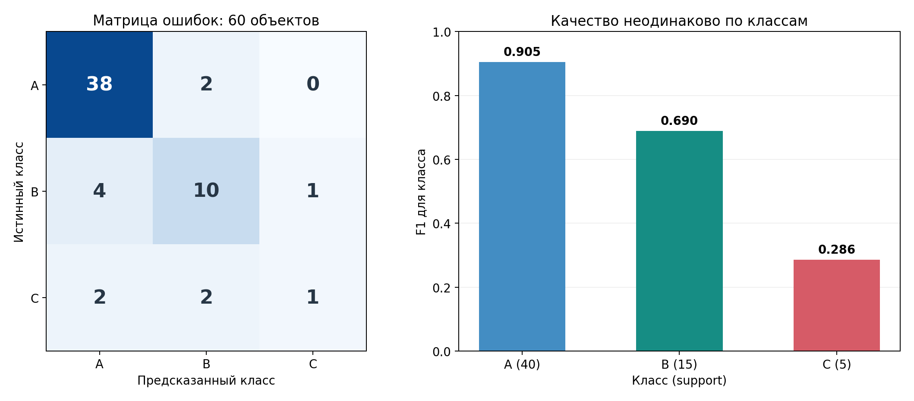

*Рисунок 35. Диагональ содержит правильные ответы, а внедиагональные ячейки показывают, какие классы смешивает модель.*

Здесь $38+10+1=49$ правильных прогнозов из 60, поэтому

```math
\mathrm{Accuracy}=\frac{49}{60}\approx0{,}817.
\qquad\text{(32)}
```

Около 82% — звучит неплохо. Однако из пяти объектов класса C правильно найден только один. Проверим, как это отражается на precision, recall и F1.

### 7.2. Метрики для отдельного класса

Чтобы использовать знакомые бинарные определения, выберем один класс, например C, и временно будем считать его положительным. Все остальные классы станут отрицательными.

- **$TP_C$** — настоящий C, предсказанный как C: один объект.
- **$FN_C$** — настоящий C, ошибочно предсказанный как A или B: $2+2=4$ объекта.
- **$FP_C$** — объект другого класса, ошибочно предсказанный как C: один объект.

Следовательно,

```math
\mathrm{Precision}_C=\frac{TP_C}{TP_C+FP_C}
=\frac{1}{2}=0{,}5,
```

```math
\mathrm{Recall}_C=\frac{TP_C}{TP_C+FN_C}
=\frac{1}{5}=0{,}2.
```

Precision отвечает на вопрос: «Какая доля объектов, названных C, действительно была C?». Recall отвечает на другой вопрос: «Какую долю всех настоящих C удалось найти?».


*Рисунок 36. Для выбранного класса C: TP — диагональная ячейка, FN — остальные ячейки строки C, FP — остальные ячейки столбца C.*

Метрика $F_1$ объединяет precision и recall через гармоническое среднее:

```math
F_{1,c}=\frac{2P_cR_c}{P_c+R_c}
=\frac{2TP_c}{2TP_c+FP_c+FN_c}.
\qquad\text{(33)}
```

Для C получаем

```math
F_{1,C}=\frac{2\cdot1}{2\cdot1+1+4}=\frac27\approx0{,}286.
```

Пройдём по всем классам точно так же:

| Класс | Support | Precision | Recall | F1 |
|---|---:|---:|---:|---:|
| A | 40 | 0,864 | 0,950 | 0,905 |
| B | 15 | 0,714 | 0,667 | 0,690 |
| C | 5 | 0,500 | 0,200 | 0,286 |

**Support** — число объектов с данным истинным классом. Оно существенно для интерпретации: у C всего пять наблюдений, поэтому даже одна дополнительная правильная или неправильная классификация заметно изменит recall.

Если для некоторого класса не было ни одного предсказания, precision содержит нулевой знаменатель. Программные библиотеки используют оговорённое соглашение обработки таких случаев, например `zero_division=0`. При чтении отчёта важно понимать, не скрывается ли за нулевой метрикой отсутствие предсказаний класса.

### 7.3. Macro-F1: одинаковый вес каждого класса

Один из способов объединить классовые показатели — сначала посчитать $F_{1,c}$ для каждого класса, а затем взять обычное среднее:

```math
\boxed{F_1^{\mathrm{macro}}=\frac1K\sum_{c=1}^{K}F_{1,c}.}
\qquad\text{(34)}
```

Для таблицы выше

```math
F_1^{\mathrm{macro}}
=\frac{0{,}905+0{,}690+0{,}286}{3}
\approx0{,}627.
```

В отличие от accuracy, macro-F1 **даёт каждому классу одинаковый вес**, независимо от того, сколько объектов ему соответствует. Класс C составляет только $5/60$ выборки, но в macro-усреднении его F1 влияет на результат так же, как F1 класса A.

Это удобно, когда мы не хотим, чтобы плохая работа по редким классам исчезала за высоким качеством на массовых. Однако равный вес классов — **выбор критерия качества**, а не универсальное требование. Если ошибки для разных классов имеют разные прикладные последствия, полезно смотреть и на отдельные precision/recall, и на более специализированные метрики.

Отдельная тонкость: macro-F1 — это **среднее от классовых F1**, а не F1, вычисленный из усреднённых по классам precision и recall. Эти операции в общем случае дают разные числа.

### 7.4. Weighted-F1: вес по распространённости класса

Другой подход — усреднять классовые F1 пропорционально support:

```math
\boxed{
F_1^{\mathrm{weighted}}
=\sum_{c=1}^{K}\frac{n_c}{n}F_{1,c}
},
\qquad\text{(35)}
```

где $n_c$ — число настоящих объектов класса $c$, а $n=\sum_cn_c$. В нашем случае:

```math
F_1^{\mathrm{weighted}}
=\frac{40}{60}\cdot0{,}905
+\frac{15}{60}\cdot0{,}690
+\frac5{60}\cdot0{,}286
\approx0{,}799.
```

Уже заметно ближе к accuracy. Причина понятна: класс A составляет две трети всей выборки и имеет высокий F1. Weighted-усреднение учитывает распространённость классов, поэтому его результат преимущественно отражает качество на многочисленных категориях.

Не нужно объявлять weighted-F1 неправильной метрикой. Просто она отвечает на иной вопрос, чем macro-F1. В разных прикладных постановках могут иметь смысл разные правила агрегирования ошибок.

### 7.5. Micro-F1: сначала объединяем события, затем считаем метрику

В macro и weighted мы сначала считали precision/recall/F1 каждого класса и лишь потом усредняли. **Micro-усреднение** меняет порядок: сначала суммирует $TP$, $FP$, $FN$ по всем классам, затем подставляет суммарные величины в формулу метрики.

Посмотрим, что это даёт для **single-label multiclass** с полным набором классов. Пусть $n$ объектов проверены, из них $t$ получили правильный ответ.

- Правильно классифицированный объект создаёт один $TP$ для своего класса.
- Ошибочно классифицированный объект создаёт один $FN$ для настоящего класса и один $FP$ для предсказанного.

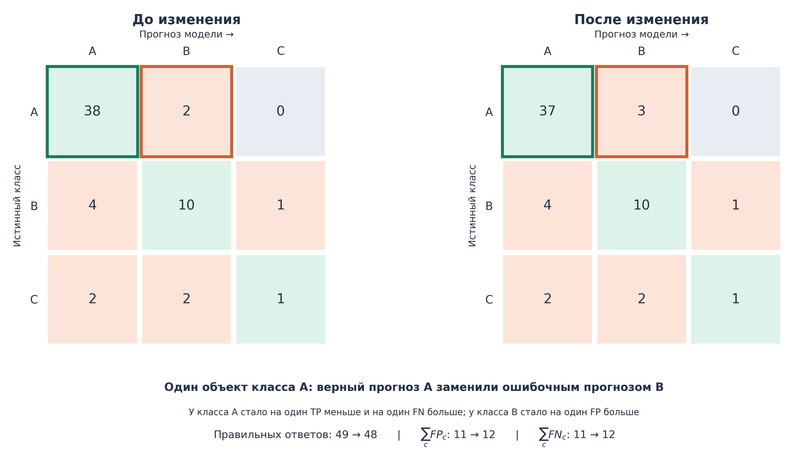

*Рисунок 37. Одна ошибка вместо правильного ответа уменьшает суммарный TP на единицу и добавляет по одной единице к суммарным FP и FN.*

Отсюда

```math
\sum_cTP_c=t,\qquad
\sum_cFP_c=\sum_cFN_c=n-t.
```

Поэтому

```math
P_{\mathrm{micro}}=\frac{t}{t+(n-t)}=\frac tn,
```

```math
R_{\mathrm{micro}}=\frac tn,
```

и их гармоническое среднее тоже равно $t/n$:

```math
\boxed{
P_{\mathrm{micro}}=R_{\mathrm{micro}}=F_{1,\mathrm{micro}}
=\mathrm{Accuracy}
}.
\qquad\text{(36)}
```

В нашем примере все эти величины равны $49/60\approx0{,}817$.

Это свойство относится к обычной многоклассовой постановке с **ровно одной** истинной и **ровно одной** предсказанной меткой для каждого объекта и усреднением по всем классам. В multilabel-задачах или при вычислении micro по выбранному подмножеству классов равенство с accuracy в общем случае не действует.

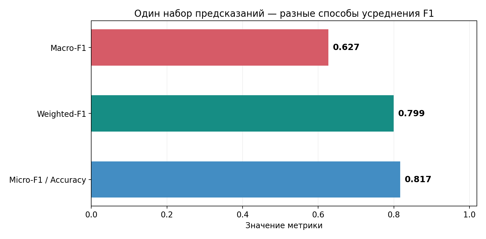

*Рисунок 38. Разные агрегаты для одной матрицы ошибок дают разные значения, потому что по-разному учитывают классы и их распространённость.*

Сведём результаты:

| Метрика | Значение в примере | Что подчёркивает |
|---|---:|---|
| Accuracy | 0,817 | Долю всех правильных предсказаний |
| Macro-F1 | 0,627 | Равную значимость классовых F1 |
| Weighted-F1 | 0,799 | Усреднение классовых F1 с учётом support |
| Micro-F1 | 0,817 | Совпадает с accuracy в данной постановке |

### 7.6. Какую метрику выбрать и как изучать ошибки

Не существует обязательного правила «в многоклассовой задаче всегда выбирайте macro-F1». Метрика должна соответствовать тому, какие ошибки значимы в приложении.

Если все классы имеют сопоставимую ценность, macro-F1 полезна как общий ориентир: она не позволит полностью скрыть слабое качество редкого класса. Однако если особое значение имеет, например, пропуск конкретной опасной категории, следует дополнительно смотреть **recall этого класса**. При дорогих ложных тревогах важен precision соответствующей категории.

Матрица ошибок не менее важна, чем агрегированная метрика. Она показывает **направления путаницы**: какие настоящие категории часто превращаются в какие прогнозы. В нашем примере слабая работа по C не сводится к одному общему числу — модель отправляет два настоящих C в A и два в B. Это информация для диагностики, изменения представления признаков и выбора следующих экспериментов.

В обычном анализе ошибок полезно рассматривать проверочные прогнозы, полученные на объектах вне обучения соответствующей модели. Такие прогнозы можно собрать по CV-фолдам (*out-of-fold*, OOF). Если гиперпараметры уже подбирались по тем же данным, полученный анализ остаётся исследовательской диагностикой на данных разработки и не заменяет независимую оценку на test. На семинаре посмотрим, как получать и интерпретировать такие прогнозы.

Для некоторых задач важна не только жёсткая метка, но и качество ранжирования вероятностей. Существуют многоклассовые варианты ROC-AUC и PR-анализа, например по схеме One-vs-Rest. Но они требуют отдельного выбора стратегии агрегирования и интерпретации, поэтому не будем заменять ими подробный разбор per-class метрик и F1.

## 8. От модели к целостной процедуре эксперимента

Мы изучили несколько разных способов получить прогноз. Ridge и Lasso меняют критерий выбора коэффициентов линейной модели, kNN использует соседние наблюдения, OvR объединяет бинарные классификаторы, а multinomial logistic regression обучает совместную вероятностную модель. Однако для сравнения этих методов недостаточно написать несколько вызовов `fit`.

Представим задачу классификации табличных данных, где одни признаки числовые, другие — категориальные, часть значений отсутствует. Чтобы сравнить логистическую регрессию и kNN, необходимо определить не только алгоритм, но и **весь путь от исходной таблицы к прогнозу**:

```math
\text{исходные признаки}
\;\longrightarrow\;
\text{преобразования}
\;\longrightarrow\;
\text{модель}
\;\longrightarrow\;
\text{прогноз}.
```

Для kNN особенно важны расстояния и масштаб. Для регуляризованной логистической регрессии масштаб влияет на действие штрафа. Если таблица содержит категории, потребуется обоснованное числовое представление. Если есть пропуски, нужно выбрать способ обработки. **Всё, что настраивается по обучающей выборке, должно заново настраиваться внутри каждого CV-прохода на его train-части**.

Следовательно, сравниваются не просто имена алгоритмов, а полные *конфигурации процедуры обучения*. Именно эта идея позволяет объединить все темы недели в один воспроизводимый эксперимент.

Последовательность работы может выглядеть так:

1. Зафиксировать задачу и доступные признаки; выбрать метрику, по которой будут сравниваться варианты.
2. Определить допустимую схему разбиения данных и сохранить отдельную проверку, если она нужна для итоговой независимой оценки.
3. Построить базовые модели и процедуры преобразования признаков.
4. Для нескольких конфигураций выполнить CV по одним и тем же разбиениям; оценить качество и его различия между классами или подгруппами.
5. Обоснованно выбрать гиперпараметры и представление признаков, затем обучить окончательную процедуру на всех данных разработки.
6. Проверить зафиксированное решение на отложенных объектах и подготовить его к применению к новой таблице.

На семинаре мы реализуем такую последовательность в Jupyter Notebook. `Pipeline` позволит объединить обучаемые преобразования с моделью, `ColumnTransformer` — по-разному обработать группы столбцов, а `GridSearchCV` — сравнить полные конфигурации с помощью кросс-валидации. Будем не просто получать итоговый score, а разбирать, **какие решения повлияли на качество и насколько обоснованно сделаны выводы**.

## Основные выводы

- **Регуляризация меняет правило обучения.** Ridge штрафует сумму квадратов коэффициентов, Lasso — сумму модулей, Elastic Net сочетает оба подхода. Это помогает управлять сложностью, но не гарантирует автоматического улучшения качества на новых данных.
- **Сила регуляризации — гиперпараметр.** Выбирать её только по обучающей ошибке нельзя: необходима отложенная проверка.
- **Кросс-валидация многократно обучает одну процедуру на разных фолдах.** Оценки на validation-частях объединяются, чтобы сравнивать заранее заданные варианты.
- **Подбор конфигурации и независимая оценка результата — разные задачи.** Лучший CV-score после перебора не следует считать окончательной независимой оценкой; после выбора обычно выполняется refit.
- **kNN строит локальный прогноз по соседям.** Его гибкость зависит от числа соседей, выбор соседей — от расстояния и масштаба признаков. Высокая размерность и вычислительная стоимость ограничивают применимость метода.
- **Многоклассовую классификацию можно строить через OvR или совместный softmax.** Первый подход обучает несколько бинарных моделей, второй — одну общую вероятностную модель с multiclass cross-entropy.
- **Macro-, weighted- и micro-метрики отвечают на разные вопросы.** Для single-label multiclass micro-F1 совпадает с accuracy; macro-F1 даёт каждому классу одинаковый вес. Ни одна агрегированная метрика не заменяет матрицу ошибок и показатели отдельных классов.
- **Единица корректного сравнения — вся обучаемая процедура.** Подготовка признаков, модель, гиперпараметры и схема проверки должны согласовываться друг с другом.

## Вопросы для самопроверки

1. Почему две линейные модели могут давать одинаковые прогнозы на обучающих наблюдениях, но различаться на новых? Объясните это на примере сильно коррелирующих признаков.
2. Запишите критерии МНК и Ridge при нормировке ошибки на $n$. Какую роль играет $\lambda$? Почему в обычном случае не штрафуется свободный член?
3. Выведите нормальные уравнения Ridge для центрированных $X$ и $y$. Почему при $\lambda>0$ матрица $X_c^\top X_c+n\lambda I$ обратима даже при линейно зависимых столбцах?
4. Почему смена единиц измерения признака влияет на Ridge и Lasso, хотя обычная линейная модель без регуляризации может сохранять те же прогнозы после пересчёта коэффициентов?
5. Чем различаются L1- и L2-штрафы? Как геометрия допустимых коэффициентов помогает понять появление нулевых коэффициентов Lasso?
6. Для $J_\lambda(b)=(b-2)^2+\lambda|b|$ найдите оптимальный $b$ при $\lambda=1$, $3$ и $5$. При каких значениях $\lambda$ оптимальный коэффициент $\hat b_\lambda$ равен нулю?
7. Почему регуляризованная логистическая регрессия особенно полезна при линейно разделимых наблюдениях? Как связаны направления изменения $\lambda$ и параметра `C`?
8. Что именно переобучается в каждом проходе K-fold CV? Почему CV-оценку нельзя считать метрикой одной модели, обученной на всех данных?
9. Чем отличаются StratifiedKFold и GroupKFold? В каких задачах случайное разбиение по строкам способно дать чрезмерно оптимистичную оценку?
10. В эксперименте значения CV-MSE для трёх настроек равны $2{,}8$, $2{,}5$ и $2{,}6$. Что именно позволяет сказать это сравнение, а чего оно не доказывает?
11. Почему лучшая CV-оценка после перебора множества вариантов может быть оптимистичной? Какую роль выполняют refit, test и при необходимости nested CV?
12. Опишите прогноз 1NN и kNN. Чем доля голосов соседей отличается от гарантированно калиброванной вероятности класса?
13. Придумайте пример, в котором изменение единиц измерения одного признака поменяет ближайшего соседа. Почему scaling является частью определения модели kNN?
14. Как влияют число соседей $k$ и размерность признакового пространства на локальность и устойчивость предсказания? Почему нельзя назвать универсальный порог размерности, после которого kNN «не работает»?
15. Чем обучение OvR отличается от обучения multinomial logistic regression? Почему нормировка бинарных вероятностей после OvR не делает процедуру эквивалентной совместному softmax-обучению?
16. Для scores $(2,1,0)$ вычислите softmax-вероятности. Какая будет multiclass log-loss, если истинная метка — второй класс?
17. Для заданной многоклассовой матрицы ошибок объясните, как выделить $TP$, $FP$ и $FN$ одного класса. Чем отличаются macro- и weighted-усреднения F1?
18. Почему в single-label multiclass micro-F1 совпадает с accuracy? Сохранится ли это утверждение для multilabel-ответов?
19. Почему обучаемую предобработку признаков необходимо повторять внутри каждого CV-фолда? Что меняется в интерпретации validation-метрики, если стандартизацию сделать заранее по всей таблице?
20. Как вы организовали бы корректное сравнение логистической регрессии и kNN на таблице со смешанными числовыми и категориальными признаками, пропусками и четырьмя классами ответа?

---

## Дополнительное чтение

- **James G., Witten D., Hastie T., Tibshirani R., Taylor J. — *An Introduction to Statistical Learning with Applications in Python*.** Разделы о регуляризации линейных моделей, оценивании качества и ближайших соседях. [Официальный сайт](https://www.statlearning.com/).
- **Scikit-learn — [Cross-validation: evaluating estimator performance](https://scikit-learn.org/stable/modules/cross_validation.html)** и **[Tuning the hyper-parameters of an estimator](https://scikit-learn.org/stable/modules/grid_search.html)**. Подробности о схемах разбиения и подборе настроек.
- **Scikit-learn — [Linear Models](https://scikit-learn.org/stable/modules/linear_model.html)**, **[Nearest Neighbors](https://scikit-learn.org/stable/modules/neighbors.html)** и **[Multiclass and Multioutput](https://scikit-learn.org/stable/modules/multiclass.html)**. Документация по обсуждавшимся семействам моделей.
- **Scikit-learn — [Metrics and Scoring](https://scikit-learn.org/stable/modules/model_evaluation.html)**. Формальные определения multiclass precision, recall, F1 и различных способов усреднения.
- **Scikit-learn MOOC — [Using Numerical and Categorical Variables Together](https://inria.github.io/scikit-learn-mooc/python_scripts/03_categorical_pipeline_column_transformer.html)**. Практическое построение полного pipeline для смешанных данных; особенно полезно перед семинаром.
