# Решающие деревья: от правил разбиения к важности признаков

В линейной регрессии мы заранее задавали вид функции прогноза и находили её коэффициенты. Логистическая регрессия использовала линейную комбинацию признаков, но преобразовывала её в вероятность класса. Метод ближайших соседей (kNN), напротив, опирался на ответы близких обучающих объектов. Решающее дерево (*decision tree*) предлагает ещё один способ: оно последовательно проверяет условия по признакам и направляет объект к одному из простых прогнозов.

Такие правила можно придумать вручную. Например, оценивая вероятность покупки, сначала проверить активность пользователя, а затем — историю его заказов. Но дерево становится методом машинного обучения не благодаря форме «если — то», а благодаря **процедуре получения правил из данных**. Какие признаки использовать? Где расположить пороги? Каков порядок проверок? Когда дальнейшее деление перестаёт быть полезным? Мы последовательно ответим на эти вопросы, а затем научимся исследовать, какие признаки использует уже обученная модель и что эти признаки дают её прогнозам.

## 1. Как устроено дерево и как оно предсказывает

### 1.1. От одного условия к дереву

Пусть объект описан двумя числовыми признаками $x=(x_1,x_2)$, а ответ принимает значения $y\in\lbrace 0,1\rbrace $. Представим, что обученная модель использует правило:

1. Если $x_1\le 2.5$, предсказать класс $0$.
2. Иначе проверить $x_2$. Если $x_2\le 1.5$, предсказать $0$; иначе — $1$.

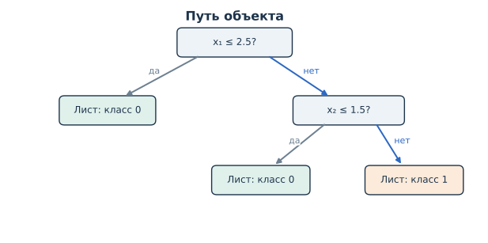

*Рисунок 1. Путь нового объекта по готовому дереву: последовательно проверяются два пороговых условия.*

Верхнюю вершину называют **корнем** (*root*). Вершина, в которой проверяется условие, — **внутренний узел** (*internal node*), а вершина с окончательным прогнозом — **лист** (*leaf*). От каждого внутреннего узла бинарного дерева отходят две ветви: одна соответствует выполнению условия, другая — его невыполнению. Узел не обязательно содержит одно наблюдение. Во время обучения в него попадает некоторое подмножество всей выборки; при применении обученной модели через него проходят новые объекты.

Проведём объект $x=(3.4,2.2)$ по готовому дереву. Условие $3.4\le 2.5$ ложно, поэтому из корня идём вправо. Проверка $2.2\le 1.5$ также ложна. Объект достигает правого нижнего листа и получает прогноз $1$. Для $x=(1,3)$ достаточно первой проверки: $1\le 2.5$, следовательно, прогноз равен $0$.

**Предикат** — функция, возвращающая истину или ложь. Проверка $x_j\le t$ — пороговый предикат по признаку $j$ с порогом $t$. Если хотим записать логический результат числом, используем индикатор:

```math
I[x_j\le t]=\begin{cases}
1,&x_j\le t,\\[0pt]
0,&x_j>t.
\end{cases}
```

В дальнейшем договоримся, что при выполнении условия объект идёт влево, иначе — вправо. Это соглашение удобно для рисунков и кода, но не является математическим свойством дерева.

Один и тот же признак может встречаться в разных узлах и даже несколько раз на одном пути. Например, дерево может сначала проверить $x_1\le5$, а затем для части объектов — $x_1\le3$. **Глубина узла** — число рёбер от корня до него. Глубина корня равна нулю; глубина всего дерева — максимальная глубина листа.

### 1.2. Откуда берётся прогноз в листе

Условие в узле ещё не даёт ответа. Оно лишь выбирает следующую ветвь. Прогноз появляется в листе — на основании обучающих объектов, которые попали в него во время построения дерева.

Допустим, в классификационный лист попали десять объектов, три с меткой $0$ и семь с меткой $1$. Простое правило `predict` возвращает наиболее распространённый класс, то есть $1$. Для `predict_proba` можно использовать доли классов:

```math
\hat p_0=\frac{3}{10}=0.3,
\qquad
\hat p_1=\frac{7}{10}=0.7.
```


*Рисунок 2. Прогноз класса и оценка вероятности определяются составом конкретного листа, а не всей обучающей выборки.*

При применении готового дерева истинный ответ нового объекта неизвестен. Он не участвует в подсчёте долей: признаки нового объекта только определяют маршрут по сохранённым условиям. Более того, оценка вероятности $1$ в листе, где всего два обучающих объекта одного класса, не означает полной уверенности в прогнозе. Малые листья дают менее устойчивые частоты, и такие вероятности могут быть плохо калиброваны.

Для **регрессионного дерева** в листе хранится число. Если критерием служит квадратичная ошибка, оптимальным постоянным прогнозом будет среднее ответов обучающих объектов внутри этого листа. Мы уже доказывали этот результат, когда разбирали константный baseline и МНК. Другой тип ответа меняет прогнозы в листьях, но не саму схему маршрутизации.

### 1.3. Дерево как разбиение пространства признаков

Одну модель можно нарисовать как дерево правил или как разбиение пространства $x$. В нашем примере три листа соответствуют трём областям:

```math
\begin{aligned}
R_1&=\lbrace x:x_1\le2.5\rbrace ,\\[0pt]
R_2&=\lbrace x:x_1>2.5,\ x_2\le1.5\rbrace ,\\[0pt]
R_3&=\lbrace x:x_1>2.5,\ x_2>1.5\rbrace .
\end{aligned}
```

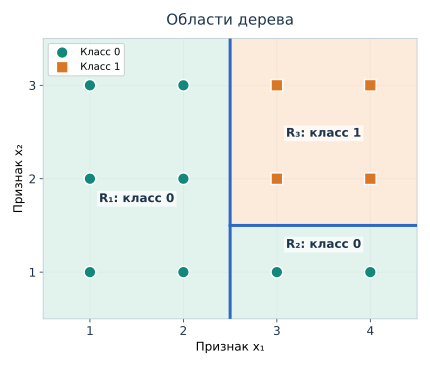

*Рисунок 3. Каждая область соответствует одному листу; внутри неё прогноз постоянен.*

Пороговый предикат по одному числовому признаку задаёт границу, параллельную одной из координатных осей. Несколько последовательных условий формируют прямоугольные области (возможно, неограниченные). При этом два разных листа могут выдавать одинаковый класс, хотя пути к ним различаются.

Если дерево задаёт области $R_1,\ldots,R_M$, а листу $m$ соответствует прогноз $c_m$, его можно записать как

```math
\boxed{\hat f_T(x)=\sum_{m=1}^{M}c_m I[x\in R_m].}
```

Для каждого $x$ ровно один индикатор равен единице, так что сумма выбирает прогноз достигнутого листа. В регрессии $c_m$ — число, в классификации — метка класса, а для вероятностной классификации аналогично выбирается вектор долей классов.

Поэтому дерево с обычными постоянными прогнозами в листьях задаёт **кусочно-постоянную функцию**. На одном числовом признаке это особенно хорошо видно: вместо прямой получается ступенчатый график.

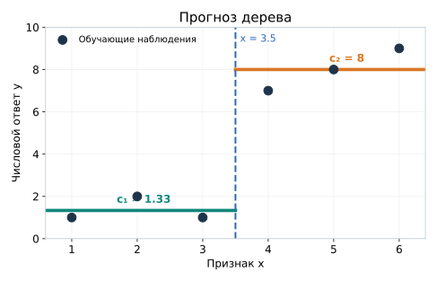

*Рисунок 4. Один порог создаёт две области с собственными постоянными прогнозами.*

Из этих наблюдений уже следуют важные свойства: дерево умеет строить нелинейные зависимости и взаимодействия признаков, но каждый отдельный прогноз определяется локальным правилом и листом. Позже мы вернёмся к тому, почему такая модель может переобучаться, плохо экстраполирует и чувствительна к изменениям выборки.

**Итак.** Применение дерева — движение по готовой структуре от корня к листу. Обучение — отдельная задача: необходимо найти структуру, пороги и прогнозы листьев по размеченным данным.

## 2. Как дерево строится по данным

### 2.1. Начало: дерево из одного листа

Пусть есть обучающая выборка

```math
D=\lbrace (x_i,y_i)\rbrace _{i=1}^{n}.
```

Для определённости сначала рассмотрим бинарную классификацию с числовыми признаками. Перед первым разбиением все объекты находятся в корне. Если считать корень единственным листом, он выдаёт класс большинства. Например, среди 12 объектов восемь имеют метку $0$, четыре — метку $1$. Одно-листовое дерево всегда предсказывает $0$: оно учло распространённость классов, но не использовало признаки.

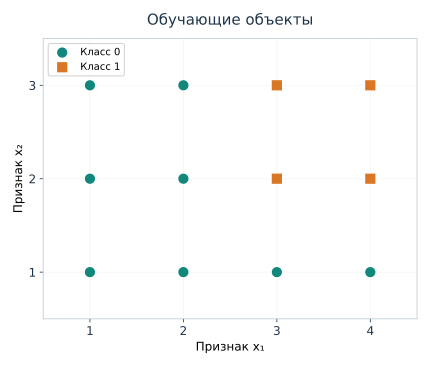

*Рисунок 5. Двенадцать объектов до первого разбиения: пока все находятся в одном узле.*

Чтобы улучшить прогноз, мы можем заменить лист внутренним узлом с условием, разбив объекты на две группы. Каждая дочерняя группа затем получит собственный прогноз либо будет разделена дальше.

### 2.2. Кандидаты на разбиение

Для числового признака стандартный кандидат выглядит так:

```math
P_{j,t}(x)=I[x_j\le t],
```

где $j$ — номер признака, $t$ — порог. Например, условия $x_1\le2.5$ и $x_2\le1.5$ — разные кандидаты. Они формируют разные пары дочерних групп, а значит, разные будущие прогнозы.

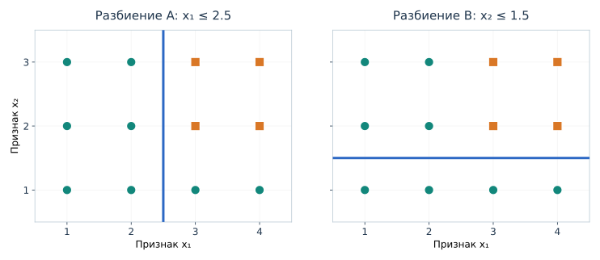

*Рисунок 6. Одни и те же объекты можно разделить по разным признакам и порогам.*

Алгоритму нужен единый способ оценить, какое разбиение лучше. В регрессии для этого подходит снижение квадратной ошибки прогнозов, в классификации — снижение неоднородности классов. Пока достаточно видеть общий принцип: **мы выбираем условие, по которому дочерние группы будут более однородными с точки зрения целевой переменной**.

Поскольку каждая группа содержит наблюдения только текущего узла, сравнение кандидатов является *локальной* задачей. Если в одном узле находятся 20 объектов, алгоритм не возвращает туда все исходные $n$ строк, чтобы заново учить глобальную модель. Он решает задачу на этих 20 объектах.

### 2.3. Рекурсивный рост

После первого разбиения появляются левый и правый дочерние узлы. Для каждого можно снова рассмотреть кандидаты и выбрать лучшее допустимое разбиение. Повторяем эту процедуру, пока узел не станет листом.

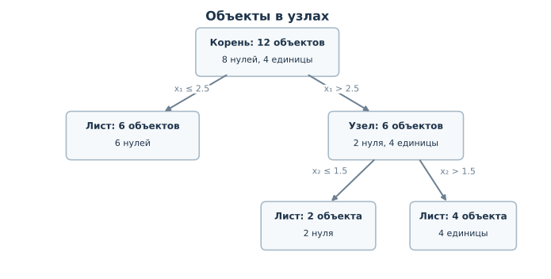

*Рисунок 7. После каждого разбиения задача выбора нового условия повторяется внутри дочерних узлов.*

Процедуру можно описать рекурсивно:

1. Получить объекты текущего узла $S$ и его глубину.
2. Проверить, нельзя ли или не следует ли прекращать деление.
3. Перебрать допустимые пары «признак — порог».
4. Выбрать пару с наибольшим уменьшением неоднородности.
5. Записать выбранное условие и построить два дочерних узла, повторив те же действия для каждого.

Рекурсия здесь — способ описать самоподобную задачу. Внутри каждого узла мы делаем ту же работу, что делали в корне, но над меньшим подмножеством данных. В реальном коде алгоритм может быть реализован рекурсивно или итеративно; это не меняет смысла обучения.

### 2.4. Когда узел становится листом

Деление прекращают по нескольким причинам. Например, все ответы в узле относятся к одному классу; дальнейшее разделение не может уменьшить Gini ниже нуля. Или у объектов нет допустимого признакового разбиения: все подходящие значения совпадают, а разделить их порогом невозможно. Кроме того, рост дерева сознательно ограничивают гиперпараметрами: максимальной глубиной, минимальным числом объектов для split, минимальным размером листа или требованием к выигрышу.

Получив лист, алгоритм сохраняет его прогноз: класс большинства и доли классов либо среднее целевых значений в регрессии. Лист может содержать объекты разных классов — ограничение сложности не обязано ждать полной чистоты.

### 2.5. Почему дерево называют жадным алгоритмом

При выборе условия в текущем узле алгоритм спрашивает: **какой из доступных split лучше сейчас?** Он не перебирает все возможные деревья целиком, сравнивая все их будущие варианты. После выбора корневого условия дальнейшие разбиения строятся уже внутри созданных групп. Другой выбор в корне мог бы привести к иной структуре.

Это **жадный** (*greedy*) принцип оптимизации. Он позволяет строить дерево последовательно и достаточно эффективно, но локально оптимальное условие не обязано входить в глобально оптимальное дерево при ограничении глубины или числа листьев.

Важно также разделять два процесса. При **`fit`** модель выбирает структуру и вычисляет значения листьев; при **`predict`** она уже не сравнивает кандидатов, а проходит по сохранённым условиям. Это знакомая нам разница между обучением и применением оценённой модели.

Далее формализуем, какое число алгоритм использует для сравнения кандидатов. Начнём с регрессии: там мы можем почти без новой математики воспользоваться МНК.

## 3. Регрессионное дерево: как выбрать разбиение по MSE

### 3.1. Прогноз одного листа

Рассмотрим шесть обучающих наблюдений с одним числовым признаком:

| Номер | 1 | 2 | 3 | 4 | 5 | 6 |
|---:|---:|---:|---:|---:|---:|---:|
| $x$ | 1 | 2 | 3 | 4 | 5 | 6 |
| $y$ | 1 | 2 | 1 | 7 | 8 | 9 |

Пока дерево состоит из одного листа, оно вынуждено выдавать один постоянный прогноз $c$. При квадратичной функции потерь выбираем

```math
\hat c\in\arg\min_c\frac{1}{6}\sum_{i=1}^{6}(y_i-c)^2.
```

Оптимальное число — среднее ответов:

```math
\bar y=\frac{1+2+1+7+8+9}{6}=\frac{14}{3}\approx4.67.
```

Напомним почему: для любого $c$

```math
\sum_i(y_i-c)^2
=\sum_i(y_i-\bar y)^2+n(c-\bar y)^2,
```

поскольку смешанный член исчезает из-за $\sum_i(y_i-\bar y)=0$. Следовательно, второе слагаемое неотрицательно и обращается в ноль при $c=\bar y$.

Сумма квадратов отклонений от этого постоянного прогноза составляет

```math
\begin{aligned}
RSS_{\text{один лист}}
&=\sum_{i=1}^{6}(y_i-\bar y)^2\\[0pt]
&=\frac{121+64+121+49+100+169}{9}\\[0pt]
&=\frac{208}{3}\approx69.33.
\end{aligned}
```

Поэтому $MSE=RSS/6=104/9\approx11.56$. Очевидно, что одна горизонтальная линия плохо описывает две группы ответов: первые три равны примерно $1$–$2$, последние три — $7$–$9$.

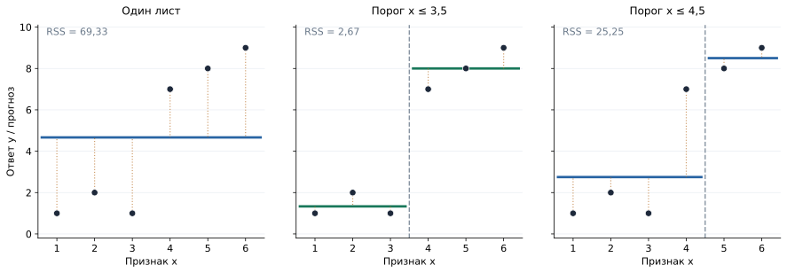

*Рисунок 8. Один постоянный прогноз и два кандидата на первое разбиение.*

### 3.2. Сравним два порога

Возьмём условие $x\le3.5$. В левом дочернем узле окажутся ответы $(1,2,1)$, в правом — $(7,8,9)$. Прогнозы в двух листьях равны соответствующим средним:

```math
\bar y_L=\frac{1+2+1}{3}=\frac43,
\qquad
\bar y_R=\frac{7+8+9}{3}=8.
```

Сумма квадратов отклонений после разбиения:

```math
\begin{aligned}
RSS_L&=(1-4/3)^2+(2-4/3)^2+(1-4/3)^2=\frac23,\\[0pt]
RSS_R&=(7-8)^2+(8-8)^2+(9-8)^2=2,\\[0pt]
RSS_{3.5}&=RSS_L+RSS_R=\boxed{\frac83\approx2.67}.
\end{aligned}
```

Улучшение относительно одного листа равно $208/3-8/3=200/3\approx66.67$. Но алгоритм не должен останавливаться на первом найденном удачном пороге: ему нужно сравнить альтернативы.

При $x\le4.5$ слева окажутся $(1,2,1,7)$, а справа — $(8,9)$. Тогда

```math
\bar y_L=\frac{11}{4}=2.75,
\qquad
\bar y_R=\frac{17}{2}=8.5,
```

```math
\begin{aligned}
RSS_L&=(1-2.75)^2+(2-2.75)^2+(1-2.75)^2+(7-2.75)^2=24.75,\\[0pt]
RSS_R&=(8-8.5)^2+(9-8.5)^2=0.5,\\[0pt]
RSS_{4.5}&=\boxed{25.25}.
\end{aligned}
```

Оба разбиения улучшают подгонку относительно одной константы, но $3.5$ существенно лучше: при $4.5$ значение $7$ смешивается с маленькими ответами и смещает среднее левого листа.

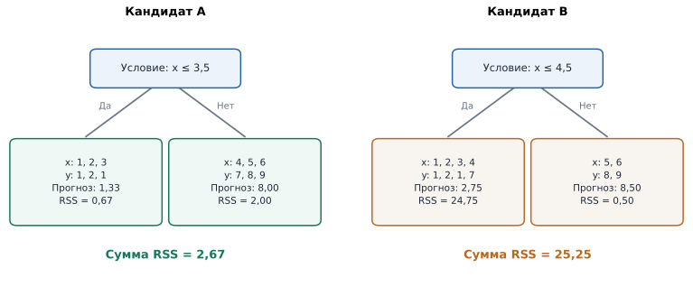

*Рисунок 9. Один и тот же набор данных, два порога, разные прогнозы и ошибки листьев.*

### 3.3. Какие пороги нужно проверить

Наши значения $x$ различны и упорядочены: $1,2,3,4,5,6$. При изменении порога состав групп меняется только при переходе через очередное наблюдаемое значение. Поэтому необязательно проверять все действительные числа — достаточно взять по одному представителю между соседними различными значениями. Обычно используют середины.

| Порог | Размеры групп | $RSS_L+RSS_R$ |
|---:|:---:|---:|
| 1.5 | $1+5$ | 53.20 |
| 2.5 | $2+4$ | 39.25 |
| **3.5** | **$3+3$** | **2.67** |
| 4.5 | $4+2$ | 25.25 |
| 5.5 | $5+1$ | 46.80 |

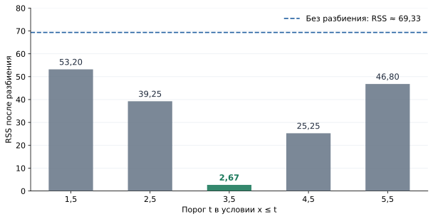

*Рисунок 10. Минимальная сумма квадратов ошибок достигается при пороге $`3.5`$.*

Если признаков несколько, алгоритм перебирает допустимые пороги каждого признака и выбирает лучшую пару «признак — порог». После этого аналогичный поиск продолжается внутри получившихся групп. Здесь важно не смешать два вывода: мы нашли **лучший split в текущем узле**, но не доказали, что он входит в глобально лучшее дерево заданной глубины.

### 3.4. Единая формула улучшения разбиения

Суммарная RSS была удобна, поскольку все кандидаты делили те же шесть объектов. Для общего описания дерева полезно перейти к **средней ошибке внутри узла**.

Пусть $S$ — множество объектов текущего узла, $|S|=n_S$. Определим его неоднородность как

```math
H_{\mathrm{MSE}}(S)=\frac{1}{n_S}\sum_{i\in S}(y_i-\bar y_S)^2,
\qquad
\bar y_S=\frac{1}{n_S}\sum_{i\in S}y_i.
```

Предикат разбивает $S$ на непустые множества $L$ и $R$. Средняя ошибка после split равна

```math
H_{\mathrm{after}}=
\frac{n_L}{n_S}H(L)+\frac{n_R}{n_S}H(R).
```

Множители $n_L/n_S$ и $n_R/n_S$ необходимы: каждая группа влияет на общую ошибку пропорционально числу объектов. **Нельзя просто усреднить две MSE без учёта размеров дочерних узлов**, если размеры различаются.

Выигрыш разбиения:

```math
\boxed{G(S\to L,R)=H(S)-\frac{n_L}{n_S}H(L)-\frac{n_R}{n_S}H(R).}
```

На наших шести объектах исходная MSE равна $104/9\approx11.56$, а после $x\le3.5$ — $(8/3)/6=4/9\approx0.44$. Поэтому

```math
G_{3.5}=\frac{104}{9}-\frac49=\boxed{\frac{100}{9}\approx11.11}.
```

Мы сформулировали общий алгоритм: найти допустимое разбиение с максимальным уменьшением неоднородности. Именно эту схему переносим на классификацию. Меняться будет не рекурсия и не формула взвешивания, а функция $H(S)$.

**Итак.** Регрессионное дерево с MSE выбирает в каждом листе среднее ответов и ищет такие разбиения, при которых суммарная квадратичная ошибка уменьшается. Рекурсивное повторение этой процедуры создаёт кусочно-постоянную прогнозную функцию.

## 4. Классификационное дерево: от долей классов к алгоритму CART

В регрессионном дереве мы выбирали разбиение, минимизирующее квадратную ошибку постоянных прогнозов в дочерних узлах. В классификации сама структура обучения сохраняется: алгоритм перебирает условия, оценивает получившиеся группы и применяет ту же процедуру к потомкам. Но целевая переменная теперь категориальная. Номер класса не обязан иметь числовой смысл, поэтому использовать обычную MSE по кодам категорий как универсальный критерий нельзя.

Внутри классификационного листа разумно хранить доли классов. Для узла $S$ определим

```math
p_k(S)=\frac{n_k(S)}{|S|},\qquad
\sum_{k=1}^{K}p_k(S)=1,
```

где $K$ — число классов, $n_k(S)$ — количество обучающих объектов класса $k$ в этом узле. Самый распространённый класс будет предсказан методом `predict`, а вектор долей $(p_1,\ldots,p_K)$ задаёт простейший вероятностный прогноз `predict_proba`.

### 4.1. Почему ошибки класса большинства недостаточно

Вернёмся к двенадцати объектам с двумя числовыми признаками. В клетках таблицы указаны классы:

| $x_2\backslash x_1$ | 1 | 2 | 3 | 4 |
|:---:|:---:|:---:|:---:|:---:|
| **3** | 0 | 0 | 1 | 1 |
| **2** | 0 | 0 | 1 | 1 |
| **1** | 0 | 0 | 0 | 0 |

В корне восемь нулей и четыре единицы. Если корень оставить листом, он предскажет ноль и ошибётся на четырёх из двенадцати обучающих наблюдений. Доля ошибок класса большинства составляет $4/12=1/3$.

В общем случае она записывается как

```math
H_{\mathrm{err}}(S)=1-\max_k p_k(S).
```

Попробуем условие $x_2\le1.5$. В левую группу попадут четыре нуля, а в правую — четыре нуля и четыре единицы. В левом листе доля ошибок равна нулю. В правом любой из классов можно выбрать как класс большинства, но четыре из восьми ответов будут неверны. В сумме остаются те же четыре ошибки:

```math
\frac{4}{12}\cdot0+\frac{8}{12}\cdot\frac12=\frac13.
```

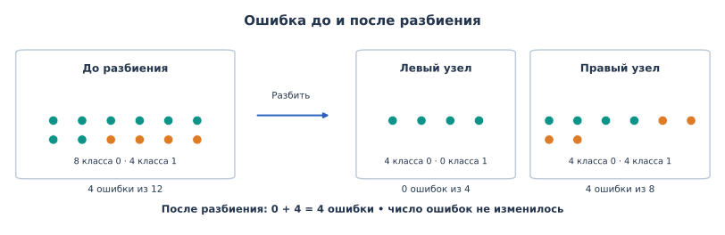

*Рисунок 11. Разбиение уже выделило чистую группу, но число ошибочно классифицированных обучающих объектов осталось прежним.*

Получился важный результат. С точки зрения ошибок конечного классификационного решения разбиение ничего не изменило. Однако одна из групп стала полностью однородной, а другая — ровно наполовину смешанной. Для дальнейшего построения дерева это не то же самое состояние, что было до разбиения. Нужна мера, реагирующая на **состав долей классов**, а не только на класс-победитель.

### 4.2. Неоднородность Gini

**Чистым** называют узел, содержащий объекты одного класса. Чем более сбалансированы несколько классов внутри узла, тем больше его неоднородность. Один из стандартных критериев — **индекс Джини для неоднородности** (*Gini impurity*):

```math
\boxed{H_{\mathrm{Gini}}(S)=1-\sum_{k=1}^{K}p_k(S)^2.}
```

Если в узле только один класс, одна его доля равна единице, остальные — нулю, и Gini равен нулю. Если два класса представлены поровну, получим $1-(1/2)^2-(1/2)^2=1/2$. Для $K$ равновероятных классов Gini равен $1-1/K$.

В бинарном случае пусть $p$ — доля класса $1$, а $1-p$ — доля класса $0$. Тогда

```math
H_{\mathrm{Gini}}(p)=1-p^2-(1-p)^2
=\boxed{2p(1-p)}.
```

Эта функция равна нулю при $p=0$ и $p=1$ и достигает максимума $1/2$ при $p=1/2$. Например, для четырёх нулей и одной единицы $p=1/5$:

```math
H_{\mathrm{Gini}}=2\cdot\frac15\cdot\frac45
=\frac8{25}=0.32.
```

Чтобы оценить разбиение, используем **ровно ту же взвешенную формулу**, которую получили в регрессии:

```math
G(S\to L,R)=H(S)-\frac{n_L}{n_S}H(L)-\frac{n_R}{n_S}H(R),
```

только теперь $H$ означает неоднородность Gini. Алгоритм ищет кандидат с наибольшим выигрышем $G$ — эквивалентно, с минимальной взвешенной неоднородностью потомков. **Принятие** найденного split зависит от правил остановки: например, алгоритм может потребовать строго положительное улучшение или разрешать нулевой выигрыш при выполнении остальных ограничений. Это различие проиллюстрируем на примере XOR в §4.6.

### 4.3. Два разбиения на двенадцати объектах

Для исходного узла доли классов равны $2/3$ и $1/3$:

```math
H(S)=1-\left(\frac23\right)^2-\left(\frac13\right)^2
=\frac49\approx0.4444.
```

**Кандидат A:** $x_2\le1.5$. Слева четыре нуля, значит $H(L)=0$. Справа четыре нуля и четыре единицы, значит $H(R)=1/2$. Средняя неоднородность после split:

```math
H_A^{\mathrm{after}}=\frac4{12}\cdot0+\frac8{12}\cdot\frac12=\frac13.
```

Выигрыш равен

```math
G_A=\frac49-\frac13=\boxed{\frac19\approx0.1111}.
```

Таким образом, Gini **заметил улучшение**, которого не обнаружила доля ошибок класса большинства.

**Кандидат B:** $x_1\le2.5$. Слева шесть нулей, значит $H(L)=0$. Справа шесть наблюдений: два класса $0$ и четыре класса $1$. Для правой группы

```math
H(R)=1-\left(\frac26\right)^2-\left(\frac46\right)^2
=\frac49.
```

После split:

```math
H_B^{\mathrm{after}}=\frac6{12}\cdot0+\frac6{12}\cdot\frac49
=\frac29,
```

поэтому

```math
G_B=\frac49-\frac29=\boxed{\frac29\approx0.2222}.
```

Это улучшение вдвое больше выигрыша кандидата A. Из двух рассмотренных условий предпочитаем $x_1\le2.5$.

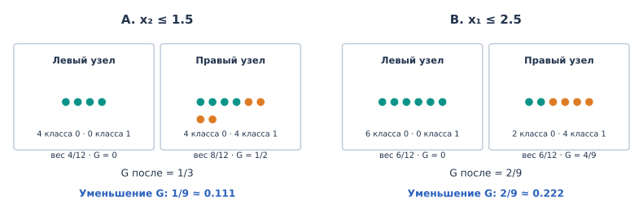

*Рисунок 12. Взвешенная неоднородность после двух разных разбиений; меньшая соответствует большему выигрышу.*

Следует подчеркнуть: мы сравнили **два кандидата**, но настоящее дерево должно рассмотреть все допустимые разбиения данного узла. Если значения числового признака отсортированы, достаточно проверять середины между соседними различными значениями. В нашем примере полный перебор даёт то же выбранное корневое условие $x_1\le2.5$.

При нескольких классах формула Gini не меняется: нужно лишь суммировать квадраты всех долей классов. Не требуется попарно строить отдельное бинарное дерево для каждой пары классов.

### 4.4. Энтропия: другая мера неоднородности

Критерий Джини позволяет сравнивать разбиения по тому, насколько перемешаны классы в полученных группах. Существует и другой способ измерять неоднородность — через **неопределённость относительно класса объекта**. Он приводит к энтропии Шеннона. Чтобы понять её формулу, начнём не с дерева, а с задачи: как передать неизвестную метку класса?

**От неизвестной метки к двоичным сообщениям.** Предположим, что из некоторого узла случайно выбирают объект. Его истинный класс известен отправителю, но ещё неизвестен получателю. Получатель заранее знает, какие классы возможны и каковы их доли в узле. Отправитель должен передать значение метки так, чтобы получатель смог однозначно её восстановить.

Здесь **сообщение** — не текст на естественном языке, а одно значение случайной величины: например, метка $0$ или $1$. Вместо названия класса можно передать заранее согласованный двоичный код, состоящий из нулей и единиц. Каждый двоичный знак называют **битом**. Если нужно различить две равновероятные метки, достаточно договориться, что $0$ обозначает первую, а $1$ — вторую. Получатель прочтёт один бит и узнает метку.

Количество необходимой информации зависит от того, что получатель знал **до** сообщения. Если все объекты в узле относятся к одному классу, истинная метка уже известна: передавать дополнительный знак не требуется. Если возможны два равновероятных класса, для их различения достаточно одного бита.

**Равновероятные исходы.** Пусть возможны восемь равновероятных меток с номерами от $1$ до $8$. Их можно различить тремя последовательными вопросами «да» или «нет». Например, если выбран номер 6, отправитель может ответить:

1. Номер больше 4? **Да** — остаются 5, 6, 7, 8.
2. Номер больше 6? **Нет** — остаются 5 и 6.
3. Номер больше 5? **Да** — остаётся 6.

Если кодировать «да» как $1$, «нет» как $0$, получим последовательность `101`. После каждого вопроса число возможных вариантов уменьшалось вдвое: $8\to4\to2\to1$.

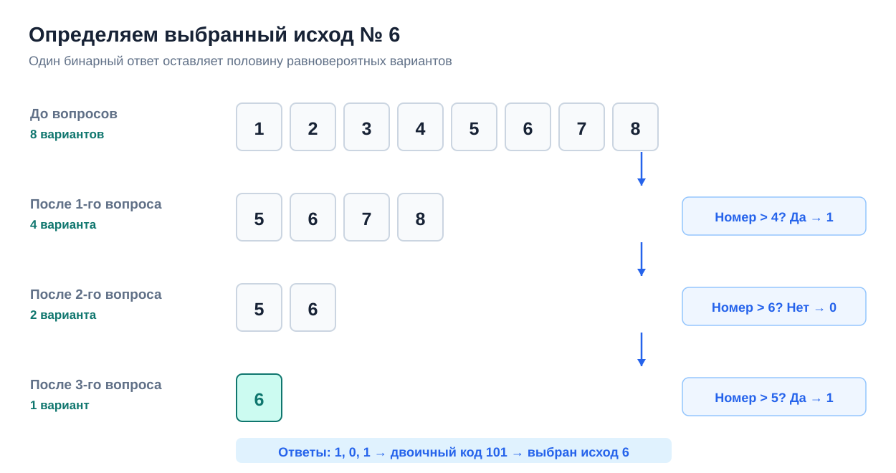

*Рисунок 13. Каждый двоичный вопрос устраняет половину оставшихся равновероятных вариантов; для определения номера 6 достаточно трёх ответов.*

Один бит позволяет различить $2$ варианта, два бита — $2^2=4$, три — $2^3=8$. В общем случае $b$ бит позволяют записать $2^b$ различных последовательностей. Поэтому, если число **равновероятных** вариантов равно $m=2^b$, то

```math
b=\log_2 m.
```

Вероятность каждого из этих исходов $p=1/m$. Значит,

```math
b=\log_2\frac1p=-\log_2p.
```

Мы пока рассматривали специальный случай: исходы равновероятны, а их число — степень двойки. Но уже видно происхождение логарифма: каждый дополнительный бит **удваивает** число различимых вариантов, а логарифм показывает число таких удвоений.

**Почему частые сообщения выгодно кодировать короче.** В узле дерева доли классов обычно неодинаковы. Рассмотрим четыре метки с вероятностями

```math
p(A)=\frac12,\qquad p(B)=\frac14,\qquad
p(C)=p(D)=\frac18.
```

Предположим, метки поступают многократно. В иллюстративной серии из восьми сообщений могли встретиться четыре метки $A$, две $B$, одна $C$ и одна $D$. Это соответствует указанным долям, хотя в другой серии фактические частоты могут отличаться.

Самый простой код присваивает каждой метке два бита: $A\mapsto\texttt{00}$, $B\mapsto\texttt{01}$, $C\mapsto\texttt{10}$, $D\mapsto\texttt{11}$. Тогда на восемь сообщений уйдёт $8\cdot2=16$ бит, а средняя длина одного сообщения составит два бита. Получатель без труда разделит поток на пары знаков.

Но если мы хотим использовать коды **разной длины**, возникает новая задача: где заканчивается один код и начинается следующий? Нельзя, например, назначить $A\mapsto\texttt{0}$, $B\mapsto\texttt{1}$, $C\mapsto\texttt{10}$, $D\mapsto\texttt{01}$: получив `10`, получатель не поймёт, пришла одна метка $C$ или последовательность $B,A$. Передавать разделители возможно, но это потребовало бы дополнительных затрат.

Удобное правило: **ни один законченный код не должен быть началом другого**. Тогда получатель читает поток по одному биту и, достигнув конца кодового слова, сразу знает, что очередное сообщение закончилось. Такой код называют *префиксным*.

Для наших вероятностей можно назначить:

| Метка | Вероятность | Код | Длина |
|---|---:|:---:|---:|
| $A$ | $1/2$ | `0` | 1 бит |
| $B$ | $1/4$ | `10` | 2 бита |
| $C$ | $1/8$ | `110` | 3 бита |
| $D$ | $1/8$ | `111` | 3 бита |

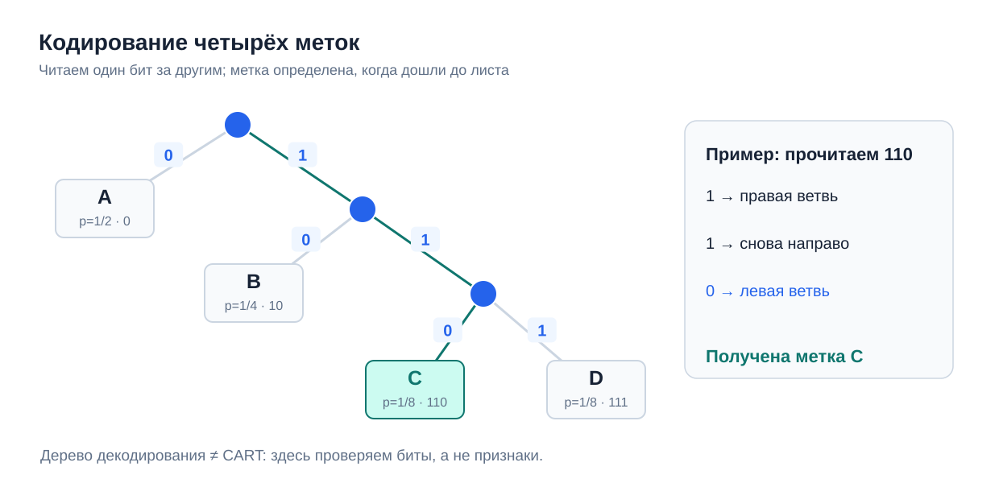

*Рисунок 14. Дерево декодирования: последовательность битов определяет путь до метки. Это дерево **декодирования сообщения**, а не решающее дерево CART.*

Например, последовательность `110` приводит к метке $C$. Следующий знак, если он есть, уже относится к новому сообщению.

Для той же иллюстративной серии длина передачи теперь равна $4\cdot1+2\cdot2+1\cdot3+1\cdot3=14$ битам вместо $16$. В среднем на одну метку приходится

```math
\bar L=\frac12\cdot1+\frac14\cdot2+\frac18\cdot3+\frac18\cdot3
=\boxed{1.75\ \text{бита на метку}}.
```


*Рисунок 15. В серии $`A,A,A,A,B,B,C,D`$ постоянный двухбитовый код требует 16 бит, а выбранный префиксный код — 14. Частые сообщения выгодно кодировать короче.*

Мы выиграли потому, что укоротили код для самого частого сообщения. Удлинение редких сообщений встречается значительно реже, поэтому в среднем сокращает затраты.

**От длины кода к информации одного исхода.** В построенном примере кодовые длины равны $1,2,3,3$, а вероятности являются степенями $1/2$. Поэтому здесь длина каждого кода совпала с числом $-\log_2p$:

```math
\begin{aligned}
p(A)=\tfrac12&\quad\Longrightarrow\quad -\log_2p(A)=1,\\[0pt]
p(B)=\tfrac14&\quad\Longrightarrow\quad -\log_2p(B)=2,\\[0pt]
p(C)=p(D)=\tfrac18&\quad\Longrightarrow\quad -\log_2p(C)=3.
\end{aligned}
```

Это частный удобный пример, а не правило о существовании кодов дробной длины. **Длина записанного двоичного слова** всегда целая. **Информационное содержание исхода** мы хотим определить иначе: как меру его статистической неожиданности, зависящую только от вероятности.

Почему для неожиданности естественен логарифм? Желательно, чтобы мера выполняла три условия: заранее известный исход даёт нулевую информацию; более редкий исход информативнее частого; информация о **двух независимых** результатах складывается. Для независимых событий с вероятностями $p$ и $q$ вероятность совместного наступления равна $pq$, а логарифм превращает произведение в сумму:

```math
-\log_2(pq)=-\log_2p-\log_2q.
```

Например, результат одного броска честной монеты даёт один бит информации, а два независимых броска — два бита: вероятность конкретной пары равна $1/4$, и $-\log_2(1/4)=2$. Три независимых броска дают восемь вариантов и три бита. Логарифм описывает ситуацию, когда каждый следующий независимый бинарный результат добавляет один бит, хотя вероятность всей последовательности каждый раз уменьшается вдвое.

Основание 2 задаёт единицу измерения — **бит**, а минус нужен потому, что $\log_2p\le0$ для допустимой вероятности $p\le1$. Так приходим к определению **информационного содержания** (*self-information*) отдельного исхода $y$ с положительной вероятностью:

```math
\boxed{h(y)=-\log_2p(y),\qquad p(y)>0.}
```

Чем реже исход, тем больше информации приносит известие о его наступлении. Например, при распределении меток $(0.9,0.1)$ частый исход имеет информационное содержание $-\log_2(0.9)\approx0.152$ бита, а редкий — $-\log_2(0.1)\approx3.322$ бита. **Это не означает**, что можно передать конкретную метку физическим кодом длиной $0.152$ символа. Речь о разных величинах. Если кодировать длинную последовательность сообщений совместно, среднее число передаваемых битов в пересчёте на одну метку может быть дробным.

Слово «информация» здесь не следует понимать как общественную значимость, полезность или важность сообщения. Мера описывает **статистическую неожиданность исхода при заранее известном распределении**.

**От информации одного исхода к неопределённости распределения.** Информация $h(y)$ относится к уже произошедшему конкретному событию. Но во время обучения дерева мы ещё **не знаем класс случайно выбранного объекта**. Нам известны лишь возможные метки и их доли внутри рассматриваемого узла. Поэтому нужна величина, характеризующая неопределённость **до наблюдения** конкретного класса.

Пусть случайная метка $Y$ принимает классы $1,\ldots,K$, а их вероятности в узле оцениваются частотами $p_k(S)$. Усредним информационное содержание возможных исходов с весами по их вероятностям. Получим **энтропию Шеннона**:

```math
\boxed{
H_{\mathrm{ent}}(S)=\mathbb E[h(Y)]
=-\sum_{k=1}^{K}p_k(S)\log_2p_k(S).
}
```

Таким образом, энтропия — *средняя информация, которую приносит раскрытие неизвестной метки*, и одновременно мера неопределённости её распределения до наблюдения.

В примере с метками $A$–$D$ энтропия равна $1.75$ бита и точно совпадает со средней длиной построенного префиксного кода. Для произвольных вероятностей совпадение энтропии со средней длиной кода отдельных сообщений не гарантируется. При совместном кодировании длинных последовательностей средний расход битов на одну метку может приближаться к энтропии.

Посмотрим на три характерных бинарных распределения:

- **$100\%/0\%$.** Единственный класс известен заранее: $H_{\mathrm{ent}}=0$.
- **$50\%/50\%$.** Каждый из двух исходов приносит один бит: $H_{\mathrm{ent}}=1$ бит.
- **$90\%/10\%$.** Частый исход приносит примерно $0.152$ бита, редкий — около $3.322$ бита. Но редкое событие случается лишь в одной десятой случаев, поэтому

```math
H_{\mathrm{ent}}=0.9\cdot0.152+0.1\cdot3.322
\approx\boxed{0.469\ \text{бита}}.
```

Получается важное различие: **редкий исход может приносить много информации, но распределение с одним преобладающим классом в среднем предсказуемее**, чем распределение $50\%/50\%$. Поэтому энтропия пригодна для измерения неоднородности классов в узле.

В бинарной классификации при доле первого класса $p$ и доле второго $1-p$ имеем

```math
H_{\mathrm{ent}}(p)= -p\log_2p-(1-p)\log_2(1-p).
```

Энтропия, как и Gini, равна нулю в чистых узлах и максимальна при равных долях. Для двух классов максимум составляет один бит, для $K$ равновероятных — $\log_2K$ бит. В формулах используется стандартное соглашение $0\log_2 0=0$: математически это предел $p\log_2p\to0$ при $p\to0+$. Для отсутствующего класса никакая информация о невозможном исходе не усредняется, поэтому его вклад принимается равным нулю.

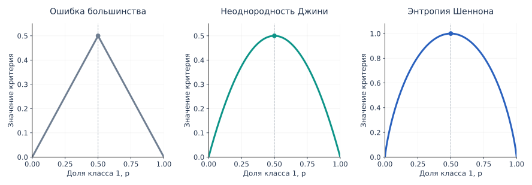

*Рисунок 16. Три меры неоднородности при бинарной классификации. На панелях разные вертикальные шкалы: ошибка большинства образует ломаную, Gini и энтропия меняются плавнее.*

**Как энтропия помогает выбрать разбиение.** После пороговой проверки объект оказывается в левом или правом дочернем узле. Распределение классов и его энтропия теперь могут различаться между группами. Чтобы оценить оставшуюся неопределённость **после того, как мы узнали ветвь**, взвесим энтропию потомков по числу объектов:

```math
H_{\mathrm{ent,after}}(S;j,t)=
\frac{n_L}{n_S}H_{\mathrm{ent}}(L)
+\frac{n_R}{n_S}H_{\mathrm{ent}}(R).
```

Разность между исходной и оставшейся энтропией называют **информационным выигрышем** (*information gain*):

```math
IG(S;j,t)=H_{\mathrm{ent}}(S)-H_{\mathrm{ent,after}}(S;j,t).
```

Здесь важно не путать информационный выигрыш с количеством бит, в которых закодирован **сам результат проверки** «да/нет». Он показывает, насколько знание ветви помогает узнать **класс объекта**.

Вернёмся к двенадцати объектам из §4.3. В корне восемь нулей и четыре единицы, поэтому

```math
H_{\mathrm{ent}}(S)
=-\frac23\log_2\frac23-\frac13\log_2\frac13
\approx0.9183\ \text{бита}.
```

**Кандидат A: $x_2\le1.5$.** Слева четыре нуля — энтропия нулевая. Справа четыре нуля и четыре единицы — энтропия равна одному биту. Следовательно,

```math
\begin{aligned}
H_{\mathrm{ent,after},A}&=\frac4{12}\cdot0+\frac8{12}\cdot1
=\frac23\approx0.6667,\\[0pt]
IG_A&\approx0.9183-0.6667
=\boxed{0.2516\ \text{бита}}.
\end{aligned}
```

**Кандидат B: $x_1\le2.5$.** Слева шесть нулей, а справа два нуля и четыре единицы. Доли в правой ветви равны $1/3$ и $2/3$, то есть энтропия этого дочернего узла совпадает с энтропией корня. Тогда

```math
\begin{aligned}
H_{\mathrm{ent,after},B}&=\frac6{12}\cdot0+\frac6{12}\cdot0.9183
\approx0.4591,\\[0pt]
IG_B&\approx0.9183-0.4591
=\boxed{0.4591\ \text{бита}}.
\end{aligned}
```

Кандидат B снова лучше A. В этом примере энтропия и Gini предпочитают один split, хотя величины выигрышей и шкалы различаются. На других данных ранжирование кандидатов может оказаться разным.

Смена основания логарифма с 2 на $e$ переводит биты в **наты**, умножая все энтропии на один положительный коэффициент. При сравнении кандидатов это не изменяет лучший split, если везде используется одно основание.

Итак, **алгоритм рекурсивного построения дерева не меняется**: мы всё так же перебираем кандидаты и сравниваем взвешенную неоднородность потомков. Меняется только функция $H$, которую алгоритм использует для оценки каждого разбиения. В §5 мы ещё раз встретим энтропию — уже как оптимальную среднюю log-loss константного вероятностного предсказания.

### 4.5. Как обучается классификационное дерево: полный пример

В §§2–4 мы уже познакомились с общим алгоритмом построения дерева, узнали, как выбирать одно разбиение, и сравнили два критерия неоднородности. Теперь соберём эти элементы в **полный последовательный расчёт**: какие варианты алгоритм рассмотрит в корне, какой выберет и как повторит ту же процедуру в дочернем узле.

Будем строить **бинарное дерево классификации с пороговыми разбиениями** по критерию Джини. Это один из стандартных вариантов CART (*Classification and Regression Trees* — «деревья классификации и регрессии»). Критерий Gini выбран для удобства арифметики: энтропия — другой допустимый вариант оценки неоднородности.

**Корень: перебираем кандидатов.** Используем те же 12 наблюдений, что и выше. Строки таблицы соответствуют значениям $x_2$, столбцы — значениям $x_1$, а в клетках стоят целевые классы:

| $x_2\backslash x_1$ | 1 | 2 | 3 | 4 |
|:---:|:---:|:---:|:---:|:---:|
| **3** | 0 | 0 | 1 | 1 |
| **2** | 0 | 0 | 1 | 1 |
| **1** | 0 | 0 | 0 | 0 |

В корне восемь нулей и четыре единицы. Если сейчас остановиться, прогнозом станет класс 0. Но сначала проверим, можно ли уменьшить неоднородность. Gini корня равен

```math
H_{\mathrm{Gini}}(S)
=1-\left(\frac8{12}\right)^2-\left(\frac4{12}\right)^2
=\frac49.
```

Какие условия имеет смысл проверить? У $x_1$ в текущем узле есть значения $1,2,3,4$. Разделение объектов изменяется только при переходе через соседние различные значения, поэтому достаточно порогов $1.5$, $2.5$ и $3.5$. Аналогично для $x_2\in\lbrace 1,2,3\rbrace $ достаточно порогов $1.5$ и $2.5$.

**Всего пять кандидатов.** Для каждого алгоритм делает одно и то же: делит объекты на две группы, рассчитывает их Gini, взвешивает по размеру групп и вычитает из исходной неоднородности. Два кандидата мы подробно считали в §4.3, а теперь покажем **полный перебор**:

| Признак и порог | Размеры групп | Выигрыш Gini |
|---|:---:|---:|
| $x_1\le1.5$ | $3+9$ | $2/27\approx0.074$ |
| **$x_1\le2.5$** | **$6+6$** | **$2/9\approx0.222$** |
| $x_1\le3.5$ | $9+3$ | $2/27\approx0.074$ |
| $x_2\le1.5$ | $4+8$ | $1/9\approx0.111$ |
| $x_2\le2.5$ | $8+4$ | $1/36\approx0.028$ |

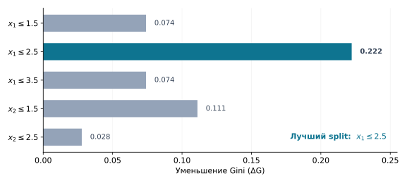

*Рисунок 17. Полный перебор порогов в корне. Максимальный выигрыш Gini получает условие $`x_1\le2.5`$.*

Выбираем **$x_1\le2.5$** и записываем его в корень. Это лучший **локальный split в корне**, но не доказательство глобальной оптимальности полученной структуры дерева.

**Дочерние узлы: у каждого свои данные.** После первого split получаем:

| Левый узел: $x_1\le2.5$ | Правый узел: $x_1>2.5$ |
|---|---|
| $x_1\in\lbrace 1,2\rbrace $ | $x_1\in\lbrace 3,4\rbrace $ |
| $x_2\in\lbrace 1,2,3\rbrace $ | $x_2\in\lbrace 1,2,3\rbrace $ |
| **6 объектов класса 0** | **2 объекта класса 0 и 4 класса 1** |
| $G(S_L)=0$ | $G(S_R)=4/9$ |

Левая группа чистая: все шесть объектов относятся к классу 0. Её дальше делить для уменьшения Gini бессмысленно, поэтому здесь появляется **лист с прогнозом 0**.

Правая группа остаётся смешанной. Но теперь дерево выбирает следующий split **только среди шести объектов этой группы**, а не повторно на всех двенадцати:

| $x_2\backslash x_1$ | 3 | 4 |
|:---:|:---:|:---:|
| **3** | 1 | 1 |
| **2** | 1 | 1 |
| **1** | 0 | 0 |

Среди оставшихся наблюдений $x_1$ принимает лишь значения 3 и 4, поэтому для него доступен один порог $3.5$. Для $x_2$ есть два порога — $1.5$ и $2.5$. Выбор опять определяется вычисленным улучшением Gini **для текущей шестёрки объектов**:

| Признак и порог | Размеры групп | Выигрыш Gini |
|---|:---:|---:|
| $x_1\le3.5$ | $3+3$ | 0 |
| **$x_2\le1.5$** | **$2+4$** | **$4/9\approx0.444$** |
| $x_2\le2.5$ | $4+2$ | $1/9\approx0.111$ |

Поясним лучший вариант: условие $x_2\le1.5$ помещает два нуля в левую группу, а четыре единицы — в правую. Оба потомка чистые, поэтому их взвешенная неоднородность равна нулю:

```math
\begin{aligned}
H_{\mathrm{after}}&=\frac26\cdot0+\frac46\cdot0=0,\\[0pt]
G(S_R)&=\frac49-0=\boxed{\frac49}.
\end{aligned}
```

Кандидат $x_1\le3.5$ ничего не улучшает, поскольку обе группы сохраняют исходные доли классов — один ноль и две единицы в каждой. Условие $x_2\le2.5$ улучшает критерий, но оставляет одну дочернюю группу смешанной. Поэтому второй внутренний узел проверяет именно **$x_2\le1.5$**.

**Остановка и готовое дерево.** После второго split у нас три листа: первый содержит шесть нулей, второй — ещё два нуля, третий — четыре единицы. Все чистые, поэтому дальнейший рост здесь не нужен.

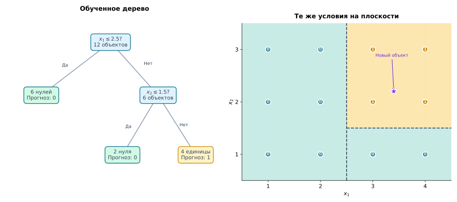

*Рисунок 18. Слева — готовое дерево с числом объектов в листьях, справа — те же правила в пространстве двух признаков. Горизонтальное разбиение применено только справа от вертикального.*

Функцию прогноза можно записать тремя случаями:

```math
\hat f(x)=\begin{cases}
0,&x_1\le2.5,\\[0pt]
0,&x_1>2.5\ \text{и}\ x_2\le1.5,\\[0pt]
1,&x_1>2.5\ \text{и}\ x_2>1.5.
\end{cases}
```

Для нового объекта $x=(3.4,2.2)$ дерево сначала проверит $3.4\le2.5$ — нет, пойдёт вправо. Затем проверит $2.2\le1.5$ — снова нет, и объект попадёт в лист класса 1. Так работает `predict`.

Для `predict_proba` тот же лист содержит четыре обучающих объекта класса 1 и ни одного класса 0, поэтому обычная долевая оценка вероятностей равна $(0,1)$. В реальном дереве листья могут быть смешанными: например, при ограничении глубины единицей правая ветвь останется листом с двумя нулями и четырьмя единицами. Тогда `predict` вернёт класс 1, а `predict_proba` — $(1/3,2/3)$. **Чистота листьев не обязательна**: остановка может быть вызвана ограничениями сложности.

**Весь алгоритм в одном псевдокоде.** Теперь можно описать построение дерева независимо от нашего конкретного примера:

```text
ПостроитьУзел(S, глубина):
    вычислить прогноз по объектам S

    если выполнено условие остановки:
        вернуть лист с этим прогнозом

    найти все допустимые кандидаты на split
    оценить их улучшение по выбранному критерию
    выбрать лучший кандидат из разрешённых правилами роста

    если допустимый для принятия split не найден:
        вернуть лист с этим прогнозом

    разделить S на непустые группы S_left и S_right
    создать внутренний узел с выбранным условием
    левый потомок  = ПостроитьУзел(S_left, глубина + 1)
    правый потомок = ПостроитьУзел(S_right, глубина + 1)
    вернуть созданный узел
```

**Рекурсивность** означает, что один и тот же алгоритм запускается сначала на всех наблюдениях, затем отдельно на объектах левой и правой ветви, затем на их подгруппах. При `fit` находятся условия и листовые прогнозы; при `predict` никакой перебор кандидатов не повторяется.

Обратим внимание на строчку «выбрать лучший кандидат из **разрешённых правилами роста**». В простейшей учебной схеме дерево продолжает делиться, если найден кандидат с *положительным* улучшением. Но общий механизм деревьев допускает и другие правила: в зависимости от реализации и настроек можно разрешать split с нулевым непосредственным выигрышем или, напротив, требовать улучшения выше заданного порога. Это различие окажется существенным для следующего примера XOR. **Жадный выбор кандидата** и **условие его принятия** — два разных шага.

CART — не единственное семейство алгоритмов. Например, классические ID3 и C4.5 используют другие соглашения о разбиениях, критериях и обработке категориальных признаков. Но базовая схема остаётся прежней: оценить текущий узел, выбрать допустимое правило, рекурсивно построить потомков и остановиться по установленным условиям. Для нас важнее понять именно CART-подобное построение, лежащее в основе обычных деревьев `scikit-learn`.

**Итак.** Мы действительно рассмотрели пять кандидатов в корне и три кандидата в правом узле. Полученные два условия не были придуманы заранее: они найдены по Gini на текущих обучающих подмножествах. В конце дерево содержит три листа, но в реальной задаче листья не обязаны быть чистыми и качество на train не гарантирует качество на новых данных.

### 4.6. Почему полезное правило может требовать промежуточного шага

Жадное обучение имеет более тонкое ограничение, чем просто возможность выбрать неоптимальный первый split. Иногда первый шаг вообще не уменьшает выбранный критерий, хотя два последовательных шага дали бы идеальную модель. Хороший пример — логическая функция XOR.

Пусть два бинарных признака $x_1,x_2\in\lbrace 0,1\rbrace $ равновероятны, а класс определяется условием «признаки различаются»:

| $x_1$ | $x_2$ | $y$ |
|---:|---:|---:|
| 0 | 0 | 0 |
| 0 | 1 | 1 |
| 1 | 0 | 1 |
| 1 | 1 | 0 |

В корне два нуля и две единицы, то есть Gini равен $0.5$. Если разделить по одному лишь $x_1$, обе дочерние группы снова будут содержать по одному нулю и одной единице. С Gini после разбиения ничего не произойдёт; выигрыш равен нулю. То же верно для разделения по $x_2$.

Но если разрешить первый шаг, не дающий немедленного улучшения, а затем внутри каждого дочернего узла разделить по второму признаку, все четыре листа станут чистыми.

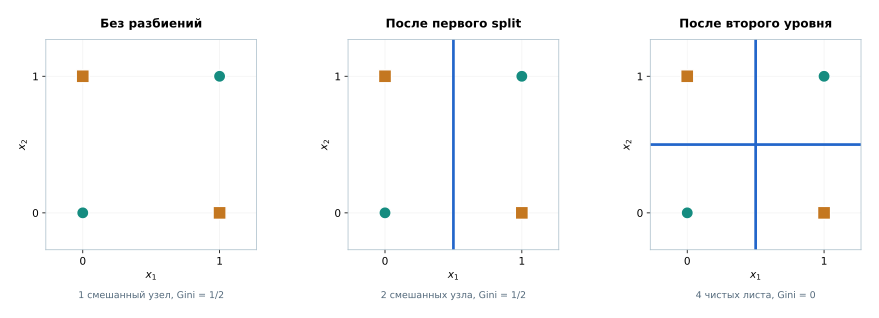

*Рисунок 19. Первый split не уменьшает неоднородность, но создаёт условия для полезных разбиений следующего уровня.*

Этот пример не означает, что любая реализация CART обязательно построит XOR. Наоборот, он показывает **зависимость результата от правил разрешения разбиений с нулевым выигрышем, остановки и выбора кандидатов**. Кроме того, в шумных реальных данных разрешение бесполезных первых шагов может привести к переобучению. Нельзя просто бесконечно делить дерево в надежде, что польза появится позже.

**Итак.** Gini и энтропия — две альтернативные меры неоднородности классов. Вычисление выигрыша, перебор условий, жадный выбор и рекурсивное построение одинаковы для обеих. Даже идеальная подгонка маленького дерева на train не говорит об обобщающей способности.

## 5. Почему Gini и энтропия связаны с функциями потерь

До сих пор мы воспринимали Gini и энтропию как способы оценивать состав классов в узле. Однако оба критерия можно получить из уже знакомой нам конструкции **модель → функция потерь → оптимальный прогноз**. Эта связь особенно полезна после линейной и логистической регрессии, где мы отдельно разбирали квадратичную и логарифмическую функции потерь.

### 5.1. Одна постановка для разных критериев

Пусть в узле $S$ содержится $n_S$ обучающих объектов $K$ классов, а их доли равны $p_1,\ldots,p_K$. Предположим, что лист должен выдавать **один и тот же вероятностный прогноз для всех объектов в нём**:

```math
q=(q_1,\ldots,q_K),\qquad q_k\ge0,
\quad\sum_{k=1}^{K}q_k=1.
```

Это константная модель — такая же по смыслу, как константный прогноз $c$ в регрессии. Мы вправе выбрать вектор $q$, минимизирующий среднюю функцию потерь на объектах узла:

```math
\hat q\in\arg\min_{q\in\Delta_K}
\frac{1}{n_S}\sum_{i\in S}L(y_i,q),
```

где $\Delta_K$ — множество допустимых вероятностных векторов.

Сначала выясним, какой $q$ предпочитают квадратичная и логарифмическая функции потерь. Затем посмотрим, чему равна минимально достижимая потеря при выбранном составе классов. Именно она станет мерой неоднородности листа.

### 5.2. Квадратичная ошибка вероятностей приводит к Gini

Для класса $y$ определим one-hot вектор $e_y$: он содержит единицу на позиции правильного класса и нули на остальных. В качестве функции потерь возьмём квадратичное расстояние между этим вектором и прогнозируемыми вероятностями:

```math
L_{\mathrm{sq}}(y,q)=\sum_{k=1}^{K}\bigl(I[y=k]-q_k\bigr)^2.
```

Усредним по объектам узла. Для каждого класса $k$ доля объектов с $I[y=k]=1$ равна $p_k$. После раскрытия квадратов получаем

```math
\begin{aligned}
R_S(q)
&=\frac{1}{n_S}\sum_{i\in S}\sum_{k=1}^{K}
\bigl(I[y_i=k]-q_k\bigr)^2\\[0pt]
&=1-2\sum_{k=1}^{K}p_kq_k+\sum_{k=1}^{K}q_k^2.
\end{aligned}
```

Добавим и вычтем $\sum_kp_k^2$:

```math
\begin{aligned}
R_S(q)
&=1-\sum_kp_k^2+\sum_k(q_k-p_k)^2\\[0pt]
&=\underbrace{\left(1-\sum_kp_k^2\right)}_{\text{зависит только от состава узла}}
+\underbrace{\|q-p\|_2^2}_{\ge0}.
\end{aligned}
```

Вторая часть минимальна при $q=p$. Следовательно, лучший постоянный вектор прогнозируемых вероятностей — **вектор долей классов**:

```math
\boxed{q^*=p.}
```

А минимально достижимый средний квадрат ошибки равен

```math
\boxed{\min_qR_S(q)=1-\sum_{k=1}^{K}p_k^2
=H_{\mathrm{Gini}}(S).}
```

Именно так Gini возникает из квадратичной функции потерь для вероятностных прогнозов. Неоднородность узла — это не произвольный штраф, а **остаточная ошибка лучшего постоянного вероятностного прогноза** в этом узле при выбранной функции потерь.

Для бинарного случая с долей единиц $p$ получаем $2p(1-p)$. Если $p=0$ или $p=1$, лист идеально предсказывает one-hot метку всех своих объектов и ошибка равна нулю. Если $p=1/2$, один постоянный вектор вероятностей $(1/2,1/2)$ неизбежно оставляет ненулевую квадратичную ошибку.

Важно помнить о соглашении относительно масштаба функции потерь. Мы определили квадрат ошибки как сумму по **всем компонентам** вероятностного вектора. Если использовать другой множитель, например среднее по классам, минимизатор не изменится, но численное значение критерия умножится на константу. Для сопоставления с обычным Gini используется именно выбранная выше нормировка.

### 5.3. Логарифмическая функция потерь приводит к энтропии

Теперь оцениваем вероятностный прогноз логарифмической функцией потерь: если правильный класс $y$, то

```math
L_{\log}(y,q)=-\ln q_y.
```

Усреднив по объектам узла, получаем

```math
R_S(q)=-\sum_{k=1}^{K}p_k\ln q_k.
```

Здесь $p_k$ — **фактические доли классов в узле**, а $q_k$ — величины, которые мы выбираем как прогнозы. Они не обязаны совпадать заранее.

Найдём минимум при условии $\sum_kq_k=1$. Для положительных вероятностей используем множитель Лагранжа:

```math
F(q,\lambda)=-\sum_kp_k\ln q_k
+\lambda\left(\sum_kq_k-1\right).
```

Приравнивая частные производные к нулю, получаем

```math
\frac{\partial F}{\partial q_k}
=-\frac{p_k}{q_k}+\lambda=0
\quad\Longrightarrow\quad q_k=\frac{p_k}{\lambda}.
```

Из условия нормировки следует $\sum_kq_k=(1/\lambda)\sum_kp_k=1/\lambda=1$, поэтому $\lambda=1$ и

```math
\boxed{q_k^*=p_k.}
```

При $p_k=0$ оптимум на границе допускает $q_k=0$, а выражение $0\ln0$ трактуется по непрерывности как ноль. Минимальная логарифмическая потеря:

```math
\boxed{\min_qR_S(q)=-\sum_{k=1}^{K}p_k\ln p_k.}
```

Это **энтропия распределения классов**, выраженная в натуральных единицах (*натах*), поскольку мы использовали $\ln$. Если взять $-\log_2q_y$, минимальная потеря будет выражена в битах:

```math
H_{\mathrm{ent}}(S)=-\sum_k p_k\log_2 p_k.
```

Энтропия через математическое ожидание информации и энтропия как минимальная log loss постоянного вероятностного прогноза — две стороны одной конструкции. Одна исходит из неопределённости о классе, другая — из качества вероятностных предсказаний.

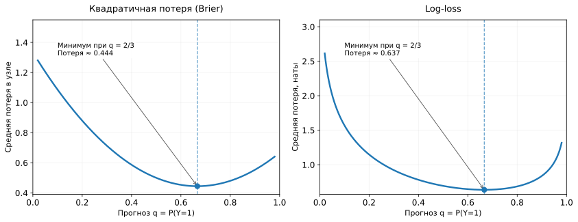

*Рисунок 20. Для заданных долей классов оптимальным постоянным вероятностным прогнозом при обеих функциях потерь служат сами доли, но минимальные значения потерь различаются.*

### 5.4. Что объединяет результаты

Мы получили три родственных ситуации:

| Задача | Что предсказывает лист | Функция потерь | Минимальная ошибка листа |
|---|---|---|---|
| Регрессия | Число $c$ | $(y-c)^2$ | MSE относительно среднего $\bar y_S$ |
| Классификация | Вероятности $q$ | $\sum_k(I[y=k]-q_k)^2$ | $1-\sum_kp_k^2$ (Gini) |
| Классификация | Вероятности $q$ | $-\ln q_y$ | $-\sum_kp_k\ln p_k$ (энтропия в натах) |

Во всех случаях мы выбираем лучший **постоянный прогноз для объектов узла**, затем оцениваем, насколько можно уменьшить его ошибку, разделив узел на два меньших. Поэтому схема построения дерева остаётся единой:

```math
\text{один узел}
\ \longrightarrow\
\text{два дочерних узла}
\ \longrightarrow\
\text{сравнение минимально возможных ошибок}.
```

Однако здесь есть важное различие. **Критерий разбиения и окончательная метрика качества модели — не одно и то же.** Дерево, обучаемое по Gini, можно оценивать по accuracy, log loss, ROC-AUC или иной выбранной метрике. Алгоритм использует уменьшение Gini как локальную цель построения структуры; качество прогнозов на новых наблюдениях проверяется отдельно.

Другой вывод касается вероятностей. То, что доли классов оптимальны на **обучающих объектах конкретного листа** для рассматриваемых функций потерь, само по себе не гарантирует хорошей калибровки вероятностей на новых данных. Лист может содержать слишком мало наблюдений, а структура дерева — быть подогнанной под случайные особенности выборки.

Именно поэтому после понимания критериев разбиения необходимо изучить **сложность дерева, ограничения роста и обобщающую способность**. Дерево способно уменьшать неоднородность всё сильнее на train, но не обязано становиться полезнее на новых объектах.

## 6. Почему деревья переобучаются и как контролировать их сложность

Мы уже знаем, как построить дерево: в каждом узле алгоритм ищет разбиение, которое снижает выбранный критерий, а затем повторяет поиск на полученных подмножествах. Но между двумя утверждениями есть принципиальная разница:

- на очередном шаге удалось уменьшить неоднородность **обучающих** наблюдений;
- построенная модель стала лучше предсказывать **новые** наблюдения.

Первое утверждение относится к алгоритму оптимизации. Второе — к обобщающей способности, которую нужно проверять на данных, не участвовавших в построении дерева.

### 6.1. Когда чистые листья становятся проблемой

Представим классификационное дерево, которому почти ничто не запрещает расти. Оно всё дальше дробит обучающую таблицу. В какой-то момент отдельные листья содержат один-два объекта, и дерево может правильно воспроизводить практически все их метки. При достаточно богатом наборе числовых разбиений и отсутствии неразделимых объектов с противоречащими метками возможно добиться нулевой обучающей ошибки.

Сам по себе этот результат не означает, что модель обнаружила устойчивое правило. Если ответ некоторого объекта содержит ошибку разметки или редкое случайное отклонение, дерево может создать специальную маленькую область именно для него. Следующий похожий объект попадёт в эту область, но его настоящий класс вполне может оказаться другим.

В регрессии проблема аналогична. Мы выяснили, что лист предсказывает среднее $y$ по своим обучающим объектам. В листе из одного наблюдения среднее совпадает с его ответом, поэтому его вклад в обучающую RSS равен нулю. Но если $y=f(x)+\varepsilon$, то вместе с систематической частью $f(x)$ дерево фактически запомнило и конкретную реализацию шума $\varepsilon$.

Посмотрим, как это проявляется геометрически.

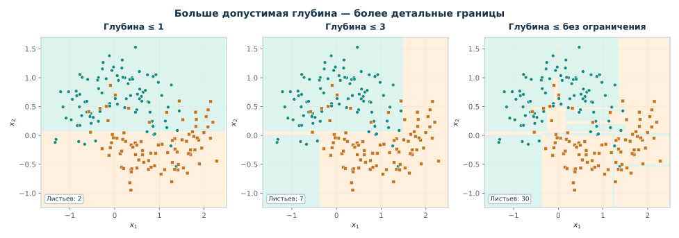

*Рисунок 21. На одних шумных данных неглубокое дерево создаёт крупные области, а глубокое может выстраивать множество мелких прямоугольников вокруг обучающих объектов.*

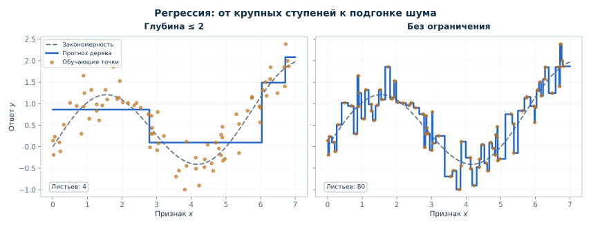

*Рисунок 22. Неглубокое регрессионное дерево усредняет ответы внутри крупных интервалов. Глубокое создаёт больше ступеней и может подстраиваться под шум отдельных наблюдений.*

Здесь не нужно полагаться на впечатление от картинки. Правильная проверка — обучить несколько деревьев разной сложности на одной обучающей части и сравнить их метрики на независимой *validation*-выборке.

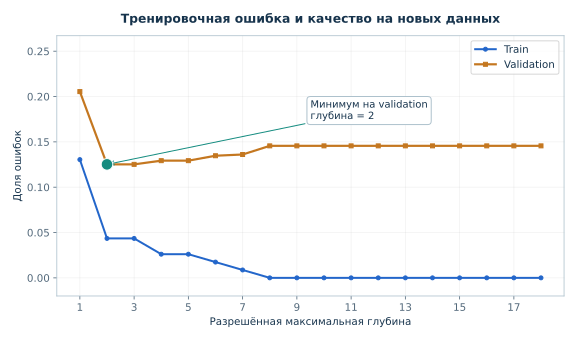

*Рисунок 23. Типичный результат эксперимента: увеличение глубины позволяет снижать обучающую ошибку, но ошибка на validation после определённого уровня перестаёт уменьшаться и может расти. Форма кривых зависит от конкретной выборки.*

Оговорим две вещи. Во-первых, `max_depth` задаёт **максимально разрешённую** глубину: алгоритм не обязан использовать её полностью. Во-вторых, ошибка на validation не обязана двигаться строго по нарисованной кривой. Мы видим не математический закон монотонности, а механизм риска переобучения.

**Регуляризация решающего дерева** — контроль множества структур, которые разрешено построить алгоритму. Можно ограничить рост заранее либо сначала вырастить дерево, а потом удалить часть ветвей.

### 6.2. Ограничиваем рост заранее: pre-pruning

*Pre-pruning* — совокупность ограничений, проверяемых непосредственно во время построения дерева. В `scikit-learn` их удобно обсуждать через несколько параметров.

**`max_depth`: максимальная глубина.** При `max_depth=2` корень находится на глубине 0, его дети — на глубине 1, и на глубине 2 должны остаться листья. Дерево не получает права создать ещё один уровень, даже если в текущем узле остались разные классы.

**`min_samples_split`: минимальный размер узла для попытки разбиения.** Например, при значении 6 узел из пяти объектов нельзя разделить дальше. Узел из шести объектов можно рассмотреть, но это ещё не гарантирует, что найдётся подходящий кандидат.

**`min_samples_leaf`: минимальное число обучающих объектов в каждой дочерней группе.** Если требуется не меньше четырёх объектов, разбиение группы из 12 наблюдений на части $6+6$ допустимо, а на $3+9$ — нет. Это ограничение относится к **обеим частям каждого кандидата**: недостаточно проверить размер только текущего узла.

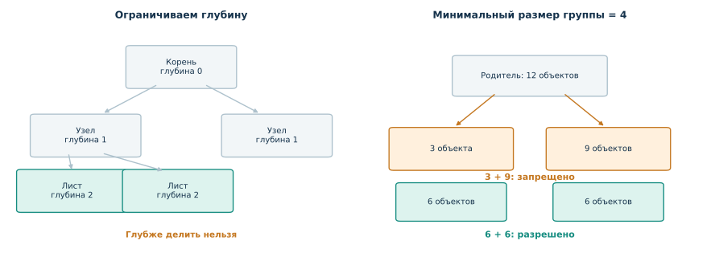

*Рисунок 24. Ограничение глубины и минимального размера дочернего узла действуют по-разному: допустимая глубина не делает допустимым разбиение $`3+9`$, если каждый лист должен иметь хотя бы четыре объекта.*

**`min_impurity_decrease`: порог требуемого уменьшения неоднородности.** Пусть условно неоднородность была $0.32$, а после разбиения стала $0.31$. Непосредственный выигрыш составляет $0.01$. Если в используемой нормировке требуется не меньше $0.02$, такое разбиение не принимается. В `scikit-learn` учитывается также доля обучающих объектов в узле относительно всей выборки, поэтому значение параметра следует интерпретировать с учётом определения взвешенного уменьшения.

Эти настройки отвечают на разные вопросы. `max_depth` ограничивает длину пути. `min_samples_split` отвечает, достаточно ли данных в узле, чтобы *пытаться* его разделить. `min_samples_leaf` запрещает слишком маленькие дочерние группы, даже когда сам исходный узел велик. А `min_impurity_decrease` сравнивает пользу кандидата с заданным порогом.

Важно помнить: когда рост прекращается, узел становится обычным листом. Его прогноз определяется по находящимся в нём обучающим объектам, даже если их ответы неодинаковы.

**Проблема преждевременной остановки.** В §4.6 мы рассматривали XOR — правило, в котором метка равна 1, когда значения двух бинарных признаков различаются. Первый split по любому из признаков не уменьшал Gini, однако после него можно было разделить обе ветви вторым признаком и получить четыре чистых листа. Следовательно, правило «в каждом узле разрешать только строго положительное непосредственное улучшение» может остановить дерево, способное выразить зависимость за два шага. Это не опровергает пользу pre-pruning, но показывает цену локальных ограничений для жадного алгоритма.

### 6.3. Обрезаем готовую структуру: post-pruning

Существует другой подход: сначала вырастить относительно большое дерево, затем заменить некоторые внутренние поддеревья одним листом. Такой процесс называют *post-pruning*.

Представим, что в некоторый внутренний узел приходит набор объектов $S$. Пока под ним существует несколько ветвей, их листья дают разные прогнозы. При обрезке эти ветви исчезают; сам узел становится одним листом и предсказывает по **всем объектам $S$**. Для MSE в нём окажется среднее этих ответов, для классификации — их классовые доли.

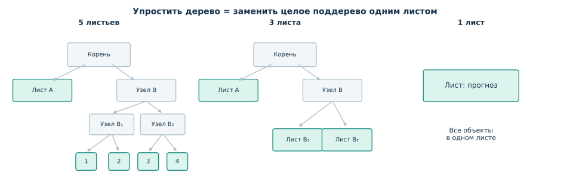

*Рисунок 25. Последовательное упрощение: сначала дерево с несколькими ветвями, затем меньшее дерево, наконец один корневой лист.*

Обрезка почти всегда ухудшает или сохраняет качество подгонки на train при том же критерии: у меньшей структуры меньше свободы. Но она способна улучшить предсказания на новых данных, если удалённые ветви в основном отражали шум.

Один из стандартных вариантов — **cost-complexity pruning**. Он выбирает компромисс между обучающим риском и числом листьев:

```math
\boxed{C_{\alpha}(T)=R(T)+\alpha\,|L(T)|,\qquad \alpha\ge0.}
```

Здесь $R(T)$ — суммарный взвешенный по листьям обучающий риск, измеренный в одной выбранной нормировке; $|L(T)|$ — количество листьев; $\alpha$ — цена дополнительной сложности. При $\alpha=0$ штрафа нет. При увеличении $\alpha$ более сложные деревья начинают проигрывать простым, даже если их обучающая ошибка ниже.

Возьмём три **иллюстративных вложенных дерева**, для которых известны значения $R(T)$:

| Дерево | Листьев | $R(T)$ | $C_\alpha(T)$ |
|---|---:|---:|---|
| Большое | 5 | $0.04$ | $0.04+5\alpha$ |
| Среднее | 3 | $0.12$ | $0.12+3\alpha$ |
| Только корень | 1 | $0.40$ | $0.40+\alpha$ |

При $\alpha=0.02$ три значения критерия составляют $0.14$, $0.18$ и $0.42$: предпочтительнее большое дерево. При $\alpha=0.08$ получаем $0.44$, $0.36$, $0.48$: выигрывает среднее. При $\alpha=0.20$ — $1.04$, $0.72$, $0.60$: выгоден единственный лист.

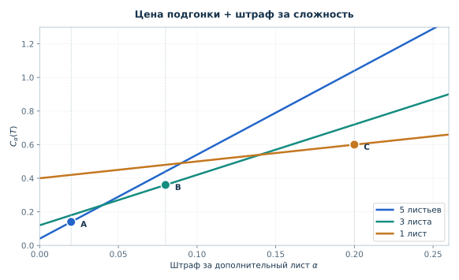

*Рисунок 26. Для трёх условных деревьев рост $`\alpha`$ меняет предпочтительный размер структуры.*

В этом сравнении большое и среднее деревья равны при $\alpha=0.04$, среднее и одно-листовое — при $\alpha=0.14$. Но реальный алгоритм должен не только сравнивать готовые деревья, а **получать варианты обрезки**.

В подходе *weakest-link pruning* оценивается, какова цена удаления каждого внутреннего поддерева $T_t$. Пусть $R(t)$ — вклад нового листа при замене этого поддерева, а $R(T_t)$ — суммарный вклад прежних листьев. Эффективное значение штрафа, при котором два варианта становятся равноценными, задаётся формулой

```math
\alpha_{\mathrm{eff}}(t)=
\frac{R(t)-R(T_t)}{|L(T_t)|-1}.
```

В числителе — прибавка обучающего риска при обрезке, в знаменателе — число **удаляемых сверх одного** листьев. Минимальный такой штраф соответствует поддереву, которое даёт наименьшую прибавку риска на единицу упрощения. Последовательно выполняя обрезку, получают вложенный набор кандидатов.

В `scikit-learn` соответствующий параметр называется `ccp_alpha`. Конкретную величину $\alpha$, как и настройки ограничения роста, выбирают по **validation или CV**, а не по итоговому test. Штраф строит последовательность моделей разной сложности, но не отменяет проверки их обобщающей способности.

### 6.4. Как выбирать сложность дерева

Для начала полезно сравнить несколько значений `max_depth` и `min_samples_leaf`: они проще всего связываются с тем, как выглядит дерево. `ccp_alpha` предоставляет альтернативный путь — вырастить структуру и затем регулировать её размер.

При подборе настроек используем уже знакомую процедуру:

1. Выделяем train и независимую итоговую проверочную часть.
2. На train проводим подбор сложности с помощью validation или кросс-валидации.
3. Выбираем конфигурацию по согласованной метрике и с учётом изменчивости её оценки.
4. Обучаем итоговую модель по установленному протоколу и оцениваем её на test без повторного подбора.

Если данные временные или групповые, способ разделения и фолды должны учитывать эту структуру. При предобработке её параметры также обучаются исключительно внутри соответствующих обучающих частей; удобный способ обеспечить это — `Pipeline`, который мы уже разбирали.

Цель — не получить дерево минимально возможного размера и не добиться чистоты каждого листа, а найти сложность, достаточную для полезного обобщения.

**Итак.** Жадное дерево может подстраиваться под шум, всё более дробя train. Pre-pruning заранее ограничивает допустимые разбиения; post-pruning удаляет ветви построенного дерева. Лучшее значение сложности — эмпирический вопрос, который решают на validation или CV.

## 7. Свойства деревьев: что следует из устройства модели

В §§1–6 мы определили дерево как последовательность пороговых проверок с постоянным прогнозом в каждом листе. Это простое устройство объясняет и сильные стороны алгоритма, и его ограничения.

### 7.1. Нелинейности и взаимодействия признаков

Линейный классификатор без преобразований признаков строит границу вида $w_0+w_1x_1+w_2x_2=0$: на плоскости это прямая. Дерево использует последовательные осевые пороги, поэтому его граница складывается из горизонтальных и вертикальных сегментов. Оно способно выделить прямоугольную область, которую невозможно отделить одной прямой от точек по всем четырём сторонам.

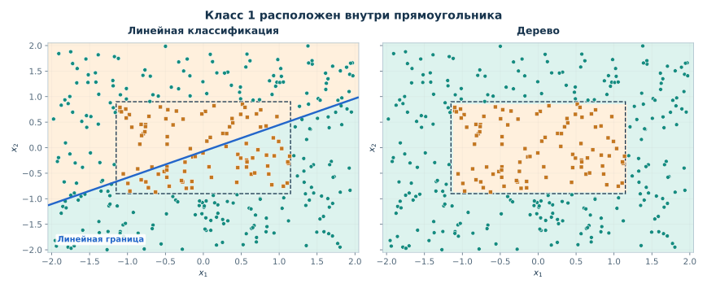

*Рисунок 27. Одна линейная граница не может изолировать центральный прямоугольник; дерево может приблизить или выделить такую область последовательными условиями.*

Вторая особенность — **взаимодействия**. Проверка признака $x_2$ может выполняться только на ветви, куда объект попал после проверки $x_1$. Иначе говоря, роль $x_2$ зависит от значения $x_1$. Для линейной модели такую связь пришлось бы задать в признаках явно, например через произведение $x_1x_2$, либо выбрать другое семейство предикторов.

Но осевые границы не всегда экономны. Диагональную границу одна прямая описывает точно, а дерево вынуждено приближать множеством коротких ступеней. Универсального доминирования деревьев над линейными моделями нет.

### 7.2. Почему деревьям обычно не нужно масштабирование

Алгоритм дерева сравнивает **порядок** значений по каждому признаку, а не расстояния между объектами. Если возраст перевести из лет в месяцы, порог $x_{\mathrm{age}}\le 20$ заменится на $x_{\mathrm{age,months}}\le240$. Те же люди пойдут в ту же ветвь.

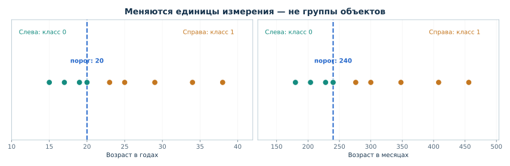

*Рисунок 28. Изменение единиц измерения признака меняет запись порога, но не разбиение объектов.*

Более общо, **строго возрастающее** преобразование сохраняет порядок объектов. При идеальном точном поиске разбиений доступные группы не изменятся, хотя значения порогов могут стать другими. Это объясняет, почему для обычных осевых деревьев стандартная нормализация числовых признаков не является обязательным шагом, в отличие от методов, использующих расстояния или штрафы, чувствительные к масштабу.

Нужны оговорки. Округление и грубая дискретизация способны объединить разные значения, а значит, уничтожить часть кандидатов на split. Преобразования, не сохраняющие порядок, могут изменить множество допустимых пороговых разбиений. В реальной библиотеке также важны точность вычислений, работа с пропусками и разрешение равных по качеству кандидатов.

### 7.3. Почему регрессионное дерево не экстраполирует тренд

Предположим, линейно растущая закономерность наблюдалась лишь при $0\le x\le5$. Линейная регрессия продолжит прямую за границей этого интервала. Обычное регрессионное дерево — нет: для $x=6,7,8$ оно применит те же пороговые проверки и, в одномерном случае, направит все объекты в крайний лист.

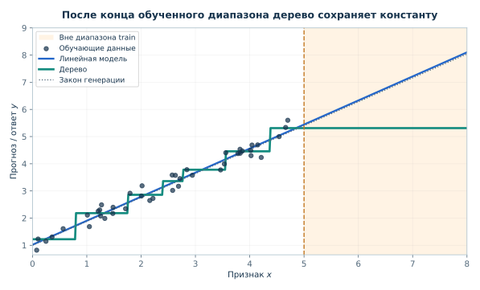

*Рисунок 29. Линейная модель продолжает тренд, а регрессионное дерево с постоянным прогнозом в листе сохраняет значение крайней ступени.*

Если критерий — MSE, каждый лист возвращает среднее некоторой группы обучающих ответов. Поэтому прогноз такого дерева не может быть ниже **минимума** или выше **максимума** обучающих $y_i$. Это строгая граница для обычного дерева с предсказанием среднего, а не утверждение обо всех возможных вариантах tree-based моделей.

При этом интерполяция внутри диапазона данных может быть успешной. Ограничение особенно важно, когда задача требует именно продолжения тренда во времени или на более экстремальные значения признаков.

### 7.4. Нестабильность структуры

Предположим, в корне дерева два возможных разбиения дают почти равный выигрыш по Gini. Несколько изменившихся или удалённых наблюдений способны поменять их порядок. Тогда дерево выберет другое корневое условие, дочерние группы станут другими, и дальнейший рост тоже пойдёт иначе.

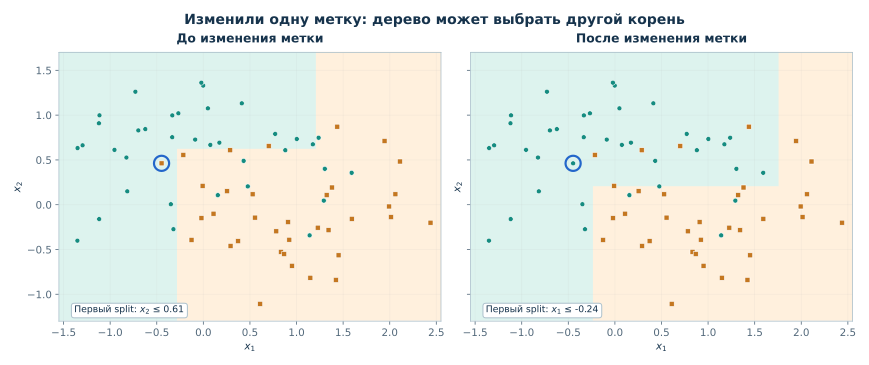

*Рисунок 30. Небольшое изменение обучающих данных может поменять ранние разбиения и всю последующую структуру.*

Мы не утверждаем, что любое изменение данных обязательно меняет дерево. Не утверждаем также, что разные структуры всегда приводят к плохим прогнозам: две существенно разные модели могут иметь близкое качество на validation. Но **чувствительность структуры и прогноза к данным обучения** необходимо учитывать, особенно если нас интересуют устойчивые объяснения.

В следующей теме курса эта проблема будет одной из причин перейти от одиночных деревьев к ансамблям. Пока важно зафиксировать её источник: жадная последовательность решений делает изменения на верхних уровнях особенно значимыми.

### 7.5. Что делать с категориальными признаками

Рассмотренные пороги имеют вид $x_j\le t$, где $x_j$ — число. Если признак — город, цвет или тип недвижимости, у его значений может не быть содержательного порядка.

Пусть `city` принимает четыре значения: Москва, Казань, Пермь и Омск. Есть три разных способа определить допустимые условия.

**Ordinal encoding.** Можно присвоить названиям числовые коды 1, 2, 3, 4. Дерево сможет проверить, например, `city_code ≤ 2.5`. Но такое условие опирается на произвольный порядок кодов; при другой кодировке набор кандидатов на split изменится. Для номинальных категорий нельзя считать подобный порядок содержательным.

**One-hot encoding.** Создадим отдельный индикатор каждой категории. Тогда дерево сможет проверять `city_Москва ≤ 0.5`, отделяя Москву от остальных городов. Для условия «Москва или Пермь против двух других городов» потребуется несколько последовательных проверок либо другой способ кодирования.

**Прямой категориальный предикат.** В реализации, поддерживающей категориальные разбиения, допустима проверка $I[x_j\in C]$, где $C$ — некоторое подмножество категорий. Например, одно условие `city ∈ {Москва, Пермь}` сразу разделяет четыре города на две пары. Но поиск по множествам категорий требует собственного алгоритма и может быть вычислительно сложным.


*Рисунок 31. Ordinal-кодирование, one-hot и прямой категориальный split задают разные семейства допустимых проверок.*

Здесь особенно важно разделять **математические возможности деревьев** и **функциональность конкретной библиотеки**. Стандартные `DecisionTreeClassifier` и `DecisionTreeRegressor` из `scikit-learn` работают с числовым представлением признаков и не принимают номинальные категории как отдельный тип условного предиката. Поэтому подготовка категорий зависит от выбранной реализации, а не от единого универсального свойства всех деревьев.

### 7.6. Что происходит при пропущенном значении

Представим узел с условием `age ≤ 30` и новый объект, у которого возраст неизвестен. Само сравнение не определено; нужен механизм маршрутизации.

**Первый подход — заполнение пропуска до обучения дерева.** Например, пропущенные значения возраста заменяют медианой, оценённой только на train. Тогда дерево видит обычные числа. Недостаток в том, что «возраст действительно равен медиане» и «возраст не указан» могут стать неразличимы. При необходимости вводят отдельный индикатор пропуска. Предобработку следует делать внутри `Pipeline` и фолдов CV, чтобы не возникла утечка.

**Второй подход — обучаемое направление для `NaN`.** Рассмотрим пять объектов:

| Объект | Возраст | Класс |
|---|---:|---:|
| A | 20 | 0 |
| B | 25 | 0 |
| C | 36 | 1 |
| D | 40 | 1 |
| E | неизвестен | 1 |

Для порога $30$ первые два объекта направляются влево, следующие два — вправо. Пятый объект можно временно отправить в обе стороны и сравнить Gini.

Если E направить **влево**, получим слева классы $(0,0,1)$ и справа $(1,1)$. Gini левой группы равен $4/9$, правой — нулю. Взвешенная неоднородность после разбиения составит

```math
\frac35\cdot\frac49+\frac25\cdot0=\frac4{15}.
```

Если направить E **вправо**, обе группы окажутся чистыми: слева $(0,0)$, справа $(1,1,1)$. Тогда взвешенная Gini равна нулю. Поэтому при таких данных выгоднее запомнить правило «пропуск в возрасте → вправо» и использовать его при прогнозировании.

**Третий подход — суррогатное разбиение.** Если возраст неизвестен, можно вместо него проверить иной признак — например, стаж, — условие по которому на обучающих объектах часто воспроизводило направление главного split. Такие *surrogate splits* нужно также определить на train; они не строятся по факту появления каждого нового объекта.

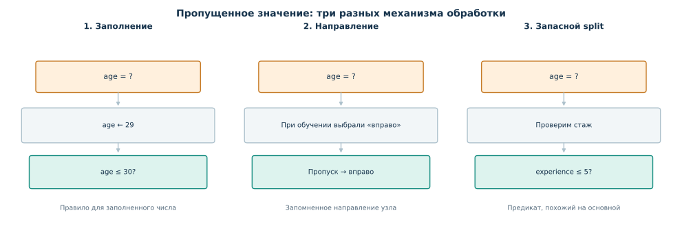

*Рисунок 32. Заполнение признака, обучаемая ветвь для пропуска и суррогатный предикат — разные механизмы.*

В актуальных версиях `scikit-learn` для поддерживаемых режимов стандартного поиска лучшего разбиения возможна встроенная обработка `NaN`: во время обучения сравниваются направления для пропущенных значений. Если пропусков по выбранному признаку в узле не было, новая пропущенная величина направляется по определённому библиотекой резервному правилу, обычно в более многочисленную дочернюю группу. Конкретную поддержку необходимо проверять в документации установленной версии и выбранных параметров. Это не тождественно surrogate splits.

### 7.7. Интерпретируемость не равна причинному объяснению

Небольшое дерево позволяет восстановить путь конкретного объекта от корня до листа. Это точное объяснение того, **какие проверки выполнила модель**.

Но из пути не следует, что признаки действительно *вызвали* событие в окружающем мире. Например, условие «район близок к центру» может участвовать в прогнозе стоимости аренды; это не доказывает эффект переноса одной и той же квартиры в другой район. Для такого вывода нужны отдельная причинная постановка и предпосылки.

И ещё: дерево из десяти узлов можно обозреть целиком, а дерево из сотен узлов — существенно сложнее, даже если каждый отдельный путь остаётся понятным. Поэтому читабельность правил не гарантирует, что мы знаем общую роль каждого признака во всех прогнозах.

Мы подошли к новой задаче. До сих пор мы спрашивали: **как по данным строится дерево?** Теперь спросим: **что можно установить о признаках, на которые опирается уже обученное дерево, и насколько это важно для его качества?**

**Итак.** Дерево способно строить нелинейные правила и взаимодействия, обычно не требует масштабирования числовых признаков, но ограничено осевой геометрией и постоянными прогнозами в листьях. Его структура может зависеть от небольших изменений данных. Работа с категориями и пропусками зависит от реализации. Интерпретация алгоритма не заменяет исследование поведения модели и не доказывает причинные эффекты.

## 8. От понимания алгоритма к исследованию обученной модели

Мы можем объяснить, как обучается решающее дерево, и даже вручную воспроизвести небольшой пример. Но это ещё не означает, что мы заранее знаем, **какую именно функцию** получим на конкретной таблице данных. Алгоритм выбирает признаки и пороги самостоятельно. В большом дереве одни признаки могут появляться много раз, другие — не появиться вообще; одни разбиения охватывают большинство наблюдений, другие — маленькие локальные группы.

После обучения возникает задача **интерпретации модели**: получить содержательное описание её поведения. Прежде чем применять какой-либо метод, нужно уточнить вопрос.

### 8.1. Какие вопросы мы можем задать

**Как построен конкретный прогноз?** Для объекта $x$ мы можем пройти по дереву и выписать использованные предикаты. Получится *локальное объяснение*: описание конкретного маршрута. Например, в дереве, которое мы подробно рассмотрим в §9.2, квартира площадью 74 м² с временем до центра 51 минуту проходит по условиям «время до центра больше 33», «площадь больше 66», «время до центра не больше 51.5» и попадает в лист, предсказывающий высокую аренду. Важны конкретные обученные пороги и состав последнего листа. Это воспроизведение работы предиктора, а не самостоятельное объяснение причин высокой аренды.

**Какие признаки определяют структуру дерева в целом?** Здесь одного маршрута мало. Мы хотим собрать сведения **обо всех внутренних узлах** и измерить, сколько улучшений обучающего критерия связано с разбиениями по каждому признаку. Такой вопрос приводит к *mean decrease in impurity* (MDI).

**Насколько информация в признаке нужна для качества прогнозов?** Этот вопрос не равен предыдущему. Дерево могло выбрать определённый признак, поскольку на train среди множества его порогов нашлось удачное разбиение; на новых объектах такая закономерность может не работать. Чтобы исследовать зависимость **качества готовой модели** от признака, можно нарушить его связь с другими колонками и ответами, сохранив саму модель. Это идея *permutation importance*.

Различаются не только вопросы, но и доступ к устройству алгоритма. MDI использует внутреннюю структуру дерева, поэтому является **модельно-специфической** оценкой. Permutation importance достаточно готового предиктора $\hat f$ и метрики, поэтому это **модельно-независимый** метод: тот же эксперимент можно провести с линейной моделью, kNN или ансамблем деревьев.

Оба метода обычно агрегируют результаты по множеству наблюдений и являются **глобальными** описаниями. Они не заменяют локальное чтение пути одного объекта.

### 8.2. Три ограничения интерпретации

Во-первых, **объяснение устройства модели не является выводом о реальном причинном эффекте**. Высокая важность района в прогнозе аренды не означает, что перемещение квартиры в другой район при прочих равных действительно изменит цену на вычисленную величину. Для такой интерпретации нужны дополнительные каузальные предпосылки.

Во-вторых, важность не сообщает **направление и форму зависимости**. Два признака могут получить близкую важность, хотя один увеличивает прогноз, другой уменьшает, а третий действует нелинейно и по-разному в различных группах.

В-третьих, объяснение относится к **определённой модели, данным и процедуре**. Мы можем получить разные рейтинги важности при изменении глубины, обучающей выборки, метрики или распределения объектов, на которых оценивается качество.

Поэтому следующая часть лекции посвящена не универсальному вопросу «какие признаки важны вообще», а двум точно определённым измерениям.

## 9. MDI: встроенная важность признаков обученного дерева

### 9.1. От выигрыша в узле к вкладу во всём дереве

При построении дерева мы многократно вычисляли уменьшение неоднородности в очередном узле. Обозначим внутренний узел через $v$, число обучающих наблюдений в нём — через $n_v$, а его потомков — через $L(v)$ и $R(v)$. Критерий неоднородности обозначим $H$: для классификации это может быть Gini, для регрессии — MSE.

Локальное улучшение равно

```math
G(v)=H(v)-\frac{n_L}{n_v}H(L(v))-\frac{n_R}{n_v}H(R(v)).
```

При выборе split алгоритм сравнивал значения $G(v)$ для разных признаков и порогов. Но теперь мы хотим понять вклад разбиения **в работу всего дерева**.

Разделение узла с 500 объектами и разделение узла с пятью объектами при одинаковом локальном выигрыше $G(v)$ не равноценны, если нас интересует средняя неоднородность по всей обучающей выборке. Поэтому умножим локальное улучшение на долю объектов, дошедших до узла:

```math
\boxed{\Delta(v)=\frac{n_v}{n}\,G(v),}
```

где $n$ — общее число обучающих наблюдений.

Каждый внутренний узел разбивается по одному признаку. Обозначим его индекс через $j(v)$. Тогда можно собрать все узлы, где использовался признак $j$, и сложить их взвешенные улучшения:

```math
A_j=\sum_{v:\,j(v)=j}\Delta(v).
```

Чтобы перейти к относительным долям, нормируем суммы по всем признакам:

```math
\boxed{\mathrm{MDI}_j=\frac{A_j}{\sum_{k=1}^{p}A_k}.}
\qquad \sum_{j=1}^{p}\mathrm{MDI}_j=1.
```

Нормировка возможна, если хотя бы одно разбиение действительно уменьшило неоднородность: иначе знаменатель равен нулю. Для обычных обученных деревьев `scikit-learn` такая характеристика доступна в `feature_importances_`.

Название **mean decrease in impurity (MDI)** обозначает вклад разбиений в уменьшение неоднородности. Но это **сводка обученной структуры**, а не тест статистической значимости и не доля объяснённой вариации целевой переменной.

### 9.2. Полный пример: дерево глубины три

Используем уже подготовленный в бакалаврской лекции пример на **24 синтетических объявлениях о квартирах**. У каждого наблюдения есть площадь, время до центра, число комнат и бинарная метка высокой аренды. Из 24 объектов 13 имеют класс 1 и 11 — класс 0.

Для примера обучено дерево со следующими параметрами:

```python
DecisionTreeClassifier(
    criterion="gini",
    max_depth=3,
    min_samples_leaf=2,
    random_state=42,
)
```

Его условия не рисовались вручную под удобный ответ: структура была получена алгоритмом на конкретной таблице. Исходные данные доступны в [tree_training_data.csv](../../../../bachelors/2026/week-09/lecture/tree_training_data.csv), а расчёты проверяются [сопровождающим скриптом](../../../../bachelors/2026/week-09/lecture/case/tree_case_check.py). В нашем курсе это **отдельная иллюстрация**, не тот же набор из 12 точек, на котором выше мы показывали рекурсивное обучение.

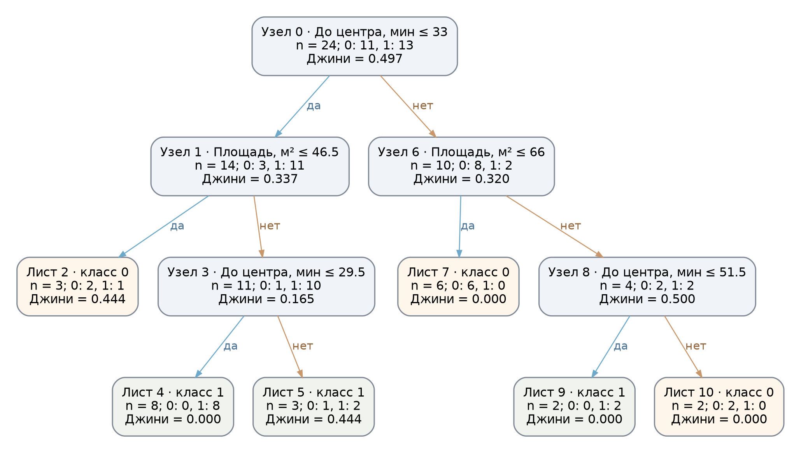

*Рисунок 33. Обученное дерево глубины три. Внутри показаны условия, численность групп, их классовый состав и Gini. Пример и обучающие данные взяты из принятой бакалаврской лекции об интерпретации.*

Посчитаем вклад корневого split. В корне доли классов равны $11/24$ и $13/24$, поэтому

```math
H(0)=1-\left(\frac{11}{24}\right)^2-\left(\frac{13}{24}\right)^2\approx0.49653.
```

Корень разделяет наблюдения по времени до центра. В левую группу попадают 14 объектов — 11 единиц и 3 нуля. В правую попадают 10 объектов — 2 единицы и 8 нулей. Получаем

```math
\begin{aligned}
H(1)&=1-\left(\frac3{14}\right)^2-\left(\frac{11}{14}\right)^2\approx0.33673,\\[0pt]
H(6)&=1-\left(\frac8{10}\right)^2-\left(\frac2{10}\right)^2=0.32.
\end{aligned}
```

Корень содержит все 24 объекта, поэтому дополнительный вес $n_v/n$ здесь равен единице:

```math
\begin{aligned}
\Delta(0)&=\frac{24}{24}\left[0.49653-\frac{14}{24}\cdot0.33673-\frac{10}{24}\cdot0.32\right]\\[0pt]
&\approx\boxed{0.16677}.
\end{aligned}
```

Теперь рассмотрим узел 1 с 14 объектами. Он разбивается уже по площади. Для него локальное улучшение дополнительно умножается на $14/24$, потому что это разбиение влияет только на часть всей выборки:

```math
\begin{aligned}
\Delta(1)
&=\frac{14}{24}\left[0.33673-\frac3{14}\cdot0.44444-\frac{11}{14}\cdot0.16529\right]\\[0pt]
&\approx\boxed{0.06512}.
\end{aligned}
```

Остальные внутренние узлы рассчитываются по точно такой же схеме. В принятом примере получена следующая таблица:

| Узел | Признак split | $n_v$ | Взвешенный выигрыш $\Delta(v)$ |
|---|---|---:|---:|
| 0 | Время до центра | 24 | 0.16677 |
| 1 | Площадь | 14 | 0.06512 |
| 3 | Время до центра | 11 | 0.02020 |
| 6 | Площадь | 10 | 0.05000 |
| 8 | Время до центра | 4 | 0.08333 |
| **Итого** | | | **0.38542** |

Складываем строки по признакам:

```math
\begin{aligned}
A_{\text{до центра}}&=0.16677+0.02020+0.08333\approx0.27030,\\[0pt]
A_{\text{площадь}}&=0.06512+0.05000\approx0.11512,\\[0pt]
A_{\text{комнаты}}&=0.
\end{aligned}
```

Деление на общую сумму $0.38542$ даёт

```math
\boxed{\begin{aligned}
\mathrm{MDI}_{\text{до центра}}&\approx0.701,\\[0pt]
\mathrm{MDI}_{\text{площадь}}&\approx0.299,\\[0pt]
\mathrm{MDI}_{\text{комнаты}}&=0.
\end{aligned}}
```

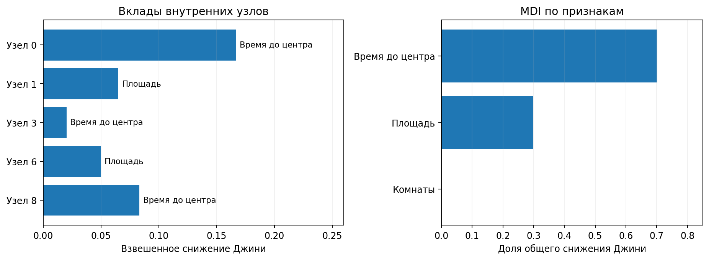

*Рисунок 34. Слева — вклады отдельных разбиений в уменьшение Gini, справа — агрегирование этих вкладов по признакам.*

Как читать этот результат? **Внутри данного обученного дерева** на разбиения по времени до центра приходится около 70% суммарного взвешенного уменьшения Gini, на площадь — около 30%. Число комнат ни разу не использовалось для split, поэтому его MDI равна нулю.

Это не означает, что время до центра объясняет «70% цены квартиры» или что число комнат **вообще не содержит полезной информации**. Мы распределили конкретную величину — общее уменьшение выбранного **обучающего** критерия — между признаками данного дерева.

Почему сумма узловых вкладов соответствует уменьшению общей неоднородности? Раскроем сумму $\Delta(v)$ по всем внутренним узлам. Каждый внутренний узел, кроме корня, сначала появляется с минусом как потомок своего родителя, а затем с плюсом как узел, который сам разбивается. Эти промежуточные слагаемые сократятся. Останутся неоднородность корня и взвешенные неоднородности финальных листьев:

```math
\boxed{\sum_{v\text{ — внутренний}}\Delta(v)=H(\text{корень})-\sum_{\ell\text{ — лист}}\frac{n_\ell}{n}H(\ell).}
```

В нашем примере два листа содержат по три объекта с неоднородностью $4/9$, а остальные листья чистые. Следовательно,

```math
0.49653-2\cdot\frac3{24}\cdot\frac49\approx0.38542,
```

что совпадает с суммой из таблицы. Так проверяется смысл нормировки MDI.

### 9.3. Когда MDI полезна

MDI удобна, когда нужно быстро прочитать **архитектуру конкретного дерева**.

Во-первых, она показывает, какие признаки участвовали в разбиениях. Во-вторых, учитывает не только число их появлений, но и то, **насколько большие группы** были разделены и насколько уменьшилась неоднородность. Корневой split, затрагивающий всю выборку, обычно имеет больший потенциальный вес, чем похожий split глубоко в небольшой ветви. В-третьих, MDI помогает сформулировать вопрос к конкретным узлам. Если время до центра получило большую важность, полезно открыть дерево и посмотреть, какие именно его пороги оказались востребованы.

При этом MDI не даёт направления эффекта. Значение 0.701 нельзя перевести в утверждение «каждая минута до центра уменьшает вероятность высокой аренды на 70%». И MDI не говорит, насколько хорошо дерево работает на новых объектах: для этого нужны отдельные метрики.

### 9.4. Два принципиальных ограничения MDI

**Смещение в пользу признаков с большим числом вариантов разбиения.** При обучении дерево перебирает кандидаты и выбирает лучший. У непрерывного признака с множеством различных значений бывает много допустимых порогов, а у бинарного — обычно один. Среди множества кандидатов легче случайно найти удачное уменьшение Gini на train, даже если настоящий предсказательный сигнал отсутствует. Поэтому непрерывный случайный идентификатор или шумовой столбец может получить заметную MDI. Это проблема отбора по максимуму большого числа проб, а не свидетельство содержательной связи.

**Замещение коррелированных признаков.** Площадь и число комнат могут нести похожую информацию. Если дерево уже использовало площадь, дополнительное разбиение по числу комнат может не дать выигрыша. Для данного дерева комнаты окажутся неиспользованными и получат нулевую MDI. Но другая обученная модель при иных данных или иной допустимой глубине вполне могла бы предпочесть число комнат.

**Итак.** MDI отвечает на вопрос: **каким образом данное дерево уменьшало неоднородность на обучении?** Если нас интересует, насколько информация в признаке помогает **качеству прогнозов**, необходима другая процедура.

## 10. Permutation importance: испытываем готовую модель

### 10.1. Мысленный эксперимент

Допустим, мы уже обучили классификатор квартир и знаем его accuracy на независимой оценочной выборке. Хотим выяснить, насколько важна для его работы площадь.

Представим, что из-за ошибки в таблице площади разных квартир перемешались местами. В каждой строке по-прежнему находятся прежние район, расстояние до центра и правильная метка, но площадь теперь принадлежит другой квартире. **Модель остаётся неизменной**: мы не переобучаем её и не перестраиваем дерево. Заново вычисляем только прогнозы на изменённой таблице.

Если качество заметно ухудшится, значит, исходная согласованность значений площади с другими колонками была полезна этому предиктору на рассматриваемых наблюдениях. Если качество почти не изменится, это может означать, что модель не использует данный признак или что его информацию способны заменить другие.

Так работает *permutation feature importance* (PI) — важность через перестановки. Метод требует только фиксированной модели $\hat f$, оценочных данных и выбранной метрики. Поэтому PI можно применять не только к деревьям.

### 10.2. Полный пример на шести квартирах

Возьмём маленькую **заданную вручную** модель, чтобы видеть, что делает перестановка, а не отвлекаться на её обучение:

```math
\hat f(a,d)=\begin{cases}
1,&a\ge50\ \text{и}\ d\le25,\\[0pt]
0,&\text{иначе},
\end{cases}
```

где $a$ — площадь квартиры, $d$ — время до центра.

На исходных шести объектах модель предсказала все классы верно: accuracy равна $6/6=1$. Теперь переставим только столбец площади; например, он мог принять порядок $(62,42,70,38,80,55)$ вместо $(42,62,70,38,55,80)$.

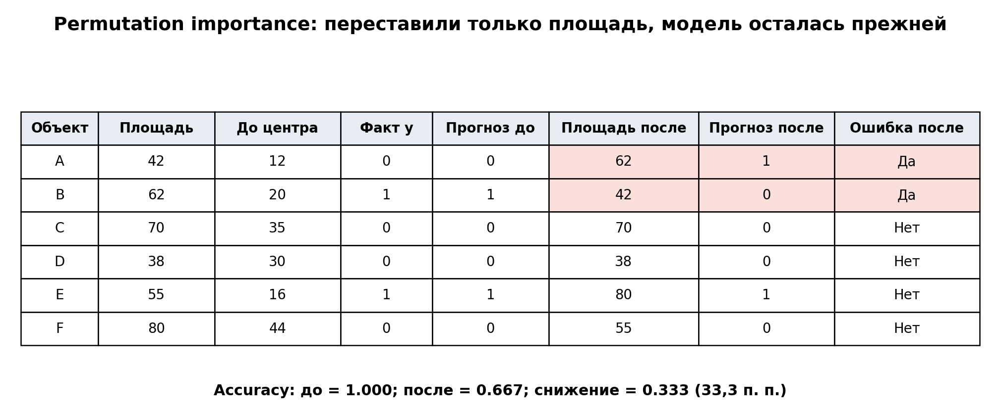

*Рисунок 35. Иллюстрация permutation importance: исходные классы и остальные признаки остаются прежними; площадь переставляется между строками.*

У квартиры A раньше были $a=42$ и $d=12$, поэтому прогноз составлял 0. После перестановки её площадь стала 62, условие «площадь не меньше 50 и до центра не больше 25» оказалось выполнено и прогноз сменился на 1, хотя правильная метка A осталась прежней.

У квартиры B произошла обратная история: её площадь оказалась меньше 50 и правильный прогноз класса 1 сменился на неправильный класс 0. У остальных четырёх квартир ответы не изменились. Следовательно, новая accuracy составляет $4/6$, а снижение равно

```math
\boxed{1-\frac46=\frac26\approx0.333.}
```

**Интерпретация:** при этой одной конкретной перестановке площадь оказалась связана со снижением accuracy на **33,3 процентного пункта**. Это пока ещё не усреднённая permutation importance: другой порядок перестановки может дать другой результат.

### 10.3. Формула и повторные перестановки

Пусть $S=(X,y)$ — оценочная выборка, а $Q(\hat f,S)$ — метрика, для которой **больше — лучше**. Например, accuracy или ROC-AUC.

Обозначим $S_j^{\pi_b}$ таблицу, где в повторении $b$ переставлен только столбец $j$. Целевая переменная и остальные колонки не изменяются. Сам предиктор $\hat f$ также фиксирован.

Процедура такова:

1. Измерить исходное качество $Q(\hat f,S)$.
2. Случайно переставить значения признака $j$ между строками.
3. Получить прогнозы фиксированной модели на изменённой таблице и пересчитать качество.
4. Повторить перестановку $B$ раз, затем усреднить снижение метрики.

Итоговое определение:

```math
\boxed{\widehat{PI}_j=Q(\hat f,S)-\frac1B\sum_{b=1}^{B}Q(\hat f,S_j^{\pi_b}).}
```

Положительное значение означает, что перемешивание признака **в среднем ухудшило** выбранную метрику. Нулевое — что выбранная процедура не обнаружила ухудшения. Отрицательная PI также возможна: при нескольких случайных перестановках качество иногда становится лучше исходного, например из-за изменчивости опыта или особенностей подгонки.

Если метрика — **ошибка**, где меньше лучше, удобнее записать важность как её прирост. Например, для MSE:

```math
\boxed{\widehat{PI}^{\mathrm{MSE}}_j=\frac1B\sum_{b=1}^{B}\mathrm{MSE}(\hat f,S_j^{\pi_b})-\mathrm{MSE}(\hat f,S).}
```

Таким образом, для положительной PI мы используем правило **«насколько стало хуже»**, но порядок вычитания зависит от направления выбранной метрики.

### 10.4. Единицы измерения и использование scikit-learn

Значение PI всегда читается **в шкале выбранной метрики**.

Если мы используем accuracy, PI, равная $0.08$, означает среднее снижение точности на **8 процентных пунктов**, а не на 8% относительно исходного уровня. Если измеряем MAE в рублях, PI, равная 150, означает среднее увеличение абсолютной ошибки на 150 рублей. Для MSE размерность будет квадратом единиц целевой переменной. Значения, рассчитанные при разных метриках, непосредственно сравнивать нельзя.

В `scikit-learn` функция `permutation_importance` принимает готовый estimator, оценочные `X` и `y`, параметр `n_repeats` и метрику `scoring`. Важный нюанс библиотеки: `scoring` устроен так, что **больший score лучше**. Поэтому для обычной MSE используется строка `scoring="neg_mean_squared_error"`.

Проверим знак. Пусть до перестановки MSE равнялась 4, после — 9. Тогда соответствующие `score` равны $-4$ и $-9$, а разность $-4-(-9)=5$. Полученная важность равна **приросту MSE на 5**, как и в нашем определении.

Аналогично `neg_mean_absolute_error` даёт PI в единицах MAE. Для регрессора стандартный `score()` без явного `scoring` часто соответствует $R^2$, для классификатора — accuracy. Но исследовательский смысл важности зависит от метрики, поэтому её лучше выбирать **явно**, а не полагаться на значение по умолчанию.

Схематически использование выглядит так:

```python
from sklearn.inspection import permutation_importance

# model уже обучена на train.
# X_valid, y_valid не использовались для подгонки модели.
result = permutation_importance(
    model,
    X_valid,
    y_valid,
    n_repeats=12,
    scoring="accuracy",
    random_state=42,
)

importance_mean = result.importances_mean
importance_std = result.importances_std
```

Поля `importances_mean` и `importances_std` описывают результаты повторных перестановок **для данной модели и данной таблицы**. Они сами по себе не дают стандартную ошибку генеральной важности признака и не устраняют неопределённость, возникающую из-за ограниченного числа оценочных объектов.

PI также не обязана суммироваться до единицы. При разных признаках перемешивание может разрушать пересекающуюся или дублирующую информацию, поэтому результаты не образуют распределение долей, подобное нормированной MDI.

### 10.5. Где оценивать важность

MDI вычислялась по обученному дереву и обучающему критерию. А PI можно посчитать на любой подходящей таблице с известными ответами — но от **выбора таблицы** зависит смысл результата.

На train PI показывает, как модель реагирует на перестановку признака на тех же наблюдениях, по которым она была подогнана. Это бывает полезно для исследования структуры, но не гарантирует, что найденная зависимость сохраняется на новых объектах.

Если вопрос касается **обобщающего качества**, разумнее использовать отложенную validation-выборку или другую независимую оценочную часть. Здесь мы проверяем цену нарушения информации в признаке на объектах, не участвовавших в подгонке. Если тестовая выборка зарезервирована для единственной финальной проверки, нежелательно многократно исследовать на ней признаки, выбирать новые гиперпараметры и возвращаться к обучению: так она постепенно превращается в инструмент разработки.

Повторные перестановки уменьшают зависимость числа от одного случайного перемешивания. Но есть как минимум **три источника изменчивости**:

- случайный порядок внутри одной перестановки;
- конкретный состав оценочной выборки;
- конкретная обученная модель, зависящая от train и процедуры обучения.

Двенадцать повторений для одной фиксированной модели на одной фиксированной validation-таблице исследуют в основном **первый** источник. Для проверки устойчивости важности к изменениям обучения потребуется получить несколько обученных моделей; для проверки устойчивости к выбору оценочных данных — изменить соответствующий протокол. Здесь полезно применять уже известные принципы повторных экспериментов, не смешивая разные источники неопределённости.

### 10.6. Почему PI — не переобучение без признака

Permutation importance **не отвечает** на вопрос: «Какое качество получит новый алгоритм, если удалить признак из обучения?»

В нашей процедуре дерево уже выросло. Его пороги, листья и прогнозы фиксированы. Мы лишь подставляем чужие значения одного столбца при оценке.

Совсем другой эксперимент — **leave-one-feature-out** (*LOFO*, или абляция с переобучением): убрать столбец из train, провести заново обучение по согласованному протоколу и сравнить качество с исходной моделью. В отсутствие одного признака алгоритм может перестроить правила и воспользоваться информацией, содержащейся в остальных. Поэтому результаты PI и LOFO не обязаны совпадать.

Представим два связанных столбца — площадь квартиры и число комнат. Исходное дерево могло разрезать данные по площади. После перестановки площади его правила начнут ошибаться, и PI будет высокой. Но при полном переобучении без площади дерево, возможно, найдёт хорошие пороги по числу комнат. Тогда абляция даст небольшой проигрыш, несмотря на большую PI исходной модели.

Это не противоречие. Мы задали **два разных вопроса**.

**Итак.** Permutation importance измеряет изменение выбранной метрики при перестановке столбца **в уже обученной модели**. Величина зависит от модели, метрики и оценочной выборки. Она не показывает направление связи, не доказывает причинность и не равна результату переобучения без признака.

## 11. Почему коррелированные признаки осложняют важности

До сих пор мы перемешивали один столбец за раз. Но признаки реальных таблиц часто связаны между собой. Площадь коррелирует с количеством комнат, время до центра — с районом, длина и ширина изделия — с его массой. В таких условиях фраза «важность признака» требует особенной аккуратности.

### 11.1. Две модели, одинаковые прогнозы — разные PI

Возьмём пять объектов, где признаки **полностью дублируют друг друга**:

```math
x_1=x_2=y\in\lbrace 0,1,2,3,4\rbrace .
```

Рассмотрим две модели:

```math
\hat f_A(x_1,x_2)=x_1,
\qquad
\hat f_B(x_1,x_2)=\frac{x_1+x_2}{2}.
```

На исходной таблице **обе модели выдают одинаковые ответы** $0,1,2,3,4$. Поэтому их MSE одинакова и равна нулю. Но способы использования двух столбцов различаются.

Теперь переставим только $x_1$ в обратном порядке: $(4,3,2,1,0)$. Второй столбец и истинные $y$ не изменяются.

Для модели A ошибки становятся $(4,2,0,-2,-4)$. Значит,

```math
\mathrm{MSE}_A^{\pi_1}=\frac{4^2+2^2+0^2+(-2)^2+(-4)^2}{5}=\boxed{8}.
```

Для модели B ошибки вдвое меньше, потому что она усредняет испорченный $x_1$ с правильным $x_2$. Поэтому

```math
\mathrm{MSE}_B^{\pi_1}=\frac84=\boxed{2}.
```

Если перемешать только $x_2$, модель A вообще не изменит свои прогнозы — она его не использует. У B результат симметричен случаю с $x_1$.

Наконец, если **согласованно переставить два столбца вместе**, сохраняя их равенство друг другу, обе модели получат ошибку MSE, равную 8.

| Эксперимент | Модель A: $\hat y=x_1$ | Модель B: $\hat y=(x_1+x_2)/2$ |
|---|---:|---:|
| Переставили только $x_1$ | 8 | 2 |
| Переставили только $x_2$ | 0 | 2 |
| Совместно переставили $x_1,x_2$ | 8 | 8 |

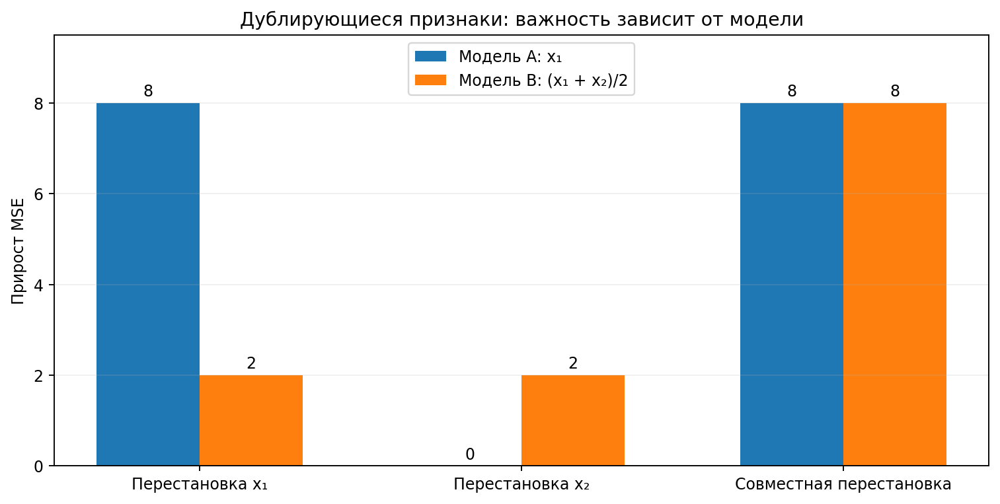

*Рисунок 36. Одни и те же исходные прогнозы допускают разное распределение зависимости между признаками в двух моделях.*

В таблице — результаты **одной выбранной перестановки**, а не среднее по всем возможным порядкам. В принятом примере бакалаврской лекции показано, что при усреднении по всем перестановкам этих пяти значений PI для $x_1$ равнялась бы 4 у A и 1 у B, а не 8 и 2. Разница между моделями остаётся.

Что мы установили? Модель A полностью полагается на $x_1$, хотя $x_2$ содержит в данных **точно такую же информацию**. Нулевая индивидуальная PI признака $x_2$ не означает, что этот столбец неинформативен сам по себе. Модель B использует оба аргумента, поэтому отдельная перестановка любого одного столбца частично компенсируется другим.

Следовательно, совпадение исходных прогнозов моделей не гарантирует одинаковые permutation importance. PI описывает **поведение фиксированной модели при заданной процедуре нарушения входов**, а не распределение некой объективной информационной ценности между столбцами.

### 11.2. Перестановка может создавать неправдоподобные комбинации

Есть ещё одна проблема. В квартирных данных площадь связана с числом комнат. Если свободно перемешать площадь, не трогая остальные поля, в таблице могут возникнуть редкие или почти невозможные сочетания: небольшая квартира с очень большим числом комнат, большая площадь при иных характеристиках малогабаритного жилья и т. д.

Поэтому PI измеряет не чистое «выключение сигнала площади». Перестановка одновременно разрушает её связь **с ответом и с другими признаками**. Модель вынуждена делать прогнозы на комбинациях, которые редко встречались при обучении. Большая PI может частично отражать именно эту ситуацию.

Важно не делать из этого вывод, что обычная PI всегда бесполезна при корреляции. Это полезный первый диагностический эксперимент, если понимать, какой вопрос он задаёт. Но его интерпретация должна быть уже, чем фраза «насколько признак важен в природе».

### 11.3. Как выбрать другой эксперимент

Исследователь может поставить несколько существенно разных задач.

| Вопрос | Эксперимент | Что означает результат |
|---|---|---|
| Насколько **текущая модель** зависит от одного столбца? | Обычная PI | Изменение метрики после перестановки столбца |
| Насколько модель зависит от **группы** связанных признаков? | Совместная перестановка группы с одинаковым переставлением строк | Изменение метрики после нарушения связи группы с остальной таблицей |
| Можно ли **обучить хорошую новую модель без признака**? | Исключить столбец и повторить обучение по прежнему протоколу (LOFO) | Изменение качества после возможности перераспределить информацию |
| Даёт ли признак **дополнительную информацию при фиксированных остальных**? | Условная перестановка или иная условная процедура | Изменение качества при правдоподобных подстановках с учётом других признаков |

**Групповая перестановка** полезна, если мы уже знаем, что несколько столбцов образуют общий блок информации. Например, если $x_1=x_2$, одинаковая перестановка этих столбцов сохраняет их связь друг с другом, но разрушает связь пары с исходными строками. Однако при более сложных зависимостях нужно понимать, насколько выбранная схема сохраняет естественную структуру группы.

**Абляция с переобучением** отвечает на вопрос о полезности столбца для будущей процедуры обучения. Здесь важно повторить не только вызов `.fit()`, но и весь корректный протокол выбора признаков, гиперпараметров и предобработки, не используя итоговый test для принятия решений.

**Условная перестановка** пытается подставлять вместо исходных значений такие, которые выглядят правдоподобно при известных остальных признаках. Но она требует моделировать условное распределение признака и меняет исследовательский вопрос: нас интересует уже не вся роль признака для модели, а его дополнительная роль при фиксированной информации остальных.

Для нашего курса не требуется реализовывать все четыре подхода. Важно уметь **распознать постановку**, в которой простая PI легко будет истолкована неверно, и предложить подходящую дополнительную проверку.

### 11.4. Что могут и чего не могут сказать MDI и PI

Теперь сопоставим два изученных метода.

| Свойство | MDI | Permutation importance |
|---|---|---|
| Что измеряет? | Суммарный взвешенный выигрыш по обучающему критерию, связанный с признаками | Ухудшение выбранной метрики при перестановке столбца |
| Что требуется? | Внутренняя структура обученного дерева | Готовая модель, данные и ответы, выбранная метрика |
| Где возникает расчёт? | На обучающем дереве и данных, определивших split | На выбранной оценочной выборке; для обобщения предпочтительна независимая |
| Шкала | При нормировке доли, сумма равна 1 | Единицы метрики; сумма не обязана быть 1 |
| Основная ловушка | Перебор множества split и замещение коррелированных признаков | Корреляции, непривычные сочетания входов, зависимость от метрики и выборки |
| Можно ли считать причинным эффектом? | Нет | Нет |

Сравнивать численные величины $0.70$ MDI и $0.08$ PI напрямую бессмысленно: у них разные определения и шкалы. Содержательное сравнение возможно в виде вопросов: совпадают ли лидирующие признаки, почему результаты расходятся, достаточно ли устойчиво качество, не находится ли случайный идентификатор среди важных по MDI.

**Итак.** Нулевая индивидуальная важность не означает отсутствия информации в столбце. При корреляции признаки могут заменять друг друга, а свободная перестановка нарушает естественные связи между ними. Значение важности всегда связано с конкретным экспериментом и обученной моделью.

## 12. От обучения дерева к осмысленному анализу модели

Вернёмся к главной последовательности этой лекции.

**Первый шаг — понять прогнозную функцию.** Дерево применяет условия от корня к листу. Структура делит пространство признаков на области, внутри которых возвращается постоянный прогноз. Классификационный лист хранит классовые доли, а регрессионный при MSE — среднее целевой переменной среди своих обучающих объектов.

**Второй шаг — понять обучение.** Алгоритм рассматривает пороги и признаки, выбирает локально наиболее выгодный split и рекурсивно повторяет процесс. В регрессии естественным критерием служит уменьшение MSE; в классификации — уменьшение Gini или энтропии. Связь с квадратичной и логарифмической потерями показывает, почему эти критерии разумны. Однако жадный локальный выбор не обещает глобально оптимальной структуры.

**Третий шаг — проверить обобщение.** Глубокое дерево может запоминать шум. Pre-pruning и post-pruning ограничивают сложность, но удачность этих ограничений устанавливается на validation/CV. Осевые разбиения помогают моделировать нелинейности и взаимодействия, но обычное дерево плохо экстраполирует и может быть нестабильно.

**Четвёртый шаг — исследовать полученную модель.** Путь по дереву объясняет локальный прогноз. MDI показывает, каким признакам дерево обязано уменьшением обучающей неоднородности. PI ставит отдельный эксперимент с фиксированной моделью и измеряет, насколько ухудшается выбранная метрика при перестановке столбца.

**Пятый шаг — не переинтерпретировать объяснение.** Важности чувствительны к корреляциям, к выборке и способу измерения. Они не дают причинных эффектов, не измеряют автоматически ценность признака для всех возможных моделей и не заменяют независимую оценку качества.

### Что следует уметь после лекции

После чтения студент должен быть способен без обращения к библиотеке:

1. Получить прогноз для нового объекта по нарисованному дереву и объяснить, как он связан с обучающими наблюдениями в листе.
2. Рассчитать RSS/MSE регрессионного разбиения и Gini классификационного разбиения на маленькой таблице.
3. Объяснить, почему алгоритм жадный, чем рискует глубокое дерево и как различаются `min_samples_split` и `min_samples_leaf`.
4. Известными числами посчитать вклад split в MDI и объяснить, почему его нужно взвесить на $n_v/n$.
5. Провести мысленный или числовой эксперимент PI, правильно прочитать знак, размерность и роль выбранной метрики.
6. Привести контрпример к утверждениям «нулевая важность означает отсутствие информации» и «важность признака есть его причинный эффект».

### Переход к следующей теме

Одиночное дерево сочетает гибкость и наглядную механику обучения, но его слабое место — чувствительность к изменениям тренировочных данных и отдельных ранних разбиений. Естественный следующий вопрос: можно ли использовать **несколько** деревьев вместо одного, чтобы стабилизировать прогнозы и лучше контролировать ошибки?

К нему мы перейдём на следующей неделе, где рассмотрим bagging, Random Forest и градиентный бустинг. Здесь же нам важно было подробно понять **базовое дерево и способы оценивать его поведение**: без этой базы ансамбли превратятся в набор внешних API-вызовов.

---

## Вопросы для самопроверки

1. Что такое пороговый предикат, внутренний узел и лист? Какие части дерева определяются обучением, а какие работают уже во время предсказания?
2. Почему прогноз обычного регрессионного дерева с MSE в листе равен среднему целевой переменной по обучающим объектам этого листа?
3. Как по таблице из шести наблюдений сравнить два кандидата на разбиение регрессионного дерева? Когда удобнее RSS, а когда MSE?
4. Почему ошибка классификации большинства может не улучшиться после полезного split, тогда как Gini уменьшится?
5. Как вычисляется Gini из долей классов и почему он равен нулю для чистого узла?
6. Что означает взвешенная неоднородность двух потомков? Почему важно учитывать $n_L/n_v$ и $n_R/n_v$?
7. Почему дерево называют жадным алгоритмом? Что показывает пример XOR относительно минимального требуемого улучшения split?
8. Как связаны Gini и квадрат ошибки вероятностного прогноза? Чем отличается соответствующая связь между энтропией и log loss?
9. Почему на train качество глубокого дерева может быть почти идеальным, а на validation — хуже, чем у неглубокого?
10. Чем различаются `min_samples_split` и `min_samples_leaf`? Допустимо ли разбиение $3+9$ при `min_samples_leaf=4`?
11. Что меняется при post-pruning? Как штраф $\alpha|L(T)|$ влияет на выбор между сложным и простым деревом?
12. Почему обычному дереву часто не нужен `StandardScaler` для числовых признаков? Что изменится при грубом округлении?
13. Почему регрессионное дерево с прогнозом среднего не продолжает линейный тренд вне обучающего диапазона?
14. Как отличаются ordinal encoding, one-hot encoding и прямой категориальный split?
15. Как можно обработать пропуск в признаке, по которому дерево проверяет условие? Где и на каких данных следует выбирать правило?
16. Что такое MDI и почему улучшение $G(v)$ взвешивается множителем $n_v/n$?
17. Как интерпретировать MDI 0.701 для времени до центра и 0.299 для площади в нашем примере? Какие неверные толкования возможны?
18. Почему шумовой признак с большим количеством уникальных значений может получить заметную MDI?
19. Что именно фиксируется во время permutation importance? Что и в каком порядке меняется?
20. При исходной MSE 4 и MSE 9 после перестановки чему равна PI в шкале ошибки? Почему для такого расчёта удобно `scoring="neg_mean_squared_error"`?
21. Чем PI на train отличается по исследовательскому смыслу от PI на validation?
22. Почему 12 перестановок одной колонки на одной validation-таблице не измеряют изменчивость важности от новых обучающих выборок?
23. Что такое LOFO и почему оно может дать иной результат, чем PI, при двух сильно коррелированных столбцах?
24. Как две модели с одинаковыми исходными прогнозами могут иметь разные важности признаков?
25. Какие данные нужны, чтобы трактовать признак как причину события, и почему одних MDI/PI недостаточно?

## Приложение A. Как перебирать пороги, не пересчитывая статистики с нуля

В маленьких примерах §§3–4 мы явно вычисляли средние, суммы квадратов и доли классов для каждого порога. Для большого набора данных такой подход был бы слишком дорогим: при переходе от одного порога к следующему почти все объекты остаются на прежней стороне.

Если отсортировать объекты по одному числовому признаку, то при последовательном движении порога вправо очередной объект (или группа объектов с одинаковым значением признака) переходит из правой группы в левую. Поэтому достаточно поддерживать **накопленные статистики**, а не заново сканировать оба множества.

### A.1. Классификация: обновление счётчиков классов

Пусть восемь объектов уже отсортированы по $x$:

| $x$ | 1 | 2 | 3 | 4 | 5 | 6 | 7 | 8 |
|---|---:|---:|---:|---:|---:|---:|---:|---:|
| $y$ | 0 | 0 | 1 | 0 | 1 | 1 | 0 | 1 |

Для бинарной классификации достаточно хранить четыре счётчика: $(n_{L,0},n_{L,1})$ и $(n_{R,0},n_{R,1})$. Изначально справа находятся все объекты, слева — ни одного. При движении порога счётчик класса очередного объекта уменьшается справа на 1 и увеличивается слева на 1.

Например:

| Порог | Слева: $(n_0,n_1)$ | Справа: $(n_0,n_1)$ | Взвешенный Gini |
|---|---|---|---:|
| $3.5$ | $(2,1)$ | $(2,3)$ | $\frac38\cdot\frac49+\frac58\cdot\frac{12}{25}=\frac7{15}\approx0.4667$ |
| $4.5$ | $(3,1)$ | $(1,3)$ | $\frac48\cdot\frac38+\frac48\cdot\frac38=\frac38=0.375$ |

Корневой Gini равен $0.5$. Поэтому второй порог лучше: его улучшение $0.5-0.375=0.125$, тогда как для первого — примерно $0.0333$.

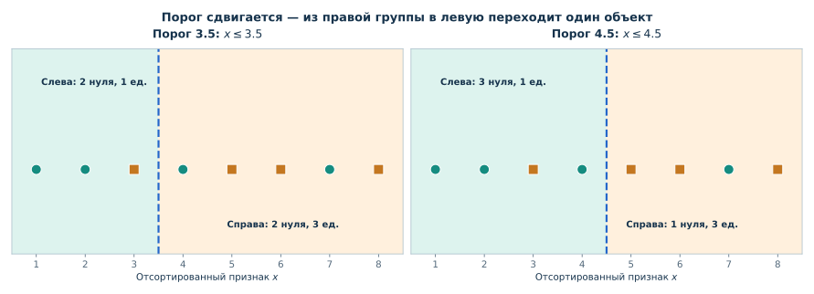

*Рисунок 37. При переходе между соседними порогами меняется принадлежность лишь одного объекта; остальные значения счётчиков сохраняются.*

### A.2. Регрессия: сумма, сумма квадратов и число объектов

Для регрессионного дерева с MSE можно использовать тождество

```math
\begin{aligned}
RSS(S)&=\sum_{i\in S}(y_i-\bar y_S)^2\\[0pt]
&=\sum_{i\in S}y_i^2-
\frac{\left(\sum_{i\in S}y_i\right)^2}{|S|}.
\end{aligned}
```

Чтобы посчитать RSS группы, нужно знать только три числа: $n_S=|S|$, сумму ответов $s_S=\sum y_i$ и сумму квадратов $q_S=\sum y_i^2$. Тогда

```math
RSS(S)=q_S-\frac{s_S^2}{n_S}.
```

При переносе очередного наблюдения с ответом $y$ из правой группы в левую изменяются только эти статистики: $(n_L,s_L,q_L)$ превращается в $(n_L+1,s_L+y,q_L+y^2)$, а соответствующие правые числа уменьшаются.

Проверим на знакомом примере из §3: $y=(1,2,1,7,8,9)$ при $x=(1,2,3,4,5,6)$. При пороге $3.5$ слева находятся $(1,2,1)$:

```math
RSS_L=6-\frac{4^2}{3}=\frac23.
```

Справа $(7,8,9)$:

```math
RSS_R=194-\frac{24^2}{3}=2.
```

Итог $RSS_L+RSS_R=8/3$, как и в прямом расчёте в §3.

Для порога $4.5$ переносим наблюдение с $y=7$. Тогда слева $(n,s,q)=(4,11,55)$, справа $(2,17,145)$. Получаем

```math
RSS_L=55-\frac{121}{4}=\frac{99}{4},
\qquad
RSS_R=145-\frac{289}{2}=\frac12.
```

Общая RSS равна $101/4$. Никакого повторного расчёта отклонений для каждого объекта не потребовалось.

Таким образом, **точный поиск порога** можно организовать как сортировку значений признака и линейный проход по кандидатам с обновлением статистик. В реальных библиотеках существуют дополнительные оптимизации; например, гистограммные алгоритмы сначала группируют значения в корзины, а затем сравнивают пороги между ними. Они уменьшают число рассматриваемых кандидатов, но могут дать иные результаты, чем точный перебор.

Главная идея приложения: стоимость перебора порогов определяется не только их количеством, но и тем, насколько эффективно мы повторно используем уже посчитанные статистики.

---

## Дополнительное чтение

- **А. Г. Дьяконов. _Машинное обучение и анализ данных_: глава «Решающие деревья».** Критерии, условия остановки и поиск порогов. [Материал](https://github.com/Dyakonov/MLDM_BOOK/blob/main/book_044_trees_202305.pdf).
- **Е. А. Соколов. «Решающие деревья», конспект лекции.** Формализация обучения дерева через оптимальное константное предсказание, критерии и pruning. [Исходник](https://github.com/esokolov/ml-course-hse/blob/master/2024-fall/lecture-notes/lecture07-trees.tex).
- **scikit-learn, [Decision Trees](https://scikit-learn.org/stable/modules/tree.html)** и [Permutation feature importance](https://scikit-learn.org/stable/modules/permutation_importance.html). Параметры дерева, `feature_importances_`, метод перестановок и особенности библиотечной реализации.
- **Яндекс Образование. [Решающие деревья](https://education.yandex.ru/handbook/ml/article/reshayushchiye-derevya)** в хендбуке по машинному обучению. Краткий обзор алгоритма и регуляризации.
